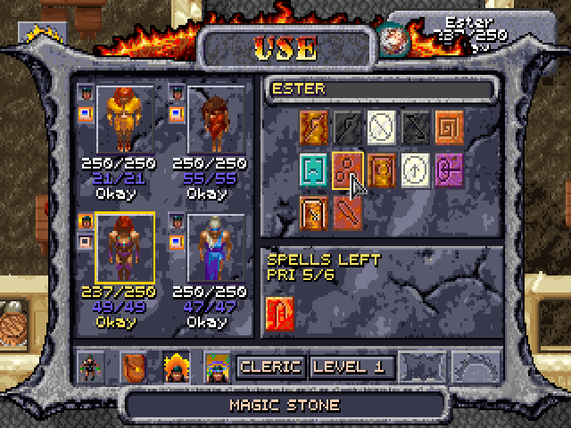
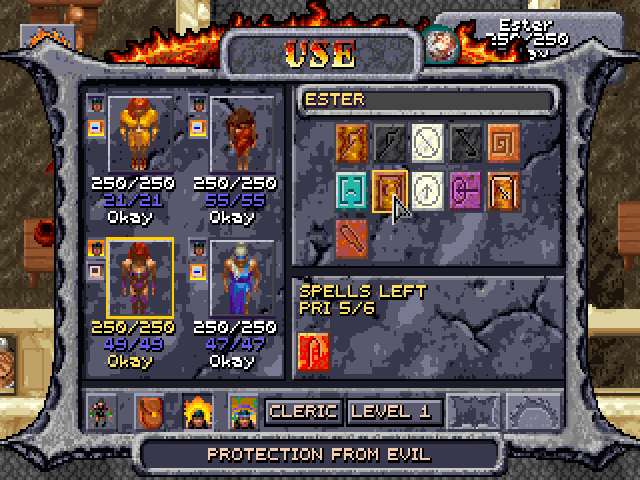

# 2026-11-25: the Elementalist's second sphere in Wake of the Ravager

**Under test:** the Elementalist's second priest sphere ported to the sequel, branch `claude/ravager-sphere`
(from `claude/ravager-kits`): DSCLOG2's EL_SPHERE at sites 90-92 (`el_sphere_know`, `el_sphere_level`,
`el_sphere_cast` in `ravager.PATCHES`), `ravager.casts` and `class_spheres` its Python, `tests/test_ravsphere.py`.

## Can it be done? Where the sequel asks

The kits' port found 62B45h (spell, class), the routine that says whether a class casts a spell, and that it
has no character. Read further (all file offsets of the GOG DSUN.EXE):

- **The sequel keeps no priest spells known.** A wizard's are bits a member (selector 320h, +39Ch, 0Fh bytes a
  member). A priest's are worked out at every use: the USE screen's list (62500h: a level's spells from the
  ranges at DS:656h/661h) asks 6260Ah "does member SI know spell N"; for a priest spell (73h-EAh) that is
  62C00h (spell, member: does one of its three classes cast it, by 62B45h) and the spell's level (62AC5h)
  against the member's highest (97E9Ch). So there is no loop marking spells known by class masks to hook, as
  SL's PROBE_EL_KNOW and PROBE_EL_GRANT did; every answer goes through 62B45h.
- **62B45h**: a byte a spell at selector 3D0h:7D3h (file 478E3h; 1 air, 2 earth, 4 fire, 8 water, 10h every
  priest's, 20h the druids') tested against the class's mask from a jump table at CS:0ADAh (its overlay's code
  from file 62100h): classes 1-4 (clerics) 10h + the element, 5-8 (druids) 30h + the element, 13-16 (rangers) as
  their element's cleric, 19 all; wizard spells (below 73h) for classes 11 and 18.
- **Its callers** (the overlay module from `ravimg/layout.json`; [the scratch
  tool](files/2026-11-25-ravager-sphere-callers.py)): in its own overlay 62C00h (at 62CABh), 628AFh (629BBh),
  626B7h twice (627D3h, 62818h, the slot count's "is this class a caster", asked with spells 8 and 73h whatever
  the spell), and by its stub 588h:20h only 97DC5h (97DDCh, the caster level, each class 0-19 asked). **Each
  caller that asks about a member has it**: 62C00h in DI, 628AFh (the highest level of the member's classes that
  cast the spell: the cast's level at 625F0h and the spells' effects' from 91E88h on) and 97DC5h at [BP+6]. And
  each call is followed by the same "add sp,4 / or al,al".

So it can be done without knowing who is casting inside 62B45h: DSCLOG2's SITE (INT F5h + a byte) replaces the
"add sp,4" after the three calls (3 bytes), reads the call's two words still on the stack (spell, class) under
the INT's frame, takes them off as the ADD did, and makes AL 1 for an Elementalist (awake, the kits' rule on)
when the class asked is its own cleric class and the spell's byte has its second sphere's bit (the sheet's +3Fh,
low three bits: the sphere + 1); the "or al,al" after is the game's. SL's design (kits.spell_spheres: the
second sphere's spells count as its class's) maps onto this exactly: known (62C00h), the cast's level and the
caster level (628AFh, 97DC5h) are the three places SL hooked (PROBE_EL_KNOW/GRANT, PROBE_EL_LEVEL,
PROBE_EL_CAST).

## The tests

`tests/test_ravsphere.py`: EL_SPHERE run through SITE's way in (25,480 cases: every cleric an Elementalist with
each second sphere, the new spells' bits above it on and off, every class 0-19, a spell of each sphere byte,
the Healers, Crusaders and dual-classed humans of `test_ravkits.characters`) against `ravager.casts`, every
register but AL kept and the stack 4 bytes higher; the rule off; the sequel's own 62B45h run from its
DSUN.EXE against `ravager.class_spheres` for classes 0-20 and every priest spell; the three sites right after
the only calls to it but 626B7h's. The full suite (`DSUN_WOTR=/tmp/playtest/rav`): 2581 passed, 89 skipped.

## Played

[The run script](files/2026-11-25-ravager-sphere-run.sh) (`A1 0 auto`, then `Actl 0x10000 auto`): ravK (the
`fountain-user` party transferred) with the Loader, the four ADDed, a new game; Ester (elf fighter 2 / fire
cleric 3) made by test edits a single-class fire cleric 5 (`ravkits.py set 2 0x01 - 3`, `levels 2 5`; a
multiclass character's kit is its group's, so the Elementalist needs one class), Elementalist (kit byte 01h),
second sphere earth (`ravkits.py sphere 2 2`: +3Fh 28h became 2Ah, the high bits kept); HP 250 for the four,
Ester's base AC -10 (both test edits, never saved). Then Computer Control for the other three and Ester's
turns by hand.

| Run | `rules_hi` | Ester's level 1 cleric spells on USE | Magic Stone (earth, level 1) |
|---|---|---|---|
| A1 | FF2Fh (kits on) | 12 | listed, cast at a Draxan |
| Actl | FF2Eh (kits off) | 11 | not listed |

```
A1:  Ester#2's turn
A1:  Magic Stone damage: 1d4 = [1] = 1
A1:  Ester#2's Magic Stone at Draxan#21: attack d20 = 10, needs 8+ (65%) (THAC0 19, +4 DEX; target AC 7) -> HIT
A1:    Draxan takes 1 from Magic Stone, now 96/120 HP
```

`ravkits.py count`'s `el_spheres` (the game's no made yes): 6643 by the cast in A1 (the USE screen asks again
at every redraw), 0 in Actl.




## The new-spell bits (+3Fh bits 3-7)

They are SL's new spells known (game.NEW_KNOWN: Reflected Image 08h, Cat's Grace 10h, Erdlu Claw 20h, Fogbolt
40h, Spook 80h; Friends in the kit byte's 80h), all wizard spells. The sequel has none of the new spells, so
the bits have nothing to serve yet. When the new spells are ported, they are what would say who knows them:
a wizard's spells known are 6260Ah's bit test at 320h:39Ch (spells below 73h), and a level's list loops over
fixed ranges (DS:656h/661h), so the port would need numbers and records for the spells and a hook there that
reads these bits for them. The transferred sheets keep them meanwhile (the transfer's copy at +3Fh).

## Found on the way

- **Spells crossed out on USE in a fight with "YOU WERE HIT"**: the sequel's (SL's) rule that a caster hit in
  the round can't cast. Ester's base AC -10 kept the Draxans off for her next turn.
- **Ending a turn by hand in the sequel**: Tab, then Return, brought the game's menu (EXIT TO DOS among its
  icons; closed with Escape while it was up), not the mod's pick-and-attack of Shattered Lands. A click on an adjacent foe attacks and ends
  the turn.
- **Waiting for a member's turn**: a crop of the top-right panel's name (window 90x18+475+12) compared with
  ImageMagick's `compare -metric AE` against one grabbed on that member's turn.
- USE in a fight: the top-left icon opens View Character for the member whose turn it is; the bar's third icon
  (97,171) is CAST SPELL/USE PSIONIC; Ester's level 1 spells from (175,57), 5 a row, 21 apart (Magic Stone the
  7th, at (196,80) in A1).
- The `fountain-user` party's sheets all have 28h at +3Fh (no second sphere; the bits above it set).
- No water in these runs (Tyr's ambush street only).
