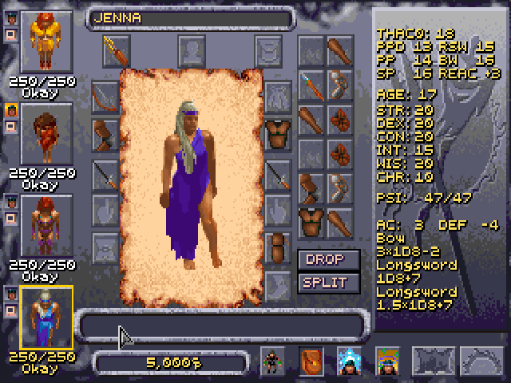
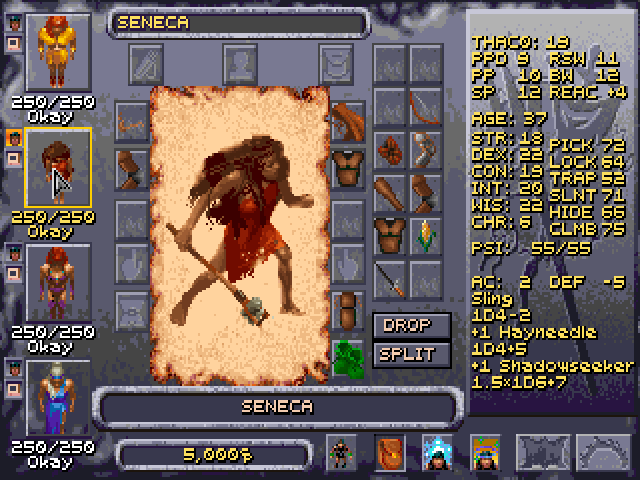
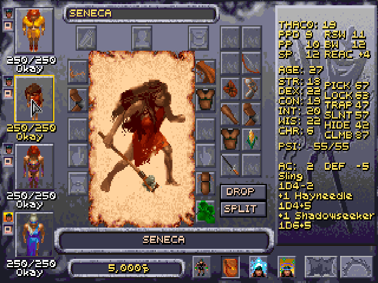

# 2026-11-25: Thieves as in AD&D and the Assassin's backstab in Wake of the Ravager

**Under test:** branch `claude/ravager-thieves` (claude/ravager-kits with claude/ravager-thief-table merged,
1f57699): DSCLOG2's THIEF_SKILL (site 52), BELT_SITE's cap, C_THIEF on the inventory, STAB_TIMES (site 53:
the weapon's dice multiplied, STR and the plus once; an Assassin's multiplier one more with the kits),
STAB_FIRST. Copy `ravK` (the `fountain-user` party transferred: 48h sheets). Controls with RAV_RULES_OFF.

Each run ([files/2026-11-25-ravager-thieves-run.sh](files/2026-11-25-ravager-thieves-run.sh), its start
[files/2026-11-25-ravager-thieves-start.sh](files/2026-11-25-ravager-thieves-start.sh), the later runs by
[files/2026-11-25-ravager-thieves-series.sh](files/2026-11-25-ravager-thieves-series.sh); T1 by hand with the
same steps): ravstart with the Loader, the four ADDed, a new game, the opening talk, test edits in memory
(never saved: no save was made in any run), Seneca's inventory grabbed in the Draxans' ambush, Computer
Control for the four, then the fight watched until a backstab's damage line.

| Run | RAV_RULES_OFF | rules / rules_hi | Seneca | Her backstab |
|---|---|---|---|---|
| T1 | - | 0xFB45 / 0xFF2F | halfling thief 3 / fighter 2 (her own) | 4 x2 + 1 + 4 = 13, HP -13 |
| Tctl2 | 0x100 (Thieves as in AD&D) | 0xFA45 / 0xFF2F | the same | (2 + 1 + 4) x2 = 14, HP -14 |
| A1b | - | 0xFB45 / 0xFF2F | human thief 3, Assassin (test edit) | 3 x3 + 1 + 4 = 14, HP -14 |
| Actl | 0x10000 (kits) | 0xFB45 / 0xFF2E | the same Assassin | 1 x2 + 1 + 4 = 7, HP -7 |

## Steps

**T1 (rule on)**: ravstart with the Loader (`RAV_LOADER=1`), the four ADDed, a new game, the opening talk;
HP 250 for the four (`ravkits.py hp`, never saved); `ravdice.py --numbers` with `RAV_STEALTH_ROLL=1` (every
hiding roll 1). Rules word 0xFB45 (RULE_THIEF_TABLE 0x100 in it), rules_hi 0xFF2F (kits on). Seneca: halfling
thief 3 / fighter 2, DEX 22, her own kit byte 0x01 (Poisoner: nothing to thief skills or backstabs).

- Seneca's inventory in the fight (USE, VIEW INVENTORY, her portrait): PICK 72 LOCK 68 TRAP 52 SLNT 67 HIDE
  57 CLMB 72. The table: AD&D's level-3 average 40/33/30/27/20/87 + the sequel's halfling row (file 49BB0h
  + 8 + 8x6: +5 +5 +5 +10 +15, climb -15) + Dark Sun's DEX 22 (+27 +30 +17 +30 +22) = 72/68/52/67/57/72: all six match.
- The dice log's hiding check uses the same 57: `Seneca hides in shadows: d100 = 1, needs 33 or less (57 +10
  cloak = 67, halved in daylight)`.
- Computer Control: the top-left icon after the inventory brings the inventory back (the menu remembers it);
  its small lower icons (game 6,18 / 6,65 / 6,112) took three of the four. **C** then the USE screen's
  lower small icons (47,53 / 98,53 / 47,112 / 98,112) is the sure way.
- The hidden backstab (round 2, Hayneedle +1, 1d4+1, STR 18 +4):
  ```
  Seneca attacks Draxan#26 BACKSTAB with Bone item 291 +1 (1d4+1): d20 = 19, needs 7+ (70%), hits AC -7, target AC 5 -> HIT
    Seneca hits Draxan#26 for 13: 1d4 = [4] +1 weapon +4 STR 18 +4 backstab (the dice 4 x2 = 8)
    Draxan now 127/140 HP (-13)
  Seneca attacks Draxan#26 with item 261 +1 (1d6+1): ... -> miss          (the off hand: no backstab)
  ```
  13 = 4 x2 + 1 + 4, the game's own HP 13 down (the game's way would be (4+1+4) x2 = 18). DSCLOG2's
  counters: `stabs=1 kit_stabs=0`.

**Tctl (control, `RAV_RULES_OFF=0x100`: rules 0xFA45)**, the same steps (the first try's fight was won
without Seneca backstabbing: she shot her sling; Tctl2 the second):

- Seneca's inventory: PICK 72 LOCK 64 TRAP 52 SLNT 71 HIDE 66 CLMB 75, the game's own formula (base + 4 a
  level + race + its DEX steps), against T1's 72/68/52/67/57/72.
- Tctl2's hidden backstab, the game's way (DSCLOG2's STAB_TIMES with the rule off: the whole multiplied):
  ```
  Seneca attacks Draxan#27 BACKSTAB with Bone item 291 +1 (1d4+1): d20 = 15, needs 7+ (70%), hits AC -3, target AC 5 -> HIT
    Seneca hits Draxan#27 for 14: (1d4 = [2] +1 weapon +4 STR 18) x2 backstab
    Draxan now 107/140 HP (-14)
  ```
  14 = (2 + 1 + 4) x2, the game's own HP 14 down. Counters `stabs=0 kit_stabs=0`.
- The dice log's hiding line said "57" in the control too: the hiding roll is the Loader's own (stealth.py),
  and it takes the AD&D table always (the rule is always on in a player's game), so a control of the thief
  table shows the game's skills on the inventory but the Loader's hiding chance. Not a player's problem.

**A1b (Seneca an Assassin)**: `ravkits.py set 1 2 1 17` (kit byte 2, human, a thief alone: the kits a halfling
fighter/thief may have are the Poisoner's only, and an Assassin is a human's; never saved). A1's first try won
the fight without her backstab.

- Her inventory as a human thief 3: PICK 67 LOCK 63 TRAP 47 SLNT 57 HIDE 42 CLMB 87 (AD&D's 40/33/30/27/20/87 +
  DEX 22's, no race row): the table again. The inventory shows the skills before the kit's -15 to pick pockets
  and open locks, as before equipment (C_THIEF; in Shattered Lands the Loader's STATS numbers, which count
  them, take its place: not in the sequel).
- The dice log's hiding: `needs 52 or less (42 +10 cloak = 52, an Assassin: not halved in daylight)`.
- The hidden backstab, x3 at thief level 3 (the game's x2, one more):
  ```
  Seneca attacks Draxan#26 BACKSTAB with Bone item 291 +1 (1d4+1): d20 = 20 (natural 20), needs 7+ (70%), hits AC -8, target AC 5 -> HIT
    Seneca hits Draxan#26 for 14: 1d4 = [3] +1 weapon +4 STR 18 +6 backstab (the dice 3 x3 = 9)
    Draxan now 126/140 HP (-14)
  ```
  Counters `kit_stabs=1 stabs=1`.

**Actl (the same Assassin, the kits off: `RAV_RULES_OFF=0x10000`, rules_hi 0xFF2E)**:

```
Seneca attacks Draxan#21 BACKSTAB with Bone item 291 +1 (1d4+1): d20 = 7, needs 5+ (80%), hits AC 5, target AC 7 -> HIT
  Seneca hits Draxan#21 for 7: 1d4 = [1] +1 weapon +4 STR 18 +1 backstab (the dice 1 x2 = 2)
  Draxan now 113/120 HP (-7)
```

x2, the dice alone multiplied: `kit_stabs=0 stabs=1`; her hiding halved in daylight (no Assassin).

## What wasn't played

- An Assassin with Thieves as in AD&D off (the whole damage x3): only in `tests/test_ravthief.py`'s
  `test_assassin` (the emulated STAB_TIMES).
- A thief's skill roll other than hiding and moving silently (no lock or trap in the ambush), the cap at 95
  (Seneca's highest is 72) and Enlarge before a backstab (its dice: the tests).
- STAB_FIRST's taking back a second backstab in a round: Seneca's off-hand attack after each backstab was a
  plain one, as the game's own count leaves it, so STAB_FIRST had nothing to take back.





## Found on the way

- **Computer Control after a look at the inventory**: the top-left icon in a fight then brings the inventory
  back (the menu remembers its last screen), whose small lower icons (game 6,18 / 6,65 / 6,112 / 6,157) took
  only three of the four; **C** then the USE screen's lower small icons (47,53 / 98,53 / 47,112 / 98,112)
  set all four.
- **A kit for a test edit depends on the race**: a halfling fighter/thief's only kit is the Poisoner, so
  Seneca's Assassin needed her race and classes edited too (`ravkits.py set 1 2 1 17`).
- **The CC AI shoots a sling** at range: one run in two ended without a backstab; the runs try twice.
- No water in these runs (Tyr's ambush street only).
