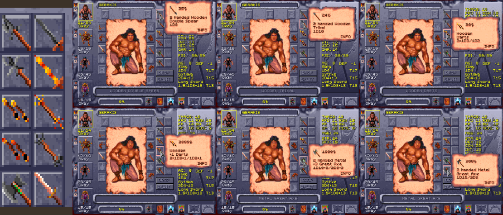

# Test log: Wake of the Ravager's weapon icons in Shattered Lands (2026-11-25)

**Under test:** branch `claude/ravager-magic-metal`: `dsloader/sequelicons.py` (the sequel's own
inventory icons for its weapons and the great axes, read from the player's copy and recoloured),
the redrawn fallback double spear, trikal and darts, and the longer `BOX_TALL` (DSCLOG's
`box_tall`: the darts, the great axes, the Great Axe +3's own picture 2727).

**Build:** `dos/DSCLOG.EXE` built from the branch; the Loader's copies prepared by `start.sh`, with
Wake of the Ravager in `$PLAYTEST_WORK/rav` (`setup_ravager.sh`), found by `wotrart.find_resources`.

## The icons and their boxes

From `pens-after-arena` (autosave and quick save off), `buildcheck.py` OK. Given to Gerakis in
memory (`givenew.py`; **not saved after**): a double spear, a trikal, darts, Darts +1, the game's
Great Axe +3 (object 1018), a metal great axe, a great sword, Great Sword +3, Lotulis +1, an
obsidian lotulis and the Bone Great Sword +1.

- The backpack draws each as the sequel's picture in the game's colours: wood the staves' red-brown,
  heads in their material, the darts' points gold, the Great Axe +3's gem green, the +1s burning
  every other pixel of the head and the +3 all of it.
- Each tall one's box (double spear, trikal, darts, Darts +1, Great Axe +3, metal great axe) draws
  the small copy in the frame, its text from row 28, nothing past the box's edge. The obsidian
  great sword's box likewise.
- Soulcrusher (a hand axe) shares the game's picture 2084 with the Great Axe +3: the axe got its
  own (2727) so Soulcrusher keeps its own (checked in the docs' icons, not in play).

## Water

No new area.
