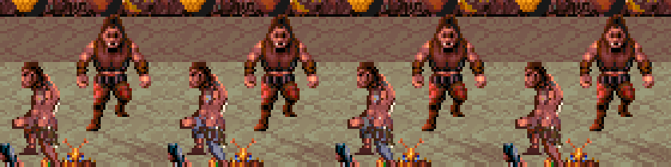
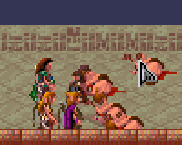

# Class outfits through the attached Loader

**Under test:** Codex's class outfits (branch `claude/class-outfits`, up to `f925bd0`) merged onto
`obsidian-edition` at `13592be` (branch `claude/import-class-outfits`). Codex's own DOSBox checks
staged the pictures with the Loader detached; this play is the first with the Loader attached, dressing
the party itself and changing outfits as gear changes.

**Build:** the merged branch, `start.sh`'s patched game, DOSBox 0.74-3, window 320x240.

## Tests

- No game files: 1963 passed, 1065 skipped.
- With both games (`DSUN_SL`, `DSUN_WOTR`, `DSUN_OBJECTS`, `DSUN_GPLDATA`, `DSUN_RESOURCE`): 2995
  passed, 33 skipped. The start-up tests for both games are included and pass.

## `pens-after-arena` (the ready-made party)

`classoutfits.for_sheet` on the live sheets: Gerakis (half-giant 308, Gladiator) gets **Gladiator**,
the human man (300, Preserver/Gladiator) **Mage**, Cilla (elf 305, Preserver/Druid/Thief) none (no elf
build has a Druid: the user's call, 2026-11-23), and the thri-kreen none.

The Loader's copy of SEGOBJEX held the human man in the plum mantle with his staff, and Gerakis in the
Gladiator outfit with his weapons, and the map showed both.

**Armour changed live:** Gerakis's chest, leg and arm pieces (items 23-25, leather) were rewritten in
memory as plate (88/26/25), then chain (57/59/58), then put back as they were. Each time the figure
changed on the map within 7 seconds, with no inventory opened: steel blue on the kilt and arm for
plate, the chain grey, then leather again. `outfitcycle.py 0 9 6` and `outfitcycle.py 2 3 4`: the
figure drawn after every change, the picture slots steady at 203, nothing STALE.

## `fountain-user` (Pehtucl's ambush)

The sheets: Jenna (human woman 301) **Ranger**, Ester (elf woman 305) **Cleric/Fighter**, Seneca
(halfling woman 311) **Fighter/Thief**, Lex (half-elf woman 307, Fighter/Preserver) none (at this commit half-elves
had only the single-class Fighter and Preserver; all 48 builds came in `53e1391`).

The speech clicked away (five clicks on the box), then `fightout.sh`: DONE after 15 passes. The
outfits showed in the fight's poses and after it; `figcheck.py` found all four figures drawn. The
watchdog logged no STUCK or GONE.

## Not covered

The dwarves and the Mul weren't in either save's party, so they were checked only by the unit tests and
Codex's staged checks.

No new area was reached, so there's nothing new to note about water.

## The half-elves, after `53e1391`

Codex's commit added all 48 half-elf builds. With the game files, 2999 tests passed and 33 were
skipped. I loaded `fountain-user` again: Lex got **Fighter/Preserver**, and the other three got the same
roles as before. I fought the ambush to the end with `fightout.sh` (DONE after 11 passes). After the
fight, `figcheck.py` reported 0 changed pixels for all four figures, which means all four were drawn.
The watchdog logged no STUCK or GONE.
