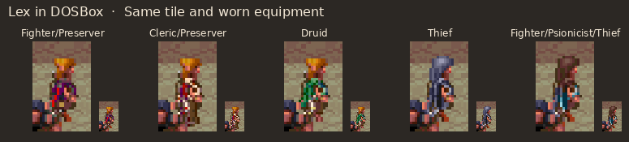

# Half-elf outfits with the Loader attached

In the checked-in `fountain-user` save, Lex is the female half-elf (307), a Fighter/Preserver. On a disposable copy, the Loader attached to the running DOSBox game and dressed her using the class bytes and equipment on her current sheet. The comparison below uses the same map position and equipment through five class selections.

The test cycled Lex through all eight single classes, 18 pairs and 22 triples by temporarily changing her three class bytes in memory. For every build, the Loader selected the expected role, the map entry referred to a loaded picture slot, and its walking and combat pictures in the Loader’s GFF copy matched an independent build with her worn equipment byte for byte. The native screenshots above are stationary map poses. The automated picture comparisons also cover the combat frames.

Restoring Lex’s original class bytes restored her starting pictures. Removing her right-hand item changed both pictures and equipping it again restored both exactly. In a second disposable session with `semyon-rack-user`, the attached Loader selected the male half-elf Cromwell’s natural Fighter/Preserver outfit on figure 306. The all-class live cycle was performed on Lex. The last adjustment to the borrowed nape fold on hooded multiclasses was checked through the picture builder. Both sessions ended without saving and both source saves retained their original hashes.
