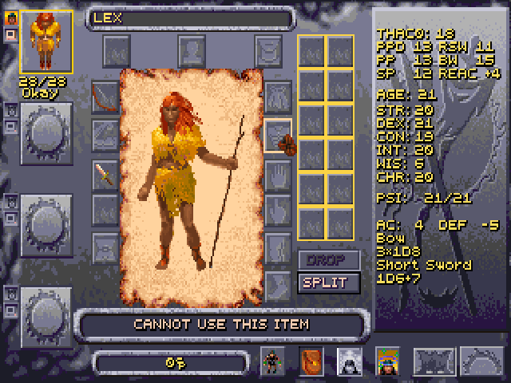
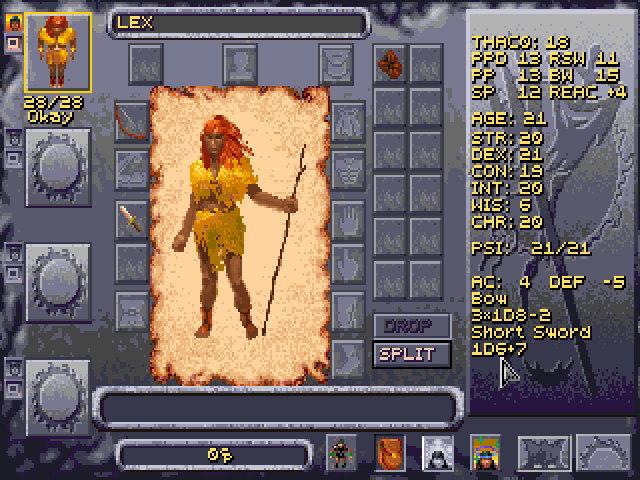
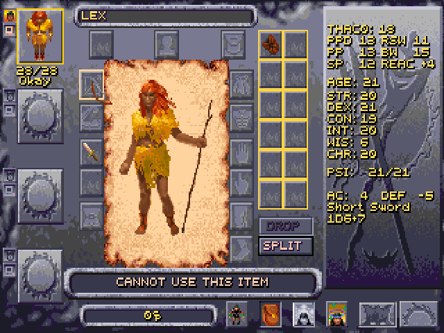
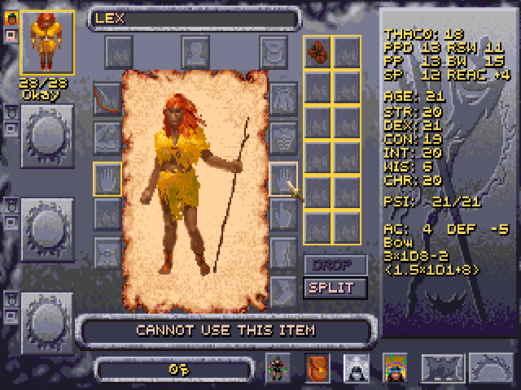

# 2026-11-26: the kits' gear limits in Wake of the Ravager

**Under test:** branch `claude/ravager-kit-gear`: DSCLOG2's KITS' GEAR (SL's KIT_FORBIDS, KIT_LIGHT,
KIT_ALLOWS, SPECS_AWAKE, SPEC_FIND, EL_SECOND) called from CU_SITE (site 19, the end of the sequel's "may
this character equip it", 775FDh) as SL's PROBE_CAN_USE calls them. No new site or header field.

**Set-up:** `ravKG`, a throwaway copy of `ravK` (the `fountain-user` party transferred). `RAV_LOADER=1
RAV_MENU=1 RAV_STDOUT=1 sh ravstart.sh /tmp/playtest/ravKG`, CREATE CHARACTERS, Lex ADDed (the ADD list's
fourth row, y 78), the dice log (`ravdice.py --numbers`: rules 0xFBC5, rules_hi 0xFF3F, the kits' bit on),
the inventory (75, 171) on the roster screen. The helper in memory checked against the build (KIT_FORBIDS,
CU_SITE, KIT_ALLOWS: the same bytes). Test edits in memory only (`ravkits.py set`, `flags`), nothing saved;
DOSBox and the dice log stopped by pid after. About 16:41-16:47 UTC.

Lex as transferred: a half-elf fighter 3 / preserver 2 (race 4, classes 9, 11), kit byte 81h (the
Spellarcher, Friends known), class bits A0h, her weapon spec the bow.

**The inventory's places** (game pixels, 320x200): the bow's slot (65, 50), the right hand (65, 91), the
left hand (174, 91), the chest (174, 69), the backpack's first squares (195, 27), (215, 27), (195, 46).
A slot the held item can take is lit; a refusal says CANNOT USE THIS ITEM and leaves it on the pointer;
a slot of the wrong kind says ILLEGAL PLACEMENT.

## What was seen

| Case | Kit | Result | Control |
|---|---|---|---|
| Leather Armor (type 32) to the chest | Spellarcher (81h, as transferred) | **CANNOT USE THIS ITEM**, no body slot lit  | no kit (00h): worn, slot 9 |
| The bow (type 18) to its slot, class bits 80h (a preserver alone) | Battle Mage (02h, a human preserver; its spec the bow) | **worn**, slot 2, "Bow 3x1D8-2"; `kit_allowed` 0 to 1  | no kit: CANNOT USE THIS ITEM  |
| Leather Armor to the chest | Battle Mage | **worn**, slot 9 | no kit: CANNOT USE THIS ITEM |
| The short sword (type 105) from the right hand to the left, class bits A0h (the game allows it) | Battle Mage | **CANNOT USE THIS ITEM**, only the right hand lit  | not run (the pause) |
| The bow, Lex made a human fighter Ravager (03h) | Ravager | worn: her weapon spec is the bow, and a kind specialized in is never a kit's limit (SL's rule, KF_CHOSEN) | |

`ravkits.py count` at the end: kit_refused 13, kit_allowed 7, restrict_count 0 (the screen asks once to
light the slots and once on the click, so a refused try counts 2 or more).

## Found

- **A transferred Spellarcher's leather Armor sat at worn slot 10, the left hand** (Lex, `ravitems.py 0`:
  item 9, type 32, slot 10, drawn in the left-hand box). Not this branch's: the transfer's slot for SL's
  worn armour, or Lex's own SL save; worth a look (does the sequel count its AC there?).
- The Ravager's bow wasn't refused because Lex specialized in the bow: as in SL, a kit keeps no weapon of
  a kind its character specialized in from it (but for the off hand's rules and the light-armour kits).
  A Ravager test needs a character without a bow spec, or arrows (no kind: refused as a missile).

## Not done (the session paused)

- The off hand's control (no kit: the short sword into the left hand).
- An Elementalist's second sphere's weapon, a Healer's off-hand weapon, a light-armour kit's chain mail
  in play (all in tests/test_ravkitgear.py).
