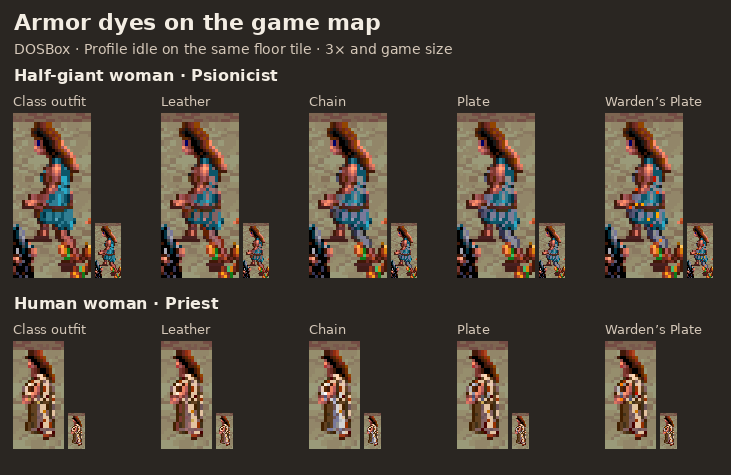

# Armor dyes in DOSBox

The half-giant woman Psionicist keeps a teal shoulder, waist and skirt in leather, chain and plate. At game size, the cool edge of the metal follows the darker fold down her leg. On the human woman Priest, plate catches the upper torso and wrist while the linen skirt keeps its warm folds. Warden’s Plate adds a moving highlight on each figure.

## How the views were captured

The Loader built each outfit from the player’s retail assets. For each of the ten views, its walking and combat pictures were installed in the same party member’s picture slots in a disposable game copy. From a fresh DOSBox 0.74-3 process, the patched game loaded the unedited `pens-after-arena` save and drew the party. The still uses the left-facing profile idle from those 320 × 240 windows, cropped around the actual position of each figure and enlarged with nearest-neighbor scaling. Only chest, arm and leg slots were dressed.

The tested interaction was the game loading and drawing those prepared pictures. Inventory switching through an attached Loader, walking and combat were outside this live check.

## Pixel check

The displayed pose matched the source profile with the same horizontal flip and map position in every window. Each cell below counts the changed source pixels that also changed in the DOSBox window relative to the class outfit, followed by the number of changed source pixels.

| Figure | Leather | Chain | Plate | Warden’s Plate |
|---|---:|---:|---:|---:|
| Half-giant woman Psionicist | 69 / 70 | 71 / 72 | 71 / 72 | 72 / 73 |
| Human woman Priest | 19 / 19 | 31 / 31 | 10 / 10 | 10 / 10 |

A neighboring party figure covers one affected pixel on the half-giant’s lower leg. Across twelve successive Warden’s Plate captures, ten equipped pixels on the half-giant and three on the Priest changed with the game’s palette cycle.
