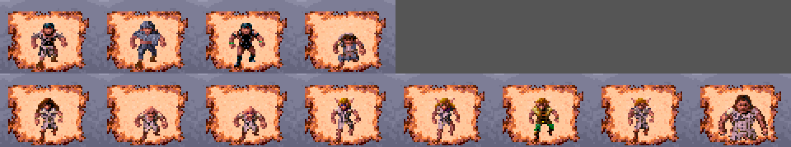

# The creation screen's figure in the class's outfit

Branch `claude/creation-class-outfits` on `obsidian-edition` 08ff61f; DSCLOG built from the branch,
the Loader's dice log attached (`start.sh`), the window 320x240. Asked by the user: the creation
screen's small figure should show the class outfits.

## What the figure is drawn from

- The figure at the top is drawn from a blob the game builds at start-up (frame 0 of each creation
  figure's walking picture from the Loader's copy of SEGOBJEX), in a paged-memory handle (DS:4C2Fh),
  with its entries' offsets at DS:543Dh. The routine that draws it reads the figure's entry each
  time. Writing pictures into the copy after start-up does nothing for it. Details are in
  [RESEARCH.md](../RESEARCH.md#creation-and-levels).
- The game draws the figure when the screen opens and after a race or portrait click, but not after
  a class click. A new character's class comes after the first drawing, where the hit points are
  drawn (63EDAh). So the first build (a wait at the opening only) opened with the plain figure,
  although the Loader had already written the fighter's outfit.

## Steps and what was seen

1. Main menu, CREATE CHARACTERS, right-click a slot, NEW. **The figure opens in the fighter
   outfit** (the brown leathers; the game's own human figure is in black).
2. Click FIGHTER off: **plain** (the game's own). Click THIEF: **the thief's outfit**, the box's
   background clean. (A human's class must be clicked off before another class will take: a click on
   another class while one is marked does nothing.)
3. Click the big portrait (40,60) through dwarf, elf, half-elf, half-giant and halfling (still a
   fighter): **each race's fighter outfit** at each click. Halfling, add THIEF: **the
   fighter/thief outfit**.
4. No errors in the dice log.

No new area, so no water note.
