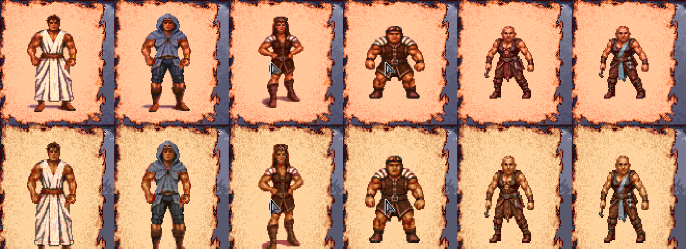

# The creation screen's full-length picture: the inventory's painting (2026-11-27)

Both games, a new character on the creation screen (Shattered Lands: the main menu's CREATE CHARACTERS,
a right-click on the first slot, NEW; Wake of the Ravager: `ravcreation.sh 0`). Nothing was kept: DOSBox
was stopped by pid on the screen.

- The screen opens with the default Fighter's picture (the sequel's after CR_HP draws it again: the game
  draws the picture before it gives a new character its class).
- A class clicked off gives the game's own picture; a class clicked on, its painting (human Cleric,
  Thief); a portrait click (race and sex) the new figure's, for the class the game gives it; a second
  class on a dwarf woman, the Fighter/Thief and Fighter/Psionicist paintings; a halfling woman, hers.
- The sequel's first try drew the picture from KP_CLASS without a frame the overlay manager can fix up:
  DOSBox died at the first click (the draw loads its overlay over the creation screen's). CR_DRAW is now
  called in such a frame, as UNLOOK's SHOW_WINDOW is.
- Shattered Lands: a party member's figure changed in memory (`_setfig.py`) keeps its race, so a human
  sheet with an elf's figure shows the elf's painting for its active class only (the race decides the
  multiclass). Set the race too (sheet +18h) to see a multiclass painting in the inventory.

Water: nothing new (no area reached).
