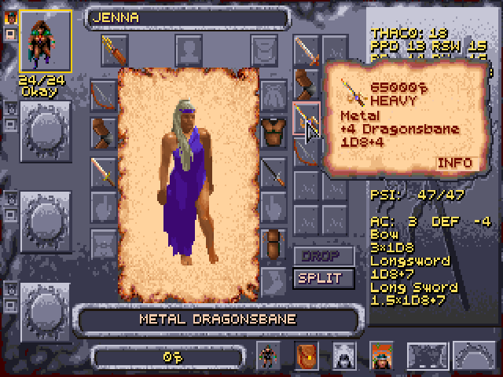
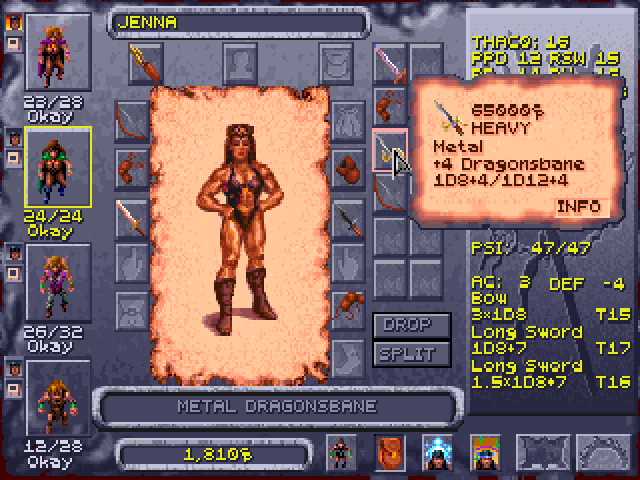
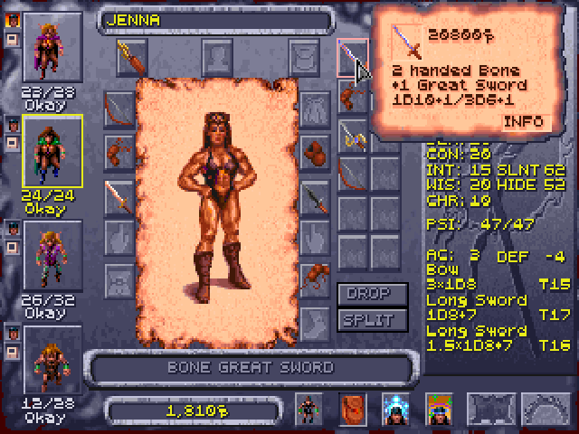
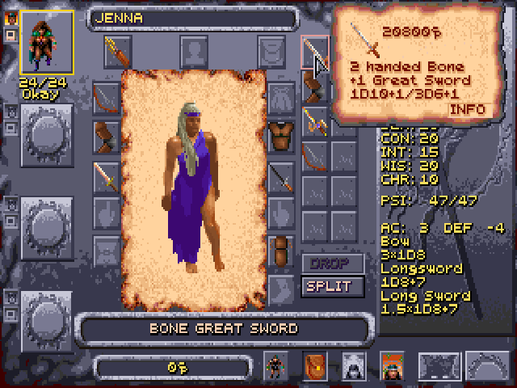
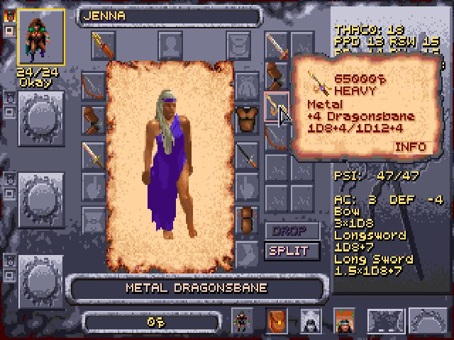

# 2026-11-27: one Dragonsbane, metal in both games

Branch `claude/dragonsbane-metal`. The user: "It is metal in Shattered Lands, right? then it should be metal in the
sequel". SSI's sequel made Dragonsbane (OBJEX 675, +4) an obsidian long sword (type 73); Shattered Lands' (SEGOBJEX
2605, type 47) is metal. Since the weapon-materials fix (#267) the transfer dropped ITEMS.BIN's pair 2605 -> 675 (another
material) and made a metal Dragonsbane of its own, so a party could hold two. Now the Loader's copy makes 675 the
sequel's metal long sword (97, Bloodwrath's type: the same record but the material and the fire cleric's bit;
`ravager.RAV_OBJECT_TYPES`, `RAV_SKIP=object_types`), and `ravtransfer.load_sequel` reads it so, so the pair holds again.

## Offline

- Every sequel file searched for item records of object 675: only OBJEX's own template (the game makes the sword
  from it), so the template alone is changed: the item's type word (+0Ah) and its copy of the type (kind 4, number
  and record).
- A copy of the weapon-materials save with Dragonsbane in Jenna's backpack (`files/2026-11-27-dragonsbane-save.py`),
  transferred: Jenna's item object 675, type 97, the sequel's name 58, +4 (not a Loader object).

## The play (about 19:25-19:45 UTC)

- The sequel (`RAV_LOADER=1 RAV_MENU=1 sh ravstart.sh` on the transferred copy, `ravdice.py` attached), CREATE
  CHARACTERS, Jenna added, her inventory: Dragonsbane's box "65000$ HEAVY, Metal +4 Dragonsbane, 1D8+4", the
  status line METAL DRAGONSBANE .
- Shattered Lands (the same edited save as a throwaway set in `saves/`, removed after; nothing saved): Jenna's
  Dragonsbane "65000$ HEAVY, Metal +4 Dragonsbane, 1D8+4/1D12+4" , and the
  Bone Great Sword +1 "20800$, 2 handed Bone +1 Great Sword, 1D10+1/3D6+1"
  : the same words as the sequel's box now (logs/2026-11-27-ravager-weapon-materials.md).
- One difference left between the two boxes then: Shattered Lands shows both damages (against man-sized / larger), the
  sequel's box only the first. Ported (DSCLOG's SIZE_LINE and SIZE_PRE as DSCLOG2's sites 249 and 250, the
  sequel's line routine 7AF9Eh the same as SL's 7286Ah but its arguments 2 bytes on) and played again (about
  19:45 UTC): the Bone Great Sword +1 "1D10+1/3D6+1" , Dragonsbane
  "1D8+4/1D12+4" , as Shattered Lands' boxes. The second
  number fits in the box's line.

DOSBox and the dice logs stopped by pid; the game folder's SAVE01.SAV put back to trap-user's.
