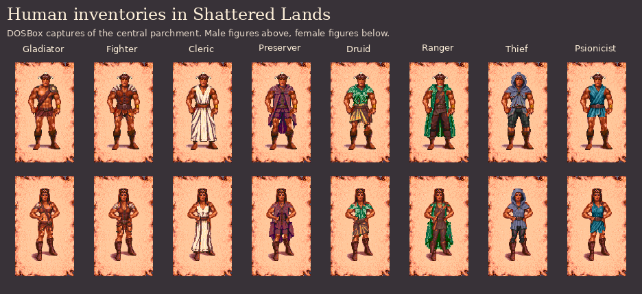

# Human inventory outfits in Shattered Lands

Opened all eight active classes on both human inventory figures. The sheet below crops the central parchment from sixteen 320 × 240 DOSBox captures. Each column pairs the two poses at the game’s display scale.

Four disposable copies of the PENS save supplied four characters each. Two parties covered Gladiator, Fighter, Cleric and Preserver with the sexes swapped on the second pass. Two more covered Druid, Ranger, Thief and Psionicist the same way. The Loader prepared the game files and the DOS helper drew the inventory. The host dice log was detached. No test game was saved.

Pressed I, selected each party member and returned to the first. Compared every captured figure with the eight decoded class pictures for that pose, aligning native rows to the DOSBox display’s 6:5 vertical stretch. The selected class was the closest match in all sixteen captures. Returning to the first member reproduced the same parchment crop pixel for pixel in all four parties.

The open plum mantle leaves the Preserver’s knees visible beside the Cleric’s long linen panel. The woman’s bent arms remain visible across the Fighter’s jerkin and the Ranger’s cloak. The review sheet places both inventory poses beside the corresponding front-idle map outfits. [Human fittings](../../obsidian-edition/docs/class-outfits/README.md#human-inventory-fittings)
