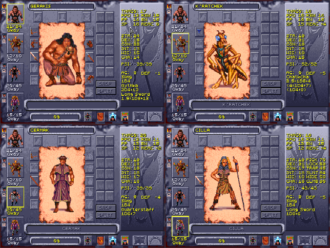

# Class portraits in the Shattered Lands inventory

This log records the earlier all-races prototype. The shipping archive contains the two human figures. [Human inventory verification](2026-11-27-human-inventory.md)

The DOSBox run used a disposable copy of the GOG installation, the rebuilt DSCLOG.EXE and the Loader’s prepared RESOURCE.GFF. The game window measured 320 × 240. This environment mounts process memory read-only, so the host dice log could not attach. The DOS helper selected and loaded the pictures itself.

Loaded PENS, pressed I, selected each party face and returned to the first member. Gerakis wore a bronze shoulder guard and a red leather kilt. K’ratchek showed markings on the thorax and arm plates. Cermak showed his active Preserver class in plum. Cilla showed her Druid kilt, Preserver mantle and Thief hood.

A second disposable save gave all four members the same human figure. Selecting them in sequence showed the Fighter’s leather, the Thief’s hood, the dual-class Preserver’s plum robe, and the original figure for a classless sheet. Returning to the first member restored his Fighter portrait. No game was saved during either run.

The local renderer built 308 distinct figure and class combinations, including Cilla’s special combination. The pictures use the native dimensions of their respective poses. The run stayed in the slave pens.
