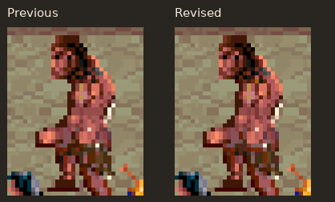
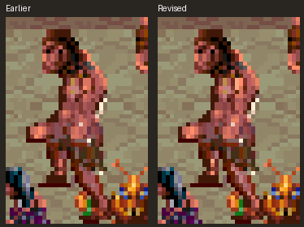

# Gladiator artwork with the Loader attached

This check used a disposable copy of `pens-after-arena` and the retail picture and palette banks. Gerakis resolved to party object 308, source picture 2072, race 5 and class 10 (half-giant Gladiator). His equipped items stayed in place throughout the comparison.

1. Attach the Loader and let it dress Gerakis. Read back the walking and combat pictures from the writable game archive and compare them byte for byte with independently built pictures for his class and gear.
2. Turn class display off, turn it back on and check both pictures again. The restored pictures matched the first dressed build.
3. With the equipment unchanged, build from the earlier artwork, read both pictures back, then repeat with the revised artwork. Both revised pictures regained their original SHA-256. Across all 29 poses, the two art versions differed by 19–110 pixels per pose. The map retained slot 203 and picture IDs 2466 and 2467 throughout.

With the normal Loader redraw enabled, Gerakis stood facing left. Changing from the earlier art to the revised art altered 46 native pixels in his mirrored side idle (pose 02). They corresponded exactly to the 57 changed pixels in his DOSBox capture after aspect scaling.

The walk SHA-256 was `9a5ca3375db7f5def1a4c0a42f69bd50a4f1f9be682c9b72f8af7fad7fb51749` and the combat SHA-256 was `346919de4c73c81abc01817023fb2a3c5d29680525635e45008f40ebb2a2ac73`. The source save’s three files retained their original SHA-256 after shutdown.

[View the frame-by-frame comparison with the retail Warrior](../../obsidian-edition/docs/class-outfits/material-folds.md)

## Body shaping under the Gladiator leather

Compared the next art pass with `17aaacef`, using the same save and Gerakis’s original equipment. All 29 walking and combat poses changed by 8–54 pixels. Both pictures matched the Loader’s independent builds byte for byte, including after disabling and restoring the class display. The map reused slot 203.

In the mirrored side idle, 30 native pixels changed. After DOSBox aspect scaling their pattern matched all 39 changed screen pixels in the comparison area. The nearer rib and shoulder catch the light above the belt. The source save files retained their original checksums.

