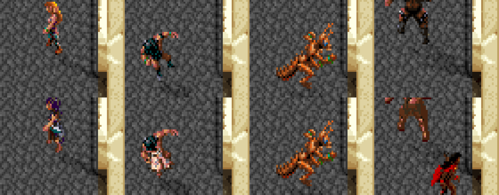

# 2026-11-27: the class outfits in Wake of the Ravager

**Under test:** the branch `claude/ravager-class-outfits`. The Loader's `OBJEX2.GFF` holds each party picture as the
Loader's own Shattered Lands figure, with room after it (`ravdress.copy_chunks`). The dice log's `dress` pass
(`ravdress.RavDresser`) writes each member's class outfit into it and has the game load it again.

**Setup:** `ravload.sh ravager-after-ambush` (RAV_LOADER=1). `ravdice.py` with `RAV_NO_SAVES=1` for the dresser.
`RAV_SKIP=class_outfits` for the control. Then `RAV_LOADER=1 ravhold.sh` for the first fight (its Hold Person
memory edit, never saved).

## Steps

1. **The control** (`RAV_SKIP=class_outfits`). The leader is Thy'rokh, the thri-kreen, so the orange, insect-like
   figure in the street is right; it has no outfits. Keys 1 to 4 make each member the leader. The sequel
   draws only the leader outside a fight.
2. **The copy with room, before the dice log.** With keys 1 to 4, each member is drawn plain and whole
   (top row of the picture below). The padded frames, which have empty rows and columns around the figure,
   stand where the game's did.
3. **The dice log attached.** It dressed the party within the 8 s before the keys were pressed (the roles below). With keys
   1 to 4 again (bottom row):
   - Ar'Anda (305, Preserver/Psionicist/Thief) wears the purple hooded robe.
   - Terrannus (300, Priest) wears the cream robe.
   - Thy'rokh is unchanged (the thri-kreen has no outfits).
   - Gerakis (308, half-giant Gladiator) wears the loincloth and straps.

   Each matches the outfit drawn offline from Shattered Lands' palette.
4. **The fight** (the Draxans' ambush, `ravhold.sh`). All three fight in their outfits, drawn from the
   fighting pictures (CBMP), each on its square.

## Learned

- The sequel's party things' slot (+10h) is FFFFh for the members not drawn outside a fight; only the leader
  holds a slot there.
- `ravstart.sh`'s RAV_SKIP did not know `class_outfits`; it now does (RESEARCH-RAVAGER-AUDIT.md's table).
- Offline renders of the sequel's pictures need the in-game region's palette: `ravitems.region_palettes()[0]`
  is darker than the street's.

**Water:** no new area.
