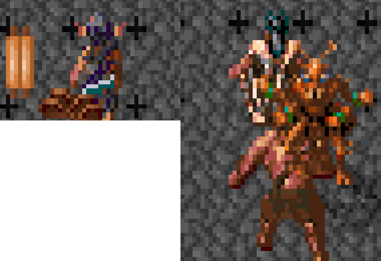
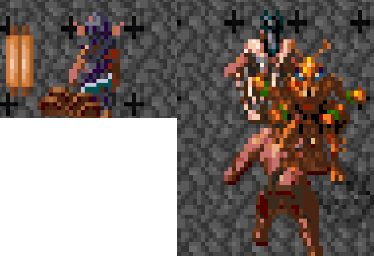
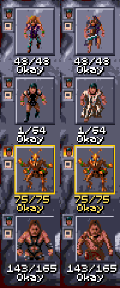

# 2026-11-27: the class outfits in Wake of the Ravager

**Under test:** the branch `claude/ravager-class-outfits`. The Loader's `OBJEX2.GFF` holds each party picture as the
Loader's own Shattered Lands figure, with room after it (`ravdress.copy_chunks`). The dice log's `dress` pass
(`ravdress.RavDresser`) writes each member's class outfit into it and has the game load it again.

**Setup:** `ravload.sh ravager-after-ambush` (RAV_LOADER=1). `ravdice.py` with `RAV_NO_SAVES=1` for the dresser.
`RAV_SKIP=class_outfits` for the control. Then `RAV_LOADER=1 ravhold.sh` for the first fight (its Hold Person
memory edit, never saved).

## Steps

1. **The control** (`RAV_SKIP=class_outfits`). The leader is Thy'rokh, the thri-kreen, so the orange, insect-like
   figure in the street is right; it has no outfits. Keys 1 to 4 make each member the leader. The sequel
   draws only the leader outside a fight.
2. **The copy with room, before the dice log.** With keys 1 to 4, each member is drawn plain and whole
   (top row of the picture below). The padded frames, which have empty rows and columns around the figure,
   stand where the game's did.
3. **The dice log attached.** It dressed the party within the 8 s before the keys were pressed (the roles below). With keys
   1 to 4 again (bottom row):
   - Ar'Anda (305, Preserver/Psionicist/Thief) wears the purple hooded robe.
   - Terrannus (300, Priest) wears the cream robe.
   - Thy'rokh is unchanged (the thri-kreen has no outfits).
   - Gerakis (308, half-giant Gladiator) wears the loincloth and straps.

   Each matches the outfit drawn offline from Shattered Lands' palette.
4. **The fight** (the Draxans' ambush, `ravhold.sh`). All three fight in their outfits, drawn from the
   fighting pictures (CBMP), each on its square.

## Learned

- The sequel's party things' slot (+10h) is FFFFh for the members not drawn outside a fight; only the leader
  holds a slot there.
- `ravstart.sh`'s RAV_SKIP did not know `class_outfits`; it now does (RESEARCH-RAVAGER-AUDIT.md's table).
- Offline renders of the sequel's pictures need the in-game region's palette: `ravitems.region_palettes()[0]`
  is darker than the street's.

**Water:** no new area.

## Later the same day: the colours matched in Lab

The 290-outfit comparison (project files `class-figures/outfit-colour-comparison/`) led to a change: the colour
match now uses Lab distance instead of weighted RGB, which cuts the colour error by 10 to 20%. `ravhold.sh` was
run again with the dice log. The outfits are the same, and the thri-kreen's yellows are closer to Shattered Lands'.
The figures stand where they did in the control run (`RAV_SKIP=class_outfits`), within a pixel or two, with their
shadows at their feet.

## Later: the party column's small figures (branch `claude/ravager-small-figures`)

The sequel's inventory draws each member's small figure with routine 6F7EAh. It works like Shattered Lands'
6797Ah: `mov ax,[es:bx+10h] / add ax,23h` names the figure's preloaded picture, and the loader at 7B827h reads it.
Two changes make it show the outfit:

- DSCLOG2's SMALL_FIG (site 254) names BMP 7000h + the figure * 256 + a bit per class group (1-8, as the
  inventory's class pictures: a human's one class), from the member's sheet; for the creature being made, from
  the creation sheet.
- INV_LOAD reads that picture from the Loader's OBJEX2.GFF, where `ravdress.small_chunks` keeps frame 0 of the
  figure's walking picture in that outfit: 290 pictures, one per figure and class combination with an outfit,
  made at the copy. Where there is none, the stock preloaded picture.

`ravload.sh ravager-after-ambush`, then I: the column shows each member's outfit (right in the picture below;
left the stock figures), with or without the dice log (the same pixels): Ar'Anda's elf Preserver/Psionicist/Thief
outfit, Terrannus's cream Priest robe and Gerakis's Gladiator outfit. Thy'rokh's figure is unchanged.

On the creation screen (`ravcreation.sh`), the small figure wears the class outfit when the screen opens and after
a race's or a portrait's click, when the game draws it again. A class's click does not redraw it: a redraw of ours
(the game's own calls, from the class click's probe and then from CR_HP's) quit the game with "Math Err" after
Fighter off and Thief on, and the control without it did not, so it was dropped.

