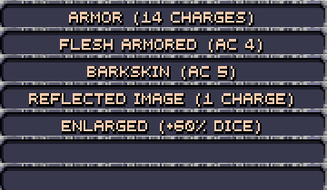
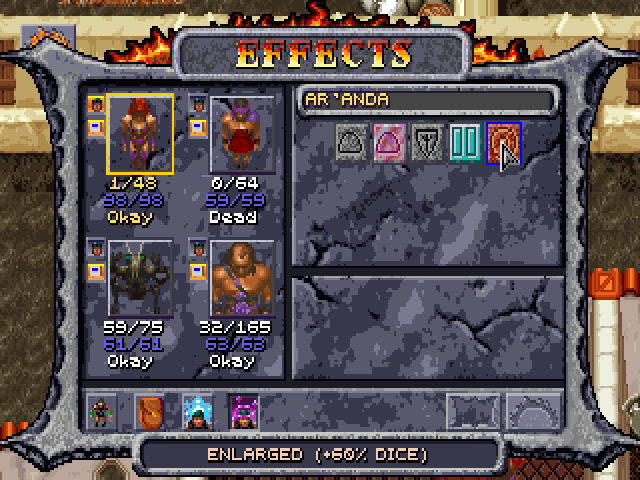
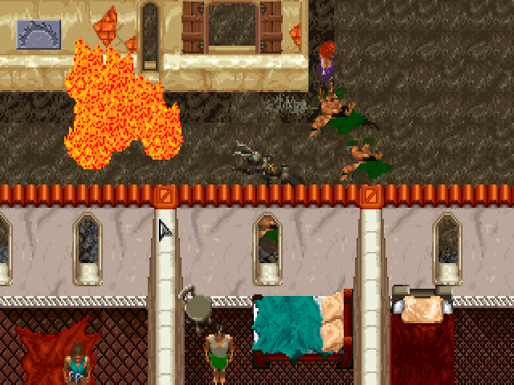

# 2026-11-27: the Effects screen's other lines and a computer's wall (claude/ravager-effects-lines)

Under test: DSCLOG2's EF_CHARGES with EC_MOD and EC_REFLECT (site 247 at 8ABBDh), the Loader's EF_STATS
(header +2134, ef_mod_lines +2136, HDR_LEN 2138); then AI_WALL in play (ai_walls +2120).

Set-up: ravEL, a throwaway copy of $WORK/rav (game.gog and the FLIs hard-linked, the rest copied); the lock held
by this session's holder.

## Steps
1. **The lines** (`ravload.sh ravager-roost /tmp/playtest/ravEL`, the dice log `RAV=/tmp/playtest/ravEL RAV_NO_SAVES=1
   ravdice.py 7000 el-dice.txt --numbers`: "quick saves and autosaves off"). ravaudit: hdr_len 2138, ef_stats all
   none. Ar'Anda made leader (key 1); a test edit: she knows Enlarge (`ravknow.py 5`, 3 casts a level) and
   Reflected Image (her sheet's +3Fh |= 08h). USE (22,17), level 1: Enlarge (232,59) on her portrait (70,58):
   "Enlarged on Ar'Anda#0", ef_stats "enlarge 6" (her wizard level 6). Reflected Image (175,59) on her: Mirror
   Images, spell 323, 1 charge.
   The armour spells by RESOURC2's effect byte (+19h, a test edit of the Loader's copy, put back after): Detect
   Invisible (13, level 2) made Barkskin 6 and cast on her: "Barkskin on Ar'Anda#0", ef_stats AC 5 (6 - 6/4).
   **A second cast of Detect Invisible made Flesh Armor (40) took the slot and added nothing** (the game keeps one
   effect a spell on a creature). Invisibility (17) made 40: "Flesh Armored on Ar'Anda#0", AC 4 (10 - 6). Armor
   (0) made 104 (Magical Vestments) still put Armor (5): its handler sets the effect itself, so Vestments was not
   played (the unit tests have it).
   EFFECTS (122,171), the pointer on each icon (175/194/213/232/251, 58): **"ARMOR (14 CHARGES)", "FLESH ARMORED
   (AC 4)", "BARKSKIN (AC 5)", "REFLECTED IMAGE (1 CHARGE)", "ENLARGED (+60% DICE)"**; ef_charge_lines 2,
   ef_mod_lines 3. 
   
   Ended: DOSBox and the dice log by pid; nothing saved.
2. **A computer-cast wall** (AI_WALL). **Why the last try cast nothing**: the AI's spell choice (5EEB6h, from the cast
   at 5EE00h, 570h:20h, called by the computer's turn at 5BEB5h) scores each spell of the list as rand() x the
   spell's weight / 8000h, the weights a signed byte a spell at selector 310h (file 5200h + 3C78h x 16), and takes
   the best above 0: **Wall of Fog's weight is 0**, so it is never chosen (nor Wall of Force, Stone, Ash, Prismatic
   Wall, Blade Barrier, Wall of Thorns...); the walls with a weight are Wall of Fire 54 and Wall of Ice 55 (20 each)
   and the priests' Wall of Fire 207 (40). The turn tries a spell only with the creature's +1Ch (INT) above 9, its
   308h:+B2h byte 0 (set once a try finds nothing), DS:420Ch not 1, and the target within 24 squares; a party
   member's spell must pass 628h:7Fh or 588h:48h (known, with a cast left).
   DOSBox restarted on the same copy: `ravload.sh ravager-after-ambush /tmp/playtest/ravEL`, the dice log again
   (`RAV_NO_SAVES=1`). A test edit ([walls.py](files/2026-11-27-ravager-effects-lines-walls.py)): Ar'Anda knows
   Wall of Fire and Wall of Ice alone, 3 casts at every level, her first class level 9, her weapons (slots 2, 3, 10)
   moved to backpack cells 29-31 (INT 18). `ravgo.py y 1224 x 1839`, Right x4: Tyr's thieves; 2, Space: the fight;
   C on Thy'rokh's turn, the four Computer Control icons, Escape. **On her first turn, a thief beside her, Ar'Anda
   cast Wall of Fire**: "Wall of Fire damage: 2d6 = [2 + 5] +9 = 16 (... caster level 9)", a Thug burned twice
   and a Pedestrian later; **ai_walls 1**. The wall on the map after the fight is a blaze several cells across,
   not a point. Her later turns were blows (Computer Control took weapons up from the pack). "Fight over: 4 rounds,
   4 kills". 
3. Ended: the watchdog, the dice log, DOSBox, the lock holder and the Xvfb this session started, by pid; RESOURC2's
   bytes put back (and rewritten by the next start); the throwaway copy ravEL deleted; nothing saved after an edit.

**Water**: no new area (the Roost and Tyr's street).

**Left**: Magical Vestments' line not played (Armor's handler sets its own effect, so the byte edit didn't take; the
unit tests cover it); Reflected Image's own icon on the Effects screen (not ported); the cast sound heard.
