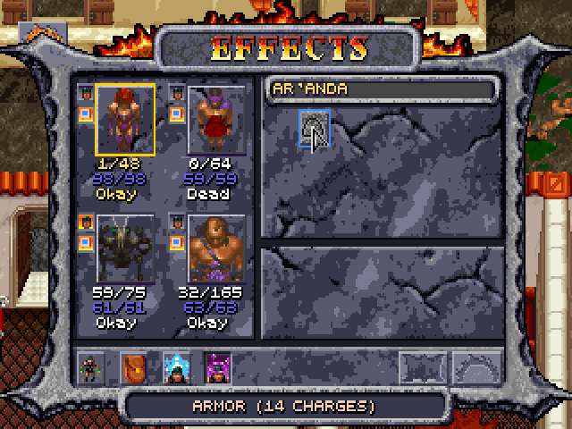
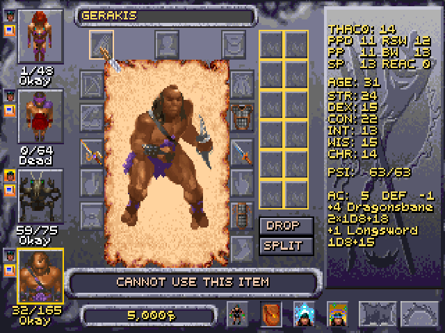

# 2026-11-27: the last ports in Wake of the Ravager (claude/ravager-final-items)

Under test: DSCLOG2's EF_CHARGES (site 247 at 8ABBDh), ARROWS_FORBID (in CU_SITE, site 19), the spell arrows'
cast sound (ARROWS_ASK: B8h:0A22h with 6Eh); header +2128..+2133. Play checks: a lock, a computer's wall,
a living creature's side after Berserk.

Set-up: ravFI, a throwaway copy of $WORK/rav (game.gog and three FLIs hard-linked, the rest copied);
`ravload.sh ravager-roost /tmp/playtest/ravFI`, the dice log `RAV=/tmp/playtest/ravFI RAV_NO_SAVES=1
ravdice.py 7000 fi-dice.txt --numbers` ("quick saves and autosaves off"); the lock held by this session's
holder; the watchdog on. ravaudit.py: hdr_len 2134 (the new build), the three new counters 0.

## Steps
1. **EF_CHARGES.** Ar'Anda made leader (47,43); 3 wizard casts at every level (`ravknow.py 0`, a test edit). USE
   (22,17), level 1, Armor (174,59) on her portrait (70,58): "Armor has 14 charges". LEVEL (197,171), Detect
   Invisible (174,59) on her: timed (an "effect ends" event, kind 7, thing 0, handle 1, at DS:2A63h's queue: the
   queue's place and layout as SL's), charges 0. The PSIONIC page (150,171), Inertial Barrier (231,59) on her (one
   failed check first): "Immune to Missiles", **its effect record's charges 15 and no event: the stray of an
   effect cast for -9999** (the case of SL's bug). EFFECTS (122,171), the pointer on each icon (175/194/213,58):
   "IMMUNE TO MISSILES", "DETECT INVISIBLE", **"ARMOR (14 CHARGES)"** (the game's font is capitals);
   ef_charge_lines 2 (one a hover over Armor). 
2. **The cast sound.** Ar'Anda made a Spellarcher (a test edit: `ravkits.py set 0 0x41 4 9 11`, half-elf
   fighter/preserver, kit 1); she knows Chill Touch. USE: CHILL ARROWS (157,147) under her powers. Pressed in
   armour: "Ar'Anda can't weave spell arrows in armour." (Continue 22,157); `ravitems.py 0 --bare`, pressed
   again: "Ar'Anda makes one of the chill arrows in the quiver (1 of 24 now)"; **arrows_sounds 1** (the game's
   sound flags DS:13F7h and 1435h both 1, so its routine went on past its tests; nothing to hear: DOSBox's sound
   is off in ravstart.sh).
3. **ARROWS_FORBID.** The inventory (75,171): the arrows taken from her quiver (72,27), Gerakis's portrait
   (22,167), his quiver (72,27): **"CANNOT USE THIS ITEM"**, the arrows left on the pointer; arrows_barred 7 (the
   can-use routine runs for every slot it lights). Back on Ar'Anda's quiver: taken (the Spellarcher's own).
   Control, the kits off in the helper's header (+270 bit 0 cleared, a test edit): Gerakis's quiver took them
   (slot 1), arrows_barred stayed 8. The kits on again and the inventory shut: "The chill arrows go back to Ar'Anda
   from Gerakis: only a Spellarcher carries them (1)" (return_strays, the backstop).
   
4. **The lock rule.** The sequel's open-locks rolls (every DO_ACTION 3 of the 350 scripts, read from each byte
   so the 93 that don't decode whole are read too): GPL 9 at 4378 (the Pyramid's grate under the Garden), GPL 40
   at 6218 (Magnolia's chain, Humbleton Forest), **GPL 89 at 7826 (the mind flayers' chest: "The chest is locked
   and looks quite sturdy", Pick the lock)**, GPL 264 at 1154 (the Generoe acolyte's cage, which has a lock-out of
   its own: "has jammed picks in the lock ... The lock can no longer be picked"). None is near the start (Tyr):
   so a test edit, never saved: every talk trigger of the Roost's region (29: the list at (load + 3C10h):0Fh,
   13-byte records at far DS:40C0h) made place 7120 of GPL 89 (MAS 58's use trigger for the chest, object
   -5102). The look pointer (two right-clicks) on Reyhan (game 150,112, then 160,85 as the view moved): "The chest
   is locked and looks quite sturdy. ... Pick the lock." (2): "Thy'rokh goes to work on the intricate lock. After
   several minutes of manipulating tumblers, the lock remains intact." The dice log: "Thy'rokh#2 tries to open
   locks: d100 = 34, needs -4 or less -> failure"; LOCK_BARRED member 2 (50, 264): the region and Reyhan's thing.
   Again: **"Thy'rokh#2 tries to open locks: d100 = 28 -> failure (Thy'rokh#2 failed this lock at this thief
   level: another try once a level is gained)"**, lock_bars 1; a third time the same, lock_bars 2. The acting
   character was Thy'rokh each time (the leader on the map), whoever was picked on the screens. Talk triggers put
   back after. (Ar'Anda's Computer Control was found on and turned off on the inventory screen, 6,18.)
5. **A living creature's side after Berserk** (BERSERK_ADD and BERSERK_END, sites 245, 246). Haste (29), timed
   (60 s a level), made Berserk (7) in the Loader's `dos/RESOURC2.GFF` (the record's +19h, 42 to 7: a test edit,
   rewritten by the next start); the sequel reads its spell records from the file each cast. Ar'Anda's USE out
   of a fight (the map's inventory: her portrait 22,25, the USE icon 218,188; MAGE at 151,171, LEVEL 3 at
   197,171, HASTE at 194,60), aimed at Gerakis's portrait: Haste's area put it on **Ar'Anda** (owner 0), the
   record's +9 **0, her own side**, berserk_sides 1, an "effect ends" event (kind 7, handle 3) at clock 3347
   (the clock 2837). A test edit: her creature's side (+15h) made **1**. The clock ran slowly out of a fight
   (about a game second a real one), so the event's time was brought to the clock + 20 (a test edit). At 2973
   the effect went (the event and the record gone): **her side 0 again, berserk_ends 1**. (Without the fix the
   end routine has no case for 7 and the side stays as it was: the unit tests' control.)
6. **A computer-cast wall** (AI_WALL, ai_walls +2120). DOSBox restarted on the same copy with
   `ravload.sh ravager-after-ambush /tmp/playtest/ravFI`, the dice log again (`RAV_NO_SAVES=1`: "quick saves and
   autosaves off"); `ravgo.py y 1224 x 1839`, Right x4: Tyr's thieves. A test edit: Ar'Anda knows Wall of Fog
   (11) alone (the bitset at 3F3DCh), 3 casts at every level. Answer 2 ("Run along now, pip"), Space: the fight;
   on Thy'rokh's turn C (USE) and Computer Control on for all four (47,53 / 98,53 / 47,113 / 98,113: "COMPUTER
   CONTROL IS ON"), Escape. **Ar'Anda fought with her weapons** (four turns: blows, a hide in shadows) and cast
   nothing; "Fight over: 3 rounds, 4 kills"; **ai_walls 0**. Not seen in play: the computer casting a wall
   (the unit tests run the handler on a CPU emulator; a fight where a computer caster stands off from its foes
   is still to find).
7. Ended: DOSBox, the dice log, the watchdog and the lock holder by pid; the throwaway copy ravFI deleted;
   no save written after an edit (the dice log's saves off throughout).

**Water**: no new area (the Roost and Tyr's street, as before).

**Left**: the computer's wall in play; the cast sound heard (DOSBox's sound off here); the sequel's Enlarge
and armour-spell AC lines on the Effects screen (not ported).

Scripts (the test edits): `logs/files/2026-11-27-ravager-final-items-*.py` (effs, side, evtime, spells, retalk, onlywall).
