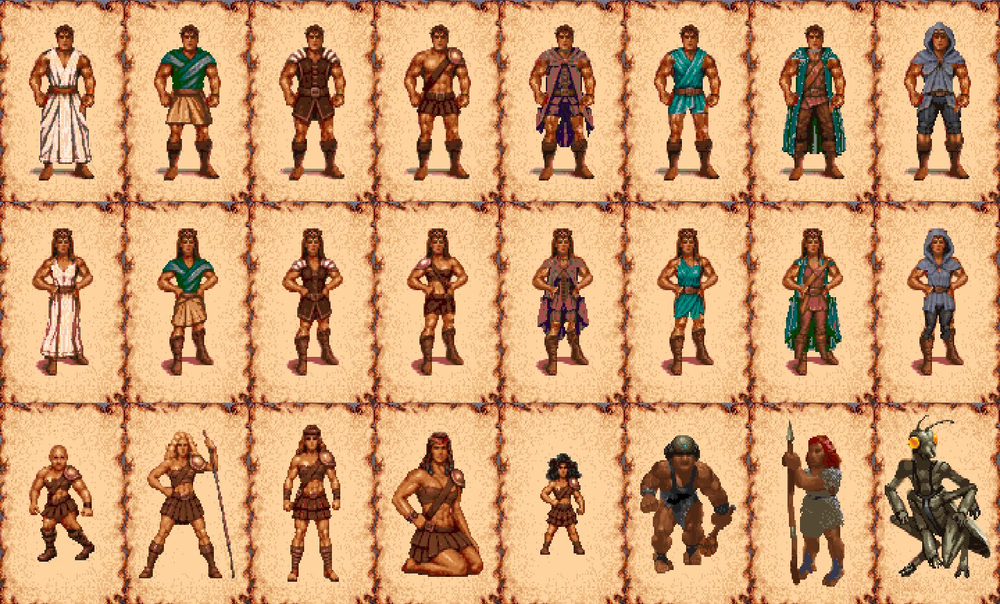

# The class pictures on Wake of the Ravager's inventory (2026-11-27)

The Loader's way (`ravload.sh ravager-after-ambush`, the sequel with the mod's DSUNLOG2.EXE and
RESOURC2.GFF from this branch, Shattered Lands from `$GAME`). **I** opened the inventory on Thy'rokh.
`ravinvfig.py FIG CLASS 0 0 RACE` gave him each figure and class in memory, and a click on another
portrait and back drew it again. Nothing was saved; he was put back (13, classes 9 and 7, race 8) and
DOSBox stopped by pid.

- All 16 human builds (8 classes, the man and the woman) and the dwarf, elf, half-elf, half-giant and
  halfling women as Gladiators drew Shattered Lands' dressed figures, centred on the parchment.
- Fallbacks drew the sequel's own pictures: a dwarf man Gladiator, a dwarf woman Fighter, and Thy'rokh
  himself once put back.
- The sequel's steady colours are fewer: the Druid's green shirt and the Ranger's cloak come out more
  teal, the Preserver's plum a little bluer. The skin and leather are close.

Water: nothing new (the opening's area only).
