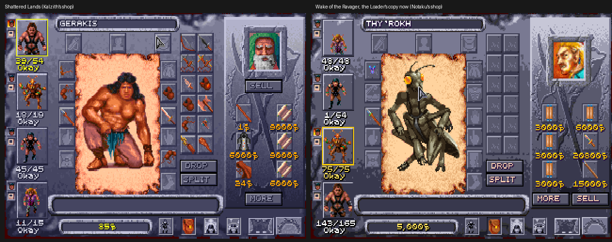
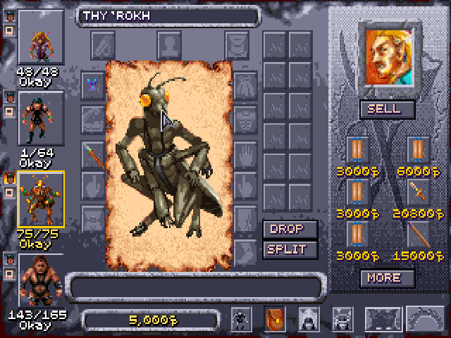
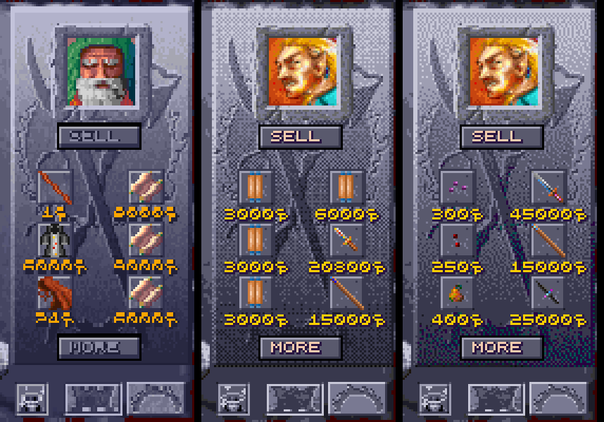

# 2026-11-27: Wake of the Ravager's no-speaker box and shop panel as Shattered Lands' (claude/portrait-empty-shop)

Under test: `dsloader/ravportraits.py` (`emblem`, `shop_window`, the shop patches at (252, 11)) and
`dsloader/ravui.py` (`dithered` for BMP 13004). The ask: after the small talk portraits, close the two
places not yet compared with Shattered Lands, the box with no speaker and the shop screen, and make the
sequel match.

## Shattered Lands, seen first
1. **The shop** (`selling-junk-user`, `openshop.sh`: Kalzith): the face in its frame at (252, 11) at the
   panel's top, SELL right under it, the six items, MORE alone at the bottom. The code agrees: its face
   routine 7DEDFh puts the shop's face at (104h, 12h), the shop (836F1h) its frame (BMP 12000 frame 0) at
   (0FCh, 0Bh); its WIND 13500 has SELL (13304) at (255, 59), MORE (13303) at (255, 159).
2. **No speaker**: the same routine draws BMP 12000's frame 1 at the face's place; Shattered Lands' is a 32
   by 32 stone dark-sun emblem (`docs/vulture-meal.png`, the reward box after Dinos's meal, a grab from
   the game). A try for it after the templar ambush (`fountain-user`, `fightout.sh`, grabs every half
   second) showed no XP box there: that fight ends without one.

## Wake of the Ravager
3. **The shop before** (`ravager-after-ambush`, Notaku: ravgo.py y 1224 x 296 y 936, two right-clicks to
   the eye, 93,6 then 93,3, talk 115,66, keys 3 1 3 2): MORE and SELL side by side at the bottom, the
   face in the middle of the old 73 by 73 place; the item list already at Shattered Lands' places (WIND
   13500 differs from Shattered Lands' in the two buttons alone). The panel lighter at the top, darker at
   the foot: BMP 13004 is Shattered Lands' (`sl_interface`), its 16 greys rounded to the sequel's 7.
   
4. **The shop now**: the face in its frame at (252, 11), SELL under it, MORE alone at the bottom (it pages
   the list), the panel's greys mixed by a 4 by 4 pattern (its tone nearer Shattered Lands'; the pattern
   shows close up). 
   The owner then asked for the shade and texture to match too: the pattern traded for error diffusion
   (Floyd-Steinberg over the kept colours within 40 of each grey). Measured against Shattered Lands' panel,
   the mean colour (94.7, 94.7, 119.7): rounded (96.9, 96.8, 114.9), the pattern (96.3, 96.3, 116.0), the
   diffusion (95.6, 95.4, 118.2); the miss over 4 by 4 blocks 6.0, 2.9, 2.7. In game its grain reads as
   Shattered Lands' does. 
   No palette slot is free for Shattered Lands' own greys: PAL 1000's 32-95 are magenta placeholders
   that every region palette fills, 1-31 are cycled, and the 101 colours every region keeps hold 7
   blue-greys (233-239) and the system greys.
5. **The no-speaker picture**: `RAV_POKE=88E6F=33f690` (every face the empty one) and Notaku's shop: the
   frame with Shattered Lands' emblem in it, drawn by the game (frame 1 of the copy's BMP 12000). The talk
   box draws the same frame 1 at (8, 6) (the XP message, played in the earlier log).
6. **The control** `RAV_SKIP=sl_interface`: the sequel's own panel picture, SELL and MORE still moved (they
   belong to `small_portraits`), the face as in step 4; the emblem left out (the grey wash).

Edits made for the test (never saved): the foes' HP 1 in the Shattered Lands fight (`fightout.sh`), with
autosave and quick save off.

Water: nothing new (the pens' fountain area, Tyr's street, Notaku's stall).
