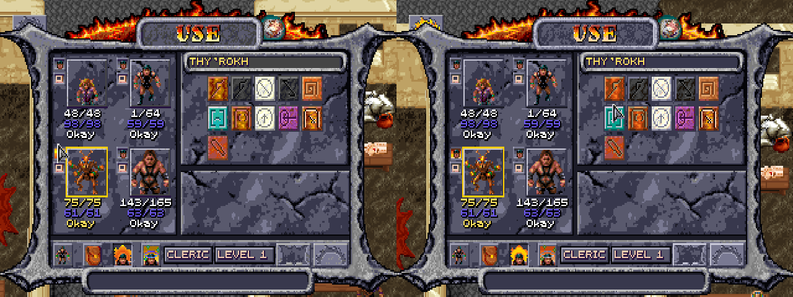
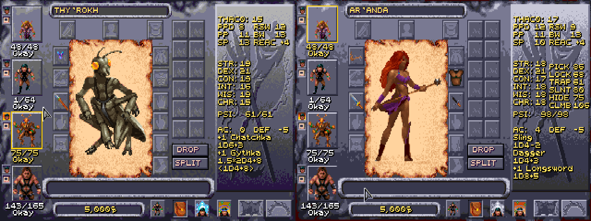

# Wake of the Ravager with Shattered Lands' screens and icons (2026-11-27)

**Under test:** `dsloader/ravui.py` (branch `claude/ravager-sl-interface`): Shattered Lands' 45 interface
pictures and 221 icons put into the Loader's RESOURC2.GFF, last and only where the copy has the game's own
chunk. Its chunks were first checked byte for byte against darksun-recompiled's `sl_figures.py build-ui`
on the same GOG files: all 266 the same.

**Build:** the branch's Loader, `ravload.sh ravager-after-ambush` (RAV_LOADER=1), the GOG files from the
private repository's installers (`setup_game.sh`, `setup_ravager.sh`). No memory edit, nothing saved.

## With the interface (the default)

1. Loaded in Tyr's street. The top-left icon (22,17): the USE screen, Ar'Anda selected, its frame and
   panels in Shattered Lands' bluer stone.
2. VIEW INVENTORY (74,171): the inventory, its slots and stat panel drawn, nothing out of place. A click
   on the cloak and the armour slots took the item up (AC 4 to 5); a second click on the same slot put
   it back (AC 4).
3. Escape (a screen up) closed it; the top-left icon then opened the inventory again (the last screen).
4. U: the USE screen for Thy'rokh, its spell and psionic icons Shattered Lands' drawings.

## The control (`RAV_SKIP=sl_interface`)

The same save; U, then I. The copy's `BMP 10000` and `ICON 21000` are the game's own (checked in the
file). The screens are the sequel's: greyer stone, its own icons.

**Seen:** the change is subtle, as on 2026-11-20 in darksun-recompiled: smoother art and a slightly bluer
stone. No stray colours, no frame cut. Not reached this time: the END menu, a talk box's MORE button
(kept as the sequel's), CHOOSE A SPELL.

**Water:** no new area.
