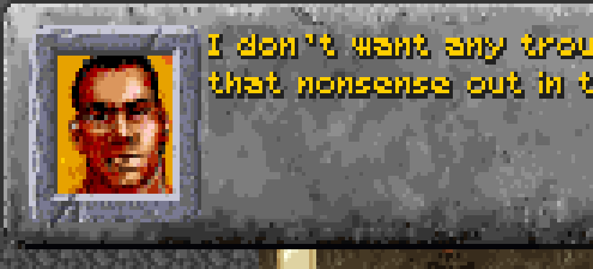
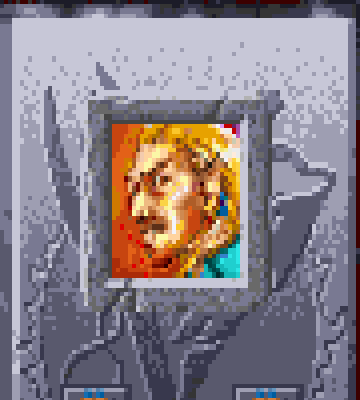

# 2026-11-27: Wake of the Ravager's talk portraits at Shattered Lands' size (claude/ravager-portrait-size)

Under test: `dsloader/ravportraits.py` (the owner's ask: the sequel's portraits much larger than Shattered
Lands'). The Loader's copies (`ravstart.sh` / `ravload.sh` with RAV_LOADER=1): the faces in GPLDAT2.GFF 48 by
46 (a 32 by 32 face in the sequel's own frame cut down), BMP 12000 and WIND 12500 in RESOURC2.GFF, five patches
to 88E67h. Control: `RAV_SKIP=small_portraits`.

## Measured first
- Shattered Lands (`legcrusher-fountain-user`, Legcrusher's speech): the box full width, 58 high; the frame
  48 by 47 at (8, 6), the face 32 by 32 inside it at (16, 13); the text from x 58 (WIND 3007 says the same).
- The sequel (`ravager-after-ambush`, Uhubito): the face 72 by 72 with its frame at (0, 0), hanging below the
  58-high text box (the window 72 high), the text from x 75.

## Steps
1. **Uhubito** (`ravager-after-ambush`; his office's floor 240,140, then 220,170, the look pointer on him at
   215,163, the Look box's talk button 119,188): the frame at (8, 6), the face 32 by 32, the text from x 58,
   five lines in the box; a reply's answer and "Goodbye." the same.
   
2. **Notaku** (`ravgo.py y 1224 x 296 y 936`; the eye on him at 93,6, then 93,3 opens the Look box; talk 115,66;
   keys 3, 1, 3, 2): his talk the same; **his shop**: the face first drawn at the old place's corner (238, 6),
   then (the patch made) in the middle of it, (250, 19), on the shop's own frame drawn there too.
   
3. **The opening talk** (a new game): the woman's face small, five lines of her second speech in the box.
4. **The XP message at the first fight's end** (RESEARCH.md, "The talk portraits", for winning it fast):
   first run: **no frame at all**: the game draws BMP 12000's *frame 1* (the frame round a grey wash) there,
   and the first smaller 12000 had one frame. Made with two (the frame alone, and the frame round the wash
   cut to 32 by 32), the control (RAV_SKIP=small_portraits) and the new build side by side: the 73 by 73
   frame with its wash, and now Shattered Lands' 48-wide one. Picture: `obsidian-edition/docs/ravager-small-portraits.png`.

Edits made for the test (never saved): the party's HP 250 and the Draxans' 1 in the creature records, the
fight then won by Computer Control. RAV_POKE 88E6F=33f690 (every face the empty one) for one look: a talk out
of a fight with no speaker draws no frame at all, in the game as before.

Water: nothing new (Tyr's street, Uhubito's office, Notaku's stall).
