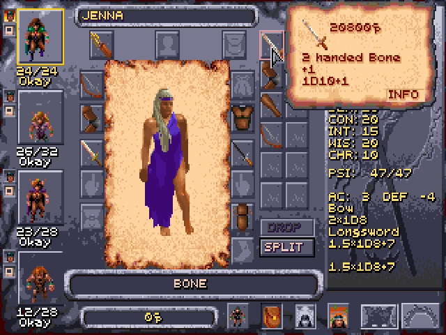
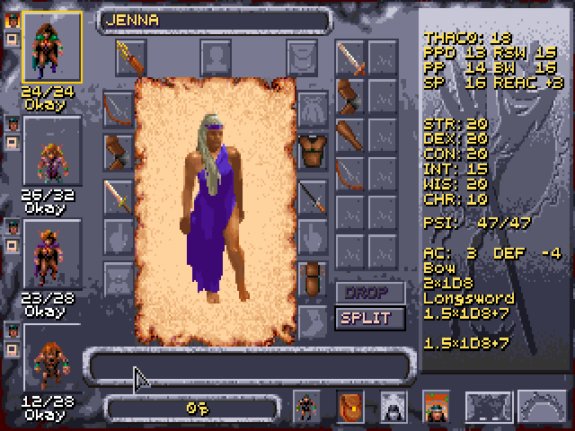
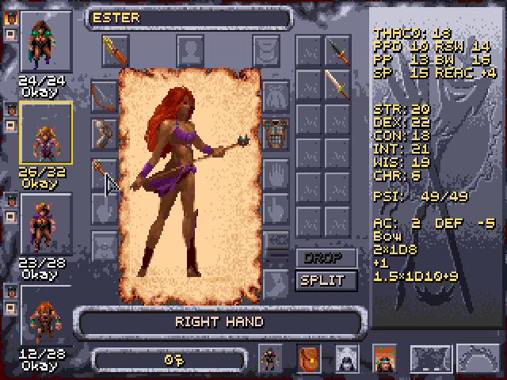
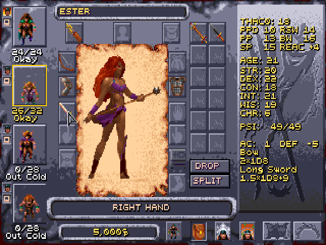

# Test log: weapons keep their material and kind in Wake of the Ravager (2026-11-27)

*Branch `claude/ravager-weapon-materials`.*

## Under test

- The five backported weapons that lost their material crossing over (the metal great sword, lotulis and
  javelin, the obsidian lotulis, the bone great sword) as the mod's own sequel types 141-145.
- The user's wider ask: every SL weapon of its kind and material in the sequel. SSI's `ITEMS.BIN` pairs that
  change a weapon's material or kind dropped (`ravtransfer.weapon_pairs`), the Loader making the weapon in a
  sequel type of its kind and material instead; SL's bone long sword added as type 146; the sequel's club,
  toothed club, bow and sling made wood and leather (`ravager.RAV_MATERIALS`).
- The bone great sword's weight 110 in both games.

## Before the game (the real files, `DSUN_SL`/`DSUN_WOTR`)

- An audit of all 337 SL weapon objects against what the transfer gives: 20 changed material or kind before
  (the bone Long Sword 1012 the sequel's obsidian Longsword 614; Great Axe +3 an obsidian great axe; the
  Polearm +1 a Double Spear; Terror Blade a stone dagger; Bloodwrath and Dark Flame metal; Dragonsbane
  obsidian; Swiftbite, Draketooth and Hornblade bone long swords made obsidian or wood; Dag's Dagger stone;
  clubs, bows and slings of no material). After: none
  (`test_ravitems.GameTests.test_every_weapon_keeps_kind_and_material`; Hornblade's pair has no record, so it
  was always made by the Loader, now as type 146).
- The sequel's metal dagger 99 is a thrown one only (flags 12h): a melee metal dagger (Dag's Dagger) goes to
  the mod's metal dagger instead (melee or missile is part of the match).

## The play (about 18:40-19:20 UTC)

- The save: trap-user with test weapons written into backpack items of the save file (a copy, never loaded in
  Shattered Lands): Bone Great Sword +1 to Jenna, Obsidian Lotulis +1 to Ester (elf fighter/fire cleric, a
  Battle Dancer), the metal great sword, lotulis, javelin and the Great Axe +3 to Lex, the Polearm +1 and
  Terror Blade to Seneca, a Club to Jenna. Transferred the Loader's way into a copy of the sequel; the same
  save through origin/obsidian-edition's code into another copy, the control.
- Roster files compared (each item's sequel type, kind, material): control: the Bone Great Sword +1 type 101
  obsidian, the Obsidian Lotulis +1 type 61 stone, the metal great sword 101 obsidian, the metal lotulis 61
  stone, the metal javelin 59 obsidian, Great Axe +3 51 obsidian, Polearm +1 39 a double spear, Terror Blade
  37 stone, the bone Long Swords 73 obsidian, Bloodwrath 97 metal. This branch: 145 bone, 144 obsidian, 141
  metal, 142 metal, 143 metal, 113 metal, 80 bone polearm, 72 obsidian dagger, 146 bone, 73 obsidian.
- `RAV_LOADER=1 RAV_MENU=1 sh ravstart.sh` on the branch's copy: CREATE CHARACTERS, the four added. Jenna's
  inventory: the Bone Great Sword +1's box "2 handed Bone +1 1D10+1, 20800", the material line BONE
   .
- `ravitems.py` in memory: Jenna's long sword type 146 material 1 (bone), the great sword 145 bone; Ester's
  lotulis 144 material 3 (obsidian); Lex's 141, 142, 143 metal and the axe 113 metal; the clubs and bows
  material 80h (wood, spared the weaker material's to-hit), the sling 85h. The game ran to the title, the
  roster, a new game and Tyr's opening fight with the 147 types.
- Ester took the Obsidian Lotulis +1 in hand, "+1 1.5x1D10+9" :
  **not a test of the rules**, the dice log (and so DSCLOG2's rules word) not yet attached then.
- With `ravdice.py` attached (rules word FBE5h, RULE_RESTRICT on), in the roster screen and again in Tyr's
  fight: Ester's bone long sword (146) out of the hand and back, and her bow out and back: both kept
  . Right by SL's rules: her Battle Dancer kit allows the
  long sword and the bow whatever her fire sphere (`restrict.kit_allows`, DSCLOG2's KIT_ALLOWS before
  CLASS_FORBIDS). `restrict_count` stayed 0. DSCLOG2's class and kit limits on the new types are checked
  against SL's in the emulated tests (test_ravrestrict: type 146 for 30 class sets; test_ravkitgear: every
  mod type, 141-145 among them).
- Not seen: the bone great sword's box shows "2 handed Bone +1" with no "Great Sword" (the mod's name in the
  sequel); not looked into (the names are not this branch's).

DOSBox and the dice log stopped by pid, nothing saved (the test copies' rosters only).
