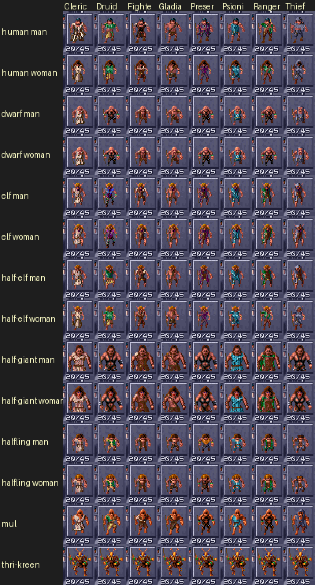

# Small party figures in their class outfits (Shattered Lands)

Under test: DSCLOG's `SMALL_FIGURE` (the inventory's party column draws each member's own walking
picture from the Loader's SEGOBJEX, frame 0) and the Loader's `SMALL_PICS` table
(`Dresser.write_small`), branch `claude/small-party-figures`, helper `DSCLOGvf`.

- Started with `loadsave.sh pens-after-arena`, window 320x240, `buildcheck.py small_figure
  small_figure_far inventory_load inventory_load_far`: all the same as the EXE, every vector at
  its handler.
- `SMALL_PICS` read (2466, 2476, 2450, 2460): Gerakis (half-giant man, figure 8), K'ratchek
  (thri-kreen, 13), Cermak (human man, 0), Cilla (elf woman, 5), each their figure's walking
  picture (2450 + 2 x figure).
- I opened the inventory: Cermak's small figure wore the Preserver's plum mantle and Cilla hers; Gerakis
  and K'ratchek their map figures. Before the change all four were the game's stock figures (the
  user's screenshot).
- The tool [files/2026-11-27-small-party-figures-cycle.py](files/2026-11-27-small-party-figures-cycle.py) set Cermak's figure (creature +18h),
  race (sheet +18h) and class (sheet +21h) in memory to each of the 14 figures x 8 classes, waited
  1.8 s for the Loader, closed and reopened the inventory (Escape, I) and grabbed the window. It put
  everything back at the end. It is a memory edit, so the game was not saved.
- Result, below: every race that has class outfits shows them in the column, matching its map
  figure. A class a race can't take (a dwarf Druid, a half-giant Preserver) and the thri-kreen show
  the plain figure, as on the map. With Cermak a half-giant man (Gerakis's figure), he was given his
  place's spare (2482) and both showed their own outfit; as an elf woman he took 2460 and Cilla
  the spare.

