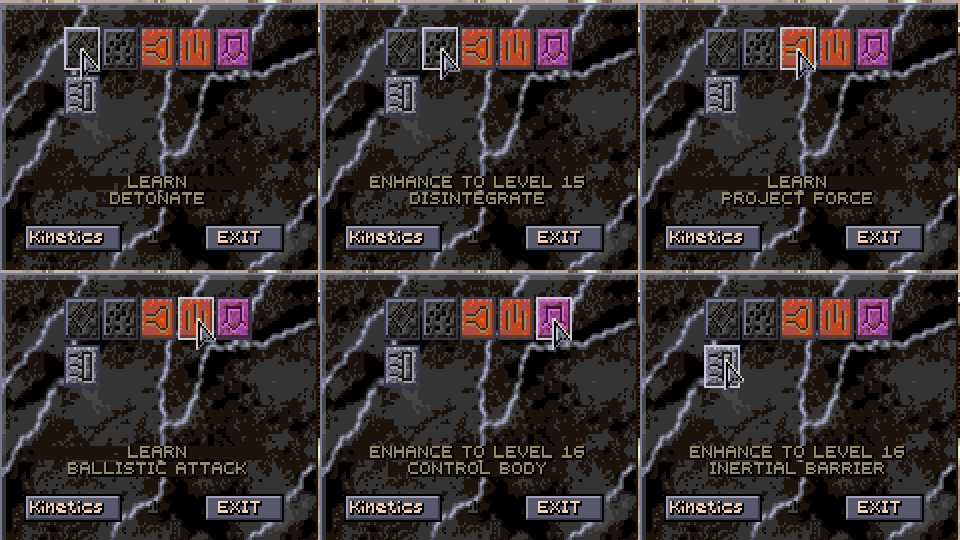
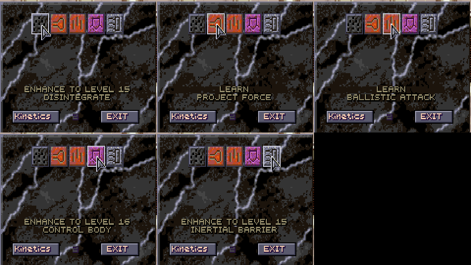
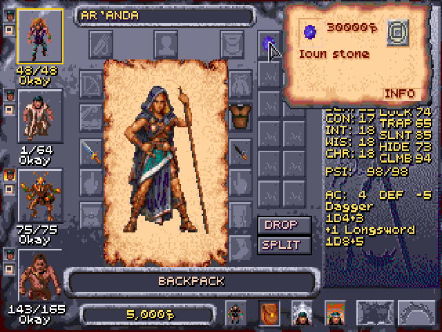
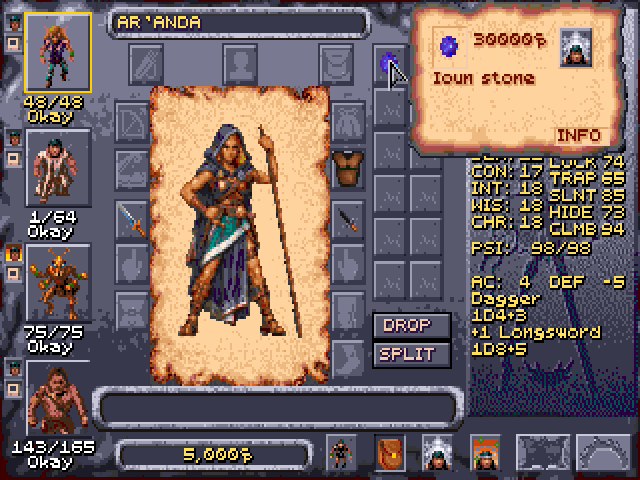

# Wake of the Ravager: the reported bugs' fixes in play (2026-11-28)

Under test: branch `claude/ravager-walkthrough-bugs` ([the report](../../reports/ravager-walkthrough-bugs-2026-11-28.md)).
Every run on the Loader's copy (`RAV_LOADER=1`), test edits in memory only, never saved.

## Detonate at a level up: seen working

A psionicist (Thy'rokh's power list cleared of Detonate with `ravlevel.py powers 2 forget 0`, a test edit)
levelled by an XP award (the sequel splits an award between a character's classes, so the psionicist's
share was set just short first). The level-up's Kinetics list showed six powers and LEARN DETONATE;
with `RAV_SKIP=detonate_listed` the same set-up listed five, no Detonate.

 

## Protection from Fire: seen working

`ravhold.sh` (the Draxans' ambush, Ar'Anda's USE screen at LEVEL 3), the dice log running
(`ravdice.py --all --numbers`), a Protected vs Fire effect (spell 138, id 77) added on Thy'rokh in the
effects list (a test edit), then Ar'Anda's Fireball centred on him.

| | Rolled | His save | Taken |
|---|---|---|---|
| The fix | 22 | saved: 11 | **5** (67/72 after) |
| Control (`RAV_SKIP=protection_halves`) | 19 | saved: 9 | **9** (63/72 after) |

The others in the blast took their full or saved damage as before. (The dice log's "halved: Protected vs
Fire" label is what the rule should do; in the control run it is printed though the game did not halve:
the hit points are the truth there.)

## The new spells and items' own effects: seen working

`ravload.sh ravager-after-ambush`; DSCLOG2's rules are set by the dice log's attach (`ravdice.py`), so it
must run (rules 0 without it: no new spell, no NS_CMP). One of Ar'Anda's items made an Ioun stone (object
30013's record: power 142h) in memory, then its box opened (I, her portrait, a right click on it):
the stone's own picture, and DSCLOG2's `ns_not_books` 1 (a counter of that build, dropped since for the segment's room). The control: NS_BOOK's first bytes made `stc /
ret` in memory (the old way, every item a new spell's scroll): the same box showed a new spell's face.

 

Moving a powerstone (146h) in and out of a worn slot did not reach the take-off routine's compare
(the counter stayed 0): the powerstone is used, not worn. The take-off path for a worn stone was not
played.

## The new spells' descriptions on items' own effects: not reached in play

The second pass's `NS_INFO` (site 86 at 9AA95h: the SPIN text the item box's spell window looks up) is in the
program the Loader starts (`cd f5 56 90` there in `dos/DSUNLOG2.EXE`), but no click reached that window:
a lemon's box (its icon from the charges word, +0Eh, as the fruit type's flag asks) shows its icon and
INFO lists who may use it; a left click on the box's icon eats the fruit or picks the item up. DSCLOG2's
`ns_infos` (a counter of that build, dropped since) stayed 0. The cluebook says the window comes up with a right click on a scroll.

## Not played

The ranger's ambush warning (the forest is far from any save) and Xarax's potions (the same): their
scripts decode whole in the tests (`test_walkthrough_scripts`, `test_free_action_potion`).

## Water

No new area reached.
