# Ravager figure catalogue

The catalogue tracks party members, NPCs, creatures and occupied scenery in Wake of the Ravager. Entries preserve original comparisons alongside later reviews. Read the approval text for the selected artwork. A mobile figure can have several facings and actions, while a placed still can have a single drawing. Preview scales and the sequences shown are identified in the individual reviews.

When checking coverage, search map placements and scenery objects as well as character records. Compare static, fallen and mirrored poses against the original animation banks. Record attached furniture, separate encounter resources and pictures without a direct object assignment. [Archive census and review queue](figure-audit.md)

After a figure is approved, record the decision and present the next pending figure with its artwork and recommendation in the same review.

For an unidentified figure, keep its identity and race open while redrawing it in the Shattered Lands style. Preserve the source comparison and document any visual donor separately from the game’s character assignments.

When recommending a redraw, include the proposed artwork in that review. For each redraw review, show the Ravager original, the redraw and a named Shattered Lands reference at the same pixel scale. Compare the camera angle, silhouette and shading while checking the movement required by Ravager. For every new draft, show it beside actual Shattered Lands party figures at the same native pixel scale. Judge the head, shoulders, feet, outlines and motion in that lineup. At game size, compare which facial features, clothing or armour edges, and moving hands remain readable on both figures. For a person using scenery, also check the point of contact in the room with the project’s furniture treatment applied.

**Make outfit fit, texture and detail a priority in every redraw.** Start with the Shattered Lands party body for the character’s build. Check where the outfit fastens and bears weight, which limbs pass in front of the cloth, and where a fold begins or ends. Follow the collar, belt and hem through the walk and strike in every available facing. Compare the redraw at game size on its map terrain with both the party body and a named Shattered Lands figure wearing a similar material. Match their facings and poses. Check that seams, folds and highlights read as clearly as the reference and stay attached as the body moves. Use the enlarged animation to trace any flicker or gaps visible at game size. [Class-outfits cloth detail workflow](https://github.com/daaki85/darksun-obsidian-edition/blob/b69215a3fb0d84d0bc037f24b7a81fdf08244f77/obsidian-edition/docs/class-outfits/cloth-detail.md)

When a refit exposes skin, show the retail pose, the cleaned body, and the dressed body in that order. Trace the wrist and the advancing knee with the garment toggled off and on. Check idle → walk → idle and the strike on two game floors, and match each reference step through its own animation script. [Class-outfits body and motion checks](https://github.com/daaki85/darksun-obsidian-edition/blob/80caf1dd6eed98ebd82bdb38d0d2ad1f5b0922b4/obsidian-edition/docs/class-outfits/workflow.md)

For a full Elf on a party body, render the Obsidian Edition’s pointed ears after fitting the outfit. Check the front, profile, rear, bow and strike against the modded party figure. Use the character record to identify the race before applying that model to a shared picture. [Elf model and assignment audit](elf-models.md)

**Match the facing when judging an angle.** Show the redraw and the Shattered Lands reference side by side, at the same pixel scale, facing the same direction. Select each frame from its game animation script and apply its mirror flag. Compare idle with idle, and compare moving poses at the same phase where available. Label the facing and action. If a reference lacks that view, use another named figure that has it or identify the view that still needs checking.

When a creature’s catalogue picture has a single frame, check RESOURCE.GFF for separate base and combat pictures and an animation script. Record the scope of the proposed package before recommending approval. [Drake animation banks](#3312-air-drake)

**Verify the idle artwork in every facing.** Decode the standing pose from the imported game data, including mirrors. Compare it with the shipped Ravager pose, the walk cycle and a same-facing Shattered Lands idle. For a redrawn figure, flag any held pose that still displays the shipped artwork. Hold the idle at game size on its terrain long enough to judge its balance. A staggered stance can suit a guard or fighter. A lifted heel, a swinging arm or a civilian frozen in a stride needs review. Check the transition into rest after walking, melee and bow, including the foot anchor. For stationary figures, inspect each separately triggered pose alongside the default sequence and record what the game data establishes about its use. [Giant idle comparison](img/2469-planted-idles.png) · [Walk into rest in four directions](img/2469-walk-to-rest.gif) · [Maze knights](#2577-white-knight)

**Check alternate poses against the same character.** For seated, prone, sickbed, captive, crouching and working figures, look up the placed object, all same-name records and dialogue or scripts that switch the actor or use an alias. Follow the approved object assignments through to the mobile picture. Put the alternate pose beside the standing idle and walk in the same palette and at the same pixel scale. Compare face, hair, clothing, build and distinctive equipment. Record the evidence when identity is uncertain, especially for generic jobs and patients. Check who else shares a walking picture before changing it. [Alternate-pose audit and comparison sheets](alternate-poses.md)

**Check for stiffness in every redraw.** At game size, look at the resting pose beside its Shattered Lands reference. Where does the figure carry its weight? For a standing figure, make sure you can read the direction of the feet or paws and where they meet the floor. On humanoids, check that the silhouette widens from shin to toe, especially in armour. For animated figures, watch a full loop in each available facing. Follow the movement through the joints and check that a planted foot holds its place as the weight shifts. [Ludwig’s earlier and approved stances beside the Shattered Lands Castle Guard](img/1476-ludwig-stance-comparison.png)

[New miner and occupied scenery studies beside the Shattered Lands party](scenery-and-miner.md)

[Current merchant and scenery revisions, including the Tyr street test and all 18 scene comparisons](merchant-batch-contrast.md)

[Giant figure index and scale references](giant-figures.md) covers Silt Sea and beasthead giants, half-giant records, and shared artwork.

[Regular and Greater Elementals](elemental-tiers.md) lists the eight figures, their artwork and the original and new object assignments.

### Figures reviewed in groups

The baby snakes, mind flayers and Verini are approved. The four Jann are approved. The White and Black Knights are approved. All three drakes are approved, including the revised bipedal Fire Drake. The comparisons below use the shipped picture banks, transparency masks, and animation scripts. Each colour variant should appear on the review sheet at game size.

| Group | Figures | What one review can cover |
| --- | --- | --- |
| Baby snakes | 2727, 2772 | The twelve stored pictures are byte-identical. Both original scripts passed with the approved shared artwork. |
| Mind flayers | 2884, 2885, 2887–2891 | All seven share the same 19 base silhouettes, 15 combat silhouettes and script. The seven robe colours were approved after the Mines3 terrain comparison. The records use race code 16. |
| Verini | 2850, 2852–2855, 2858–2861, 2863 | All ten use one script and the same 15 base silhouettes. Combat frame 13 of yellow 2852 has a different silhouette. The approved shading pass preserves the yellow variant’s raised hand. All carry the general monster code 12. |
| Jann | 2457–2460 | [2457](#2457-jann-blue-skin-yellow) reuses approved 2413. The three companion designs are approved. The shipped animations form two pairs, 2457/2459 and 2458/2460. The former pair differs in base silhouette at frame 13. The records for 2457–2459 use race code 0. Magnolia (2460) is coded Halfling (6), identified as a young jann in dialogue, and has [approved captive art](#1269-magnolia) for continuity. |
| White and Black Knights | 2577, 2578, 3605, 3606 | All four are approved, including [the encounter pair’s crossing lunge and separate held stance](#2577-white-knight). The four-pose objects have no race field. Mobile 3605 has Human and unspecified users, and 3606 is Human. |
| Air, Fire and Earth Drakes | 3312–3314 | The approved package covers the three catalogue stills and all three animated encounter resources (11005–11007). [Play a selection of the original movement and attack frames](img/3312-original-drake-motion.gif). [Compare the Air and Earth designs](#3312-air-drake) and [review the revised Fire Drake in all four facings](img/11006-raptor-motion.gif). |

The [merchant and scenery batch](merchant-batch-contrast.md) is fully approved. [Shadow](#3893-shadow) is approved. [The party Thri-kreen and its duplicate](#3917-thri-kreen-party-figure-object-313) are approved. [Cleave’s sickbed and personal walker](#649-cleave-on-his-sickbed) are approved. [Runner, Firegazer and Axestopper](#2452-runner-firegazer-and-axestopper) are approved. [Dmitri and the Veiled Alliance member](#2453-dmitri-and-the-veiled-alliance-member) are approved. [Halla, Glade, Irma and Dodger](#2454-halla-glade-irma-and-dodger) are approved. [Sureshot, Ash and the unnamed Halfling](#2455-sureshot-ash-and-the-unnamed-halfling) are approved. [Dariya and Silvain](#2456-dariya-and-silvain) are approved. [Surrakina](#2461-surrakina) is approved. [2462, Warrior at El’s Temple](#2462-warrior-at-els-temple) is approved. [Raenika and the Merchant](#2463-raenika-and-the-merchant) are approved. [Romila Parthian](#2467-romila-parthian) is approved. [Matthias Morthen](#2468-matthias-morthen) is approved. [Melantha standing](#2472-melantha-standing) is approved. [Aravinda](#2473-aravinda) is approved. [El and Keign](#2474-el-and-the-silt-sea-leader) are approved. [The Human and Dwarf miners](#2476-human-and-dwarf-miners) are approved. [The Revenant](#2536-revenant-grey-ghostly-man) is approved. [The revised Aurumvorax](#2537-aurumvorax-small-golden-beast) is approved. [The Soulshard with corrected profile strikes](#2539-soulshard-grey-stone-man) is approved. [Figure 2541 with its revised idle stance](#2541-unidentified-combat-sprite) is approved. [Teal Crown for the Great Feyr](#2554-great-feyr-tentacled-maw) is approved. [The Umber Hulk](#2555-umber-hulk) is approved. [The Shambling Mound](#2556-shambling-mound-green) is approved. [Butler and Leader](#2558-butler-and-leader) are approved. [The Lord Warrior](#2575-lord-warrior-black-armour) is approved. [The cleaned artwork for picture 2900](#2900-unidentified-combat-sprite) is approved. [Mordenk’s Sword](#3238-mordenks-sword) is approved with its original Ravager artwork.

**Artwork review complete.** All 225 numbered entries are approved, including the rising skeleton and axe wielder added by the archive census. Additional scenery, unassigned art and Tarrasque sequence resources are tracked in the audit. The owners and races of 2541 and 2900 remain unverified. [Coverage findings and entry-by-entry register](figure-audit.md) · [Axe wielder 3130](#3130-unassigned-axe-wielder) · [In-game checks](in-game-checks.md)

## 25: Human male party figure (object 300)

Ours: the Obsidian Edition's party figure. Shattered Lands row: the Shattered Lands party figure (the mod's) (SL 300).

**Approved.** Use the Shattered Lands human male for the player-created human male and Terrannus. The game records Terrannus as Human (race code 1).

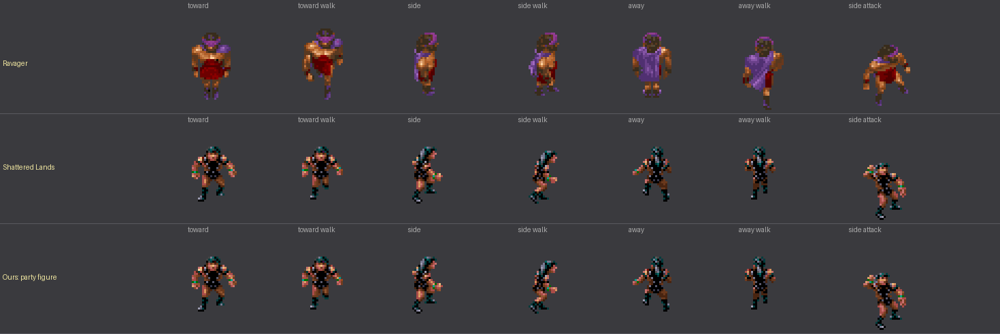

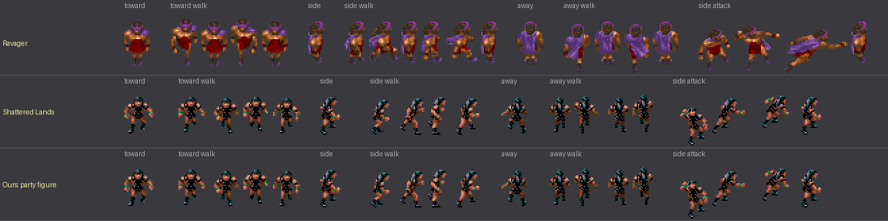

## 269: Tarrasque

**Artwork approved.** Use the blue-steel grey Tarrasque with two ivory brow tusks, a spiky mane and a long whip tail. The preview shows the approved redraw above the original encounter art.

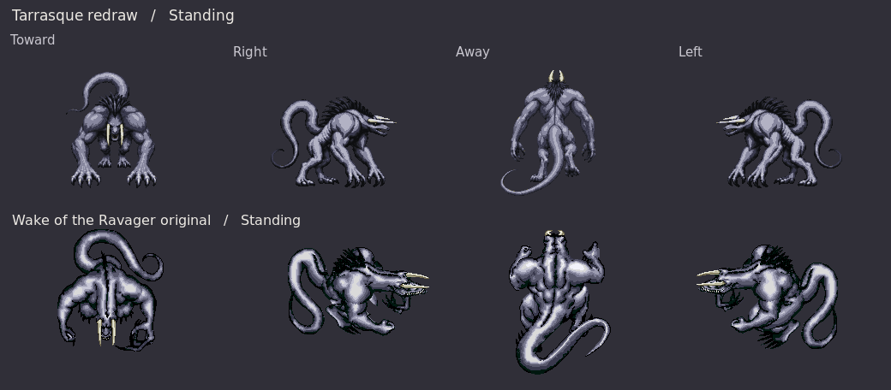

[Approved pose sheet](img/269-approved.png) | [36 transparent sprite frames](approved/269-frames.zip)

**Packaged for the final encounter.** The catalogue importer writes both sets of base, combat and script chunks to `RESOURCE.GFF` (11001 and 11002). The package uses the encounter’s steel-grey and ivory palette and the four approved gait frames for the away walk. Both halves now use the nine stock combat frame numbers. The scripts use 57 paired steps. The side poses use the stock outline bounds relative to the actor origin. Alternate source drawings are available in the transparent frame archive above. [Encounter package](approved/269-tarrasque-encounter.zip) · [Playback decoded from the imported archive](img/269-package-playback.gif)

**Final-battle walk.** The earlier replay held one side pose across four successive squares. Each of the eight walk directions now covers one 16-pixel square per stride. In the new encounter recording, the reaching claw, gathered feet and lifted hind foot cycle six times as the Tarrasque crosses the stone floor. [Watch the walk in game](img/269-encounter-walk.gif)

**Encounter correction after the stock comparison.** Both halves now recover on base frame 9 at step 43 and enter combat frames 3, 3, 4, 4, 5, 5 at steps 44–49. The previous package switched banks while selecting frame 8 twice. The updated profiles follow the shipped foot line and forward reach on each side step. The comparison marks the actor origin in all three columns. [See the earlier attack check](img/269-encounter-replay.gif) · [See the side strike and damage placement](img/269-encounter-impact.png) · [Watch the targeted forward attack](img/269-forward-attack-check.gif) · [Compare stock, previous and corrected attacks](img/269-encounter-correction.gif) · [Encounter checks](in-game-checks.md)

Object 430 uses the single, unscripted OBJEX picture 269 in Limbo. It retains its shipped silhouette. Separate RESOURCE pictures 11012–11014 play in order as one 33-frame cinematic, moving from the full creature to its eye. The campaign playtest triggered the cinematic and matched its frame changes and lightning flashes to the stock control. The combat approval covers 11001 and 11002. [Tarrasque resource inventory](figure-audit.md#tarrasque-and-other-resource-art) [Original catalogue picture](img/269.png) · [Watch the original cinematic beside the approved battle figure](img/269-cinematic-and-battle.gif)

**Seventh cinematic pass approved. The catalogue importer installs all three reviewed banks.** Enclosed transparent pixels at the mane and tail root now use the surrounding shadow colours. The two isolated shoulder pixels in frames 22 and 23 have been removed. [Enlarged before and after](img/269-cinematic-final-detail.png) · [Watch all 33 frames beside the original](img/269-cinematic-redraw-v7.gif) · [Approved RESOURCE chunks](proposed/269-tarrasque-cinematic-v7.zip)

**Sixth cinematic proposal.** The outer sweep tapers to a point in frames 10 and 11, the shading follows the reversing curve in frame 13, and the small spiral stays connected as the head lunges in frame 23. The frames that share frame 15’s tail use the same correction. [Five enlarged corrections](img/269-cinematic-tail-v6.png) · [Full cinematic beside the original](img/269-cinematic-redraw-v6.gif) · [Proposed RESOURCE chunks](proposed/269-tarrasque-cinematic-v6.zip)

**Fifth cinematic proposal.** Each shoulder now forms its own outline and slopes inward to the central mane. Frames 01–14 were checked at an enlarged scale across the tail sweep. [Frame 05 before and after](img/269-cinematic-shoulders-v5.png) · [Watch the shoulder comparison](img/269-cinematic-shoulders-v5.gif) · [Full cinematic beside the original](img/269-cinematic-redraw-v5.gif) · [Proposed RESOURCE chunks](proposed/269-tarrasque-cinematic-v5.zip)

**Fourth cinematic proposal.** The shoulder shading joins the mane and tail root through the opening poses. Frame 02 has a continuous taper and frame 19 has a restrained red eye accent. In 27–30 the white field breaks through the rolling head, and frame 33 preserves the fine speckling around the original reflection and pupil. [Watch beside the original](img/269-cinematic-redraw-v4.gif) · [Enlarged back, tail and eyes](img/269-cinematic-back-eye-v4.png) · [Head dissolve and final eye](img/269-cinematic-dissolve-eye-v4.png) · [All 33 frame pairs](img/269-cinematic-frame-comparison-v4.png) · [Proposed RESOURCE chunks](proposed/269-tarrasque-cinematic-v4.zip)

**Third cinematic proposal.** The head rises from the opening crouch, the eyes stir during the hold, and the burst begins beneath the jaw. The snarling head rolls through the white field before the red-eye close-up. [Watch beside the original](img/269-cinematic-redraw-v3.gif) · [Read the comparison of all 33 drawings](269-cinematic-review.md) · [Numbered original and redraw](img/269-cinematic-frame-comparison-v3.png) · [Proposed RESOURCE chunks](proposed/269-tarrasque-cinematic-v3.zip)

**Second cinematic proposal.** The Tarrasque plants its feet for the overhead tail sweep. Light gathers between its claws and follows the strike. The outstretched arm and shoulder show through the flash as the head turns, and the final two eye drawings carry the same pale reflection. [Watch the revised animation beside the original](img/269-cinematic-redraw-v2.gif) · [Compare all 33 numbered frame pairs](img/269-cinematic-frame-comparison-v2.png) · [Revised RESOURCE chunks](proposed/269-tarrasque-cinematic-v2.zip)

**First cinematic proposal.** The opening uses the approved Tarrasque’s front-facing body and strike. The flash leads into a new three-quarter portrait and a zoom under the near tusk to the red eye. [Watch all 33 frames beside the original](img/269-cinematic-redraw.gif) · [Compare the 33 numbered frame pairs](img/269-cinematic-frame-comparison.png) · [Close-up artwork](proposed/269-cinematic-head.png) · [Proposed RESOURCE chunks](proposed/269-tarrasque-cinematic.zip)

## 448: Human female party figure (object 301)

Ours: the Obsidian Edition's party figure. Shattered Lands row: the Shattered Lands party figure (the mod's) (SL 301).

**Approved.** Use the Shattered Lands human woman for the player-created human woman. Wake of the Ravager party object 301 uses picture 448.

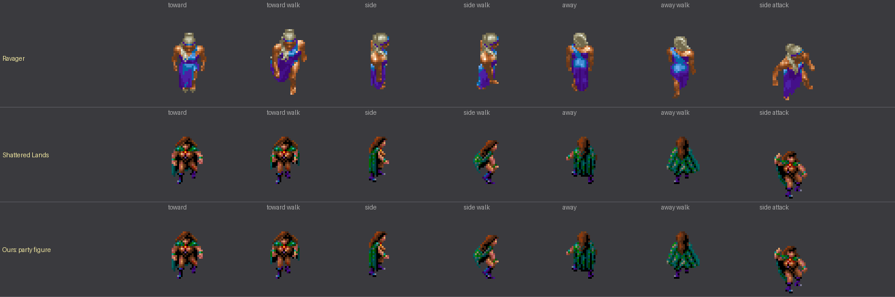

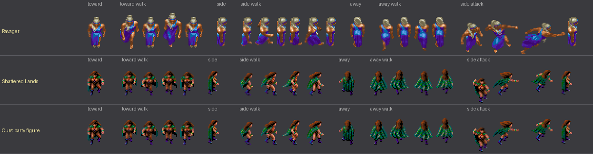

## 592: Dwarf male party figure (object 302)

Ours: the Obsidian Edition's party figure. Shattered Lands row: the Shattered Lands party figure (the mod's) (SL 302).

**Approved.** Use the Shattered Lands dwarf male figure for the player-created dwarf male.

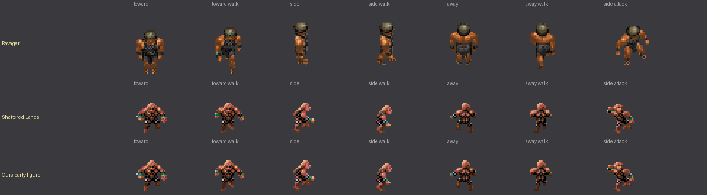

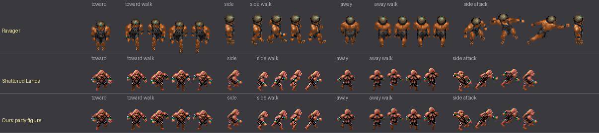

## 593: Dwarf female party figure (object 303)

Ours: the Obsidian Edition's party figure. Shattered Lands row: the Shattered Lands party figure (the mod's) (SL 303).

**Approved.** Use the Shattered Lands dwarf female party figure.

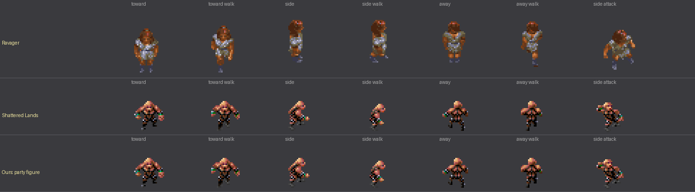

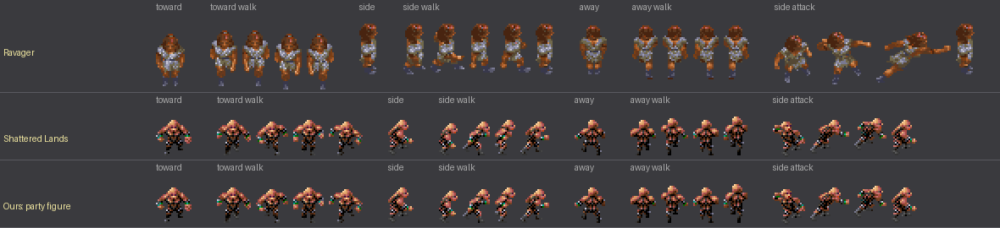

## 594: Halfling male party figure (object 310)

Ours: the Obsidian Edition's party figure. Shattered Lands row: the Shattered Lands party figure (the mod's) (SL 310).

**Approved.** Use the Shattered Lands halfling male party figure.

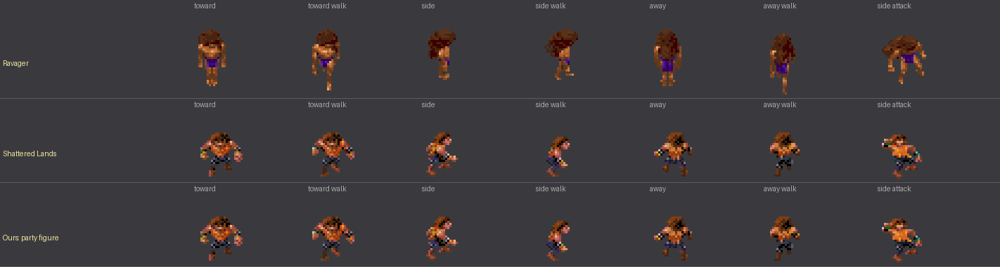

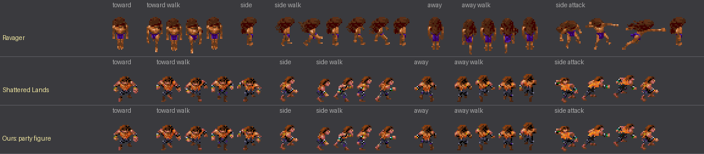

## 595: Halfling female party figure (object 311)

Ours: the Obsidian Edition's party figure. Shattered Lands row: the Shattered Lands party figure (the mod's) (SL 311).

**Approved.** Use the Shattered Lands halfling female party figure.

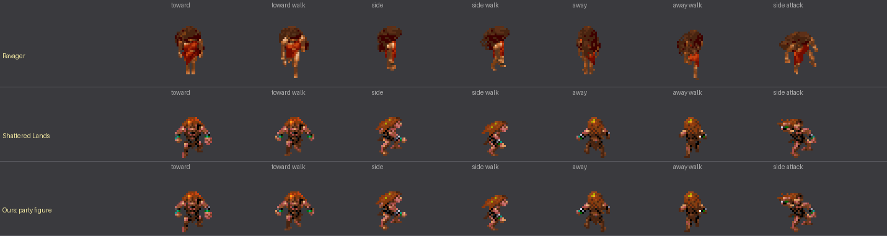

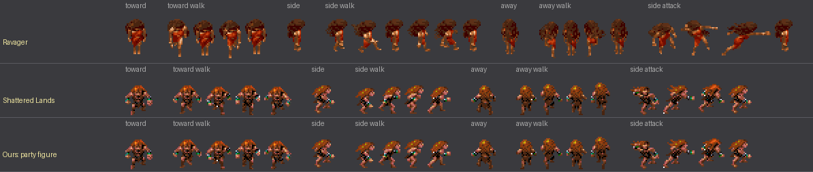

## 596: Mul party figure (object 312)

Ours: the Obsidian Edition's party figure. Shattered Lands row: the Shattered Lands party figure (the mod's) (SL 312).

**Approved.** Use the Shattered Lands mul party figure.

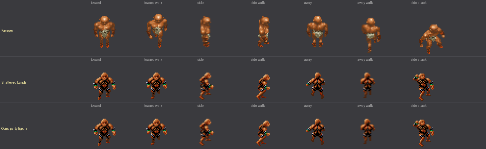

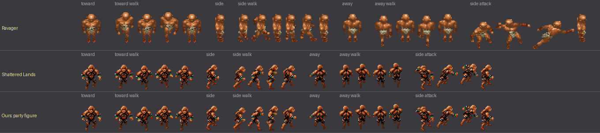

## 598: Half-giant male party figure (object 308)

**Half-giant scale check.** The male half-giant party slot (308) shares its artwork with Gerrakis (32002), who has race code 5. [Giant figure index](giant-figures.md)

Ours: the Obsidian Edition's party figure. Shattered Lands row: the Shattered Lands party figure (the mod's) (SL 308).

Gerrakis also uses this figure. The game records him as Half-giant (race code 5).

**Approved.** Use the Shattered Lands half-giant male party figure.

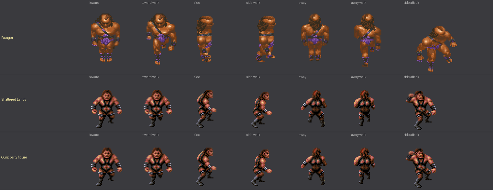

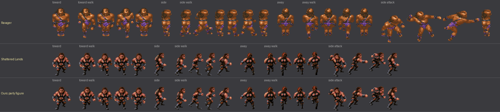

## 599: Elf female party figure (object 305)

The original comparison below shows the retail Elf on both Shattered Lands rows. The audit matched all 18 displayed poses to the retail pixels. The corrected Obsidian artwork is approved and registered. [Before and after](img/elf-ears-audit.png) · [Assignment and archive checks](elf-models.md)

**Approved.** Use the Obsidian Edition’s female Elf with pointed ears.

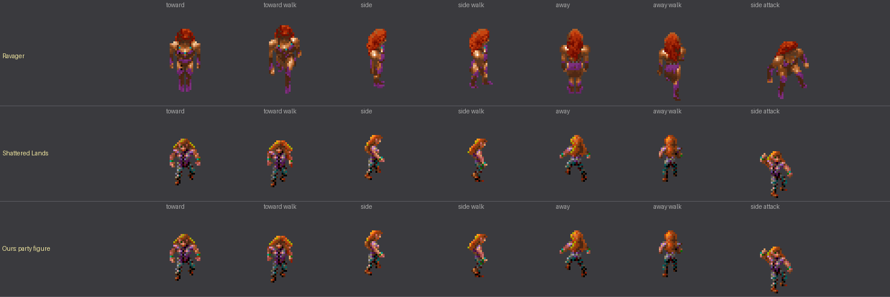

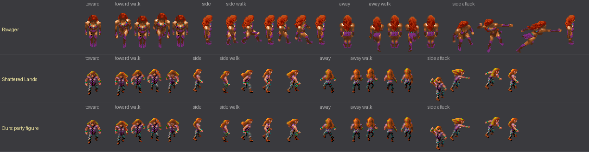

## 649: Cleave on his sickbed

**Approved sickbed and personal walker.** Object 148 is Cleave in his bed in Humbleton. The mobile character is object 83, originally figure 2452, recorded as Halfling (race code 6). The bed object has no race field. Script 31 names Cleave when the party revives him using the Hero Flask. Runner, Firegazer and Axestopper still use mobile picture 2452. [Compare Cleave’s bed and mobile artwork](img/alternate-pose-followups.png) · [Humbleton recovery](../../guide/wake-of-the-ravager-walkthrough.txt#L2940)

**Approved sickbed artwork.** The original bed has one stored pose. Its rails and bedding match the shipped empty bed (pictures 588 and 2574, which are identical). The approved artwork uses the Humbleton furniture pass’s 32 × 24 visible empty bed at its existing ground line. Cleave lies with his head toward the foot, as in Ravager. His 14 × 17 pose comes from the Shattered Lands male Halfling’s prone frame, with the blue-grey hair and dark shorts keyed to his walker. The comparison shows the original, proposal, empty bed, current mobile study and Shattered Lands reference. The lower row reconstructs the room at game size. The approved picture decoded in a test archive with the original object anchor. [Humbleton comparison](img/649-cleave-humbleton.png) · [Approved sickbed resource](proposals/649-cleave-sickbed.zip)

**Approved standing and walking artwork.** Mobile object 83 is a Halfling. The current dressing recipe for shared picture 2452 uses Shattered Lands object 302, the male Dwarf. The earlier sickbed comparison matched the blue-grey head and dark clothing but missed the body mismatch. The approved Cleave-only walker (3970) uses object 310, the same male Halfling whose prone frame supplies the patient. The approved combat bank’s prone drawing matches the sickbed patient pixel for pixel. The comparison shows the current and proposed idles and walks in four facings at the same scale as the bed. Object 83 now uses 3970. Runner, Firegazer and Axestopper keep 2452. [Standing and walking comparison](img/649-cleave-continuity.gif) · [Held poses](img/649-cleave-continuity.png) · [Approved mobile resources](proposals/3970-cleave-halfling.zip)

## 650: small villager, green shirt (halfling-sized)

Ours: dressed. Shattered Lands row: dressed on this Shattered Lands body (SL 310).

**Game race:** Halfling. The Villager, Strongrip and Branch all have race code 6 in the Ravager character data.

**Approved.** Use the Shattered Lands halfling male body with the villager’s green clothing.

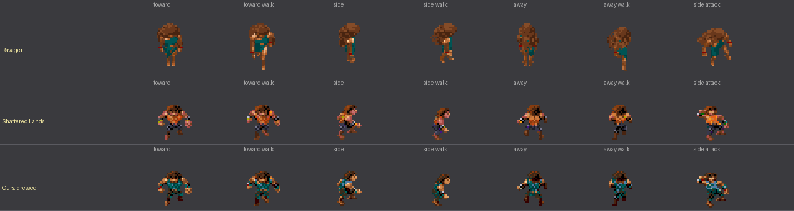

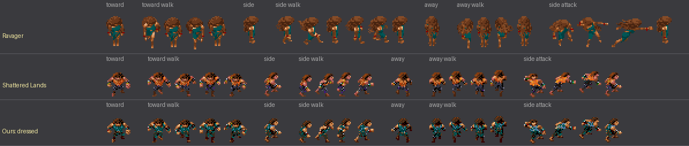

## 651: small villager, red (halfling-sized)

Ours: dressed. Shattered Lands row: dressed on this Shattered Lands body (SL 311).

**Game race:** Halfling. Soothsurg, the Villager, Greshard, Leaftop and the NPC named Halfling all have race code 6.

**Approved.** Use the dressed Shattered Lands halfling body (SL 311) for the red-haired villager. Leaftop alone (object 94) now uses the bald mobile figure 3969 to match his staff pose 747. The four other users retain 651. [Approved facings and actions](img/alternate-pose-approved-motion.gif)

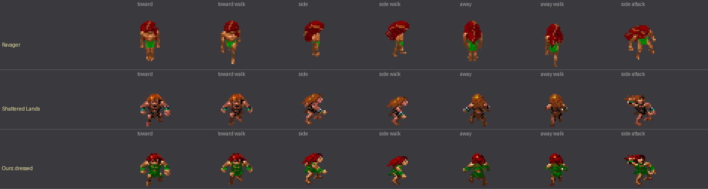

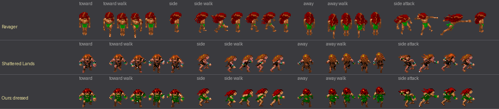

## 691: Elf male party figure (object 304)

The original comparison below shows the retail Elf on both Shattered Lands rows. The audit matched all 18 displayed poses to the retail pixels. The corrected Obsidian artwork is approved and registered. [Before and after](img/elf-ears-audit.png) · [Assignment and archive checks](elf-models.md)

**Artwork approved for the player-created male elf only.** Object 304 is the Elf character-creation slot. The older preview below shows the approved body and pose with the retail head.

**Approved split.** The importer assigns the Obsidian male Elf on picture 3961 to object 304 only. It installs the shipped walking, combat and script chunks on 691 for the ten Human merchants, including when importing over an earlier party-art swap. Live character creation is pending.

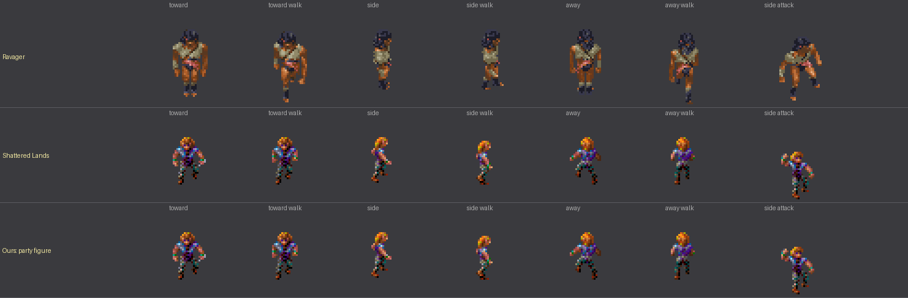

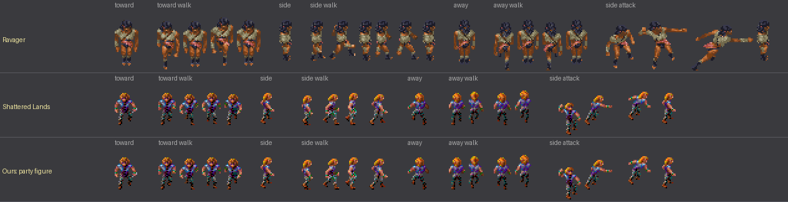

### 691 in the original game · Human merchants

Two armorers, two weaponers and six salespeople also reference 691. The game records all ten as Human (race code 1). Keep their original artwork on 691. Any future merchant redraw gets a separate review.

**Detached Human merchant study.** [Review the separate NPC proposal](merchant-batch.md#shared-merchant-figures). The approved player-only split is documented above.

**Current proposal.** [Review the revision](merchant-batch-contrast.md#tyr-street-comparison).

## 692: Half-giant female party figure (object 309)

**Half-giant scale check.** Object 309 is the female half-giant party slot and the sole user. [Giant figure index](giant-figures.md)

Ours: the Obsidian Edition's party figure. Shattered Lands row: the Shattered Lands party figure (the mod's) (SL 309).

**Game race:** Half-giant. The female half-giant party template (object 309) is the only object record that uses picture 692.

**Approved.** Use the Shattered Lands half-giant female artwork shown below for the player-created female half-giant (object 309).

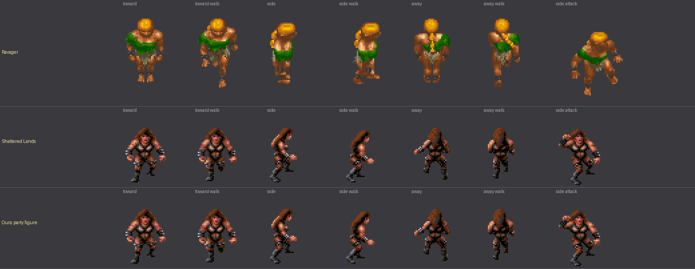

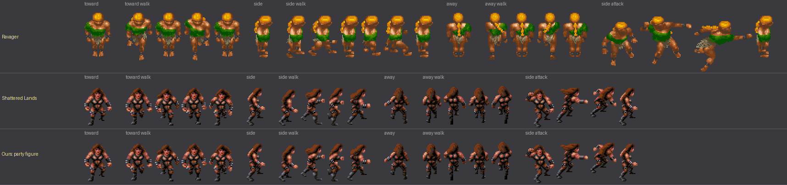

## 693: Magma Golem

**Artwork approved.** Use the volcanic golem with glowing shoulder seams and the revised overhead strike. The raised fist clears the brow at game size. The catalogue importer now installs all 16 approved poses in `OBJEX.GFF`. All 52 shipped animation steps decoded with their original timing and movement. The approved art provides one profile strike. The golem turns into that strike when attacking from the front or back, and returns to its facing afterward. The left-facing strike mirrors the right. The live Volcano Core encounter test is pending. [Game package](approved/693-magma-golem.zip) · [Playback decoded from the imported archive](img/693-package-playback.gif)

**Before · Original catalogue comparison.** The top row shows the Magma Golem as shipped in Wake of the Ravager. The middle row shows the Shattered Lands Red Slaad reference (SL 158). The bottom row shows the earlier restyle.

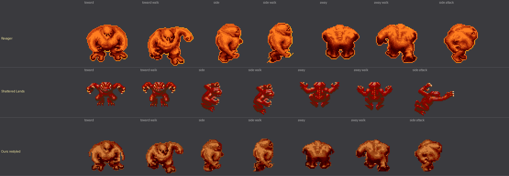

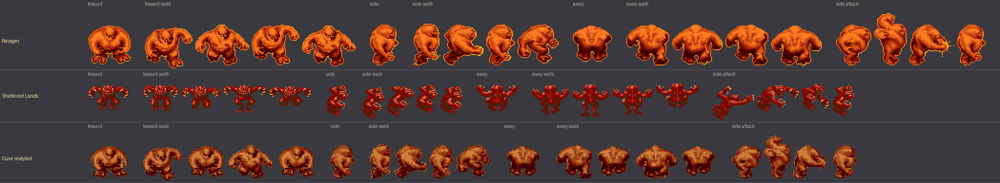

**After · Approved redraw.** The four columns show the toward, side and away walks and the revised overhead strike.

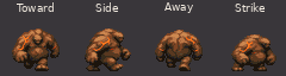

[Download the 16 transparent frames](approved/693-frames.zip) · [Original catalogue comparison](img/693.png)

## 714: innkeeper, teal (behind a counter, no walking)

Earlier proposal: dressed. Shattered Lands row: dressed on this Shattered Lands body (SL 85).

**Game race:** Unspecified. Object 114 is the Innkeeper in Tyr. Its record contains no race field. The original has two stationary frames. Object 114 has no explicit sex field. The earlier proposal used the male Dag Prisoner base. The original innkeeper’s sex is unconfirmed.

**Before and earlier proposal.**

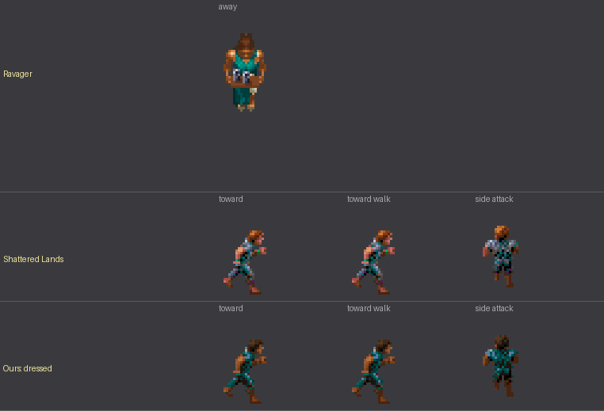

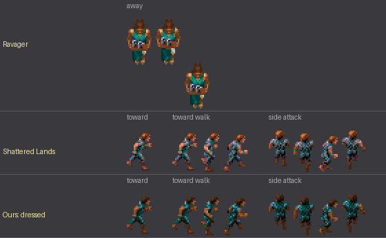

**First human woman redraw.** Depict the innkeeper as a human woman. Shattered Lands party object 301 supplies the base. The teal work dress, cloth and two stationary serving poses follow Ravager figure 714. The preview shows the original, the base and the redraw at equal scale. Both replacement frames were decoded from a test OBJEX.GFF using the original figure assignment and animation script. In-game review is pending.

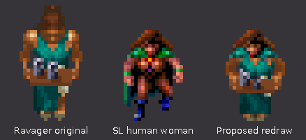

[Two transparent frames and the encoded picture resource](proposals/714-human-woman.zip)

**Artwork approved.** Use the Shattered Lands human woman with the Ravager innkeeper’s hairstyle and two stationary serving poses. In-game verification in Tyr is pending. The dark hair sits close to the temples and rises into the small squared crown visible in the original Ravager frames. The two serving poses use the same hand and tray movement as the first human woman redraw.

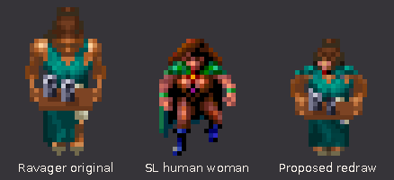

[Revised transparent frames and encoded picture resource](proposals/714-human-woman-hair.zip)

## 715: shopkeeper, dark (no walking)

Ours: dressed. Shattered Lands row: dressed on this Shattered Lands body (SL 118).

**Game race and sex:** Unspecified. Object 115 is named Shopkeeper and appears at two locations in Tyr. Its animation uses two stationary frames with a small arm movement.

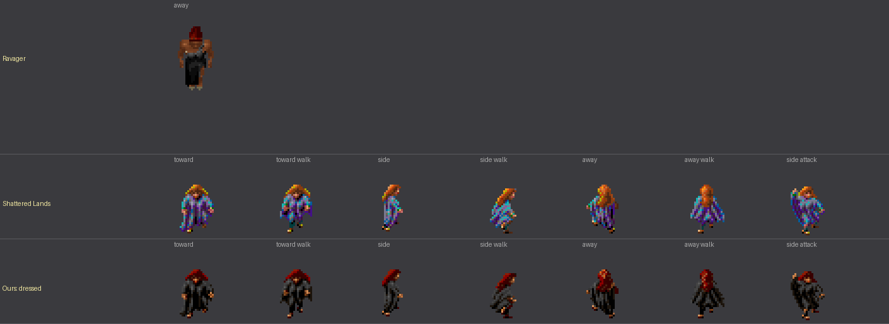

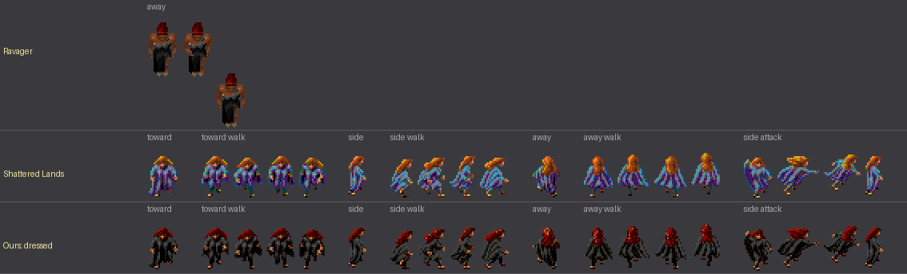

**Previously approved version.** The two-pose shopkeeper redraw below preceded the approved shoulder adjustment. The shopkeeper keeps the close auburn hair, bare shoulders and diagonal black wrap. A forearm moves across the waist in the second pose. The head and feet stay planted in both frames. The comparison shows the Ravager original and the redraw at the same scale.

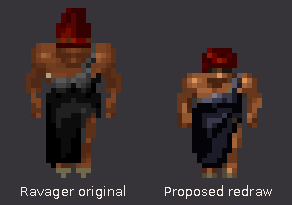

[Two transparent poses and encoded picture resource](proposals/715-shopkeeper.zip)

Both replacement frames decoded correctly in a test copy of the game data with the original animation script and anchors. In-game review in Tyr is pending.

**Artwork approved · final shoulder adjustment.** Use the two-pose redraw with the revised shoulders for figure 715. The outer shoulders slope down from the neck in both poses, following the standing human woman from Shattered Lands (party object 301, picture 2099). The visible figures are each 17 × 26 pixels in the revised redraw and the SL reference. Both revised frames decoded correctly in a test copy of the game data with the original Ravager animation script and anchors.

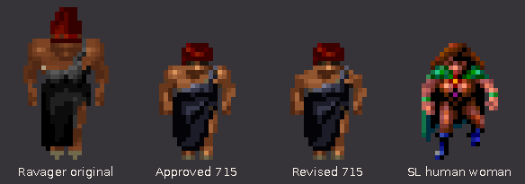

[Revised transparent poses and encoded picture resource](proposals/715-sl-shoulder.zip)

## 716: beggar, seated

Ours: restyled.

**Game race and sex:** Unspecified. Object 144 is named Beggar and is placed in Tyr. The original has a seated idle and a second animation that uses the other six frames. The comparison below shows the idle.

**Shattered Lands references for review.** The front-facing Villager (object 227, picture 632) shows how to separate the hands from an object in the lap. The seated Drummer (object 323, picture 65) gives a second reference for the bent knee and the shading on bare arms.

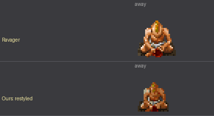

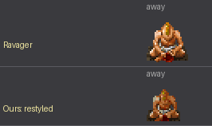

**Artwork approved.** The hands have a short shadow beneath each wrist and a small knuckle highlight. The shoulders catch the light as the beggar raises their head. The comparison plays the original and approved gesture together, with the Shattered Lands Villager and Drummer at the same pixel scale.

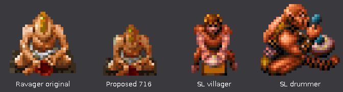

[View at game size](img/716-seated-native.gif) · [Download all seven poses and the encoded picture resource](proposals/716-seated-gesture.zip)

All seven frames decoded pixel-for-pixel after insertion into a test copy of the game archive. The original frame dimensions and animation script are preserved. An in-game check in Tyr is still pending.

## 718: man, teal, holding cloth (no walking)

Ours: dressed. Shattered Lands row: dressed on this Shattered Lands body (SL 85).

**Review · Stitches (object 149, Tyr).** The game record gives no race or sex. The original has one four-frame standing animation. Stitches looks down and moves a hand across a pale cloth at the waist. The Shattered Lands reference is the Dag Prisoner (object 85, picture 1669). The earlier proposal below uses that figure’s walking and attack poses. It supplied the proportions and shading reference for the stationary redraw. The revised stance below is the approved artwork.

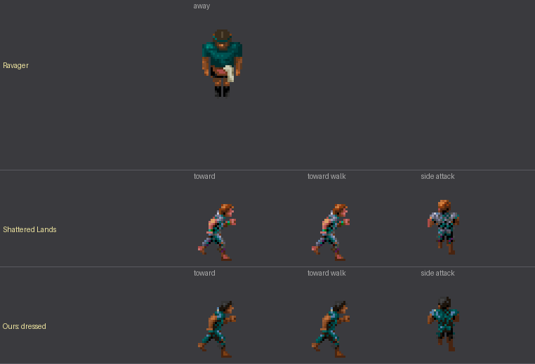

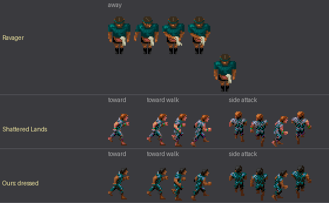

**Earlier four-pose redraw.** Stitches wears a teal tunic and rust-red sash. The head stays bowed as one hand moves outward and then crosses the waist to catch the pale cloth. The redraw and the Shattered Lands Dag Prisoner reference both stand 27 pixels tall. The comparison plays the Ravager original and redraw together at the same pixel scale, with the Dag Prisoner standing alongside.

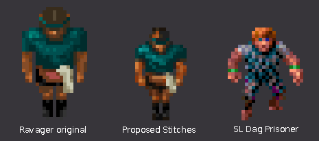

[View at game size](img/718-stitches-native.gif) · [Download four transparent poses and the encoded picture resource](proposals/718-stitches.zip)

All four poses decoded pixel-for-pixel from a test copy of the Ravager archive with the original frame dimensions, anchors and animation script. In-game review in Tyr is pending.

**Artwork approved · revised angle.** In all four poses, Stitches’s viewer-right shoulder sits one pixel farther in and the boot on the same side sits one pixel higher. The comparison shows the original, both redraws and the Shattered Lands Dag Prisoner at equal scale.

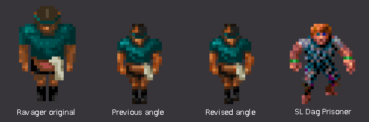

[View at game size](img/718-angle-native.gif) · [Download the four revised poses and encoded picture resource](proposals/718-angle.zip)

All four revised frames passed the archive round-trip test with the original animation script and anchors.

## 719: merchant woman, purple robe (no walking)

Ours: dressed. Shattered Lands row: dressed on this Shattered Lands body (SL 118).

**Review · Merchant (object 158).** This object appears three times in Tyr. The game record specifies neither race nor sex. In the two-frame standing gesture, the feet stay planted while both arms open outward. The purple garment leaves the shoulders and arms bare. Linara (Shattered Lands object 118, picture 154) provides a 26-pixel standing reference. The earlier proposal matches Linara’s height. Its wide sleeves and walking poses prompted the stationary redraw below.

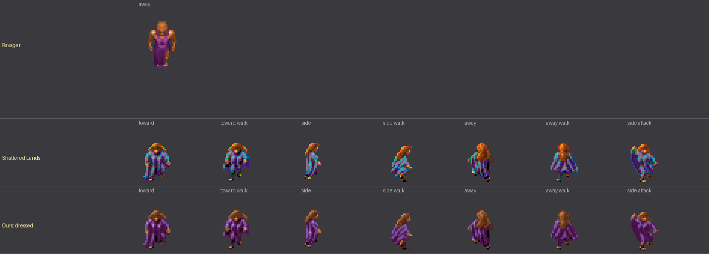

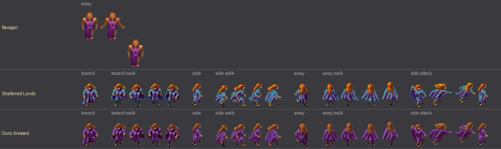

**Artwork approved · two-pose stationary redraw.** The merchant opens both bare arms from a relaxed stance. The fitted purple robe follows the Ravager original. The 26-pixel figure uses Linara and the Shattered Lands party human woman (object 301, picture 2099) as references for the elevated view. The nearer sandal on the viewer’s left sits two pixels lower than the other. The shoulders, head, skirt and feet hold their positions through the gesture.

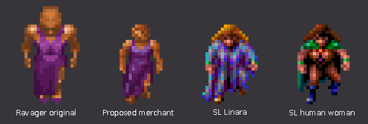

[View at game size](img/719-merchant-native.gif) · [Download both transparent poses and the encoded picture resource](proposals/719-merchant.zip)

Both replacement poses decoded pixel-for-pixel in a test copy of the game archive with their original frame dimensions, animation script and anchors. In-game review in Tyr is pending.

## 720: merchant, black (no walking)

Ours: dressed. Shattered Lands row: dressed on this Shattered Lands body (SL 85).

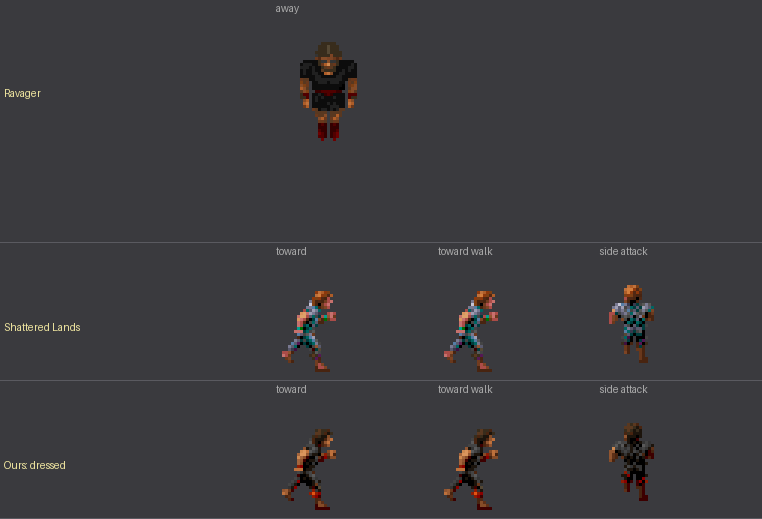

**Artwork approved · stationary batch redraw.** [Original, proposal and Shattered Lands reference](merchant-batch.md#tyr-merchants-and-townspeople).

## 721: woman, pink dress (no walking)

Ours: dressed. Shattered Lands row: dressed on this Shattered Lands body (SL 305).

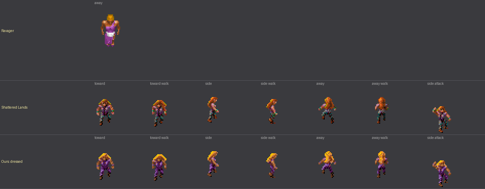

**Artwork approved · corrected reach.** [Original, proposal and Shattered Lands reference](merchant-batch.md#tyr-merchants-and-townspeople).

In the second pose, Tasarla extends her viewer-left arm. The previous pass retained a second hand beside her apron. The corrected pose clears those pixels.

[View at game size](img/721-reach-native.gif) · [Download corrected artwork and viewer](proposals/merchant-batch.zip)

**Current proposal.** [Review the revision](merchant-batch-contrast.md#tyr-street-comparison).

## 722: merchant, black (no walking)

Ours: dressed. Shattered Lands row: dressed on this Shattered Lands body (SL 85).

**Artwork approved · stationary batch redraw.** [Original, proposal and Shattered Lands reference](merchant-batch.md#tyr-merchants-and-townspeople).

## 734: Unassigned front pose, copy A

**Approved by exact pose reuse.** The trimmed shipped still matches picture 2900, base frame 0, pixel for pixel. The installed still uses the corresponding approved drawing, centred at the original foot line. The object table has no direct assignment. Runtime use remains unverified. [Installed comparisons](img/audit-exact-figure-stills.png) · [Approved picture banks](proposals/exact-figure-stills.zip)

## 735: Unassigned front pose, copy B

**Approved by exact pose reuse.** The trimmed shipped still matches picture 2900, base frame 0, pixel for pixel. The installed still uses the corresponding approved drawing, centred at the original foot line. The object table has no direct assignment. Runtime use remains unverified. [Installed comparisons](img/audit-exact-figure-stills.png) · [Approved picture banks](proposals/exact-figure-stills.zip)

## 745: Donno

Ours: restyled.

**Review · fallen Donno.** Object 176 stores one ground pose and has no animation script or race field. Donno’s character record (object 99, figure 2451) identifies him as Halfling (race code 6). The Cavern 2 encounter has Donno pass out after he speaks and recover when the party uses the Flask. [Walkthrough](../../guide/wake-of-the-ravager-walkthrough.txt#L2826)

**Earlier pass.** The batch pose keeps the green clothing and sprawled limbs. Its visible silhouette measures 20 × 21 pixels. The fallen Shattered Lands male halfling measures 14 × 17 and has a clearer separation between the head and torso. Use that ground pose (object 310, combat picture 2069, frame 13) as the scale and angle reference for Donno.

[View at game size](img/745-donno-native.png) · [Original, proposal and Shattered Lands reference](merchant-batch.md#standing-and-seated-figures).

**Artwork approved.** The 16 × 18 fallen pose keeps Donno clear of the basin in Cavern 2. His green shorts and splayed legs remain visible against the reddish floor. [Reconstructed scene](img/donno-cavern-comparison.png) · [Scene at game size](img/donno-cavern-native.png) · [Approved revision](merchant-batch-contrast.md#donno-figure-745).

## 746: Snake

Ravager stores one pose and has no animation script.

**Artwork approved.** The approved coil measures 24 × 17 pixels. Object 2978 uses the same still at four locations in Cavern 2. [Four reconstructed placements](img/746-cavern-detail.png) · [At game size](img/746-cavern-native.png) · [Shattered Lands reference and party scale](img/746-references.png). [Original, proposal and Shattered Lands reference](merchant-batch.md#creatures-and-single-poses).

## 747: Leaftop

Ours: restyled.

**Earlier batch pass.** [Original, proposal and Shattered Lands reference](merchant-batch.md#standing-and-seated-figures).

**Earlier contrast revision.** Leaftop’s combat record identifies him as Halfling (race code 6). His staff-leaning Cavern 2 object leaves race unset. Both revised poses stand 19 pixels tall beside the 21-pixel Shattered Lands male halfling. [Two-pose comparison in the reconstructed cavern](img/747-cavern-detail.gif) · [At game size](img/747-cavern-native.gif) · [Review the revision](merchant-batch-contrast.md#tyr-street-comparison).

**Artwork approved · Shattered Lands halfling redraw.** The previous pass kept too much of the Ravager drawing. This redraw takes the near arm and staggered legs from Shattered Lands male halfling 2068 and gives Leaftop a bald crown, a green sash and a planted staff. His head dips in the second pose. Both frames use the original 15 × 23 canvas and animation anchors.

[Native game size](img/747-leaftop-sl-native.gif) · [Two-frame game resource and PNGs](proposals/747-leaftop-sl.zip)

## 779: Half-elf female party figure (object 307)

**Artwork approved.** Use the Obsidian Edition’s dedicated female half-elf for the created character and Ar’Anda. The mod gives her a golden bun, a slimmer torso, pointed ears, a purple cloak and red boots.

**Game race.** Object 307, the female half-elf character-creation slot, and object 32003, Ar'Anda of the pregenerated party, both record Half-elf (race code 4). These are the only two shipped object records that use figure 779.

[Native-size comparison](img/779-obsidian-native.gif) · [Approved walking, combat and animation resources](proposals/779-obsidian-half-elf.zip) · [Obsidian Edition figure definitions](https://github.com/daaki85/darksun-obsidian-edition/blob/0f5b7ee671a1024a55d30e5a1984af94612a8237/obsidian-edition/dsloader/figures.py#L17)

The stock female half-elf and human woman share walking picture 2099. The Obsidian loader generates walking picture 2464 and combat picture 2465 for half-elf object 307. The test Ravager archive contains all 15 walking and 14 combat frames in its palette. The animation anchors account for the mod’s equipment margins. A live in-game check is pending.

**Earlier comparison · superseded.** Its standing frame matches the stock human woman pixel for pixel. The original catalogue and earlier Tyr sample are retained below. [Earlier Tyr sample](img/779-party-tyr-detail.gif) · [Earlier native-size sample](img/779-party-tyr-native.gif)

## 780: Half-elf male party figure (object 306)

**Artwork approved.** Use the Obsidian Edition’s dedicated male half-elf for the player-created character. His short golden hair, linen shirt, leather jerkin, green trousers and boots are visible in the side and rear views.

**Game race.** Object 306 is the male half-elf character-creation slot. Its template leaves the race field unset (0). It is the only shipped object record pointing to figure 780.

Stock Shattered Lands uses human male picture 2095 for this slot. The Obsidian Edition generates walking picture 2462 and combat picture 2463. All 15 walking frames and 14 combat frames were verified in Ravager’s palette in a test archive. A live in-game check is pending. [Native-size animation](img/780-obsidian-native.gif) · [Approved figure resources](proposals/780-obsidian-half-elf.zip) · [Obsidian Edition male half-elf definition](https://github.com/daaki85/darksun-obsidian-edition/blob/0f5b7ee671a1024a55d30e5a1984af94612a8237/obsidian-edition/dsloader/figures.py#L12)

**Earlier catalogue comparison**

## 787: Pavis

Ours: restyled.

**First batch study.** [Original, proposal and Shattered Lands reference](merchant-batch.md#figures-with-scenery).

**Earlier proposal.** [Review the revision](merchant-batch-contrast.md#prop-and-palette-details).

**Artwork approved.** Use the restored-detail Pavis poses and lowered basin. [Compare both idle poses with the SL figures](scenery-and-miner.md#787-pavis-creature-redraw).

## 788: Tantris

**Artwork approved.** Both original poses retain the hunched shoulders, downward-facing head and tightly banded coil. The lowered basin and viewing angle are approved. Object 562 leaves race unspecified.

**Approved colour match.** Both basin poses now use the violet shadows and highlights of Tantris’s mobile Yuan-ti picture 2845. The basin, script and placement are preserved. [Approved comparison](img/alternate-pose-approved-motion.gif)

Both frames decode at their original dimensions. The preview uses the original 600 and 400 ms timing. The room preview uses the RGN037 map artwork. A live in-game check is pending. [Game-size animation](img/788-tantris-native.gif) · [Room comparison](img/788-tantris-map.gif) · [Approved figure resource and pose PNGs](proposals/788-tantris.zip) · [Earlier batch study](merchant-batch.md#figures-with-scenery)

## 818: Helmine

**Artwork approved.** Use the 35-pixel seated Helmine with the rescued infant. Her silver hair and teal clothing match standing figure 2471. Her baby stays in her cloak throughout the nest gesture. [Both poses at game size](img/helmine-matched-native.gif)

**Giant scale · Helmine and the rescued infant.** Nest pose, object 1. The infant is drawn into the same three frames. Compare with Helmine’s standing figure 2471. [Giant figure index](giant-figures.md)

Ours: restyled.

**Earlier batch proposal.** [Original, proposal and Shattered Lands reference](merchant-batch.md#standing-and-seated-figures).

**Earlier seated redraw · missing the baby.** Helmine sits in the Air Drake nest. The seated object (1) has no race field, and Helmine’s separate character record (9, figure 2471) leaves race unset. The Shattered Lands human woman (picture 2099) supplies the scale and upper-body drawing. The new poses retain Helmine’s white hair, teal clothing, reaching hand and red-tipped staff.

The three poses were decoded at their original dimensions. The preview uses the original nine-step sequence, timing and offsets at the recorded placement in RGN042. [Native-size animation](img/818-helmine-seated-native.gif) · [Proposed three-frame resource](proposals/818-helmine-seated.zip)

**Earlier rescue pose · child restored.** Helmine is cradling a baby giant under her cloak in the Air Drake nest. In the shipped rescue dialogue she says, “I can't get out while holding the baby.” After the rescue she explains that she hid him in her cloak. The cluebook identifies her as the Silt Sea Islands giant tribe’s shaman and says she is small for a giant. The blank race fields do not establish her size relative to the party. Sources are the game’s GPLDATA.GFF, GPL script 3, and the *Wake of the Ravager Cluebook*, pp. 76–77, Helmine and location 8.

The revised proposal gives the infant a visible face and a body held in the cloak across Helmine’s lap. Her supporting arm stays under him while her free hand moves. The exact size of the pair within the nest remains open for visual review. [Reconstructed nest animation beside the SL party woman](img/818-helmine-and-child-detail.gif) · [Native game size](img/818-helmine-and-child-native.gif) · [Three-frame proposal](proposals/818-helmine-and-child.zip)

**35-pixel seated scale approved.** This earlier scale comparison shows the shipped standing figure. The matched standing artwork appears at 2471. The first rescue pose was only 21 pixels tall, compared with 38 in Ravager. This proposal restores the seated pair to 35 pixels in every pose, using the original nest anchor and nine-step animation. The right panel shows the proposed pair beside Helmine’s own 49-pixel standing figure and the SL human woman at the same scale. The cave view is reconstructed. A live rescue-scene check is pending.

[Native game size](img/818-giant-scale-native.gif) · [Three-frame scale proposal](proposals/818-giant-scale.zip)

## 849: Garzak, Psurlon

**Artwork approved as shipped.** Keep Ravager’s existing figure and animations. Object 229 is Garzak and object 441 is the generic Psurlon. Both have race code 12, the general monster code. The front pose and the Shattered Lands psurlon (picture 1907) each measure 40 × 45 pixels. Their hunched silhouette, ringed mouth and long forearms match at party scale.

[Game-size comparison](img/849-psurlon-native.png)

## 914: beast-headed giant, skull head, loincloth

**Artwork approved.** The final bundle includes the standing figure, walk and attacks in all four directions. [Complete approved Ptar resources](approved/914-ptar.zip)

**Standing and walking artwork approved.** Use the 47-pixel standing figure and its toward, side and away walks for Ptar and the two Beasthead Giant records. The comparison includes the shipped figure, the approved crouch (1268) and the Shattered Lands party at the same scale.

[Game-size comparison](img/914-ptar-review-native.gif) · [Approved movement resources](approved/914-standing-and-walk.zip)

**Forward strike approved.** Both forward combat sequences use the three matched poses and recover directly to the approved standing frame. The earlier comparison below shows the shipped side and rear attacks alongside the approved forward strike. The crouching gesture belongs to figure 1268.

[Game-size combat facings](img/914-combat-facings-native.gif) · [Reviewed forward strike beside the original and SL half-giant](img/914-forward-strike-study-detail.gif) · [Native-size forward comparison](img/914-forward-strike-study-native.gif) · [Approved movement and forward combat resources](approved/914-movement-and-forward-strike.zip)

The forward frames and recovery were verified in a test archive. Live game playback is pending. [Earlier recovery-only comparison](img/914-attack-recovery.gif)

**Side strike approved for both facings.** In the shipped attack, Ptar changes to the narrower Ravager torso and finishes on the old stance. The four approved poses use his approved profile skull and the Shattered Lands giant brute’s striking arm. He shifts his weight, draws the fist back, extends through the swing and settles into the approved stance. The rear foot stays planted in both mirrored sequences. The preview shows the original and approved attacks at the same scale as the approved stance and the Shattered Lands male half-giant, on terrain sampled from a beasthead giant’s placement in RGN041.

[Game-size side strikes](img/914-side-attack-review-native.gif) · [Approved movement, forward and side strike resources](approved/914-movement-forward-and-side-strikes.zip)

The four side poses, their mirrored playback and the return frames were verified in a test archive.

**Rear strike approved.** Ptar draws his weight back, raises his fist above the pale skull and turns his shoulders into the blow. The Shattered Lands giant brute supplies the body poses. The raised arm follows the overhead arc of the shipped strike. Both rear sequences return to the approved standing frame. The test archive verified all four new combat pictures and both recoveries.

[Game-size rear strike](img/914-rear-attack-review-native.gif) · [Complete approved resources](approved/914-ptar.zip)

**Giant scale · Ptar and the beasthead giants.** Ptar (139) and two Beasthead Giant records (198 and 451) share this walking figure. Compare Ptar’s crouch at 1268. [Giant figure index](giant-figures.md)

Ours: dressed. Shattered Lands row: dressed on this Shattered Lands body (SL 12).

## 915: Regular Water Elemental

**Regular Water Elemental · artwork approved.** Object 425 keeps figure 915. In the shipped game it shares this figure with object 429, Greater Water Elemental. Both have race code 14. The review build gives object 429 its own Ravager-derived figure, [3955](elemental-tiers.md). Shattered Lands object 174 is Water Elemental and supplies picture 2171 and its combat companion 2172.

[Game-size animation](img/915-water-elemental-native.gif) · [Approved pictures and script](approved/915-water-elemental.zip)

The front pose measures 52 × 38 pixels in Ravager and 36 × 27 in Shattered Lands and the approved swap. The white crest and darker blue-violet underside are visible on terrain sampled at one of two recorded Greater Water Elemental placements in RGN044. The party references are the Shattered Lands human woman and male half-giant.

The approved script uses Ravager’s action slots, timing and movement deltas with the Shattered Lands frames. Several extra slots in the donor script reference combat frames beyond its nine-frame picture bank. A test archive verified all 15 base frames, nine combat frames and each active script reference. Live encounter playback is pending.

**Earlier catalogue comparison**

Ours: swapped. Shattered Lands row: the Shattered Lands figure swapped in (SL 174).

## 917: Sicky

**Approved.** Keep Sicky’s patient artwork and animation at the reviewed scale on the 37 × 39 cot.

**First batch study.** [Original, proposal and Shattered Lands reference](merchant-batch.md#figures-with-scenery).

**Earlier proposal.** [Review the revision](merchant-batch-contrast.md#scenery-and-occupant-scale).

**Approved cot proportions.** [37 × 39 bed and party comparison](scenery-and-miner.md#how-large-the-furniture-should-look).

Object 1338 leaves Sicky’s race unspecified. The other cot patients (objects 379–381) also have unspecified race. No giant or half-giant identification was found for any of the four. [Giant figure catalogue](giant-figures.md). The SL Villager supplies the figure-scale reference. Sicky rests in the first pose. A triggered gesture uses the other two poses and returns to rest, with 175 ms per step. The comparison shows the cot at both recorded placements, RGN033 above and RGN038 below. [Game-size animation](img/917-sicky-game-size.gif) · [Original, current cot and SL figures](img/917-sicky-placements.png).

## 918: Blick's Uncle

**Approved.** Prone Blick in his plum tunic, with the original two-frame mine idle. [Approved comparison](img/918-blick-pass2.png).

**First batch study.** [Original, proposal and Shattered Lands reference](merchant-batch.md#standing-and-seated-figures).

**Earlier contrast pass.** [Review the revision](merchant-batch-contrast.md#tyr-street-comparison).

**Encounter review of the earlier pass.** Object 3147 is named “Blick’s Uncle” and has no race field. In the mine rescue, GPL script 80 references object 3147 and then object 76 immediately after the speaker asks to get up. The speaker introduces himself as Blick. Object 76 is Blick’s standing character, figure 2433, and has race code 1 (Human). The encounter supports using the Shattered Lands human man as the main scale reference for the prone pose. [Mine rescue in the walkthrough](../../guide/wake-of-the-ravager-walkthrough.txt#L3024)

The earlier proposal measures 23 × 21 visible pixels in each idle frame. The fallen SL human man measures 18 × 21. Blick’s outstretched arm and separated boots account for his wider silhouette. The idle uses frames 0 and 1, held for 500 and 750 ms. The third stored frame is absent from that script. The preview uses the recorded RGN038 placement. [Game-size animation](img/918-blick-mine-native.gif)

**Approved second pass.** Blick now wears the plum tunic and dark boots seen on his standing figure. His face has a dark hairline, and the open hand lifts slightly at the end of the extended arm. Both idle frames occupy 23 × 21 visible pixels. The comparison shows the stock mine placement, the previous pass, the revised pose, and the fallen and standing Shattered Lands human references. All three stored poses decoded from a test archive with the original animation script. The mine preview is a reconstruction.

[Game-size idle](img/918-blick-pass2-native.gif) · [Enlarged idle](img/918-blick-pass2-detail.gif) · [Approved artwork and original script](proposals/918-blick-second-pass.zip)

## 1115: Captive on the upright rack

**Approved captive and matching empty rack.** Object 5064 places the captive in RGN03A. The original three-step script holds the raised head for 90 timing units and the bowed head for 150, then returns to the first drawing. The approved animation confines the change to a 10 × 10 area around the head and upper chest. Both wrists, feet, chains and the handle stay fixed. The occupied fixture measures 45 × 41 pixels on the original canvas. Empty rack 1116 uses the same scale and anchor, with its loose lower restraints visible. It belongs to object 5065 in Limbo. The preview shows the room and the Shattered Lands Obsidian Human party figure at matching enlargement. The captive’s identity and race remain open. [Animation](img/audit-captive-rack.gif) · [Both poses and empty rack](img/audit-captive-rack.png) · [Approved picture banks](proposals/1115-captive-and-rack.zip)

## 1117: Mirrored fallen figure in Limbo

**Approved by exact pose reuse.** Object 5066 has two placements in Limbo. The entire visible drawing matches the horizontal mirror of Crypt body 2931. The replacement mirrors its approved artwork on the original canvas. The match establishes the pose. The body’s identity is unrecorded. [Installed comparisons](img/audit-exact-figure-stills.png) · [Approved picture banks](proposals/exact-figure-stills.zip)

## 1142: Stationary Obsidian Golem picture

**Approved by exact pose reuse.** The trimmed shipped still matches picture 2394, base frame 0, pixel for pixel. The installed still uses the corresponding approved drawing, centred at the original foot line. The golem faces forward at two placements in RGN03A and eight in RGN045. [Installed comparisons](img/audit-exact-figure-stills.png) · [Approved picture banks](proposals/exact-figure-stills.zip)

## 1160: Nnamdi

Ours: restyled.

**First batch study.** [Original, proposal and Shattered Lands reference](merchant-batch.md#figures-with-scenery).

**Earlier proposal.** [Review the revision](merchant-batch-contrast.md#scenery-and-occupant-scale).

**Artwork approved.** [Lowered bottle counter and party comparison](scenery-and-miner.md#how-large-the-furniture-should-look).

## 1161: Aleka

Ours: restyled.

**First batch study.** [Original, proposal and Shattered Lands reference](merchant-batch.md#figures-with-scenery).

**Earlier proposal.** [Review the revision](merchant-batch-contrast.md#scenery-and-occupant-scale).

**Artwork approved.** [Lowered writing table and party comparison](scenery-and-miner.md#how-large-the-furniture-should-look).

## 1247: Sultan

Ours: restyled.

**Redraw approved.** The Sultan sits facing the party with his hands on his knees. His white turban, blue shoulders and copper trousers distinguish him against the purple cushions. The Shattered Lands seated drummer supplies the reference for the raised camera angle and the shading at the elbows and knees. Object 106 has no race field. The encounter identifies him as the Sultan of the Jann tribe.

The idle sequence holds the first pose for 0.90 seconds and the slight head turn for 0.45 seconds. The separate empty-cushion state matches the original pixel for pixel. All three frames decoded at their original dimensions in a test copy of OBJEX.GFF with the original script and placement anchor. A live in-game check is pending. [Game-size animation](img/1247-sultan-native.gif) · [Empty seat in the tent](img/1247-sultan-empty.png) · [Approved picture resource](proposals/1247-sultan.zip) · [Earlier batch comparison](merchant-batch.md#figures-with-scenery).

## 1249: Heroga

**Approved storyteller redraw.** Heroga gestures from the muted ochre cushion in all five poses. [Game-size animation](img/1249-heroga-storyteller-game-size.gif).

**First batch study.** [Original, proposal and Shattered Lands reference](merchant-batch.md#standing-and-seated-figures).

**Earlier cushion revision.** [Review the revision](merchant-batch-contrast.md#prop-and-palette-details).

Object 471 leaves race unspecified. Heroga identifies himself in dialogue (GPL 61) as “storyteller of the jann” and calls himself an old jann. The revised face and beard separate from the indigo sleeves, and the pale hand reads against the purple tent in the wide gesture. The muted ochre cushion keeps its footprint and shading from the earlier proposal. In the resting pose Heroga and his cushion measure 27 pixels high beside the 28-pixel Shattered Lands seated drummer.

The idle plays five poses in 2.55 seconds. The two wide gestures use the original five-pixel horizontal anchor adjustment. All five frames decoded in a test archive with the original script. The preview reconstructs the RGN03B placement. [Game-size animation](img/1249-heroga-storyteller-game-size.gif) · [Enlarged animation](img/1249-heroga-storyteller-enlarged.gif) · [Approved artwork and original script](proposals/1249-heroga-storyteller.zip)

## 1268: beast-headed giant, crouched

**Artwork approved.** Ptar’s three-frame cave crouch and reach. [Approved lineup and resources](giant-figures.md#approved-giant-figures)

**Giant scale · Ptar crouching.** Object 445 is Ptar. Keep his head and shoulders consistent with his standing figure 914 when he crouches beside Magnolia. [Giant figure index](giant-figures.md)

Ours: dressed. Shattered Lands row: dressed on this Shattered Lands body (SL 12).

**Batch review pending.** [Original, proposal and Shattered Lands reference](merchant-batch.md#standing-and-seated-figures).

## 1269: Magnolia

**Approved.** Captive Magnolia’s three idle poses and her stake and loose chain after release.

**Earlier batch comparison.** [Original, proposal and Shattered Lands reference](merchant-batch.md#standing-and-seated-figures).

Game dialogue calls Magnolia a young jann (GPL 34), and she introduces herself as the Sultan’s daughter (GPL 40). Captive object 146 has no race field. Her separate mobile character record, object 4 using figure 2460, carries race code 6 (Halfling). The chained figure is 26–27 pixels tall across the three idle poses. Its green clothing and purple skin echo her mobile figure. The links remain visible against the ground, and the fourth stored pose leaves the stake and loose chain in place after her release. [Rescue encounter](../../guide/wake-of-the-ravager-walkthrough.txt#L2533)

The first two panels reconstruct the RGN001 placement. Ptar appears separately for scale. All four frames decoded in a test archive with the original script and anchors. The GIF uses the catalogue viewer’s default hold for the first two idle steps, whose delay bytes are zero. [Game-size idle](img/1269-magnolia-game-size.gif) · [Enlarged idle](img/1269-magnolia-enlarged.gif) · [Stake after release](img/1269-magnolia-released.png)

## 1412: beast-headed giant, horned, loincloth

**Artwork and animation approved.** The forward stance is 51 pixels tall beside approved Ptar at 47. The long violet-grey skull and purple loincloth distinguish the two at game size. All three user records carry race code 12, a general monster code. Their names and encounters identify these characters as beasthead giants.

The combat revision keeps the shipped action silhouettes and held objects, broadens the exposed limbs, and uses the skin and cloth shadows from the walking artwork. The eight action slots cover two sequences in each facing. Each returns to its matching approved stance. All 34 base frames and 19 combat frames decoded in a test archive. The previews use a common viewing pace. The two map comparisons reconstruct recorded placements in Humbleton and the Silt Sea. [Game-size walk](img/1412-movement-game-size.gif) · [Game-size combat](img/1412-combat-game-size.gif) · [Enlarged combat](img/1412-combat-enlarged.gif) · [Map placements](img/1412-placements.png) · [Approved artwork and script](proposals/1412-horned-beasthead.zip)

**Earlier movement study.** The study introduced the longer horned skull and the Shattered Lands giant’s stride. [Giant motion comparison](giant-figures.md#giant-motion-review)

**Giant scale · Horned beasthead giants.** Object 140 is Ptar’s Friend. Objects 199 and 522 are named Beasthead Giant. Use the other beastheads, including 914, to judge their size. [Giant figure index](giant-figures.md)

Ours: dressed. Shattered Lands row: dressed on this Shattered Lands body (SL 12).

## 1475: Asquire

Ours: restyled.

**Earlier batch study.** [Original, proposal and Shattered Lands reference](merchant-batch.md#standing-and-seated-figures).

**Earlier contrast pass.** [Review the revision](merchant-batch-contrast.md#tyr-street-comparison).

**Encounter and first-pass review.** Asquire is the ghost who calls himself Asquir in the Chandelier of Ancestry encounter. Object 225 leaves race unspecified. In GPL 104 he describes existing without a body. His grey colouring suits this role. The darker shoulder and elbow contours separate him from the mottled floor beside the fallen body. In the resting pose he is 28 pixels tall, the same height as the Shattered Lands Castle Guard. The comparison also shows the SL Shadow and human party figures. [Chandelier encounter](../../guide/wake-of-the-ravager-walkthrough.txt#L2045)

All four frames decoded in a test archive with the original script and placement anchors. The preview holds the first and last frames for 250 ms and uses the catalogue viewer’s 175 ms default for the two middle frames with zero game delay. [Game-size animation](img/1475-asquire-game-size.gif) · [Placement comparison](img/1475-asquire-placement.png)

**Earlier second pass.** The new slate-grey brow, cheek and shoulder give Asquire’s head a clear position as it dips. His near forearm lifts and reaches out while his feet stay planted. The resting figure is 28 pixels high beside the Shattered Lands Castle Guard. He keeps the subdued colouring of the chandelier-room apparition. Object 225 leaves his race unspecified.

All four poses decoded at their original canvas sizes in a test archive with the shipped script and placement anchors. The reconstructed preview uses the catalogue’s default hold for the two zero-delay steps. [Game-size animation](img/1475-asquire-second-game-size.gif) · [Gesture comparison](img/1475-asquire-second.png) · [Revised picture and original script](proposals/1475-asquire-second-pass.zip)

**Earlier third pass.** The open helmet shows a brow and cheek in shadow. The near shoulder has overlapping plate edges, a dark seam separates the gauntlet from the chest on the reach, and small highlights mark the belt and greaves. The resting pose is 28 pixels high, level with the SL Castle Guard. The comparison shows the original, the preceding pass and the revised figure at the recorded chandelier-room placement, followed by the Castle Guard, Shadow and a human party member.

All four poses decoded at their shipped canvas sizes in a test archive with the original script and anchors. The feet align across all four frames. The reconstructed preview uses the catalogue’s default hold for the two zero-delay steps. [Game-size animation](img/1475-asquire-detail-restored-game-size.gif) · [Extended hand comparison](img/1475-asquire-detail-restored.png) · [Artwork and original script](proposals/1475-asquire-detail-restored.zip)

**Approved · revised stance.** Asquire’s nearer boot turns toward screen right and shows a rounded toe. His other boot sits farther back. The open helmet and four-pose reach still distinguish him from Ludwig. Both ghosts stand 28 pixels tall at rest. The room panels show how the feet read against the floor beside the fallen body.

All four poses decoded in a test archive with the shipped script and placement anchors. [Game-size animation](img/1475-asquire-stance-game-size.gif) · [Enlarged animation](img/1475-asquire-stance-enlarged.gif) · [Proposed artwork and original script](proposals/1475-asquire-stance.zip)

## 1476: Ludwig

Ours: restyled.

**First batch study.** [Original, proposal and Shattered Lands reference](merchant-batch.md#standing-and-seated-figures).

**Earlier contrast pass.** [Review the revision](merchant-batch-contrast.md#tyr-street-comparison).

**Earlier King Ludwig redraw.** Object 226 leaves race unspecified. In the Chandelier of Ancestry encounter Ludwig is the second ghost. The broad crown and open face distinguish him from Asquire’s helmet at the same 28-pixel standing height as the Shattered Lands Castle Guard. Ludwig moves his face as he speaks and occasionally extends his screen-right gauntlet. [Chandelier encounter](../../guide/wake-of-the-ravager-walkthrough.txt#L2045)

All three poses decoded in a test archive at their original canvas sizes with the shipped script and placement anchors. The preview follows the 12-step order. It uses the catalogue viewer’s pacing for the zero-delay steps. [Game-size animation](img/1476-ludwig-game-size.gif) · [Extended hand in the reconstructed room](img/1476-ludwig-placement.png) · [Proposed artwork and original script](proposals/1476-ludwig.zip)

**Earlier speaking gesture.** Ludwig turns his chin and shifts his shoulder as his elbow bends. His gauntlet opens palm-up at waist height and draws back before he settles. Two intermediate poses carry the movement between rest and extension. His feet stay planted throughout the 28-pixel-high gesture.

All five poses decoded in a test archive. The script keeps its 12 beats, original delay values and placement anchors. Only the frame selections change. The reconstructed preview uses the catalogue viewer’s pacing for the zero-delay beats. [Game-size animation](img/1476-ludwig-speaking-game-size.gif) · [Revised picture and script](proposals/1476-ludwig-speaking.zip)

**Approved · revised boots and stance.** Ludwig plants his nearer boot toward screen left, with a lit toe and a dark sole. His farther boot turns out to screen right and sits two pixels higher in the scene. As he opens his palm, the back knee bends inward by one pixel while both soles stay planted. He stands 28 pixels tall beside the Shattered Lands Castle Guard.

All five poses decoded in a test archive with the speaking gesture and placement anchors preserved. The animation shows the stance on the reconstructed chandelier-room floor. [Game-size animation](img/1476-ludwig-stance-game-size.gif) · [Enlarged animation](img/1476-ludwig-stance-enlarged.gif) · [Proposed picture and script](proposals/1476-ludwig-stance.zip)

## 1477: Fletch

Ours: restyled.

**Earlier batch study.** [Original, proposal and Shattered Lands reference](merchant-batch.md#standing-and-seated-figures).

**Current proposal.** [Review the revision](merchant-batch-contrast.md#tyr-street-comparison).

**Earlier seated proposal.** Object 230 lists Fletch’s race as unspecified. In the two stored poses he raises and lowers a narrow staff while seated. The hand follows the shaft, and the chair legs and forward foot stay planted. At the recorded placement in RGN03C, the purple sleeve and bent knee read against the chair and the wooden structure behind it. The Shattered Lands seated drummer provides a comparison for the angle and seated body size. The upright staff accounts for the extra height above Fletch’s head.

Both poses decoded in a test archive at their original canvas sizes with the shipped script and anchors. The preview uses catalogue pacing for the four zero-delay gesture beats. [Game-size animation](img/1477-fletch-game-size.gif) · [Enlarged animation](img/1477-fletch-enlarged.gif)

**Approved · lowered chair.** The wooden furnishing behind Fletch is a separate map object (picture 703). The project’s furniture pass takes it from 43 × 38 to 43 × 25 pixels. The earlier review showed the shipped furnishing. Fletch’s occupied chair is part of picture 1477 and needs its own adjustment. This proposal brings the chair back from 36 to 24 pixels high, preserves the original chair width and ground contact, and seats Fletch lower. His head now sits just below the standing human party member’s head, with the rod visible above his hand.

The middle and right panels use the project’s patched RGN03C furnishings. A Shattered Lands human party member is staged on the same ground line for scale. Both poses decoded at the shipped dimensions with the original script and placement anchors. The feet and chair base stay planted through the gesture. [Game-size room animation](img/1477-fletch-room-game-size.gif) · [Enlarged room animation](img/1477-fletch-room-enlarged.gif) · [Proposed picture and script](proposals/1477-fletch-chair.zip)

## 1478: Parrot

The shipped picture contains one stored pose and has no animation script.

**Earlier batch study.** [Original, proposal and Shattered Lands reference](merchant-batch.md#creatures-and-single-poses).

**Approved · contrast revision.** The museum parrot gives clues to the statue puzzle. Object 118 uses a single picture for the bird and its stand. The green sheet at its base is a separate puzzle item. The contrast pass changes 25 pixels within the original 16 × 28 silhouette. The orange beak and blue tail remain legible against the purple floor, and the green sheet stays visible at the foot of the stand. The middle panel places a Shattered Lands human party member beside it for scale. The SL wyvern provides a wing-shading reference. [Museum walkthrough](../../guide/wake-of-the-ravager-walkthrough.txt#L2023)

[Game-size comparison](img/1478-parrot-native.png) · [Proposed picture in the contrast batch](proposals/merchant-batch-contrast.zip)

## 1479: Ikibod

Ours: restyled.

**First batch study.** [Original, proposal and Shattered Lands reference](merchant-batch.md#figures-with-scenery).

**Earlier proposal.** [Review the revision](merchant-batch-contrast.md#scenery-and-occupant-scale).

**Shared counter approved.** [Lowered bottle counter and party comparison](scenery-and-miner.md#how-large-the-furniture-should-look).

## 1571: Rear-view Umber Hulk picture

**Approved by exact pose reuse.** The trimmed shipped still matches picture 2555, base frame 1, pixel for pixel. The installed still uses the corresponding approved drawing, centred at the original foot line. The Umber Hulk faces away at both RGN036 placements. [Installed comparisons](img/audit-exact-figure-stills.png) · [Approved picture banks](proposals/exact-figure-stills.zip)

## 1602: Skeleton rising from scattered bones

**Approved six-frame rise.** Object 1343 has seven placements in the Lord Warrior’s Crypt (RGN043). The pile gathers around the blade, lifts into a crouch and reaches its full height before the chest lights. The sixth drawing uses the exact 40-pixel front idle of approved Giant Skeleton 1753 at its standing anchor. The fifth shares its skull, feet and blade. Only the chest changes on the last step. The package preserves the six shipped script records and their original canvas anchors. The preview reconstructs a Crypt placement and holds each drawing for inspection. All six drawings were checked at all seven placements, and all three staged archive imports passed. [Animation beside 1753 and the Shattered Lands Outcast](img/audit-rising-skeleton.gif) · [Six original and proposed frames](img/audit-rising-skeleton-frames.png) · [Approved picture bank](proposals/1602-rising-skeleton.zip)

## 1617: Kovar

Ours: restyled.

**Individual review.** The party finds Kovar chained to the wall. Object 191 uses this picture and has no race field. Kovar’s mobile character record, object 190, uses picture 2420 and gives his race as Human (1). The earlier batch proposal leaves the face and bent arms hard to distinguish against the purple clothing. Use the SL human man for shoulder and head proportions, and the fourth frame with the empty chains to align his wrists with the shackles. [Rescue encounter](../../guide/wake-of-the-ravager-walkthrough.txt#L4195) · [Original and batch proposal in the chamber](img/1617-kovar-review.gif) · [Empty shackles](img/1617-kovar-fourth-state.png)

**Redraw approved.** Kovar wears his original purple cap and tunic. The central pose is 27 pixels tall, the same height as the Shattered Lands human man. His face and wrists catch the light as his weight shifts from one arm to the other.

The two wall plates stay fixed as the chains follow his wrists. The separate empty-shackle frame matches the original pixel for pixel. All four frames passed an archive round trip with the original dimensions, placement anchor and script. A live in-game test is pending. [Game-size animation](img/1617-kovar-redraw-native.gif) · [Empty shackles](img/1617-kovar-redraw-empty.png) · [Approved game resource](proposals/1617-kovar.zip)

**Earlier batch proposal.** [Original, proposal and Shattered Lands reference](merchant-batch.md#figures-with-scenery).

## 1736: Bit o'Tarrasque

The comparison below shows the shipped artwork.

**Approved as shipped.** Object 14 uses a 4 × 4 picture with nine visible pixels. All 36 script steps select its single frame. The pale blue-grey highlight already suits the [approved Tarrasque](#269-tarrasque). The recorded placement is in Limbo (RGN0FF). The middle panel is a scale study staged on Mosaic terrain beside the Shattered Lands human male party figure. The fragment sits to his right. Live encounter visibility remains unverified.

## 1753: skeleton (white bones)

**Giant Skeleton.** Objects 418, 419 and 549 use this undead figure (race code 9). The scale reference is the giant skeleton encounter. [Giant figure index](giant-figures.md)

Ours: redrawn (Codex). Shattered Lands row: nearest Shattered Lands creature, for comparison (SL 39).

**Earlier side-stance proposal.** The earlier redraw walks in profile, then shows the skeleton’s back when it stops facing right. The new idle uses the skull, ribs and shield from the profile walk with a braced stance. Both side facings return to this pose after attacking. The mirrored attack also uses the matching right-facing combat frames’ placement anchors. The front standing pose measures 41 pixels against 27 for the SL human man. The three map panels reconstruct one of the recorded Tyr placements with the project’s furnishings. The lineup shows the proposed giant, the SL Outcast (object 39) and the human party figure on a common ground line.

The preview cycles through standing, walking and side attacks at review speed. The proposed base picture, combat picture and script decoded from a test archive. Each script step retains its timing and movement values. Live play with the revised stance remains unverified. [Game-size animation](img/1753-giant-native.gif) · [Enlarged animation](img/1753-giant-enlarged.gif) · [Proposed resources](proposals/1753-giant-skeleton.zip)

**Approved · matching idle and combat poses.** The previous proposal still switched from the custom walks to the earlier front and rear standing poses and attack artwork. The new standing and attack poses use the skull, glowing ribs, shield and limbs from the directional walks. In all four facings, the last attack beat returns to the same pose and foot placement used at rest. The front stance is 40 pixels tall beside the 27-pixel Shattered Lands human man.

The four-facing preview follows each skeleton from idle through its walk, halt, attack and recovery at a common review pace. It holds the shorter left attack for one extra display beat to synchronize the columns. All 71 steps across the 16 active script slots selected the expected artwork in the test archive. Each step retains its game timing, movement and facing flags. In DOSBox the diners hid the bowls during the meal. Moving the five settings eight pixels toward the foreground exposed them while eating and kept them under the slumped diners. [Matched gameplay views](../../ravager-furniture/mine-dining-live.png) [Game-size loop](img/1753-matched-native.gif) · [Enlarged loop](img/1753-matched-enlarged.gif) · [Revised figure and script](proposals/1753-giant-matched.zip)

## 1754: skeleton warrior, red cloak, sword

Ours: redrawn (Codex). Shattered Lands row: nearest Shattered Lands creature, for comparison (SL 39).

**Approved · matched cloak and sword poses.** Objects 406, 407 and 548 name this figure SkeletonWarrior and identify its race as Undead (9). Its 28-pixel front stance is close to the 27-pixel Shattered Lands human. The red cloak and curved sword distinguish it from the taller, open-ribbed Giant Skeleton in the same encounter. In the earlier pass the sword crossed to the other side of the cloak when the warrior halted facing away. The new standing and attack poses use the skull, cloak and sword from the corresponding walk. All four attacks recover into their facing’s idle pose.

The reconstructed scene uses the region furniture treatment. The proposed panel includes the approved Giant Skeleton at its neighbouring placement. The preview shows all four facings at review speed. All 79 active script steps selected their expected frames in a test archive with their original timing and movement. Live encounter playback is pending. [Game-size loop](img/1754-warrior-native.gif) · [Enlarged loop](img/1754-warrior-enlarged.gif) · [Proposed artwork and script](proposals/1754-warrior.zip)

## 1755: yuan-ti (purple serpent)

Ours: restyled.

**Earlier restyle.** Objects 433 and 467 both name this creature Yuan-ti and record race code 15. The front coil stands 26 pixels high beside the 27-pixel Shattered Lands human man. The Ssurran provides a comparison for the raised camera angle and reptilian head. On the dark floor of the Yuan-ti Tunnels, the copper bands trace the tail as it uncoils. On the pale stone in El’s Temple, the shaded purple edge separates the head and coil from the floor.

The figure has 15 standing and movement frames and nine combat frames. All 52 active script steps resolved to the restyled resources in a test archive with the original timing, movement and facing flags. Each attack ends on its facing’s idle frame and anchor. The four-facing preview plays at review speed in the reconstructed tunnels. Live encounter playback is pending. [Game-size animation](img/1755-yuan-ti-native.gif) · [Enlarged animation](img/1755-yuan-ti-enlarged.gif) · [Reviewed artwork and script](proposals/1755-yuan-ti.zip)

**Earlier raised-angle pass.** The older side pose hides the head below the far arm, and the rear pose presents the back almost straight on. The redraw shows the crown, both shoulder tops and the upper surface of the banded coil. The rear view foreshortens the torso over the coil. The side view separates the snout from the near shoulder. The lineup uses the Shattered Lands Ssurran and human party member at the same pixel scale. Objects 433 and 467 both record Yuan-ti, race code 15.

All 15 standing and movement pictures and nine combat pictures were rebuilt for this angle. The tail opens during the slither, and the blade follows the weapon hand through the strike. The original script keeps its frame order, timing, movement and mirror flags with placement anchors fitted to the new pictures. All 52 active steps decoded and fit the review crop at the recorded tunnel and temple placements. Each attack ended at its matching idle frame and anchor. The loops use review pacing. Live encounter playback is pending. [Game-size tunnel loop](img/1755-angle-native.gif) · [Enlarged loop](img/1755-angle-enlarged.gif) · [Game-size temple loop](img/1755-angle-temple.gif) · [Shipped, previous and revised profile](img/1755-angle-comparison.png) · [Both encounter settings](img/1755-angle-scenes.png) · [Revised artwork and script](proposals/1755-yuan-ti-raised-angle.zip)

**Comparison with Shattered Lands monsters.** The Ssurran (picture 280), Daggoran (2147), Mastyrial (2159) and Rampager (2426) use their own standing and movement frames for each facing. The toward-facing yuan-ti is 29 pixels tall when coiled, alongside the 28-pixel Ssurran and 29-pixel Daggoran. The Daggoran is the closest comparison for how much of the crown and back show on a low, compact creature. The copper stripe down the yuan-ti’s back describes the curve into the coil in the away view, much as the Rampager’s ridge describes its spine. The right profile is the weakest view at native size. The far forearm and snout overlap, leaving less space around the jaw than on the Daggoran or Rampager. I recommend keeping the raised angle.

[Native-size lineup](img/1755-sl-monsters-native.png) · [Four movement beats in each facing at a common review pace](img/1755-sl-monsters-walk.gif)

**Approved · raised angle and lowered weapon arm.** The raised angle keeps the crown and the top of the coil visible. The far hand now holds the blade below the jaw and thrusts forward from there. This leaves the snout readable on both sides throughout the slither and the strike. At game size, the Daggoran offers the closest comparison for the amount of head and back visible. The Ssurran shows how a reptilian head can stand out from a bent arm at this scale.

Eight side-view pictures changed across idle, movement and combat. Both mirrored profiles use those pictures. All 52 active script steps were checked in the test archive with the tunnel and temple palettes. Each strike returns to its idle pose and anchor. Live encounter playback is pending.

[Game-size tunnel animation](img/1755-profile-native.gif) · [Enlarged animation](img/1755-profile-enlarged.gif) · [Game-size temple animation](img/1755-profile-temple.gif) · [Before and after in both rooms](img/1755-profile-rooms.png) · [Revised artwork and script](proposals/1755-yuan-ti-profile.zip)

[Right-facing idle comparison with the Shattered Lands Daggoran, Mastyrial and human at native size and 2×](img/serpents-right-facing-idle.png)

**Approved yuan-ti variants.** Figures 2843, 2844, 2845, 2846, 2847, 2849 and 2895 use the same 15 standing and movement pictures and nine combat poses as 1755 in their original animation. Five have identical silhouettes in every shipped frame. Tantris and Senturnis each differ by one opaque pixel in one frame. All seven now use 1755’s approved raised angle, low weapon arm, strike, recovery and anchors, with colours drawn from each variant’s skin and markings.

The combined package covers eight yuan-ti and three adult snakes. All 584 active script steps decoded from a rebuilt test archive with their original timing, movement and facing flags. Each attack returned to its matching idle pose and anchor. Live encounter playback is pending. [Four-facing yuan-ti animations](img/approved-yuan-ti-facings.gif) · [Reconstructed tunnel and temple placements](img/approved-serpents-placements.png) · [Combined artwork and scripts](proposals/approved-yuan-ti-and-snakes.zip)

## 1756: giant snake (white)

Ours: restyled.

**Approved · current restyle and viewing angle.** The top of the white coil stays visible under the raised head and through the side strike. Objects 400, 446 and 447 use this figure. Their recorded map placements are in Limbo. Live encounter appearance remains unverified.

The adult snake family includes 1757 and 1758. All three use the same movement and attack script. [Approved snake colours](img/approved-snakes-colours.png) · [Four-facing snake animations](img/approved-snakes-facings.gif) · [Combined artwork and scripts](proposals/approved-yuan-ti-and-snakes.zip)

## 1757: snake (orange)

Ours: restyled.

**Approved · Kartang in orange.** Object 550 uses this orange snake in the Yuan-ti Tunnels. Its side idle measures 27 × 20 pixels, the same as the approved white giant snake. Both use the same animation script. On the tunnel floor, Kartang’s yellow bands pick out the top of the coil while the darker red along its underside separates the loops.

All 56 active script steps resolved to artwork in the reconstructed tunnel scene. The preview shows idle, slither, strike and recovery in four facings at review speed. Live encounter playback is pending. [Game-size animation](img/1757-kartang-native.gif) · [Enlarged animation](img/1757-kartang-detail.gif)

[Combined artwork and scripts](proposals/approved-yuan-ti-and-snakes.zip)

## 1758: snake (teal)

**Approved · teal snake.** Objects 5 (Traxiss) and 551 (Kartang) both record Yuan-ti, race code 15. This figure uses the adult snake script. Its restyle preserves its own slither drawings and teal markings with the scale and shading treatment approved for the white and orange snakes. The recorded placements are in the Yuan-ti Tunnels and Limbo.

[Shipped and approved colours at party scale](img/approved-snakes-colours.png) · [Tunnel placement](img/approved-serpents-placements.png) · [Combined artwork and scripts](proposals/approved-yuan-ti-and-snakes.zip)

## 1759: Int. Devourer, Int.Devourer

Shipped artwork and animation

**Approved · Intellect Devourer redraw.** Seven object records use this figure and identify it with the general monster race code 12. Object 444 has four recorded placements in the Yuan-ti Tunnels. The shipped side idle is 12 pixels wide and 15 high. The proposed 20 × 14 profile shows the upper brain folds and separates the forward claws from the hind feet. The Screamer Beetle provides a Shattered Lands reference for a low body seen from above. The Dark Spider shows how much space can remain visible between bent legs. Each row uses the same scripted idle facing across the original, proposal and references.

All 11 stored pictures were redrawn. Movement and combat share the bounding poses. All 44 active script steps resolved to the new pictures with the original timing, displacement and facing flags in a test archive. Each attack recovered to its corresponding idle frame and anchor. The loops show all four cardinal facings at review speed. Live encounter playback is pending. [Game-size comparison](img/1759-idle-native.png) · [Game-size tunnel animation](img/1759-tunnel-native.gif) · [Enlarged animation](img/1759-tunnel-detail.gif) · [Four tunnel placements, before and after](img/1759-tunnels.png) · [Proposed artwork and script](proposals/1759-intellect-devourer.zip)

## 1881: Regular Earth Elemental

Ours: swapped. Shattered Lands row: the Shattered Lands figure swapped in (SL 164).

**Regular Earth Elemental · artwork approved.** Object 424 keeps the approved Shattered Lands figure. In the shipped game object 428, Greater Earth Elemental, shares figure 1881. Both have race code 14. The review build gives object 428 its own Ravager-derived figure, [3954](elemental-tiers.md). Shattered Lands objects 164 and 165 share picture 1131. The proposed swap uses its original silhouettes and combat companion, picture 1132, in Ravager’s palette. The right profile is 26 × 31 pixels beside the 15 × 28 Shattered Lands human. At both recorded Greater Earth Elemental placements in RGN044, the muted stone colour blends into the greenery at the shoulder, while the forearm and feet remain visible against the path.

The reviewed script fits the donor frames to Ravager’s timing and movement. It uses the donor’s side-walk mirror flags so the figure steps in its direction of travel. All 66 active steps decoded in a test archive, and each strike recovered to the idle frame and anchor for that facing. Live encounter playback is pending. [Native-size comparison](img/1881-earth-native.png) · [Game-size animation](img/1881-earth-native.gif) · [Enlarged animation](img/1881-earth-detail.gif) · [Both encounter placements](img/1881-earth-placements.png) · [Proposed artwork and script](proposals/1881-earth-elemental.zip)

## 2022: big woman, orange hair

**Half-giant scale check.** Melody, mine boss (74), is Half-giant in her character record (5) and in the cluebook. [Giant figure index](giant-figures.md)

Ours: dressed. Shattered Lands row: dressed on this Shattered Lands body (SL 309).

**Melody · first pass on the selected half-giant model.** Object 74 is the only character using figure 2022. Her half-giant party reference is Shattered Lands object 309. Both measure 30 × 41 pixels facing toward the viewer. The human woman measures 17 × 26 in the same pose. Melody keeps the half-giant’s stance and stride, with her copper hair, blue-grey wrap and dark boots.

The mine comparison stages Melody beside the approved miner 3613 on RGN039 terrain. Her only static map placement is in Limbo. All 72 active script steps decoded in a test archive with Ravager’s original timing and travel distances. Each strike recovers to the corresponding idle pose and anchor. Live encounter playback is pending. [Game-size lineup](img/2022-melody-native.png) · [Game-size animation](img/2022-melody-native.gif) · [Enlarged animation](img/2022-melody-detail.gif) · [Mine comparison](img/2022-melody-mine.png) · [Reviewed artwork and script](proposals/2022-melody.zip)

**Earlier texture revision.** The copper braid has darker seams between the overlapping strands. A slate-blue fold crosses the wrap, and a narrow cuff and worn toe distinguish the dark leather boots from Melody’s bare legs. The revision follows the selected Shattered Lands half-giant woman through all 15 standing and walking frames and 14 combat pictures. Every frame retains its first-pass silhouette, including the loose hair during her stride.

The revised pictures passed a round-trip check in a test archive. All 72 active animation steps retain the previously reviewed script and anchors. The mine scene stages Melody beside the approved miner for comparison. Live encounter playback is pending. [Game-size lineup](img/2022-texture-native.png) · [Game-size animation](img/2022-texture-native.gif) · [Enlarged animation](img/2022-texture-detail.gif) · [Mine comparison](img/2022-texture-mine.png) · [Revised artwork and script](proposals/2022-melody-texture.zip)

**Approved · Melody with revised shoulder shading.** In profile, a pale diagonal on Melody’s far upper arm ran along the outside of her copper braid. The revision puts that strip in warm brown shadow in the idle pose and carries the shading through the affected movement and combat poses. The comparison shows right-facing idle at native size and 4×.

Seven pictures received local shading edits. All 29 silhouettes and the animation script match the earlier texture revision. All 72 active steps passed the archive check. Live encounter playback is pending. [Game-size animation](img/2022-shoulder-native.gif) · [Enlarged animation](img/2022-shoulder-detail.gif) · [Staged mine comparison](img/2022-shoulder-mine.png) · [Revised artwork and script](proposals/2022-melody-shoulder.zip)

## 2345: sundew (plant blob)

**Artwork approved.** Use the grey-green Giant Sundew with three textured tendrils. [Approved enlarged animation](img/2345-fibres-detail.gif) · [Approved artwork and script](proposals/2345-sundew-fibres.zip)

**Giant Sundew, a carnivorous plant.** The *Wake of the Ravager* manual (printed p. 31, “Sundew, Giant”) describes a three- to four-foot mound of sticky grey-green strands resembling tarred rope or rags. Its small illustration and Ravager’s shipped tendril strike are the visual references for the creature’s identity. The walkthrough places hostile sundews in Humbleton Forest.

Ours: restyled from Ravager’s own Sundew.

**Earlier Sundew restyle.** Object 553 uses this artwork at three recorded placements in RGN001. The turquoise centre stays visible against the green groundcover at all three. The front idle measures 25 × 24 pixels, beside the Shattered Lands human’s 22 × 27. The Tyrian Slime in the lineup is a separate Shattered Lands creature included for ground-level scale and shading. Its script reuses the same idle artwork across these facings. The sundew stays planted and extends its tendrils to attack.

The reviewed package adds the missing end flag to the final one-step sequence in slot 31. All 34 active script steps then resolved in the test archive with the original frame order, timing and movement. Live encounter playback is pending. [Native-size comparison](img/2345-sundew-native.png) · [Game-size attack animation](img/2345-sundew-native.gif) · [Enlarged animation](img/2345-sundew-detail.gif) · [All three placements](img/2345-sundew-settings.png) · [Reviewed artwork and script](proposals/2345-sundew.zip)

**First Giant Sundew redraw.** The idle is a low mound of overlapping grey-green coils. Pale ridges pick out the turns of the strands on the forest floor. Three tendrils uncoil to strike while the mound stays rooted. The comparison shows the right-facing idle and strike, with the Shattered Lands human at the same scale and facing.

The archive test resolved all 34 script steps. In all four directions the tendrils stay connected to the mound and the attack ends on the resting footprint. The forest previews use the three recorded placements. Live encounter playback is pending.

[Game-size attack](img/2345-rope-native.gif) · [Enlarged attack](img/2345-rope-detail.gif) · [Three forest placements](img/2345-rope-forest.png) · [Native-size comparison](img/2345-rope-native.png) · [Redrawn artwork and script](proposals/2345-sundew-redraw.zip)

**Revised Giant Sundew · previous palette.** The coiled strands build up into a compact mound with a dark underside, closer to the silhouette on manual p. 31. Short grey-green highlights pick out the overlapping coils on the forest floor. During the strike the middle tendril leads and one outer tendril lingers on the recoil. The right-facing Shattered Lands party member provides a scale and shading comparison for both poses.

All 34 script steps resolved after packing and decoding the revised art. In all four directions the strands stay attached throughout the strike and the final frame matches the resting footprint. Previews show the three reconstructed Humbleton Forest placements. Live encounter playback is pending.

[Game-size strike in four directions](img/2345-coil-native.gif) · [Enlarged animation](img/2345-coil-detail.gif) · [Three forest placements](img/2345-coil-forest.png) · [Game-size comparison](img/2345-coil-native.png) · [Revised artwork and script](proposals/2345-sundew-revised.zip)

**Forest palette · earlier strike.** In Humbleton Forest the olive shadows on the mound blend into the moss, especially around the lower coils. Deep blue-green shadows and cooler grey ridges give the plant a clearer silhouette. The smaller highlights carry along the tendrils during the strike. Each row shows one recorded placement, with the previous and proposed palettes paired at rest and at full reach.

The packed proposal preserves the silhouette and transparency in all 20 bitmaps and uses the same animation script. All 34 active steps rendered from the test archive. Forest views are reconstructed from the map data. Live encounter playback is pending.

[Enlarged forest comparison](img/2345-forest-palette-detail.png) · [Game-size four-direction animation](img/2345-forest-palette-native.gif) · [Enlarged animation](img/2345-forest-palette-detail.gif) · [Shipped, previous and proposed beside the Shattered Lands party](img/2345-palette-lineup-detail.png) · [Proposed artwork and script](proposals/2345-sundew-forest-palette.zip)

**Approved textured tendrils.** Short, staggered grey highlights follow the twist of each extended strand. Blue-green shading rounds the underside and continues into the tapered tips. The enlarged comparison shows the same rightward strike before and after the texture pass.

The test archive preserves the resting artwork, silhouette of every combat frame, anchors and animation script. All 34 steps rendered. The forest comparison pairs both versions at each of the three Humbleton Forest placements. Live encounter playback is pending.

[Game-size four-direction animation](img/2345-fibres-native.gif) · [Enlarged animation](img/2345-fibres-detail.gif) · [Three forest placements](img/2345-fibres-forest.png) · [Shipped and revised strikes beside the Shattered Lands party](img/2345-fibres-party-detail.png) · [Approved artwork and script](proposals/2345-sundew-fibres.zip)

## 2394: obsidian golem (black)

**Artwork and animation approved.** Use the 44 × 44 front stance and the four-facing walk and strike. [Approved animation](img/2394-motion-detail.gif) · [Approved artwork and script](proposals/2394-obsidian-golem.zip)

Earlier catalogue restyle. Shattered Lands row: nearest Shattered Lands creature, for comparison (SL 35).

**Approved front stance.** Object 540 is named Obsidian Golem and carries race code 12, the general monster category. The 44 × 44 pixel stance keeps the low head, green eyes and heavy forearms. Narrow highlights on the shoulders and knees describe the facets of the black stone. All four figures below face toward the viewer at the same pixel scale. The movement review below includes all four facings and a staged dark-floor comparison.

**Approved walk and strike.** The front idle uses the 44 × 44 stance above. Each four-step walk alternates the supporting foot. During the profile strike the golem draws a closed fist behind its head, leans into the swing and returns to its idle anchor. The manual describes a twelve-foot statue with fists that cannot open (printed p. 29).

[Game-size animation](img/2394-motion-native.gif) · [Walk and strike over dark mine terrain](img/2394-motion-mine.gif) · [Matched movement beside the Shattered Lands party](img/2394-motion-lineup.png) · [Approved game artwork and animation script](proposals/2394-obsidian-golem.zip)

The lineup shows the toward stride, away stride and rightward strike beside the shipped golem, the Shattered Lands half-giant and the human party figure. The mine preview stages the golem on RGN039 terrain using the travel distances from its game script. The walkthrough describes an actual fight at the Bloodletter coffer in the Sorrows. Live encounter playback is pending. All 52 active script steps resolved from the test archive, and the four attack sequences returned to their respective idle artwork and anchors. [Bloodletter encounter](../../guide/wake-of-the-ravager-walkthrough.txt#L2285)

## 2395: Dust devil

**Artwork and animation approved as shipped.** Keep Ravager’s Dust Devil for the summon.

Ravager object 569 and Shattered Lands object 239 are both named Dust Devil. The four spinning movement frames and three attack poses match the dimensions and composition of the Shattered Lands artwork. Ravager also uses the first Shattered Lands combat pose as its idle. The two games differ slightly in colour and scattered edge pixels. All four cardinal facings in Ravager use the same spinning artwork.

The comparison synchronizes matching poses for inspection. The ground preview stages Ravager’s summoned whirlwind on Tyr terrain. [Game-size comparison](img/2395-match-native.gif) · [Tyr terrain preview](img/2395-ground.gif) · [Dust Devil spell](../../guide/wake-of-the-ravager-walkthrough.txt#L872)

## 2403: snappersaw (spiky plant)

**Artwork and animation approved.** Use the 52 × 43 pixel Snappersaw with pale berries and five purple saw-stalks. [Approved animation](img/2403-snappersaw-detail.gif) · [Approved artwork and script](proposals/2403-snappersaw.zip)

Earlier catalogue restyle.

**Approved Snappersaw redraw.** Ravager object 554 is a rooted, carnivorous plant. The manual calls it foresters’ bane and describes pale berries, ribbed leaves and concealed purple saw-stalks. The approved 52 × 43 pixel plant shows the berries at rest. Five toothed stalks rise from the crown and fold back in during Ravager’s ten-step attack. The game uses the same attack in all four directions.

The forest comparison shows the idle and full extension at all seven recorded RGN001 placements. All six packed bitmaps decoded pixel for pixel, and all 52 active script steps resolved from the test archive. Live encounter playback is pending. [Game-size animation](img/2403-snappersaw-native.gif) · [Seven forest placements](img/2403-snappersaw-sites.png) · [Approved artwork and script](proposals/2403-snappersaw.zip) · [Humbleton Forest encounter](../../guide/wake-of-the-ravager-walkthrough.txt#L2525)

## 2405: greater air elemental (white cloud)

**Artwork approved.** Greater Air keeps figure 2405. The approval covers all four facings, travel and the whirlwind attack. Live encounter playback is pending. [Approved animation](img/2405-elemental-motion.gif)

Regular Air uses the Shattered Lands figure at 2538. [Elemental comparison and game-size animation](elemental-tiers.md)

**Earlier restyle**

**Earlier front-pose study.** Ravager object 426, “Grt Air Elem,” has race code 14. The manual describes a large column of air that can become a whirlwind. The front study retains the broad hovering head and low, scowling brow of the shipped figure. Cool grey folds across the crown give the cloud depth. The Shattered Lands Air Elemental (object 177) and human party member are shown facing the viewer at the same scale.

The proposed pose measures 48 × 39 pixels beside the shipped front pose at 52 × 42. The scene study places it at the twelve RGN042 and two RGN044 encounter positions. The lower edge shows through on the ochre ground, while foreground masonry partly obscures the figure at one RGN044 position. [Game-size comparison](img/2405-cloud-native.png) · [Encounter placements](img/2405-cloud-settings.png) · [Encounter with both kinds of Air Elemental](../../guide/wake-of-the-ravager-walkthrough.txt#L3550)

## 2408: Caravan Master, Miner and Guard (purple sash)

**Game race.** The Caravan Master (object 52), Miner (117) and Guard (253) all use this figure. Each is Human, race code 1.

**Artwork approved.** The approval covers the revised purple sash, skin shading, and all four facings through standing, walking, striking and recoiling. The revised sash gathers over the left shoulder and opens into two folds across the back. Highlights on the cheek and forearms separate the skin from the dark hair and cloth at game size. The comparison shows all four facings on terrain from the Caravan Master’s placement, alongside the original and the Shattered Lands human party member. The still also includes the previous sash study.

[Game-size animation](img/2408-texture-native.gif) · [Enlarged animation](img/2408-texture-detail.gif) · [Four-facing still](img/2408-texture-detail.png) · [Game-size still](img/2408-texture-native.png) · [Approved figure chunks](proposals/2408-texture-motion.zip)

The animation runs through standing, walking, striking and recoiling. The party reference holds its standing pose during recoil. All 72 distinct active script steps were checked against the shipped timing and movement data in a rebuilt archive. The review uses decoded game art and terrain. A live encounter test is still pending.

**Earlier shoulder-cloth study.** The Shattered Lands human body supplies the scale, bent knees and side stance. The new idle poses restore the purple shoulder cloth and the longer drape down his back. The comparison uses terrain sampled at the Caravan Master’s RGN032 placement. The walk and attack below show the earlier catalogue version. [Game-size study](img/2408-sash-native.png) · [Enlarged comparison beside the Shattered Lands human party member](img/2408-sash-detail.png)

Ours: dressed. Shattered Lands row: dressed on this Shattered Lands body (SL 11).

## 2409: Notaku, elven merchant in Tyr

**Game race.** Notaku (object 58) is an Elf, race code 3. He is the only shipped character record using figure 2409.

**Approved figure.** The importer installs Shattered Lands Notaku directly. The donor script ends with an extra action referencing combat frame 13 in a 12-frame bank. Ravager Notaku has that slot empty. The packaged script keeps the slot empty and all 69 valid donor steps. [Approved actor resources](approved/catalogue-base-figures.zip)

**Combat transparency corrected after import.** All 12 combat drawings now use the silhouette of Shattered Lands picture 385. Its colour-zero background had become an opaque grey-blue rectangle. The corrected bank restores all 3,152 background pixels, including two inside the fourth drawing, and preserves every foreground colour. [Compare all 12 frames before and after](img/2409-combat-mask.png)

**Approved Tyr stall.** The counter uses 66% of its original height. Both counter halves follow the project’s furniture scale. Their visible heights are 42 and 40 pixels. The repaired tent, floor and original Shattered Lands Notaku are included in the shop previews. The scenery package was checked in a rebuilt archive. Live shop playback is pending. [66% shop at game size](img/2409-notaku-stall-66-native.png) · [Enlarged shop](img/2409-notaku-stall-66-detail.png) · [Four facings](img/2409-notaku-stall-66-facings.png) · [Approved 66% scenery package](proposals/2409-notaku-stall-66.zip)

**Comparison with both games.** Each row places the same counter and party member beside reduced Tyr furnishings and then beside native Shattered Lands furnishings in their original palette. The Tyr table, pottery display, bed and shelf are pictures 519, 2365, 547 and 2819. The Shattered Lands table, jar, bed and shelf are pictures 539, 216, 156 and 657. Every asset uses the same pixel scale and baseline. The rows show 66%, the exact midpoint of 75.5%, and 85%. These expose 23, 20 and 16 of Notaku’s 26 front-facing rows respectively. Counter measurements include the merchandise and the depth of the curved display. [Side by side with both games’ furnishings](img/2409-furnishings-both-games.png) · [Three heights in the repaired shop](img/2409-stall-midpoint.png)

**Earlier 85% stall study.** Keep Notaku’s original Shattered Lands figure at its native size. The earlier furniture pass left both curved counter halves at their shipped height and shortened several adjoining pieces of the purple tent. The revised scene reconnects the tent and floor and reduces the counter artwork to 85% of its original height. Both halves share a baseline, preserving the counter width and the alignment of the cloth, mortar and glassware.

The shipped counter leaves 22 of the original merchant’s 37 standing rows visible from the front. With the Shattered Lands figure, the earlier setting shows 12 of 26 rows. The revised counter shows 16 of 26, close to the original proportion. All four standing facings show 16 rows. The comparison renders the RGN032 placement in map order with each figure’s animation anchor. A Shattered Lands human party member stands on the customer’s side for scale. The scenery chunks were checked in a rebuilt archive. Live shop playback is pending.

[Game-size whole stall](img/2409-notaku-stall-native.png) · [Enlarged whole stall](img/2409-notaku-stall-detail.png) · [Four facings in the revised stall](img/2409-notaku-stall-facings.png) · [Earlier 85% scenery chunks](proposals/2409-notaku-stall.zip)

**Comparison with Tyr’s furniture pass.** The pass kept 66% of the vertical artwork. Across the 60 altered Tyr pictures, the median reduction in visible height was 33%. A table with a dish (519) went from 31 to 21 pixels, the pottery display (2365) from 41 to 27, and Fletch’s wooden furnishing (703) from 38 to 25. Both counter halves originally exceeded the pass’s height cutoff and were skipped. At the earlier 85% scale, their visible heights go from 64 to 54 and 60 to 51 pixels. Applying the furniture rule would bring them to 42 and 40 pixels and expose 23 of Notaku’s 26 standing rows. The 85% scale exposes 16, closest to the shipped scene’s 22 of 37. [Same stall and figures at all three counter heights](img/2409-counter-height-comparison.png)

**Furnishings at the same scale.** The lineup places Notaku and a Shattered Lands human beside six Tyr furnishings on a common baseline. The top row shows the shipped furnishings. The middle and bottom rows use the project’s lowered furnishings with the 85% and 66% counters respectively. Pixel labels give the visible artwork height, including goods on display. The two counter values refer to its left and right halves. [Counter, party member and six furnishings side by side](img/2409-counter-furnishings.png)

**Earlier counter comparison.** The catalogue uses Shattered Lands object 102 (Larissa). Notaku’s own Shattered Lands record, object 264, points to the same walking picture (384), combat picture (385) and animation script (2). The proposed figure therefore restores his original Shattered Lands appearance. His head and shoulders remain visible above the curved counter at his Tyr shop. The comparison uses his RGN032 placement and the project’s lowered furniture, with the idle figures aligned at the feet. [Game-size shop comparison](img/2409-notaku-shop-native.png) · [Enlarged shop comparison](img/2409-notaku-shop-detail.png) · [Walking and attack animation](img/2409.gif)

## 2410: Fayina, the woman who owes Acar

**Game race.** Fayina (object 59) is Human, race code 1. She is the only shipped character record using figure 2410. The party meets her in a room at the Roost in Tyr, where she asks for help settling her debt to Acar. [Quest walkthrough](../../guide/wake-of-the-ravager-walkthrough.txt#L1839)

**Approved artwork.** Fayina’s front hairline, brow and chin now sit over the centre of her scoop neckline. In the rear view the crown sits over the nape, with the plait descending between her shoulders to the turquoise tie. The correction follows all eight front and rear walking pictures and both corresponding hit reactions.

[Front and back before and after, with the Ravager original and SL visitor](img/2410-fayina-level-heads.png) · [Four standing views](img/2410-fayina-level-standing.png) · [Game-size Roost animation](img/2410-fayina-level-native.gif) · [Enlarged animation](img/2410-fayina-level-detail.gif) · [Approved figure chunks](proposals/2410-fayina-level-motion.zip)

The two standing pictures, eight walking pictures and two reactions changed. Archive checks confirmed the same animation script, frame dimensions and movement timing. All 34 pictures have connected silhouettes and retain the previous enclosed transparency. Live encounter playback is pending.

**Earlier stride outline and shading revision.** The pictured long stride had two background-coloured cuts where the hair joins the head and below the bent forearm at the waist. Both opened at the silhouette. The revised long strides connect the swept hair to the crown, carry the arm across the light blouse and give the green wrap a continuous upper edge. The cheek shadow, scoop neckline, turquoise braid tie, knees and sandal heels have also been refined across the figure.

[Reported stride before and after, facing both ways](img/2410-fayina-contour-stride.png) · [Matched detail and game-size Roost comparison](img/2410-fayina-contour-comparison.png) · [Four standing views](img/2410-fayina-contour-standing.png) · [Game-size animation](img/2410-fayina-contour-native.gif) · [Enlarged animation](img/2410-fayina-contour-detail.gif) · [Proposed figure chunks](proposals/2410-fayina-contour-motion.zip)

All 34 stored pictures were checked on contrasting ground and decoded from a rebuilt archive. Each has one connected silhouette. The only enclosed transparent areas are the original spaces between the front resting arms and blouse and their hit-reaction counterparts. Five formerly transparent pixels in the reported hair and waist cuts were checked explicitly. The left-facing stride mirrors the corrected right-facing picture. All 72 active steps retain their timing and movement distances. Live encounter playback is pending.

**Earlier standing and walking revision.** Fayina settles onto one leg with one hand at her sash and the other hanging loose. The cheek highlight sits beneath the dark hairline. In the previous civilian proposal the third and sixth pictures in each sideways stride reused her standing pose. Both profile walks now use six distinct walking pictures, with a dedicated passing pose on each of those beats.

[Detail comparison at 5× and on the Roost floor at game size](img/2410-fayina-settle-detail-comparison.png) · [Walk across the Roost and stop, previous and revised](img/2410-fayina-settle-stop.gif) · [Four standing views with the originals](img/2410-fayina-settle-standing.png) · [Game-size animation](img/2410-fayina-settle-native.gif) · [Enlarged animation](img/2410-fayina-settle-detail.gif) · [Proposed figure chunks](proposals/2410-fayina-settle-motion.zip)

The moving comparison places both versions on the same route in the reconstructed Roost and advances each using the shipped movement offsets. All 72 active animation steps retained their original timing and displacement. The 34 stored pictures have connected silhouettes. The front standing pose and its hit reaction have open spaces between the forearms and the blouse. Live encounter playback is pending.

**Earlier face, clothing and stance revision.** Fayina keeps the unarmed *Shattered Lands* civilian’s proportions and stride. The new standing poses give her a visible cheek and chin, a scooped linen neckline, a plait tied at the back, and a diagonal overlap in the green wrap. One sandal sits slightly ahead of the other. The face, cloth folds and sandal shading carry through the moving poses.

[Four standing views](img/2410-fayina-linen-standing.png) · [Game-size Roost animation](img/2410-fayina-linen-native.gif) · [Enlarged Roost animation](img/2410-fayina-linen-detail.gif) · [Proposed figure chunks](proposals/2410-fayina-linen-motion.zip)

The room comparison shows the shipped figure, previous civilian proposal, revision and two original *Shattered Lands* references in matching directions. The references share Fayina’s standing floor position. All 72 active animation steps were checked in a rebuilt archive. All 32 stored pictures have a connected silhouette. The only enclosed transparency is the space between the arm and waist in the front standing pose and its hit reaction. The previews use the reconstructed room. Live encounter playback is pending.

**Earlier civilian proposal.** The unarmed human NPC artwork shared by Chaya and Katura in *Shattered Lands* (picture 987) supplies the walk and limb proportions. Fayina keeps her dark hair, light scoop-neck blouse and short green wrap. Her standing pose places one sandal slightly ahead of the other, with a relaxed near arm and a small bend at the knee in profile.

[Standing comparison in all four directions](img/2410-fayina-visitor-standing.png) · [Game-size animation at the Roost](img/2410-fayina-visitor-native.gif) · [Enlarged animation](img/2410-fayina-visitor-detail.gif) · [Proposed figure chunks](proposals/2410-fayina-visitor-motion.zip)

The comparison shows the Ravager original, previous proposal, new proposal, unarmed *Shattered Lands* NPC and *Shattered Lands* human party woman in matching directions. The previews use the reconstructed room at the Roost. All 72 active animation steps were checked against a rebuilt archive, including the return to the standing position after strikes and hit reactions. Live encounter playback is pending.

**Earlier standing pose and shoulder repair.** Fayina rests with her arms close to her sides and both sandals planted, with one foot slightly forward. The front and rear standing poses and the side profile have been redrawn. The forward walking poses also restore the shoulder contours and give the knees and sandals a continuous outline. The lighter skin and dark plait carry through the revision.

[Standing poses beside the previous pass and the SL human woman](img/2410-fayina-solid-standing.png) · [Game-size animation](img/2410-fayina-solid-native.gif) · [Enlarged animation](img/2410-fayina-solid-detail.gif) · [Walking comparison](img/2410-fayina-solid-walk.png) · [Proposed figure chunks](proposals/2410-fayina-solid.zip)

All 29 frames were decoded from a rebuilt archive and checked for enclosed transparent pixels. Only the deliberate spaces around the arms in one combat pose and its duplicate remain. In all four directions the strike and recoil return to the revised standing picture at its original anchor. The animation previews use the patterned inn floor and plain ground. Live encounter playback is pending.

**Earlier lighter-skin and movement pass.** Fayina’s face, forearms and shins use warmer, lighter highlights against the patterned inn floor. The revised rear walk gives her connected arms and lower legs throughout the stride. The redraw also closes gaps at the neckline and removes stray pixels left by the donor’s cloak. The comparison plays the previous pass and the revision on the same floor, then shows the revised silhouette on plain ground and the Shattered Lands human woman in the matching facing.

[Enlarged animation](img/2410-fayina-light-detail.gif) · [Game-size animation](img/2410-fayina-light-native.gif) · [Walking comparison](img/2410-fayina-light-detail.png) · [Revised figure chunks](proposals/2410-fayina-light-repair.zip)

All 29 picture frames decoded from the rebuilt test archive have a connected silhouette. The animation script and frame dimensions match the earlier human-based pass. The GIFs preserve the scene and sprite colours exactly. Live encounter playback is pending.

**Earlier human-based redraw.** The proposal uses the Shattered Lands human woman’s stance and animation (party object 301, walking picture 2099). Fayina wears an ivory wrap top, a short green skirt and her dark hair down her back. In the comparison each facing is shown beside the same facing of the human party woman in Fayina’s RGN032 room with the project’s lowered furnishings. The bed and patterned floor are separate map artwork.

[Game-size animation](img/2410-fayina-native.gif) · [Enlarged animation](img/2410-fayina-detail.gif) · [Original, earlier elf-based pass, human-based redraw and SL reference](img/2410-fayina-detail.png) · [Game-size still](img/2410-fayina-native.png) · [Earlier human-based figure chunks](proposals/2410-fayina-human-motion.zip)

The rebuilt test archive preserves the timing and movement data of all 72 distinct active Ravager script steps. Each strike and recoil returns to its corresponding standing picture and anchor. Live encounter playback is pending.

**Earlier elf-based pass.** The original catalogue comparison below uses the Shattered Lands elf woman (object 305).

## 2411: Thief, man with a red headband and white shoulder wrap

**Game race.** The shipped character record names object 60 Thief and identifies him as Human (race code 1). He is the only character record using picture 2411. His only static map placement is in Limbo (RGN0FF). A live encounter location has yet to be verified.

**Approved fitted shoulder wrap.** The white cloth sits on the thief’s right shoulder and crosses the ribs into the waistband. Each pose has its own shoulder, underarm and belt positions. The visible forearm and wrist pass in front of the cloth in profile and during the strike. The comparison includes the previous wrap, the *Shattered Lands* base figure and the human party man. [Obsidian Edition class-outfit workflow](https://github.com/daaki85/darksun-obsidian-edition/blob/1a6f92dbce38d0daa7cd888ba734ed2a9e0a267b/obsidian-edition/docs/class-outfits/workflow.md)

[Compare the fit in five poses](img/2411-thief-fitted-comparison.png) · [Game-size motion on Tyr ground](img/2411-thief-fitted-native.gif) · [Enlarged animation](img/2411-thief-fitted-detail.gif) · [Approved figure chunks](proposals/2411-thief-fitted-motion.zip)

All 40 stored pictures preserve the preceding proposal’s dimensions and transparency. The animation script is byte-identical, including the standing positions, timing and travel distances. The comparison uses staged Tyr terrain. Live encounter playback is pending.

**Earlier shoulder-wrap proposal.** An unarmed *Shattered Lands* human figure (object 11) supplies the stance and movement. The thief wears his original red headband, white shoulder wrap and dark trousers. The comparison shows the shipped thief, earlier catalogue redraw, proposed thief, *Shattered Lands* rogue and human party man in matching facings. The animations use a sample of Tyr ground to compare scale and contrast. The rebuilt archive retained the timing and movement distances of all 72 active steps.

[Matching poses and stride](img/2411-thief-comparison.png) · [Game-size animation](img/2411-thief-native.gif) · [Enlarged animation](img/2411-thief-detail.gif) · [Proposed figure chunks](proposals/2411-thief-wrap-motion.zip)

**Earlier catalogue redraw (Codex).**

## 2412: dark-skinned man, black shorts

**Game race and users.** Five shipped character records share this figure. Miner (79), Draxan (107), Mercenary (137), VA Guard (166) and Kitchen slave (254) each have race code 1, Human. Draxan has a static placement in Tyr (RGN032), the VA Guard in RGN033, and the other three records in Limbo (RGN0FF).

**Approved cape with revised profile wind-ups.** The class-outfits shoulder and layering checks were used for this shared Human NPC figure. Stepping through the profile strikes exposed a missed transition. The torso turns toward the viewer during the wind-up, and the previous version reduced the cape to the frontal fastening for one beat. The revision keeps the hem visible behind the flank as the arm crosses. The facing comparison shows both wind-ups and the following reach. [Class-outfits workflow and human review checklist](https://github.com/daaki85/darksun-obsidian-edition/blob/1a6f92dbce38d0daa7cd888ba734ed2a9e0a267b/obsidian-edition/docs/class-outfits/workflow.md)

[Previous and revised strike poses beside the original and SL body](img/2412-cape-windup-check.png) · [Game-size motion](img/2412-cape-windup-native.gif) · [Enlarged motion](img/2412-cape-windup-detail.gif) · [Approved figure chunks](proposals/2412-cape-windup-motion.zip)

Four stored pictures changed across the base and combat banks. The script is byte-identical to the previous proposal, and all 38 pictures have connected silhouettes. Map previews use reconstructed scenes. Live encounter playback is pending.

**Earlier short red cape proposal.** The earlier redraw used the unarmed *Shattered Lands* man (object 11) and omitted the cape. The proposal keeps that body and restores the original dark hair, black shorts and red cloth at the left shoulder. The cape opens across the back and swings behind the hips in profile. The visible forearm crosses in front of it. The comparison includes the shipped figure, earlier redraw, proposal, original *Shattered Lands* base and human party man.

[Matched standing and stride poses](img/2412-cape-comparison.png) · [Draxan and VA Guard at their map placements](img/2412-cape-placements.png) · [Game-size animation](img/2412-cape-native.gif) · [Enlarged animation](img/2412-cape-detail.gif) · [Proposed figure chunks](proposals/2412-crimson-cape-motion.zip)

All 72 active animation steps were checked against the shipped timing and movement in a rebuilt archive. All 38 stored pictures have a connected silhouette. The previews use reconstructed maps. Live encounter playback is pending.

**Earlier catalogue version.** Ours: dressed. Shattered Lands row: dressed on this Shattered Lands body (SL 11).

## 2413: jann (blue skin, yellow trousers)

**Artwork and animation approved.** Use the custom Jann with the distinct toward and away walks. The previous texture pass used the same leg and elbow paths for these two facings and repeated the passing pose in each loop. The revised walk has four distinct beats in each direction. Toward the viewer, the leading knee opens the trouser fold, the toe extends, and the opposite hand crosses the waist. Walking away, the trailing heel rises to show its sole as the other leg takes the weight. The forearm on the far side passes behind the torso. The rear poses show a dark nape above the line of the shoulder blades.

[Compare both loops at game size on camp sand](img/2413-jann-gait-native.gif) · [Enlarged loops](img/2413-jann-gait-detail.gif) · [Footfalls and passing poses beside Ravager, Wyrmias and the SL party man](img/2413-jann-gait-poses.png) · [Approved game chunks](proposals/2413-jann-gait-motion.zip)

All 72 active steps decoded from the rebuilt archive with the original timing and movement. The four toward and four away walk pictures are individually distinct. The original and earlier redraws remain below. Live encounter playback is pending.

**Earlier custom Jann texture pass.** Compared in the same facings with Wyrmias and the human party man from *Shattered Lands*, the earlier custom body lost the face under the bright brow, and the trousers read as flat patches on sand. The revised brow casts a short eye shadow. Cool highlights describe the cheek, collarbones and shoulder blades. Each wristband has a lit copper edge above the hand, and the ochre trousers have folded shadows behind the knees and small highlights where the fabric gathers. These details follow the moving joints in each pose.

[Ravager, earlier custom Jann, texture pass and both SL references](img/2413-jann-texture-comparison.png) · [Game-size animation on Jann camp sand](img/2413-jann-texture-native.gif) · [Enlarged animation](img/2413-jann-texture-detail.gif) · [Proposed game chunks](proposals/2413-jann-texture-motion.zip)

All 38 pictures retain the previous silhouettes and transparency masks. All 72 animation steps decoded from the test archive with the same script, including the return to idle after each strike and recoil. Live encounter playback is pending.

**Earlier custom-body proposal.** At game size the earlier version still shares Wyrmias’s hunched shoulders, wide elbows and low fighting stance. The new body takes the Jann’s stance from the Ravager original. He stands taller through the chest, keeps his hands closer to his flanks, and steps forward into the long punch. The dark crown, blue brow and shoulder highlights sit above loose ochre trousers gathered at the ankle. Wyrmias and the human party man supply the same-facing *Shattered Lands* angle and scale references.

[Original, previous version, custom Jann and SL references](img/2413-jann-custom-comparison.png) · [Game-size animation on camp sand](img/2413-jann-custom-native.gif) · [Enlarged animation](img/2413-jann-custom-detail.gif) · [Proposed game chunks](proposals/2413-jann-custom-motion.zip)

Character object 108 is named Jann and has race code 0 (unspecified). Its only static placement is in Limbo. The sand is sampled from the Jann camp for comparison. All 72 active steps decoded from a test archive at the original timing and movement, and each strike and recoil returned to its facing’s idle pose and anchor. Live encounter playback is pending.

**Earlier Wyrmias-based design.** The original Jann has a dark crown, a bright blue brow and shoulders, warm wrist bands and loose yellow trousers. The revision carries those details onto Wyrmias’s stance. The fuller ochre legs gather above the feet, and a plum sash with a copper fastening gives the waist a distinct shape. The sash is a design addition. The comparison places the revised figure between the previous Jann and Wyrmias in matching facings, with the *Shattered Lands* party man at the far right.

[Facing comparison](img/2413-jann-indigo-comparison.png) · [Game-size motion on Jann camp sand](img/2413-jann-indigo-native.gif) · [Enlarged motion](img/2413-jann-indigo-detail.gif) · [Revised figure chunks](proposals/2413-jann-indigo-motion.zip)

The revised archive passed all 72 active animation-step checks against the original timing and movement. The return poses align after the strike and recoil in each facing. Live encounter playback is pending.

**Previous redraw.** Character object 108 is named Jann. Its race field is unset (0). Its only static placement is in Limbo (RGN0FF). The motion comparison stages the figures on sand sampled from the Jann camp (RGN03B).

The redraw uses the body and camera angle of Wyrmias, *Shattered Lands* object 32. Fuller ochre folds follow the thighs through the walk and recoil. The last profile strike extends the leading fist to recover the original's forward reach. The comparison shows the original, earlier redraw, proposal, Wyrmias and the human party man facing the same way. All 72 active animation steps decoded from a rebuilt archive with their original timing and movement. Live encounter playback is pending.

[Facing comparison](img/2413-jann-comparison.png) · [Game-size motion](img/2413-jann-native.gif) · [Enlarged motion](img/2413-jann-detail.gif) · [Proposed figure chunks](proposals/2413-jann-motion.zip)

**Earlier catalogue version.** Ours: dressed. Shattered Lands row: dressed on this Shattered Lands body (SL 32).

## 2414: man, red shirt (Draxan soldier)

**Approved · shared Human figure (race code 1).** The catalogue importer uses the final rear-cloak revision for all nine characters who share picture 2414. Short diagonal gathers catch the light across the shoulders. Darker folds separate below the shoulder blades and shift at the hem with each step. The previews put the previous pass, this revision and the retail *Shattered Lands* Thief on the same Pyramid floor tiles through all four away-walk frames.

[Game-size away walk](img/2414-draxan-rear-native.gif) · [Enlarged away walk](img/2414-draxan-rear-enlarged.gif) · [Four steps side by side](img/2414-draxan-rear-steps.png) · [Approved game chunks](proposals/2414-draxan-rear-motion.zip)

Nine stored rear-facing pictures changed, covering idle, walk, strike and recoil. All 34 picture silhouettes match the earlier proposal. All 72 active steps decoded from the test archive with the same animation script. Live encounter playback is pending.

**Earlier cape and tunic texture pass.** In the away view, two folds start at the shoulder and open into a shadow down the back of the tan cape. In profile the folds follow the trailing hem as the forearm crosses it. Toward the viewer, the red tunic has a shadow under the chest, a visible belt and shorter pleats below it. The comparison shows the original, the previous cape, this pass, the retail *Shattered Lands* human man and the retail Thief in matching facings. The animation uses floor tiles from the Draxan placement in the Pyramid.

[Four-facing comparison](img/2414-draxan-folds-comparison.png) · [Game-size animation](img/2414-draxan-folds-native.gif) · [Enlarged animation](img/2414-draxan-folds-detail.gif) · [Proposed game chunks](proposals/2414-draxan-folds-motion.zip)

The class-outfits review measures flat cloth by counting single-colour 2×2 squares. Across the same 1,233 squares on the cape, tunic and kilt in 24 walk and strike poses, the count fell from 329 to 72 (27% to 6%). The test archive reproduced all 72 active animation steps. All 34 stored pictures retain the previous proposal’s silhouette, and the animation script is byte-identical. Live encounter playback is pending. [Class-outfits cloth workflow and retail references](https://github.com/daaki85/darksun-obsidian-edition/blob/b69215a3fb0d84d0bc037f24b7a81fdf08244f77/obsidian-edition/docs/class-outfits/cloth-detail.md)

**Earlier cape proposal · shared Human figure.** Nine shipped character records use this figure, all Human (race code 1). They are Zeegrat (80), Pedestrian (110), Prisoner (238), Slave (260) and five Draxans (365, 366, 501, 502, 503). Four Draxans have static placements in the Pyramid (RGN034). The remaining records are placed in Limbo (RGN0FF).

The earlier redraw already uses the *Shattered Lands* human male party body. Donor object 32002 and party object 300 use the same picture (2095) and animation script. The revision restores the red headband and tunic, with a tan cape fastened at the shoulder. The back view shows its full width. In profile, the hem trails the hip as the arm reaches forward. The preview stages the four figures on floor tiles from a recorded Draxan placement in the Pyramid.

[Matched facings beside the original, earlier redraw and SL human man](img/2414-draxan-cape-comparison.png) · [Game-size animation on Pyramid tiles](img/2414-draxan-cape-native.gif) · [Enlarged animation](img/2414-draxan-cape-detail.gif) · [Proposed game chunks](proposals/2414-draxan-cape-motion.zip)

All 72 active steps decoded from a test archive with the original timing and movement. The profile strike reaches full extension on the original impact beat and returns to the standing anchor. Live encounter playback is pending.

**Earlier catalogue version.**

Ours: dressed. Shattered Lands row: dressed on this Shattered Lands body (SL 32002).

## 2415: man, purple and red

**Approved · open-collar Human and Mul outfits.** The Human (2415) and Halik, a Mul (3956), retain the jaw and exposed neck from their respective *Shattered Lands* figures. The collar follows each pose, including the lowered head in the strike. All 30 stored pictures for each figure were checked against the corresponding retail pose. The catalogue importer installs both tailored outfits. The archive importer verified the same three Human users and Halik’s separate assignment. Live encounter playback is pending.

[Watch the collars beside the retail faces](img/2415-open-neck-faces.gif) · [Game-size animation](img/2415-open-neck-native.gif) · [Enlarged animation](img/2415-open-neck-enlarged.gif) · [Four facings](img/2415-open-neck-poses.png) · [Earlier open-collar body studies](proposals/2415-human-halik-open-neck-bodies.zip) · [Approved tailored outfits](proposals/2415-human-halik-open-neck.zip)

**Earlier tailored outfits and body studies.** The Human Pedestrian (111), Miner (276) and Guard (294) keep picture 2415. Halik (236), a Mul, uses new picture 3956. The initial body split and garment pass are preserved here for comparison. [Earlier body split](proposals/2415-human-halik-bodies.zip) · [Tailored artwork for both figures](proposals/2415-human-halik-tailored.zip)

The Human wears a violet tunic on the *Shattered Lands* human man. Short folds run from the shoulder into the waist, with a darker belt and lower garment. Halik’s version fits the broader shoulders and deeper chest of the retail Mul. In the away walk the highlights stay at the shoulders while the lower folds follow the hips. Both comparisons show the retail reference in the same facing and pose. The Human stands on floor tiles from a Miner placement in RGN039. Halik stands on Jann camp sand from RGN03B for the lighting comparison. The walkthrough places his encounter by the camp wagon. [Walkthrough](../../guide/wake-of-the-ravager-walkthrough.txt#L3652)

[Game-size walks and strikes](img/2415-split-tailored-native.gif) · [Enlarged animation](img/2415-split-tailored-enlarged.gif) · [Four-facing comparison](img/2415-split-tailored-poses.png)

Both packages passed the catalogue importer. For each figure, all 30 stored pictures decoded and all 64 active steps preserved Ravager’s timing and movement. Each strike returned to the standing anchor in its own facing. A second import over the installed split reproduced the tailored picture and script chunks. Only Halik’s object assignment changed. Live encounter playback is pending.

**Earlier body studies.** Ravager gives the Pedestrian (111), Miner (276) and Guard (294) race code 1, Human. Halik (236) has race code 7, Mul. Four static placements in RGN039 use the Miner record. The current catalogue drawing uses the Obsidian half-elf man. The proposed split keeps 2415 for the three Humans and would give Halik his own Mul picture.

The studies fit a purple garment to each *Shattered Lands* body and show matching facings on the miner’s terrain. The animation previews the body choice before game packaging or object reassignment. [Compare the studies and retail references](img/2415-race-studies.png) · [Watch the walks](img/2415-race-studies.gif)

Ours: dressed.

## 2416: dark-skinned woman, orange robe

**Approved · Obsidian half-elf woman artwork.** Pedestrian 112 is the only character record using picture 2416. Ravager identifies her as Human (race code 1). The selected artwork keeps the catalogue’s dark-haired half-elf woman in the orange-red robe. Her only static placement is in Limbo (RGN0FF). [Approved game chunks](approved/2416-half-elf-woman.zip)

**Earlier Human-body alternative.** Object 112 is the only character record using this picture. Its race field is 1, Human. Its only static placement is in Limbo (RGN0FF). The earlier catalogue artwork uses the Obsidian half-elf woman. The revision uses the *Shattered Lands* Human woman (object 301, picture 2099), with dark hair, an open neckline and a front panel that follows the stride. The back draws on the folds in the retail cloak. The preview uses sample Tyr cobbles. A live encounter has yet to be verified.

[Four-facing comparison with Ravager, the earlier catalogue artwork and the SL Human woman](img/2416-ochre-robe-comparison.png) · [Game-size animation](img/2416-ochre-robe-native.gif) · [Enlarged animation](img/2416-ochre-robe-detail.gif) · [Human-body comparison package](proposals/2416-ochre-robe-motion.zip)

All 72 active steps decoded from the test archive with Ravager’s timing and movement. Each strike and recoil returns to its facing’s standing anchor.

## 2417: blonde woman, green skirt

**Approved · Human and Halfling split.** The importer keeps the blonde Human artwork on 2417 for Thesisa and the Pedestrian and installs the blonde Halfling on new picture 3957 for Zombie 480. A fresh import and a repeat import verified the assignments and both figures’ 64 active animation steps. [Approved game chunks](approved/2417-human-halfling.zip)

**Shipped records.** Thesisa (466) and Pedestrian (113) are Human, code 1. Zombie (480) carries race code 6, Halfling. All three use the same shipped picture, 2417. Thesisa has a static placement in RGN037. The other two creature records are stored in Limbo (RGN0FF).

Ravager has three creature records named Zombie. In OBJEX.GFF, the race byte at offset 18 decimal in the type-3 RDFF payload is 1 for 479 (Human, picture 2435), 6 for 480 (Halfling, picture 2417) and 7 for 481 (Mul, picture 2429). The race-name list in the shipped DSUN.EXE places HALFLING between HALF-GIANT and MUL. Object 480’s entire 66-byte type-3 payload matches the one used by Dariya (81), Dmitri (82) and Snaggle (85). Its race value comes from a shared character template. [Character creation race table](https://github.com/VirInvictus/opends/blob/713b3149157e76945457225499dfbe775b3c224d/docs/reference/chargen-flow.md#L79)

GPLDATA.GFF script 30 contains three consecutive REQUEST commands at byte offsets 1679, 1694 and 1709. They pair map objects 6479, 6480 and 6481 with creature records 479, 480 and 481 respectively. RGN001 (forest) contains two placements of 6479 and three of 6480. This connects object 480 to the forest through the script. The exact runtime outcome of each placement has yet to be verified. In script 33, Dariya says the guards were jungle dwellers or travellers who ate from the zombie plant and now defend it. The walkthrough reports five attackers and says clerics cannot turn them. [Forest map placements](https://github.com/VirInvictus/opends/blob/713b3149157e76945457225499dfbe775b3c224d/docs/catalogues/world-dump-ds2.md#L664) · [Zombie plant encounter](../../guide/wake-of-the-ravager-walkthrough.txt#L2625)

**Approved · olive skin for the three forest victims.** The importer assigns the Human (479) to picture 3958, the Halfling (480) to 3957 and the Mul (481) to 3959. Thesisa and the Pedestrian keep 2417. The other users of 2435 and 2429 retain their shared pictures. [Earlier Human and Mul figures](approved/forest-victim-bodies.zip) · [Original Ravager figures at the same scale](img/2417-forest-victims-originals.png) · [Earlier three-body comparison](img/2417-forest-victims.gif)

The approved palette moves selected skin shadows and midtones toward olive while retaining warm highlights. The comparison shows each victim before and after on forest tiles from RGN001. All 200 active animation steps kept their timing and movement. The approved package passed clean and repeat imports with the same object assignments. Live playback in the forest encounter is pending. [Game-size animation](img/forest-victims-olive-native.gif) · [Enlarged animation](img/forest-victims-olive-enlarged.gif) · [Four-facing comparison](img/forest-victims-olive-poses.png) · [Approved olive skin package](proposals/forest-victim-olive.zip)

**Original 2417 review.** [Game-size animation](img/2417-thesisa-halfling-native.gif) · [Enlarged animation](img/2417-thesisa-halfling-enlarged.gif) · [Four-facing comparison](img/2417-thesisa-halfling-poses.png)

Ours: dressed. Shattered Lands row: dressed on this Shattered Lands body (SL 103).

## 2419: dark-skinned man in black

**Approved · grey shoulder cloak with hanging folds.** All six character records are Human (race code 1): VA Guard (165), two Slaves (242 and 258), Guard (293), Warrior (458) and Miner (490). Two VA Guard placements are in VA Headquarters (RGN033) and two Warrior placements are in El’s Temple (RGN037). The other four records have static placements in Limbo.

**Approved cloak comparison.** The approved Human figures 2412 and 2414 show two different cuts. The short red cape on 2412 opens behind the hip during the reach. The tan Draxan cape on 2414 gathers across the shoulders and breaks into longer folds down the back. On 2419 the bright diagonal crossed most of the grey back like a sash. The approved version in column two shortens the shoulder highlight, separates the folds with a deeper shadow and carries them down to the hip. The retail Shattered Lands Thief supplies a longer cloak for comparison. All 72 active steps decoded from the test archive. The catalogue importer installed the approved base pictures, combat pictures and script byte for byte. All six original characters still use 2419. Live in-game playback is pending.

[Compare the two grey cloaks, the approved red and tan capes, and the retail Thief](img/2419-peer-cloaks.png) · [Four-step away walk at game size and 4× on VA Headquarters terrain](img/2419-peer-cloaks-away.gif) · [Approved game chunks](proposals/2419-hanging-folds-motion.zip)

**Earlier cloth detail revision.** The previous cloak’s two vertical bands merged at game size. In the revised away view, a light fold crosses diagonally from the carrying shoulder and breaks into shadow above the turned hem. A smaller fold shows at the front shoulder. The dark waist wrap has a rolled edge and the boots have worn leather edges. Compare the third column with the previous fit in the second, then with the retail Shattered Lands Human man and Thief at the same scale and facing.

[Game-size walk and strike on VA Headquarters terrain](img/2419-cloth-detail-native.gif) · [Enlarged animation](img/2419-cloth-detail-detail.gif) · [Proposed game chunks](proposals/2419-cloth-detail-motion.zip)

The test archive decoded all 72 active steps. The 36 distinct images used by the script retain the fitted version’s silhouette and transparency. Live in-game playback is pending.

**Earlier fitted cloak.** The grey cloth fastens at the left shoulder. Its hip-length hem stays close to the body in profile, and the near and far shoulders have separate artwork so the cloak keeps its side when the figure turns. The back has two folds that gather at the shoulder. The comparison uses the retail Shattered Lands Human man for anatomy and the Thief for cloth texture. The animations show all four facings on VA Headquarters terrain. The test archive reproduced all 72 active script steps with their original timing and standing floor positions. Live in-game playback is pending.

[Game-size animation](img/2419-fitted-cloak-native.gif) · [Enlarged animation](img/2419-fitted-cloak-detail.gif) · [Proposed game chunks](proposals/2419-fitted-cloak-motion.zip)

**Earlier shoulder cloak proposal.** Ravager shows a small grey fold over one shoulder from the front and a cloak reaching the hips from behind. The proposal restores that detail on the *Shattered Lands* Human man and leaves his face clear. The comparisons show matching facings and include terrain from a VA Guard placement. All 72 active animation steps decoded from the test archive. Live playback is pending. [Compare four facings](img/2419-shoulder-cloak-comparison.png) · [Game-size animation](img/2419-shoulder-cloak-native.gif) · [Enlarged animation](img/2419-shoulder-cloak-detail.gif) · [Proposed game chunks](proposals/2419-shoulder-cloak-motion.zip)

**Earlier catalogue version.**

Ours: dressed. Shattered Lands row: dressed on this Shattered Lands body (SL 32002).

## 2420: Templar, Boric, Kovar and Kalaobuta (Human)

**Approved · violet mantle on the Shattered Lands Human man.** All four Ravager character records identify their race as Human (1). The Templar (122), Boric (161) and Kalaobuta (290) have placements in Tyr. Kovar’s mobile record (190) is placed in Limbo. His chained scene uses figure 1617.

The earlier catalogue swaps in the Shattered Lands Troop Leader (object 18, picture 980), whose green cape and sword change both the outfit and the attack. The approved redraw dresses the unarmed retail Human man (object 300) in a violet cap, shoulder mantle and dark trousers. The profile strike shows the hand at full extension. The previews use terrain from the Templar’s Tyr placement. All 72 active animation steps decoded in the test archive. The catalogue importer installed the approved base pictures, combat pictures and script byte for byte. All four original character records still use this figure. Live in-game playback is pending.

[Four matching poses beside the Ravager original, SL Troop Leader and SL Human man](img/2420-violet-mantle-comparison.png) · [Game-size animation in Tyr](img/2420-violet-mantle-native.gif) · [Enlarged animation](img/2420-violet-mantle-detail.gif) · [Approved game chunks](proposals/2420-violet-mantle-motion.zip)

**Earlier catalogue swap.**

Ours: swapped. Shattered Lands row: the Shattered Lands figure swapped in (SL 18).

## 2421: Warrior and Tyrian Soldiers (Mul)

**Approved · blue hip wrap on the Shattered Lands male Mul.** The blue covers the full seat in profile. A short highlight follows the curve of the hip and a narrow slate shadow marks where the cloth turns under it. In side walk 2 the hand crosses the waistband and the rear leg emerges below the hem. The comparison plays the right and left strides, strike and recoil beside the retail male Mul on two Tyr floors.

[Profile animation at game size and 3×](img/2421-turned-hem-stride.gif) · [Hip detail before and after](img/2421-turned-hem-detail.png) · [All four facings](img/2421-turned-hem-workflow.gif) · [Base frames](img/2421-turned-hem-full-base.png) · [Combat frames](img/2421-turned-hem-full-combat.png) · [All native poses](img/2421-turned-hem-poses.png) · [Approved game chunks](proposals/2421-turned-hem-motion.zip)

All 34 packed pictures retain the preceding pass’s cloth coverage and transparency. Fourteen contain shading edits. The catalogue importer installed all 34 frames and the script byte for byte from the approved package. The previews use decoded assets on reconstructed game terrain. Live in-game playback is pending.

**Earlier wrap around the rear hip.** The previous pass repaired the lower fold but left skin visible at the outer edge of the buttock. The blue now reaches the silhouette, curves under the seat and meets the bare rear thigh. On side walk 2 the hand still passes in front of the cloth. The same fit carries through the side idle, stride, strike, bow and recoil poses and their mirrored facings.

[Outer hip before and after at 10×](img/2421-seat-wrap-detail.png) · [Stride beside the Shattered Lands party Mul](img/2421-seat-wrap-stride.gif) · [Four-facing animation](img/2421-seat-wrap-workflow.gif) · [All base frames](img/2421-seat-wrap-full-base.png) · [All combat frames](img/2421-seat-wrap-full-combat.png) · [All native poses](img/2421-seat-wrap-poses.png) · [Proposed game chunks](proposals/2421-seat-wrap-motion.zip)

The archive comparison found palette edits in 14 of the 34 stored frames. All 34 retain their silhouettes. The animation script matches the previous pass byte for byte. The motion previews use decoded assets on reconstructed Tyr terrain.

**Earlier lower-fold correction.** In side walk steps 2 and 4 and side idle, one skin-coloured pixel broke the shaded rear edge of the cloth. Each pose now uses the adjoining fold’s dark blue at that point. Both side recoils inherit the idle correction. A decoded comparison across all 34 stored frames found exactly five changed pixels, one in each affected frame. The animation script matches the previous pass byte for byte. The previews use archived game art on reconstructed terrain.

[Enlarged before and after with pointers](img/2421-rear-edge-detail.png) · [Stride loop beside the retail Mul](img/2421-rear-edge-stride.gif) · [Four-facing animation](img/2421-rear-edge-workflow.gif) · [All base frames](img/2421-rear-edge-full-base.png) · [All combat frames](img/2421-rear-edge-full-combat.png) · [All native poses](img/2421-rear-edge-poses.png) · [Proposed game chunks](proposals/2421-rear-edge-motion.zip)

**Earlier hip and cloth detail pass.** Watch the side stride in the centre column. The waistband follows the tilt of the retail Mul’s pelvis and passes behind his near wrist. The lower fold narrows as the thigh advances. In the rear view the tuck, crease and hanging edge turn with the planted hip. The cloth casts a short shadow on the thigh. The shoulder blades, calves and violet foot bindings also pick up more of the retail figure’s shading.

[Side and rear strides — previous, revised and retail Mul at game size and 3×](img/2421-worn-wrap-stride.gif) · [Eight reported poses before and after](img/2421-worn-wrap-corrections.png) · [All 16 base frames](img/2421-worn-wrap-full-base.png) · [All 18 combat frames](img/2421-worn-wrap-full-combat.png) · [Four facings on two Tyr floors with the retail Mul and Warrior](img/2421-worn-wrap-workflow.gif) · [All 29 native poses](img/2421-worn-wrap-poses.png) · [Proposed game chunks](proposals/2421-worn-wrap-motion.zip)

The cloth coverage and foreground limbs passed checks across all 29 native poses. The 34 archived pictures decode, and all 72 active script steps retain the previous timing and anchors. The previews use decoded game assets. Live in-game playback is pending.

**Earlier full blue wrap.** The preceding pass sampled separate patches of blue from Ravager’s frames. In the away strike the middle of the cloth disappeared, and in the side walk the upper leg showed through the panel. The revised drawing gives each pose a continuous cloth surface from waistband to hem and places the foreground wrist over it. The correction carries through both copies of the side strike start and the derived recoils.

[Compare the eight reported poses before and after](img/2421-whole-wrap-corrections.png) · [All 16 base frames](img/2421-whole-wrap-full-base.png) · [All 18 combat frames](img/2421-whole-wrap-full-combat.png) · [Watch the new fit beside the previous pass and retail Mul on two Tyr floors](img/2421-whole-wrap-workflow.gif) · [All 29 retail, cleaned and dressed poses](img/2421-whole-wrap-poses.png) · [Proposed game chunks](proposals/2421-whole-wrap-motion.zip)

Each native pose was checked for interior gaps in the cloth and for paint crossing the protected limbs. All 34 packaged frames decoded and the animation script matches the preceding pass byte for byte. Live in-game playback is pending.

**Earlier blue wrap and violet bindings.** A short fastening sits at the hip. The bright blue is concentrated on the turned fold, with a slate shadow under the overlap and a dark lower edge. The front, back and narrow side panel each have their own fold drawing. In the profile stride the raised knee clears the hem. The violet bindings now follow each visible foot separately. The previous pass missed the far foot in several steps and applied sole colour to the lowered hand in the front strike.

[All 16 base frames at 5×](img/2421-tailored-indigo-full-base.png) · [All 18 combat frames at 5×](img/2421-tailored-indigo-full-combat.png)

[Inspect the waist, far foot and lowered hand beside the retail Mul and previous pass](img/2421-tailored-indigo-fit-check.png) · [Four facings with the Ravager original](img/2421-tailored-indigo-comparison.png) · [Walk and strike on two Tyr floors beside the cleaned Mul and retail Warrior](img/2421-tailored-indigo-workflow.gif) · [All native poses, retail / cleaned / dressed](img/2421-tailored-indigo-poses.png) · [Game-size animation](img/2421-tailored-indigo-native.gif) · [Enlarged animation](img/2421-tailored-indigo-detail.gif) · [Proposed game chunks](proposals/2421-tailored-indigo-motion.zip)

The fit check covered both feet and the foreground limb masks on all 29 native poses. All 34 stored pictures decoded with the same transparency as the preceding proposal, and all 72 active script steps retained their timing and anchors. The animation previews use archived sprites on reconstructed Tyr terrain. Live in-game playback is pending.

**Earlier body and wrap study.** This figure is shared by the Warrior and both Tyrian Soldier records, all Mul (7). The previous panel lay across the near hip during the right stride. The new study first removes the retail Mul’s dark harness and lower garment, rebuilding exposed skin from nearby tones in each pose. Ravager’s blue front and rear folds supply the shape and colours of the new cloth. The profile has a short tie and a separate hanging end. Follow the near wrist and the advancing thigh at right walk step 5 of 6. The side view shows less blue where the limbs cross the hip.

[Compare the Ravager original, previous fit, new wrap and retail Mul](img/2421-layered-wrap-comparison.png) · [Watch the cleaned body and both fits beside the retail Mul and Warrior on two Tyr floors](img/2421-layered-wrap-workflow.gif) · [All 29 native poses, retail / cleaned / dressed within each group](img/2421-layered-wrap-poses.png) · [Game-size animation](img/2421-layered-wrap-native.gif) · [Enlarged animation](img/2421-layered-wrap-detail.gif) · [Proposed game chunks](proposals/2421-layered-wrap-motion.zip)

The new previews follow the four native front and rear steps in order. The earlier retail comparison used the six-step profile mapping in those views and briefly showed idle during the walk. The test archive decoded all 34 stored pictures and all 72 active steps. Live in-game playback is pending.

**Earlier hip-fit proposal.** The earlier blue wrap picked up dark pixels from both thighs and separated into patches as the legs moved. The revised waistband follows the tilt of the pelvis in each pose. A tapered panel hangs from it, with the near hand crossing in front in profile. Compare the previous and revised fits in the away stride and the left strike alongside the original and the retail Shattered Lands party Mul (object 312). On Tyr terrain the blue now reads as one piece through the walk. The game package passed all 72 active steps. All 34 stored pictures have one connected blue panel, and the animation script matches the previous proposal byte for byte. Live in-game playback is pending.

[Before and after beside the Ravager original and SL Mul](img/2421-hip-wrap-comparison.png) · [Game-size animation on Tyr terrain](img/2421-hip-wrap-native.gif) · [Enlarged animation](img/2421-hip-wrap-detail.gif) · [Proposed game chunks](proposals/2421-hip-wrap-motion.zip)

**Earlier blue loincloth proposal.** The Warrior (123) and both Tyrian Soldier records (135 and 136) have race code 7, Mul. The Warrior and Soldier 136 have placements in Tyr (RGN032). Soldiers 135 and 136 also have placements in Limbo.

The catalogue already uses the retail Shattered Lands party Mul man (object 312, picture 2093). The proposed redraw gives the waist wrap a lighter folded edge and a dark overlap at the hip, and restores the violet foot wraps visible in Ravager. Compare the front and side stride with the retail Mul at the same scale. The animation uses terrain from Tyrian Soldier 136’s placement. All 72 active animation steps decoded from the test archive. Live in-game playback is pending.

[Four matching poses](img/2421-blue-wrap-comparison.png) · [Game-size walk and strike on Tyr terrain](img/2421-blue-wrap-native.gif) · [Enlarged animation](img/2421-blue-wrap-detail.gif) · [Proposed game chunks](proposals/2421-blue-wrap-motion.zip)

**Earlier catalogue version.**

Ours: dressed. Shattered Lands row: dressed on this Shattered Lands body (SL 312).

## 2422: Miners, Winchester, Slave, Ladel and Warrior (Human and Dwarf)

**Approved · final hip and strap fitting for the Human and Dwarf.** In profile the outer edge of each purple wrap now follows its own hip as the planted leg changes. The shaded lower edge turns under the seat. The near hand passes in front of the cloth on the advancing step. In the front view the straps now meet the waistband continuously through the walk, including the Dwarf’s two previously bare rows below the straps. The back band catches the light over the hip and darkens as it turns away.

[Previous and revised fits moving beside the matching SL party bodies at 1× and 3×](img/2422-hipfit-stride.gif) · [Ravager, both fits, party body and retail Priest in four poses](img/2422-hipfit-comparison.png) · [All four facings on two floors](img/2422-hipfit-motion.gif) · [Front idle](img/2422-hipfit-idle.png) · [All Human poses](img/2422-hipfit-human-poses.png) · [All Dwarf poses](img/2422-hipfit-dwarf-poses.png) · [Approved game chunks](proposals/2422-human-dwarf-hipfit.zip)

The test import reproduced the reviewed picture banks and race assignments for the three Humans and four Dwarves. All 64 packaged pictures have the same transparency as the preceding proposal, and both animation scripts match byte for byte. Foreground limb, head and bow masks were checked on all 58 native poses. The catalogue importer installed the approved package byte for byte. Live in-game playback is pending.

**Earlier crossed straps and short purple hip wrap.** The shipped front view shows purple straps meeting across the chest. In the rear view the shoulder blades are bare and the cloth starts at the waist. Both versions use the cleaned male party bodies and pose-specific garment and limb masks from the class-outfits branch. The Human keeps the red hair. The Dwarf keeps the bare scalp and has a shorter wrap fitted to his hips. Both wear violet wrist ties and narrow leather sandals.

Compare the straps in front idle, the uninterrupted band across the back on Human rear step 2, and the crossing wrist on Dwarf side step 2. On Dwarf rear step 4 a pixel of hem met the swinging hand and closed the space beneath it. The revised hem leaves that gap open. The motion board shows the original, retail body, cleaned body, redraw and retail Priest on the same ground, with each facing shown enlarged and at game size across the two local floors.

[Original, earlier study and refit beside the SL party and Priest](img/2422-fitted-comparison.png) · [Walk, strike and recoil in four directions](img/2422-fitted-motion.gif) · [Front idle on both floors](img/2422-fitted-idle.png) · [Human, all 29 poses in retail / clean / dressed order](img/2422-fitted-human-poses.png) · [Dwarf, all 29 poses](img/2422-fitted-dwarf-poses.png) · [Proposed game chunks](proposals/2422-human-dwarf-fitted.zip)

A test catalogue import retained 2422 for the three Human records (race 1) and assigned 3960 to the four Dwarf records (race 2). Both sets of 32 packaged pictures decoded. Each script has 64 active steps. The outfit was checked against the protected head, foreground limb and bow masks and for new enclosed transparency across the 58 native poses. These are archive previews. This earlier package was superseded by the approved fitting above. [Class-outfits fitting workflow](https://github.com/daaki85/darksun-obsidian-edition/blob/a8c762add0ed76174c9d5a35c63915645b709296/obsidian-edition/docs/class-outfits/workflow.md) · [Cloth detail and retail references](https://github.com/daaki85/darksun-obsidian-edition/blob/a8c762add0ed76174c9d5a35c63915645b709296/obsidian-edition/docs/class-outfits/cloth-detail.md)

**Earlier tunic study and race audit.** Seven character records share the shipped red-haired figure in purple. Miners 116 and 119 and Warrior 460 are Human (1). Miner 133, Winchester 187, Slave 259 and Ladel 292 are Dwarf (2). The earlier catalogue dressed the Obsidian half-elf man for all seven.

The Human study gives the purple tunic and short red hair to the Shattered Lands male Human body. The Dwarf study fits the tunic to the stock male Dwarf’s broader torso and keeps his bare scalp. Each study is shown beside its own party reference in the same facing. The floor under the Human pair comes from Warrior 460’s placement, and the Dwarf pair stands on Miner 133’s Tyr floor. That first study covered idle and walk.

[Compare the original, both studies and their party references](img/2422-human-dwarf-study.png) · [Watch the three-facing walk with game-size profiles](img/2422-human-dwarf-walk.gif)

**Earlier catalogue version.**

Ours: dressed.

## 2423: Mug, Arslan and Slave (Dwarf)

**Approved · dark red Dwarf wrap.** The shipped records for Mug (77), Arslan (141) and Slave (239) all give Dwarf as the race (2). Arslan has a placement in Tyr. The shipped 2423 matches 2422 in every pixel of all 15 base and 11 combat frames after a five-entry colour substitution. Their animation scripts are identical.

The redesign uses the Dwarf fitting approved under 2422 (picture 3960), with the crossed straps, hip wrap and wrist ties in dark red. It retains the bare scalp, sandals, and shading around the rear hip. The profile walk shows how the hand passes across the wrap. The approved package replaces picture 2423 in place for all three records. The test import installed all 32 frames and the script byte for byte. The animation shows the original, the approved purple variant, the red proposal and the retail party Dwarf on neutral ground and at game size on Arslan’s Tyr floor. Live in-game playback is pending.

[Matching facings and side strike](img/2423-red-dwarf-comparison.png) · [Game-size and enlarged motion](img/2423-red-dwarf-motion.gif) · [Approved game chunks](proposals/2423-dwarf-red-wrap.zip)

**Earlier half-elf catalogue version.**

Ours: dressed.

## 2424: Receptionist (Human)

**Approved.** The Receptionist uses the 2408 sash across all 27 poses. Object 142 is the only shipped user. Its character record gives Human (1). Its only static map placement is in Limbo (RGN0FF), so the ground in the preview is a Tyr comparison floor.

Every frame in the Receptionist’s single picture bank matches one of the original 2408 walking or combat pictures pixel for pixel. The Receptionist uses the approved 2408 body and purple shoulder cloth for the 23 standing, walking and fighting poses. In the earlier catalogue version the last four poses switched back to scaled Ravager art. The new fallen and three bow poses use the retail Human party frames, the cleaned Human body, the shaded sash and the native bow. The fallen Human is turned to match the direction of the original. Compare the rear sash, the hand on the bow in frame 25 and the dark hair in the fallen pose.

[Original, earlier catalogue version, approved redraw and SL party Human](img/2424-sash-review.png) · [All 27 stored poses enlarged and at game size](img/2424-sash-poses.gif) · [Approved game picture bank](proposals/2424-receptionist-sash.zip)

Importing the approved catalogue installed the picture bank byte for byte. All 27 poses decoded, and object 142 retained its original assignment. The shipped resources have no separate combat bank or animation script under 2424. The loop shows stored poses in order at review speed. In-game use and playback are pending.

**Earlier catalogue version.**

Ours: dressed (the 2408 man's Shattered Lands body, in the receptionist's own 27 poses: receptionist.py).

## 2425: Fermin and Defiler (Human)

**Approved.** Fermin (object 160) and Defiler (object 369) share this picture. Both character records give Human (race 1). Five placements of the Defiler use it in RGN034. Fermin’s only static placement is in Limbo.

The approved redraw uses the Shattered Lands Defiler (object 258, picture 2123) for the stride, shoulders and folds of the cloak. A charcoal hood frames the face, a muted violet collar sits below it, and the rear folds open with the stride. The comparisons show the original, the Shattered Lands donor in its native palette, the approved redraw and a Shattered Lands party Human facing the same way. The animation includes a game-size row on the floor at the Defiler’s first RGN034 placement.

[Facing and strike comparison](img/2425-charcoal-review.png) · [Four-facing animation at game size and enlarged](img/2425-charcoal-motion.gif) · [Approved game resources](proposals/2425-defiler-charcoal.zip)

The approved catalogue import installed both picture banks and the animation script byte for byte. All 72 script steps reference decodable frames. The original action slots, step timings and movement deltas are preserved. Live playback is pending.

**Earlier catalogue version.**

Ours: swapped. Shattered Lands row: the Shattered Lands figure swapped in (SL 258).

## 2426: Preserver and VA Member (Elf)

**Approved with Obsidian ears.** Both users are Elves (race 3). The previous export used the Elf woman’s body and class outfit but skipped the Obsidian Edition’s final pointed-ear layer. The corrected package applies the mod’s per-pose ears after dressing, with its rules for occlusion. The original tunic and golden hair are retained. The approved import passed all 72 animation steps. Live playback is pending.

[Head comparison, including both party Elves](img/elf-ears-audit.png) · [Four facings, walks, strikes and bows at game size and enlarged](img/elf-ears-motion.gif) · [Corrected 2426 resources](proposals/2426-obsidian-ears.zip)

**Previous fit and colour pass.** The Preserver (object 12) and VA Member (object 169) are the only shipped characters assigned to this figure. Both character records give Elf (race 3). The proposed redraw keeps them on the Shattered Lands party Elf woman’s body (object 305, picture 2059).

The original’s long golden hair and brown outfit identify her from the front and back. The redraw uses the class-outfits branch’s Elf woman poses to fit the short tunic around her shoulders and hips. A sand-coloured fold across the front separates the cloth from her arm. Her hair has a darker underside so it stays distinct from her shoulder as she turns. The bow uses its own pose layer.

The comparison shows the original, earlier catalogue version, proposed redraw and retail Shattered Lands Elf woman in matching facings. The animation shows both game size and an enlargement. Its ground comes from the Preserver’s placement in RGN032 and the VA Member’s placement in RGN033, using each region’s palette.

[Facing and strike comparison](img/2426-preserver-review.png) · [Four-facing walk, strike and bow animation](img/2426-preserver-motion.gif) · [Proposed game resources](proposals/2426-elf-preserver.zip)

The staged catalogue import installed the base pictures, combat pictures and animation script byte for byte. Every animation step references a decodable frame, and both characters retain their original assignments. The original action slots, step timings and movement deltas are preserved. Live playback is pending.

**Earlier catalogue version.**

Ours: dressed. Shattered Lands row: dressed on this Shattered Lands body (SL 305).

## 2427: Draxans, Templars, Kranix, Jumah, Zorani and Deathraker

**Approved refitted cloaks.** The sixteen Humans (race 1) share picture 2427. Deathraker (object 185) is the sole Mul (race 7) and uses 3962 in the approved import. The earlier pass estimated where the arm crossed the mantle. This pass starts from the class-outfits branch’s separately fitted Human Mage and Mul Thief garments. The Human’s hem follows the raised thigh and lifts behind him on the strike. Deathraker’s cloak falls in a longer diagonal from his broader shoulder, with an opening for the drawing arm. Both faces stay exposed.

The red folds follow the shading of the fitted cloth. The median number of cloak shades per source pose rose from nine to eleven on the Human and from nine to fifteen on the Mul. The profile animation includes Shattered Lands’ cloaked Father Garyn for comparison and shows both proposals at game size on their Ravager floors. [Class-outfits fitting workflow](https://github.com/daaki85/darksun-obsidian-edition/blob/d1c46a4a669b078db464d7ca7a58eede1e186928/obsidian-edition/docs/class-outfits/workflow.md) · [Cloth-detail workflow](https://github.com/daaki85/darksun-obsidian-edition/blob/d1c46a4a669b078db464d7ca7a58eede1e186928/obsidian-edition/docs/class-outfits/cloth-detail.md)

[Body, arm and cloak close-ups](img/2427-fit-layers.png) · [Enlarged and game-size side animation](img/2427-fit-profile.gif) · [Side walk and strike frames](img/2427-fit-profile.png) · [All four facings on the map floors](img/2427-fit-motion.gif) · [Facing comparison with the Ravager original](img/2427-fit-review.png)

All 31 stored pictures for each figure matched the fitted export pixel for pixel after import. Both 72-step animation scripts matched the previous pass byte for byte. Live encounter playback is pending. [Every Human frame](img/2427-fit-human-frames.png) · [Every Mul frame](img/2427-fit-mul-frames.png) · [Approved game resources](proposals/2427-fitted-mantles.zip)

**Earlier cloak revision.** In the previous profile walk, the red cloth narrowed to a strip behind the arm as the forward foot came down. Both the Human and Deathraker now have a visible back edge from shoulder to thigh. The outer fold swings with the stride. A brick-red ridge catches the light where the cloth turns, and the near arm and bow cross in front. The forward strikes have separately drawn hems for the bent poses. The fallen pose has its own pooled cloth.

[Side walk and strike before and after](img/2427-cloak-profile.png) · [Enlarged and game-size profile animation on both floors, beside the cloaked Shattered Lands Father Garyn](img/2427-cloak-profile.gif) · [All four facings beside the Ravager original and Shattered Lands party references](img/2427-fold-motion.gif) · [Facing comparison](img/2427-fold-review.png) · [Revised game resources](proposals/2427-mantle-folds.zip)

The staged import decoded all 31 stored pictures and all 72 script steps for each figure. Both scripts match the earlier proposal byte for byte. The sixteen Human records point to 2427 and Deathraker alone points to 3962. Live encounter playback is pending.

**Earlier split proposal.** Sixteen users are Human (race 1): seven Draxan records, six Templars, Kranix, Jumah and Zorani. Deathraker (object 185) is a Mul (race 7). The shipped game gives all seventeen the same red mantle, green lower garment and gold-coloured head. The earlier catalogue used the Obsidian half-elf woman. The walkthrough refers to Kranix and Jumah as men. A separate gender identification for every generic record is unavailable here.

The proposal keeps the sixteen Humans on 2427 and gives Deathraker picture 3962. Both outfits use the open-neck fit from the approved 2415 Human and Mul studies. The red mantle fastens at the shoulders and hangs lower behind the hip in profile. The Human has golden hair. Deathraker has a gold headband over the broader, bare-headed Shattered Lands Mul. Both wear dark green below the belt. The near arm passes over the mantle in the strike.

[Original, both proposals and same-facing party references](img/2427-split-review.png) · [Four-facing animation at game size and enlarged](img/2427-split-motion.gif) · [Proposed split resources](proposals/2427-human-deathraker.zip)

The game-size Human comparison uses the floor from Templar object 519 in RGN034. Deathraker stands on the floor from object 185’s RGN03C placement. The staged import assigns only Deathraker to 3962. Both scripts retain the original timing and movement deltas for all 72 steps, and both picture banks decode. Live encounter playback is pending.

**Earlier half-elf study.**

Ours: dressed.

## 2428: Draxans and Gladiators (Mul), with a separate Human Draxan

**Approved ochre wraps and race split.** Eight Draxans and four Gladiators are Muls (race 7) and keep picture 2428. Draxan object 367 is Human (race 1) and gets picture 3963 in the approved import. Both wear the shipped figure’s ochre hip wrap and dark green bindings.

The Mul uses the approved 2421 wrap. Its blue folds are recoloured ochre, with the short highlight over the rear hip, the shadow under the hem and the nearer hand all in their approved positions. The Human uses the class-outfits Human body with the waist and hip fitted separately. The comparison follows both figures through the walk, strike and bow beside the original, the approved blue wrap and the same-facing Shattered Lands party bodies. The native-size rows use floors from Gladiator 518’s RGN034 placement and Draxan 367’s RGN0FF placement.

[Facing and hip comparison](img/2428-ochre-comparison.png) · [Four facings at game size and enlarged](img/2428-ochre-motion.gif) · [Approved game resources](proposals/2428-ochre-wraps.zip)

The approved import decoded 32 stored pictures per figure and verified all 72 animation steps. The new script assignments retain 2428’s action slots, timing and movement. Both figures draw a bow in the original ranged action. Live encounter playback is pending.

**Earlier shared-body study.**

Ours: dressed. Shattered Lands row: dressed on this Shattered Lands body (SL 312).

## 2429: huge muscular man, green bands (half-giant)

**Approved bandana refit for Draxan 370 and the eight Humans.** The earlier dressing rule recoloured the same two rows near the top of each cel. On a raised-arm strike those rows can cross a wrist or miss the forehead. The revised olive-green cloth follows the brow of each pose. The exposed crown catches the light, the cloth turns down at the temple, and a short knot shows at the nape. The Half-giant and Human use their own Shattered Lands party poses, including the drawn bow.

| Original 2429 users | Recorded race | Picture and review status |
| --- | --- | --- |
| Draxan 370 | Half-giant (5) | 3964, with the broad shoulders and longer stride of the male party Half-giant |
| Slave 237, Guards 243 and 249, Thug 299, Miner 492, Fighters 509, 510 and 511 | Human (1) | 3965, with the wrap fitted to the Human brow and the shoulder strap fitted to the Human torso |
| Miner 274, three placements at the Mines2 elevator | Dwarf (2) | 2429, approved grey work tunic at Half-giant scale |
| Forest victim 481 | Mul (7) | Already approved on 3959 |

[Bandana close-ups, including the previous fit](img/2429-bandana-detail.png) · [Facing and size comparison](img/2429-bandana-facings.png) · [Four-facing animation at native size and enlarged](img/2429-bandana-motion.gif) · [Approved Half-giant and Human resources](proposals/2429-fitted-bandanas.zip)

The animation uses the floor from Fighter 511’s RGN034 placement and the floor from Draxan 370’s RGN0FF placement. The staged import decoded 29 pictures and checked 72 animation steps for each new figure. It verified all eleven assignments and preserved both 274’s current resources and 481’s approved resources byte for byte. Live encounter playback is pending.

**Miner 274 · approved grey work tunic.** All three elevator placements use the male Shattered Lands Half-giant at native scale. The character record retains race code 2 (Dwarf). The shipped game makes all three miners in front visibly larger than the miners behind them. The cluebook identifies the workers waiting at the elevator as male half-giants in grey tunics. The approved figure has short sleeves, a belted grey tunic and the green headband from the shipped figure. Its hem turns with the leading thigh, leaving the forearms and sandals visible.

After the approved character split, 274 is the sole remaining object on picture 2429. The approved package supplies that picture directly. The scene comparison shows all three placements with the neighbouring miners and elevator machinery. The approved import matched the reviewed build byte for byte across all 29 frames and 72 animation steps. Live encounter playback is pending. [Elevator scene before and after](img/2429-grey-tunic-elevator.png) · [Four-facing motion beside the original and the Shattered Lands party Half-giant](img/2429-grey-tunic-motion.gif) · [Approved miner resources](proposals/2429-elevator-miner-tunic.zip)

**Earlier scale comparison.** The Mines2 map places three copies together in front of five miners using object 275 (Dwarf, picture 2475) and four using object 276 (Human, picture 2415). The cluebook describes half-giants in grey tunics waiting for this elevator. The three in front use the large bandana figure in the shipped game. I favour Half-giant visual scale for this group, with the Dwarf race field retained. The comparison substitutes the two retail Shattered Lands bodies at the same floor contacts to show scale. Their clothes are reference outfits. [Elevator group at shipped, Half-giant and Dwarf scale](img/2429-elevator-scale.png)

**Forest victim 481 · Mul (7).** Picture 2429 is also used by characters of other races, including Half-giant Draxan 370. The importer assigns 481 its own Mul picture, 3959. It uses the *Shattered Lands* party Mul with green bands and a grey loincloth. [Approved forest colours](img/forest-victims-olive-enlarged.gif)

**Half-giant scale check.** Shared figure. Draxan object 370 is Half-giant (5). Other users include Human guards and fighters, a miner with code 2 and a Zombie. Check each user before changing the shared body. [Giant figure index](giant-figures.md)

Ours: dressed. Shattered Lands row: dressed on this Shattered Lands body (SL 293).

## 2430: woman, teal dress

**Approved.** Chander (object 61) is Human (race code 1). The VA Member (170) shares this picture and has an unspecified race (0). These are its only two shipped character records. Use the Shattered Lands Human woman (party object 301, picture 2099) for both. The fitted teal dress keeps the long hem of the Ravager original. Folds follow the leading knee in profile and open around the feet on the rear step.

The room comparison places the VA Member at her recorded position in RGN033 with the shipped furnishings. Chander’s static placement is in Limbo (RGN0FF). All 31 stored frames and 72 scripted steps matched the reviewed build after the approved import. Live encounter playback is pending.

[Matching facings and side strike](img/2430-teal-review.png) · [Four-facing motion, enlarged and at game size](img/2430-teal-motion.gif) · [VA Member in her room](img/2430-teal-scene.png) · [Approved resources](proposals/2430-human-teal-dress.zip)

**Earlier Elf-body proposal.**

Ours: dressed. Shattered Lands row: dressed on this Shattered Lands body (SL 305).

## 2431: man, blue shirt

**Approved · Ulbin.** Object 72 is the only shipped character using 2431. His record identifies him as Halfling (race code 6). Chander describes the two caravan survivors in dialogue (GPL 194) with the words “Ulbin and I were the only humans here at the time.” The *Wake of the Ravager* cluebook, p. 82, describes him as an elven merchant, thief and preserver. The earlier catalogue study used the Obsidian half-elf man.

The approved redraw uses the Shattered Lands Human man (object 300, picture 2095) for the artwork, following Chander’s account. The package keeps Ulbin’s recorded race. His dark hair, bright blue shirt and short grey wrap follow the Ravager original. The class-outfits pose layers carry the shoulder folds, waistband and hem through the walk, bow and strike. The scale sheet compares the approved figure with the party Human, Obsidian Elf and Halfling in matching facings.

The walkthrough places Ulbin in the Volcano Temple prison sequence. His only static map placement is in Limbo. The furnishing comparison stages him beside a table on Volcano Level 2 (RGN03D). All 31 stored frames and 72 scripted steps matched the reviewed build after the approved import. Live encounter playback is pending.

[Matching facings and strike](img/2431-ulbin-review.png) · [Four-facing animation at game size and 2×](img/2431-ulbin-motion.gif) · [Human, Elf and Halfling comparison](img/2431-ulbin-scale.png) · [Volcano furnishings at both sizes](img/2431-ulbin-room.png) · [Approved resources](proposals/2431-ulbin-blue-shirt.zip) · [Prison encounter walkthrough](../../guide/wake-of-the-ravager-walkthrough.txt#L3853-L3866)

**Earlier half-elf study.**

Ours: dressed.

## 2432: man, green tunic

**Approved · Wren.** Wren (object 75) is the only shipped user of 2432. His character record identifies him as Elf (race code 3). The cluebook describes him as the miners’ medic and an elven treasure hunter seeking Promere’s Hammer. The redraw fits his dark hair and green tunic to the Shattered Lands Elf man (object 304, picture 2061) and uses the Obsidian Edition’s pointed-ear layer after dressing each pose. The comparison shows the party Elf at the same scale and facing.

The mine comparison stages him beside the sick miner’s recorded placement in Mines1. The revised panel includes the approved cot from figure 917. Wren’s static placement is in Limbo. The approved import reproduced all 32 stored frames and preserved the timing and movement of all 72 scripted steps. Live encounter playback is pending.

[Same-facing comparison](img/2432-wren-review.png) · [Four-facing animation enlarged and at game size](img/2432-wren-motion.gif) · [Wren beside the patient’s cot](img/2432-wren-mine.png) · [Approved resources](proposals/2432-wren-elf-tunic.zip) · [Mine walkthrough](../../guide/wake-of-the-ravager-walkthrough.txt#L3037-L3040)

**Earlier half-elf study.** [Elf model audit](elf-models.md)

Ours: dressed.

## 2433: man, purple robe

**Approved · Blick and the VA Member.** Blick (object 76), the mine elevator operator, is Human in his shipped character record (race code 1). The cluebook describes him as an elven fighter. The VA Member (167) has an unspecified race (0). These are the only shipped users of 2433. Use the Shattered Lands Human man for both, following Blick’s recorded race and the approved prone rescue pose on figure 918.

The fitted plum tunic, dark hair and boots carry through from prone to standing. The folds come from the class-outfits Mage garment on the Human man (party object 300, picture 2095). The rescue comparison stages the standing pose at the prone figure’s Mines1 floor position and shows the VA Member at its recorded RGN033 placement. The four-facing preview includes the walk, strike and bow. All 31 stored frames and 72 scripted steps matched the reviewed build after the approved import. Live encounter playback is pending.

[Matching poses against the party Human man](img/2433-blick-review.png) · [Game-size and enlarged animation](img/2433-blick-motion.gif) · [Mine rescue and VA Member room](img/2433-blick-rescue.png) · [Approved resources](proposals/2433-blick-plum-tunic.zip) · [Approved prone figure](#918-blicks-uncle)

**Earlier robe study.**

Ours: dressed. Shattered Lands row: dressed on this Shattered Lands body (SL 78).

## 2434: dark-haired man, bare chest

**Approved · Dwarf guards and miners.** The shipped game assigns 2434 to two Guards (56 and 250) and two Miners (78 and 134). All four have race code 2, Dwarf. Keep a shared figure on the Shattered Lands Dwarf man (party object 302, picture 2055). The bare chest, dark crown and short brown wrap come from the Ravager artwork. The waist and hip folds follow the fitted Dwarf outfit used for 2422. The lower hem clears the forward knee, and the hands overlap the wrap where the arms swing across it.

All four objects have static placements in Limbo. The Mines1 comparison stages the figure beside the same mine cars in both panels. The animation follows all four walk and strike facings and the three bow facings present in the Ravager script. All 30 stored frames and 64 active animation steps matched the reviewed build after the approved import. Base frames 3 and 12–14 are stored outside those scripted steps and are shown separately. Live encounter playback is pending.

[Same-facing Shattered Lands party comparison](img/2434-dwarf-review.png) · [Motion at game size and 2×](img/2434-dwarf-motion.gif) · [Scale beside the mine cars](img/2434-dwarf-mine.png) · [Four additional stored poses](img/2434-dwarf-extra.png) · [Approved resources](proposals/2434-dwarf-work-wrap.zip)

**Earlier catalogue study.**

Ours: dressed. Shattered Lands row: dressed on this Shattered Lands body (SL 11).

## 2435: grey-haired man

**Approved · Granger and the shared Human figure.** Five characters use this picture after the forest victim split. They are Granger (57), Miner (264), Citizen (296), Citizen (297) and Dream (498). The game identifies all five as Human (race code 1). Granger is a miner held captive in the Underdark. [Granger in the walkthrough](../../guide/wake-of-the-ravager-walkthrough.txt#L3211-L3241)

The redraw uses Egrus from Shattered Lands (object 282, picture 493). His bent knees and forward lean give the grey-haired man a distinct stance beside the Human party member. The silver crown, olive-grey tunic and short plum wrap carry over from Ravager. The scene comparison places Dream on his recorded tile in the Pyramid. The other four records have their static placements in Limbo.

The test import preserved the timing and movement of all 64 active animation steps. All 31 stored frames matched the proposal after import, including the fallen pose and three bow poses shown separately. Forest victim 479 retained its approved picture and animation on 3958. Live encounter playback is pending.

[Same-facing comparison with Egrus and the SL Human man](img/2435-granger-review.png) · [Motion at game size and 2×](img/2435-granger-motion.gif) · [Dream in the Pyramid](img/2435-granger-scene.png) · [Fallen and bow poses](img/2435-granger-extra.png) · [Approved resources](proposals/2435-granger-civilian.zip)

**Forest victim 479 · Human (1).** All six shipped character records on picture 2435 are Human. The importer gives 479 its own copy of the grey-haired civilian artwork on picture 3958 for the victim-specific skin colour. [Approved forest colours](img/forest-victims-olive-enlarged.gif)

Ours: dressed. Shattered Lands row: dressed on this Shattered Lands body (SL 282).

## 2436: bald man, pink loincloth

**Approved · Mul workers and guards, Human Mercenary.** Seven shipped records share 2436. The Slave (240), Guards (245, 256 and 261), Switchman (277) and Miner (493) all have race code 7, Mul. The Mercenary (138) has race code 1, Human. The approved import keeps the six Mul on 2436 and assigns the Mercenary a separate picture, 3966.

Both figures retain the original bald head, muted rose wrap, green wristbands and green footwear. The Mul uses the approved 2421 hip and hem fit. The Human uses the class-outfits waist fitted for the Human in 2428. The comparison pairs each redraw with its Shattered Lands party figure in the same pose. The mine comparison shows the Switchman at his recorded position in RGN039 beside the switch panels. The other six records have their static placements in Limbo.

The test import preserved all 72 animation steps per figure. All 31 stored frames per figure matched the proposal after reopening the archive. The fallen pose, base frame 15, sits outside the active script and is shown separately. Live encounter playback is pending.

[Same-facing original, redraws and SL party figures](img/2436-rose-comparison.png) · [Four-facing motion at game size and 2×](img/2436-rose-motion.gif) · [Switchman at the mine switches](img/2436-rose-scene.png) · [Fallen poses](img/2436-rose-fallen.png) · [Approved resources](proposals/2436-rose-work-wraps.zip)

**Earlier catalogue study.**

Ours: dressed. Shattered Lands row: dressed on this Shattered Lands body (SL 11).

## 2437: Slave and Brainsniffer, Human man in teal

**Approved · fitted bandana for Slave and Brainsniffer.** The forehead shows above a narrow blue fold. In profile the band rises towards the brow and winds into the hair behind the temple. In the rear view a short tied end drops over the dark fringe. The shadow uses the blue-violet dye visible on the Ravager original. The animation compares all four facings with the earlier pass and the Shattered Lands Human at game size and 2×. The archive check covered all 31 stored frames and 72 animation steps. The changed pixels are confined to the head, and the animation script matches the earlier proposal byte for byte. Live encounter playback is pending.

[Bandana close-ups in all four facings](img/2437-bandana-detail.png) · [Original, previous, revised and SL Human in motion](img/2437-bandana-motion.gif) · [Approved resources](proposals/2437-fitted-bandana.zip)

**Earlier teal-sash proposal.** The shipped records for Slave (241) and Brainsniffer (499) both use picture 2437 and race code 1, Human. The original's size inspired the earlier half-giant catalogue label. The redraw uses the Shattered Lands Human frame set (party object 300, picture 2095) with a little extra width at the shoulders. The original's teal sash crosses the exposed chest and back to meet the fitted wrap. The blue band sits between the bare crown and the dark fringe. The comparison includes the party Half-giant at the same scale. [Giant figure index](giant-figures.md)

Both characters have their static placements in Limbo. The mine-car comparison stages both versions at the same spot for a furniture scale check. In the test archive, all 31 stored frames and 72 animation steps matched the intended artwork and retained the shipped timing and movement. The fallen pose (base frame 11) is stored outside the active script. Live encounter playback is pending.

[Same-facing Human and Half-giant comparison](img/2437-teal-comparison.png) · [Animation at game size and 2×](img/2437-teal-motion.gif) · [Staged mine-car comparison](img/2437-teal-mine.png) · [Fallen pose](img/2437-teal-fallen.png) · [Proposed resources](proposals/2437-teal-sash.zip)

**Earlier catalogue study.**

Ours: dressed. Shattered Lands row: dressed on this Shattered Lands body (SL 32000).

## 2438: woman, red top, teal skirt

**Approved · Drisha and the two Human guards.** In the shipped game, Drisha (196) is an Elf (race code 3). Both Guards (244 and 246) are Human (race code 1). The approved import keeps Drisha on 2438 and assigns the guards picture 3967. Both wear the original dark hair, red top and teal skirt. Drisha uses the Shattered Lands Elf woman with the Obsidian Edition ear treatment applied after fitting the clothes. The guards use the Shattered Lands Human woman with a fuller skirt. The comparison pairs each redraw with its party reference in matching facings. [Elf model audit](elf-models.md)

Drisha is the captive in Keign’s cage. The island comparison puts her at her recorded position in RGN041, with the cage bars in front of her. The guards have their static placements in Limbo. [Walkthrough of Drisha’s rescue](../../guide/wake-of-the-ravager-walkthrough.txt#L3505-L3513)

**Approved cage artwork · closed and open.** Drisha’s island cage is assembled from pictures 3512–3519. Seven pictures supply the floor, rear bars and rim pieces. Picture 3519 belongs to the interactive door (object 2253) and has closed and open frames. In the project’s RGN041 décor build, only 3518 was shortened, from 18 to 12 visible pixels. The complete closed cage still measures 74 × 107 pixels.

The study keeps the 74-pixel width and front ground contact and brings the assembled height to 71 pixels. A flatter floor ellipse and shorter bars give the cage the same vertical reduction as the approved 66% furnishings. The rear bars sit behind Drisha. The foreground gate swings to the right with a latch on its free edge. The lower contrast and short highlights take their cue from the hoops on the Shattered Lands barrel (picture 629). All three panels use the proposed Elf at her recorded position. The approved package distributes the redraw across all eight original map pictures. Both door frames stay on object 2253. Rendering from the reopened archive at the island placements reproduced both panels pixel for pixel, with the original interaction record, anchors and map coordinates intact. The full rescue sequence with Keign’s key awaits an island playthrough. [Approved cage resources](approved/2438-island-cage.zip) [Current décor and proposed cage, closed and open](img/2438-drisha-cage-study.png)

Both figures passed the test import across 31 stored frames and 64 animation steps each. The four additional base frames include a fallen pose and three bow poses in the alternate colours stored in Ravager. These fall outside the active script. Live encounter playback is pending.

[Original, Drisha, guards and same-facing SL references](img/2438-drisha-comparison.png) · [Game-size and enlarged animation](img/2438-drisha-motion.gif) · [Drisha in Keign’s cage](img/2438-drisha-scene.png) · [Four additional poses](img/2438-drisha-extra.png) · [Approved figure resources](proposals/2438-drisha-and-guards.zip)

**Earlier catalogue study.**

Ours: dressed. Shattered Lands row: dressed on this Shattered Lands body (SL 305).

## 2439: woman, purple

**Approved · Victim (257), Human woman.** This is the sole shipped character record using picture 2439. The race field is 1, Human. Her static placement is in Limbo (RGN0FF), so this review uses sample terrain and makes no assignment to a particular story encounter.

The redraw uses the Shattered Lands Human woman (object 301, picture 2099). The dark hair, indigo hair tie, short purple dress and rose shoulder wrap come from the Ravager original. The mantle is fitted to each pose using the class-outfits branch’s Mage artwork. The comparison pairs the redraw with the Human party figure and shows the outfit used for the folds. The test import matched all 31 stored frames, including the fallen pose, and preserved the timing and movement of all 72 script steps. Live encounter playback is pending.

[Same-facing comparison](img/2439-victim-comparison.png) · [Animation at game size and 2×](img/2439-victim-motion.gif) · [Fallen pose](img/2439-victim-fallen.png) · [Approved resources](proposals/2439-victim-rose-mantle.zip)

**Earlier catalogue study.**

Ours: dressed. Shattered Lands row: dressed on this Shattered Lands body (SL 305).

## 2451: small dark-haired man

**Approved · Snaggle, Warrior, Scout, and a separate Donno.** Snaggle (85), Warrior (89) and Donno (99) are Halflings, race code 6. Scout (456) has the general monster code 12. The cluebook describes him as a former champion controlled by an intellect devourer (p. 43). His host’s race is unspecified. His placement in the Yuan-ti Tunnels uses the same outward appearance as the three Halflings. The approved redraw keeps that disguise on 2451. Snaggle’s [sickbed figure](#2573-snaggletooth) has already been approved.

The shared redraw uses the Shattered Lands male Halfling (310, picture 2068), with dark blue-grey hair and a russet outfit. Donno alone moves to 3968, with a bare chest and green shorts to match his [approved fallen pose](#745-donno). Both versions follow the party figure’s viewing angle and footwork. The preview includes the original, both approved redraws and the party reference at matching facings. The game-size strips use terrain from Scout’s placement and from Limbo, where the other three records are placed. Each figure passed a test import with 31 stored frames and the timing and movement of all 72 original script steps. Live encounter playback is pending.

[Same-facing comparison](img/2451-halfling-comparison.png) · [Enlarged and game-size animation](img/2451-halfling-motion.gif) · [Approved resources](proposals/2451-halfling-walkers.zip)

**Earlier catalogue study.**

Ours: dressed. Shattered Lands row: dressed on this Shattered Lands body (SL 114).

## 2452: Runner, Firegazer and Axestopper

**Approved shared Halfling walker.** After Cleave’s split, the remaining objects are Runner (7), Firegazer (84) and Axestopper (87). All three shipped character records give race 6 (Halfling) and sex 1 (male). The male and female Human creation records (300 and 301) confirm the sex codes 1 and 2 respectively. Halla calls Firegazer her brother in dialogue script 240, and script 37 refers to Runner as “he.” They share the same blue-grey head covering and khaki clothing in Ravager. The approved figure uses the Shattered Lands male Halfling body (creation object 310), a blue-grey crown with a blue band and muted khaki lower clothing. The earlier catalogue version used the male Dwarf (302). The comparison shows idle, walking, melee, ranged and diagonal travel with the script-selected facings. The game-size row stages the approved figure next to the party Halfling on Humbleton terrain. [Animation](img/2452-humbleton-review.gif) · [Held poses](img/2452-humbleton-review.png) · [Approved shared resources](proposals/2452-humbleton-halflings.zip)

**Earlier catalogue study.**

Ours: dressed. Shattered Lands row: dressed on this Shattered Lands body (SL 302).

## 2453: Dmitri and the Veiled Alliance member

**Approved split.** The shipped figure has two named users. Dmitri (object 82) is a male Halfling (race 6, sex 1). The VA Member (object 168) is a male Human (race 1, sex 1). The headquarters master script (MAS 51) assigns talk script 186 to object 82 and generic duty dialogue 175 to object 168. The player addresses Dmitri by name in script 186. He keeps figure 2453 in both Humbleton and the headquarters. Object 168 now uses its own figure, 3971.

The earlier catalogue study used the Obsidian male Half-elf for both. The approved orange-haired, purple-clad pair use the Shattered Lands male Halfling (310) and male Human (300), with pose-specific tunic shading. The comparison covers all four idles, walks, melee strikes and diagonal movement. The bottom row stages both figures beside the party on headquarters terrain at native scale. Both assignments and all three resource chunks per figure passed a test import. Live encounter playback is pending. [Compare all facings in motion](img/2453-dmitri-alliance.gif) · [Held idles](img/2453-dmitri-alliance.png) · [Approved resources](proposals/2453-dmitri-alliance.zip)

**Earlier catalogue study.**

Ours: dressed.

## 2454: Halla, Glade, Irma and Dodger

**Approved shared figure and one split.** All four shipped records specify Halfling (race 6). Halla (95) and Glade (96) have sex 0, unspecified. The cluebook calls Halla “she” and identifies Glade as a female Halfling. Irma (100) has sex 1, male, but the temple dialogue in script 247 says “Ask Irma, she speaks their language, a little.” The approved artwork follows that dialogue for Irma. Dodger (88) has sex 1, male. Script 53 gives the name “The Dodger.”

The approved assignment keeps Halla, Glade and Irma on 2454 using the Shattered Lands female Halfling (311) and assigns only Dodger to project figure 3972 using the male Halfling (310). Both carry the shared blue-grey hair and ochre clothing. The same-facing comparison covers the four idles, walking, melee, ranged attacks and diagonals. The game-size row stages the approved pair beside the party Halfling on Humbleton terrain near Dodger’s placement. Both figures retain all 72 original animation steps, their timing and travel deltas. The figure assignments and resources passed a test import. Live encounter playback is pending. [Play the four-facing comparison](img/2454-humbleton-review.gif) · [Compare the idles](img/2454-humbleton-review.png) · [Approved game resources](proposals/2454-humbleton-halflings.zip)

**Earlier catalogue study.**

Ours: dressed. Shattered Lands row: dressed on this Shattered Lands body (SL 311).

## 2455: Sureshot, Ash and the unnamed Halfling

**Approved shared walker.** All three shipped records identify these characters as Halflings (race 6). Sureshot (103) and Ash (104) have sex 1, male. Object 98 is named “Halfling” and has sex 0, unspecified. It shares the same dark-haired figure and purple shirt. The approved assignment keeps all three on 2455, using the Shattered Lands male Halfling (310). For object 98 the model choice follows the shared artwork. The original records remain intact.

The comparison shows all four held facings, walking, melee, ranged attacks and diagonal travel. The bottom row stages the approved walker beside the party Halfling on Humbleton terrain near Sureshot’s placement. The redraw preserves the shipped 72 animation steps, timing and travel deltas. Melee and ranged attacks finish on their facing’s idle pose. All resources passed a test import. Live encounter playback is pending. [Play the full comparison](img/2455-humbleton-review.gif) · [Compare the held poses](img/2455-humbleton-review.png) · [Approved shared resources](proposals/2455-humbleton-halflings.zip)

**Earlier catalogue study.**

Ours: dressed. Shattered Lands row: dressed on this Shattered Lands body (SL 310).

## 2456: Dariya and Silvain

**Approved split.** Only Dariya (81) and Silvain (171) use this figure. Both records specify male (sex 1). Dariya’s race is Halfling (6), and Dmitri says “Dariya is my mother” in script 34. The approved assignment keeps Dariya on 2456 with the Shattered Lands female Halfling body. Silvain’s race is Elf (3). The game uses “she” for Silvain in script 168 and describes her dipping her hands in the font in script 182. Page 24 of the official cluebook identifies her as “a female human water druid.”

Silvain alone uses project figure 3973, with the Shattered Lands Human woman with a fitted pink bodice and a long teal robe. The alternative uses the Obsidian Edition female Elf with pointed ears to follow her game race. Both options affect the artwork only. The comparison shows the original, all three redraws, their same-facing references, and a game-size lineup on the sickroom floor at Veiled Alliance headquarters. The animation covers four idles, walking, diagonal travel, melee and ranged attacks. Live encounter playback is pending.

**Revised Human Silvain, approved.** The pink bodice now has overlapping folds that follow her chest as she turns and raises an arm. The teal shoulder folds remain visible around her hair from behind. The four-facing comparison places the earlier Silvain, the revision and the Shattered Lands Human woman in matching poses, then shows the revised pair at game size on the sickroom floor. All 29 base and combat drawings retain their silhouettes. The revised split package passed a test import with the original 72 animation steps.

[See the torso detail](img/3973-silvain-texture.png) · [Play the revised comparison](img/3973-silvain-texture.gif) · [Approved Dariya and Human Silvain resources](proposals/2456-dariya-silvain-texture.zip)

**First split proposal and Elf alternative**

[Compare the four idles](img/2456-dariya-silvain.png) · [Play the animation](img/2456-dariya-silvain.gif) · [Proposed Dariya and Human Silvain resources](proposals/2456-dariya-silvain.zip) · [Alternative Elf Silvain resources for 3973](proposals/3973-silvain-elf-option.zip) · [Elf model audit](elf-models.md)

**Earlier catalogue study.**

Ours: dressed. Shattered Lands row: dressed on this Shattered Lands body (SL 103).

## 2457: jann (blue skin, yellow)

**Approved by exact artwork reuse from 2413.** The shipped base and combat banks of 2457 match 2413 byte for byte. All 72 animation steps now display the approved 2413 artwork. The script preserves 2457’s own movement, timing, non-mirror flags and floor contact. The users include Asim Drac and Jerrid. Their character records leave race unspecified (0).

[Four-facing animation at game size and 2×](img/2457-jann-camp-motion.gif) · [Matched poses, camp guards and both Magnolias](img/2457-jann-camp-review.png)

The sheet reconstructs the camp entrance with guards 476 and 477 at their recorded positions. The comparison follows the scripts for all four facings beside the Shattered Lands party woman and Wyrmias. During recoil Wyrmias is shown at idle. The four figures retain their original unplayed composite at base frame 13. All 288 script steps passed the archive check. [Game resources for the four Jann](proposals/2457-jann-camp-family.zip)

**Earlier catalogue comparison**

Ours: dressed. Shattered Lands row: dressed on this Shattered Lands body (SL 32).

## 2458: jann (blue skin, orange)

**Approved for Masina and the camp guards.** The brown braid sits behind the near shoulder in profile and over the blouse from behind. The orange trousers gather above the ankles. All four character records leave race unspecified (0).

[Four-facing animation at game size and 2×](img/2457-jann-camp-motion.gif) · [Matched poses, camp guards and both Magnolias](img/2457-jann-camp-review.png)

**Earlier catalogue comparison**

Ours: dressed. Shattered Lands row: dressed on this Shattered Lands body (SL 305).

## 2459: jann (blue skin, grey)

**Approved for the grey-trousered guards.** The cut of the trousers follows the approved yellow Jann through the stride. The cooler grey folds separate the near knee from the shadowed leg. All eight guard records leave race unspecified (0).

[Four-facing animation at game size and 2×](img/2457-jann-camp-motion.gif) · [Matched poses, camp guards and both Magnolias](img/2457-jann-camp-review.png)

**Earlier catalogue comparison**

Ours: dressed. Shattered Lands row: dressed on this Shattered Lands body (SL 32).

## 2460: jann (blue skin, green)

**Approved for Magnolia’s mobile figure.** Object 4 is coded Halfling (6). The dialogue identifies Magnolia as a young jann. Her purple skin, braid and green clothing follow her [approved captive depiction](#1269-magnolia). The camp floor is a palette and scale test for her. The only static placement found for object 4 was in Limbo.

[Four-facing animation at game size and 2×](img/2457-jann-camp-motion.gif) · [Matched poses, camp guards and both Magnolias](img/2457-jann-camp-review.png)

**Earlier catalogue comparison**

Ours: dressed. Shattered Lands row: dressed on this Shattered Lands body (SL 305).

## 2461: Surrakina

**Approved Human warrior redraw.** Object 10 is the only character record using 2461. It identifies Surrakina as Human (race 1) and male (sex 1). The official cluebook calls Glastow’s champion “she” and describes the conch she gives the party to summon her troops at El’s Temple (pp. 48–49). The approved figure uses the Shattered Lands Human woman in a fitted warrior outfit. A silver helm and breastplate, red hair and green waistcloth carry over from the shipped art.

The preview compares the original, the approved redraw and the party Human woman in matching facings. The bottom row places the redraw beside the party figure on terrain sampled at Surrakina’s recorded El’s Temple placement (586, 1436 in RGN037). The package preserves the original 72 animation steps and returns to a held idle after melee and ranged actions in each facing. Live encounter playback is pending.

[Compare the four idles](img/2461-surrakina.png) · [Play the animation](img/2461-surrakina.gif) · [Approved game resources](proposals/2461-surrakina.zip)

**Earlier catalogue study.**

Ours: dressed. Shattered Lands row: dressed on this Shattered Lands body (SL 305).

## 2462: Warrior at El’s Temple

**Approved revised redraw on the Shattered Lands Human woman.** Object 459 is Human (1), with sex unspecified (0). In the original Ravager art, its opaque pixel outlines exactly match Raenika (2463) in all 14 base drawings and 10 of 13 combat drawings. Chander (2430) matches in 10 of 14 base drawings and 9 of 13 combat drawings. Ulbin (2431) matches in none of either bank. The official cluebook calls both Raenika and Chander “she.” The named characters independently identify this as a female artwork pattern. The unnamed warrior’s record supplies no further identification.

[Compare the Ravager originals](img/2462-ravager-models.png) · [Revised Human woman beside her Shattered Lands reference](img/2462-warrior-woman.png) · [Revised animation](img/2462-warrior-woman.gif) · [Approved game resources](proposals/2462-warrior-woman.zip)

**Earlier male shoulder-wrap version, kept for comparison.** Object 459, named Warrior, is the only shipped character record using 2462. The game gives the warrior Human race (1) and leaves sex unspecified (0). The first proposal interpreted the original artwork as male. El’s Temple (RGN037) places object 459 twice near Surrakina, at (678, 1413) and (764, 1403).

The shipped standing and walking silhouettes and the complete animation script match the white-robed figure 2463. The redraw uses that approved shoulder-wrap cut on the Shattered Lands Human man, with grey hair and rust-brown folds from the original warrior. A dark edge separates the garment from the bare arm crossing it in profile. The comparison shows the original, the redraw, the party Human man and the approved white wrap in matching facings. The game-size row stages the warrior beside Surrakina and the party figure on terrain from the western placement.

[Compare the four idles](img/2462-warrior-review.png) · [Play the walk and combat comparison](img/2462-warrior-review.gif) · [Proposed game resources](proposals/2462-warrior-rust-wrap.zip)

**Earlier catalogue study.**

Ours: dressed. Shattered Lands row: dressed on this Shattered Lands body (SL 282).

## 2463: Raenika and the Merchant

**Revised white gown approved.** Raenika (496) identifies herself in dialogue as “Mistress of the Garden of His Welcome Arrival” (script 317). The official cluebook calls her “she” and describes her white gown. She and the unnamed Merchant (131) both have Human race (1) and unspecified sex (0) in their records. The two use the same shipped artwork. Its base-frame outlines exactly match the [approved 2462 warrior](#2462-warrior-at-els-temple). The approved assignment keeps one shared figure on the Shattered Lands Human woman. The choice for the Merchant follows the shared sprite.

The redraw retains Raenika’s dark hair, warm brown skin and long white gown. Cool grey shadows divide the folds where the skirt turns around her legs. The comparison pairs her with the party Human woman in all four facings and at game size on the floor at her Garden placement (802, 317 in RGN034). All 72 steps passed a trial import, including the four melee and four bow returns to idle. Live encounter playback is pending.

[Compare the four idles](img/2463-raenika-review.png) · [Play the walking and combat comparison](img/2463-raenika-review.gif) · [Approved white gown resources](proposals/2463-raenika-white-gown.zip)

**Earlier male redraw, superseded by the white gown above.** Raenika (object 496) and Merchant (131) both use this figure. Both records identify them as Human (race code 1). The redraw uses the Shattered Lands human male party body. A diagonal pale wrap crosses one shoulder and gathers at the waist. The lower fold parts over the moving knee. The comparison shows the shipped sprite, the earlier batch pass, the fitted wrap, Shattered Lands’ Balkazar and the human party man in matching facings. The game-size row uses terrain from Raenika’s RGN034 placement. [Four-facing animation](img/2463-white-robe-review.gif) · [Standing comparison](img/2463-white-robe-standing.png) · [Earlier game resources](proposals/2463-merchant-shoulder-wrap.zip)

All 31 stored images decoded after a test import. All four melee and four bow sequences return to their facing’s idle frame and floor anchor. The front melee recovery includes a one-pixel correction.

**Earlier catalogue study.** Ours: dressed. Shattered Lands row: dressed on this Shattered Lands body (SL 14).

**Earlier batch review.** [Original, proposal and Shattered Lands reference](merchant-batch.md#shared-merchant-figures).

**Earlier batch contrast pass.** [Review the revision](merchant-batch-contrast.md#tyr-street-comparison).

## 2464: man, blue shirt

**Approved by reuse of 2431.** Acar (120), Merchant (132), Dhukkar (143) and VA Member (164) all use this figure and all four records identify them as Human (1). Every base picture selected by the shipped script and all 13 combat pictures match Ulbin’s originals. The two scripts differ only in drawing offsets. The extra base picture at index 13 differs and neither script selects it. The package uses the approved blue-shirt artwork for the entire bank, including the fallen pose, and retains 2464’s action timing and movement. All 72 imported steps were checked, including the held idle after melee and bow in all four facings. The native-scale comparison uses terrain from Acar’s Tyr placement. [Walk, melee and bow](img/2464-blue-shirt-review.gif) · [Ulbin’s approval](#2431-man-blue-shirt) · [Approved resources](proposals/2464-blue-shirt.zip)

**Earlier catalogue study.** Ours: dressed.

**Earlier batch review.** [Original, proposal and Shattered Lands reference](merchant-batch.md#shared-merchant-figures).

**Earlier contrast pass.** [Review the revision](merchant-batch-contrast.md#tyr-street-comparison).

## 2466: white-haired old man, purple robe

**Approved teal robe.** Nnamdi (object 11, Human) wears the teal from his counter figure 1160 throughout the standing, walking and melee sequences. The white hair and staff retain their own colours. [Approved facings and actions](img/alternate-pose-approved-motion.gif)

Earlier artwork: dressed. Shattered Lands row: dressed on this Shattered Lands body (SL 78).

## 2467: Romila Parthian

**Approved detailed cloakless redraw.** Romila (object 173) is recorded as Human (1) and female (2). Romila uses the approved [Fayina (2410)](#2410-fayina-the-woman-who-owes-acar) stance and six-drawing side stride, based on the Shattered Lands civilian woman shared by Chaya and Katura (picture 987). Her cheek and neckline stay legible in front view. The bent knee, sandal upper and sole remain distinct as the feet pass in profile. Romila’s dark auburn braid, teal tie, angled red-orange bodice and overlapping grey hip wrap carry the Ravager colours through the fitted poses. The action script selects the three stored bow drawings in all four directions. Each melee and bow sequence settles on its matching standing drawing and anchor.

The package preserves the timing and travel of all 72 shipped steps. All 34 drawings have connected silhouettes and preserve the intentional spaces between arm and body in the reference. The animation includes a game-size comparison on Romila’s headquarters floor. Live encounter playback is pending.

[Compare Romila, Fayina and the Shattered Lands visitor](img/2467-romila-detail.png) · [Play the four-facing animation](img/2467-romila-detail.gif) · [Inspect all 34 drawings](img/2467-romila-detail-frames.png) · [Approved detailed redraw resources](proposals/2467-romila-detail.zip)

**Earlier fitted bodice and hip wrap.** Romila wears a fitted red-orange bodice and a short grey hip wrap. The earlier Mage outfit sent bright skirt folds outward during the rear walk and extended a red flap behind her side strike. The revised artwork uses the underlying Shattered Lands Human woman poses with both garments fitted directly to her body. Each of the 15 base and 14 combat drawings has a pose-specific waistline and hem. The palette retains the red-orange top, grey wrap, dark hair and small teal tie. The revised garment uses deeper grey folds consistently as the hips turn.

[Compare individual rear-walk and side-strike frames](img/2467-romila-cloth-motion.png) · [Inspect all 29 revised drawings](img/2467-romila-fitted-frames.png) · [Play all four facings](img/2467-romila-fitted.gif) · [Compare standing poses](img/2467-romila-fitted.png) · [Revised game resources](proposals/2467-romila-fitted.zip)

**Earlier Mage-layer proposal.** Object 173 is the only character using 2467. Her game record identifies her as Human (1) and female (2). The official cluebook calls her a female Human preserver/thief (p. 24), and dialogue script 168 identifies her as the Veiled Alliance’s second-in-command here. The earlier study used an Elf body. This revision uses the Shattered Lands Human woman with the pose-specific Mage outfit layers. The red-orange bodice, short grey wrap, dark hair and small teal tie follow the Ravager original.

The comparison covers held idles, walking, diagonal travel, melee and ranged attacks in all four facings. The bottom row stages Romila, Silvain and the party Human woman at game size on headquarters terrain from Romila’s placement (855, 1419 in RGN033). The package keeps the original timing and movement for all 72 steps and returns to the matching idle after each attack. Live encounter playback is pending.

[Compare the four idles](img/2467-romila-review.png) · [Play the enlarged animation](img/2467-romila-review.gif) · [Proposed game resources](proposals/2467-romila.zip)

**Earlier catalogue study.**

Ours: dressed. Shattered Lands row: dressed on this Shattered Lands body (SL 305).

## 2468: Matthias Morthen

**Approved redraw.** Matthias (object 172) is the Veiled Alliance leader in Tyr. His record identifies him as Human (1) and male (1). The short slate-grey tunic, red sash and grey hair follow his Ravager artwork. The standing, walking and fighting poses use the Shattered Lands Human man. The game-size row stages him beside Romila on the headquarters floor at his placement in RGN033 (216, 743).

The comparison shows all four standing poses, walks, diagonal travel and melee attacks. Each strike settles onto its standing drawing at the same foot position. Ravager also stores a fallen pose and three bow drawings in base slots 13–16. Its regular 64-step script does not select them. The proposal dresses those four poses to match and retains their original slots. Live encounter playback is pending.

[Standing and extra poses](img/2468-matthias-review.png) · [Four-facing animation and game-size comparison](img/2468-matthias-review.gif) · [Approved game resources](proposals/2468-matthias.zip)

**Earlier catalogue study.**

Ours: dressed. Shattered Lands row: dressed on this Shattered Lands body (SL 10).

## 2469: huge bald muscular man

**Approved planted idle.** The previous recovery fix pointed at the redrawn figure, but its toward idle matched walk step two pixel for pixel. Its side and rear idles matched steps two and four. The new standing pictures set both feet down and relax the hands beside the hips. The village men remain 50 pixels tall and Kiril remains 49. The imported pictures and scripts passed checks in all four directions, including all 16 melee and bow returns across the pair. The combat action drawings still use Ravager art. The motion preview uses reconstructed Silt Sea village terrain. Live playback is pending. [Original, earlier and proposed idles beside the Shattered Lands party half-giants](img/2469-planted-idles.png) · [Walk and settle at game size and 2×](img/2469-walk-to-rest.gif) · [Approved game resources](proposals/2469-village-giant-planted-idles.zip)

**Earlier recovery correction.** The original approval covered standing and walking. Melee and bow still ended on the shipped Ravager stance in all four directions. The correction uses the approved standing frame and its exact foot placement for each direction. The attack drawings themselves are still Ravager artwork. [Previous and corrected recovery poses](img/2469-idle-return.png) · [Recovery scripts with the existing pictures](proposals/2469-village-giant-recovery.zip)

**Artwork approved.** The 50-pixel standing and walking figure shared by Davin, Gilad and Velden uses compact shoulder highlights and deeper shading along the inner upper arm. [Approved lineup and resources](giant-figures.md#approved-giant-figures)

**Giant scale · Gilad, Davin and Velden.** Gilad the farmer (214), Davin the hunter (217) and Velden the smith (218) share one standing figure. Compare Gilad’s working pose at 3220. [Giant figure index](giant-figures.md)

Ours: dressed. Shattered Lands row: dressed on this Shattered Lands body (SL 32000).

## 2470: big woman, red hair, purple

**Approved planted idle.** The previous recovery fix pointed at the redrawn figure, but its toward idle matched walk step two pixel for pixel. Its side and rear idles matched steps two and four. The new standing pictures set both feet down and relax the hands beside the hips. The village men remain 50 pixels tall and Kiril remains 49. The imported pictures and scripts passed checks in all four directions, including all 16 melee and bow returns across the pair. The combat action drawings still use Ravager art. The motion preview uses reconstructed Silt Sea village terrain. Live playback is pending. [Original, earlier and proposed idles beside the Shattered Lands party half-giants](img/2469-planted-idles.png) · [Walk and settle at game size and 2×](img/2469-walk-to-rest.gif) · [Approved game resources](proposals/2469-village-giant-planted-idles.zip)

**Earlier recovery correction.** The original approval covered standing and walking. Melee and bow still ended on the shipped Ravager stance in all four directions. The correction uses the approved standing frame and its exact foot placement for each direction. The attack drawings themselves are still Ravager artwork. [Previous and corrected recovery poses](img/2469-idle-return.png) · [Recovery scripts with the existing pictures](proposals/2469-village-giant-recovery.zip)

**Artwork approved.** Kiril’s 49-pixel red-haired village figure in its standing and walking facings. [Approved lineup and resources](giant-figures.md#approved-giant-figures)

**Giant scale · Kiril.** Object 215 is Kiril, leader of the Silt Sea giant village. Compare her with the villagers using 2469. [Giant figure index](giant-figures.md)

Ours: dressed. Shattered Lands row: dressed on this Shattered Lands body (SL 309).

## 2471: big woman, dark hair, teal

**Artwork approved.** The standing pose uses the Shattered Lands female half-giant body, at Helmine’s shipped standing height of 49 pixels. Her silver crown and temple lock use the grey shades from the 35-pixel rescue pose. Both poses retain her teal clothing.

[Game-size comparison](img/helmine-matched-native.gif) · [Approved resources for both figures](approved/helmine-matched.zip)

[Scale comparison at game size](img/helmine-scale-lineup-native.png)

The two party references are the Shattered Lands human woman and female half-giant. The nest uses its recorded placement in RGN042. The columns run at a shared preview cadence. The test archive verified 15 base frames, 14 combat frames, the three seated frames and their script references. Live playback remains pending.

**Giant scale · Helmine standing.** The seated scale at 818 is approved. Object 9 is the same shaman seen in the nest at 818. She is small for a giant. Her shipped standing frame measures 49 pixels tall. [Giant figure index](giant-figures.md)

Ours: dressed. Shattered Lands row: dressed on this Shattered Lands body (SL 309).

## 2472: Melantha standing

**Approved fitted robe.** Melantha identifies herself as a silt giant. Object 51 leaves the race field unset (0). Her 62-pixel standing height, silver hair and olive clothing tie her to the approved seated Melantha (2783/2784). The earlier redraw put a separately painted head, sleeves and hem on a human robed walk. Those parts slipped against one another as the body turned. This version uses the Obsidian class-outfits Cleric robe fitted to the Shattered Lands Half-giant woman (2074/2075). The short sleeves, exposed forearms, belted waist and divided hem are deliberate design choices. The robe takes its fold shading from the retail Shattered Lands Priest. [Half-giant fitting study](https://github.com/daaki85/darksun-obsidian-edition/blob/f925bd0c6205d6fe1ab7eb34f97127d33933f602/obsidian-edition/docs/class-outfits/half-giants.md)

[Play the full review as a video](img/2472-melantha-fitted-robe.mp4) · [Full animated GIF](img/2472-melantha-fitted-robe.gif) · [The six flagged drawings, before and after](img/2472-melantha-fitted-robe-six.png) · [Matching Shattered Lands poses and the fitted robe](img/2472-melantha-fitted-robe-references.png) · [All 18 base drawings](img/2472-melantha-fitted-robe-base.png) · [All 15 combat drawings](img/2472-melantha-fitted-robe-combat.png) · [Approved game resources](proposals/2472-melantha-fitted-robe.zip)

- **02, side idle.** Follow the warm neck beneath the cheek to the sleeve. The trailing silver lock crosses the back of the shoulder.
- **04 and 17, toward strides.** The head turns with the shoulders. In 04, the visible floor is the opening between the swinging arm and waist. The robe itself stays filled. In 17, the crown, temples and face share the same drawing.
- **07, 08 and 10, profile strides.** The forearm passes in front of the short sleeve and the weighted fold opens around the leading thigh. The two passing holds use the profile stance at the same points in the six-step gait as the shipped animation.
- **Combat and fall.** The bow and fingers follow the fitted archer drawing. All eight attacks recover to their own facing and standing position. The fallen pose has its own silver hair and fitted cloth. The full video holds it at the end.

A trial import reproduced the 18 base drawings, 15 combat drawings and all 72 script steps. Every drawing has at least ten pixels of canvas clearance and a connected silhouette. The inspection covered open edges as well as enclosed gaps, including the spaces between an arm and the body and inside the bow. The lower panels are staged game-size comparisons in her furnished hut and on stone. Live encounter playback is pending.

**Earlier hair, neckline and robe revision.** Frame numbers below are the stored base-drawing indices. In 02 the jaw and throat meet an olive collar. In 04 the shoulder and skirt carry through the forward step. Frame 17 uses one continuous crown and face derived from the approved seated artwork. The three profile strides flagged in review (07, 08 and 10) have individual sleeve, knee and hem positions. The passing poses use the same neckline. Silver highlights break along separate locks across the side and rear views. The review sheet includes the Shattered Lands Half-giant woman's hair in the same three directions.

[Six flagged drawings before and after](img/2472-melantha-hair-and-drape-six-frames.png) · [Hair in matching Shattered Lands facings](img/2472-melantha-hair-and-drape-hair.png) · [Full animation including melee, bow and fallen](img/2472-melantha-hair-and-drape.gif) · [All 18 base drawings](img/2472-melantha-hair-and-drape-base.png) · [All 15 combat drawings](img/2472-melantha-hair-and-drape-combat.png) · [Outfit and party comparison](img/2472-melantha-hair-and-drape-detail.png) · [Proposed game resources](proposals/2472-melantha-hair-and-drape.zip)

A trial import reproduced every drawing and all 72 animation steps. All base drawings have continuous silhouettes without enclosed transparent gaps. The three bow poses retain the openings around the bowstrings. These archive checks supplement the visual review of open edges, hair, sleeves and foot contacts. Live encounter playback is pending.

**Earlier full-frame proposal.** Mobile Melantha keeps the 62-pixel front standing height and the face and olive clothing of her approved seated pose. Her movement now follows the Shattered Lands robed figure (picture 1124). Her profile exposes the cheek beneath the silver temple lock. The folds open over the moving foot. The bow poses have fitted sleeves and a visible string hand. A separate ground pose shows her face, loose hair and bent knee.

All 18 base and 15 combat drawings decoded after a trial import. Every drawing has at least four transparent pixels of clearance on every side. The only enclosed transparent areas are the openings in the three bow poses. Both side walks and all four diagonal travel sequences use six distinct drawings per cycle. All eight attacks recover to their corresponding idle and foot anchor. The animation shows every regular sequence in each facing, followed by the separate fallen drawing. Live encounter playback is pending.

[Revised animation](img/2472-melantha-frame-revision.gif) · [All 18 base drawings](img/2472-melantha-frame-revision-base.png) · [All 15 combat drawings](img/2472-melantha-frame-revision-combat.png) · [Hair, sleeves and robe beside Shattered Lands references](img/2472-melantha-frame-revision-detail.png) · [Revised game resources](proposals/2472-melantha-frame-revision.zip)

**Earlier mobile redraw.** Melantha calls herself a silt giant in dialogue. Her mobile record (object 51) leaves race unspecified (0). The approved seated Melantha (2783 and 2784) supplies her front-facing face, white hair and olive robe palette. Her side and rear locks follow the shipped mobile figure. The robe follows the Shattered Lands woman’s dressed poses through standing, walking, diagonal travel, melee and bow attacks.

The proposed front standing pose is 62 pixels high. The approved seated figure measures 56 pixels including the chair. The review shows all four directions against the original and the Shattered Lands party Half-giant woman, with the approved hut and a native-size lineup below. All 72 script steps retain their timing and travel, and all eight attacks return to the corresponding standing drawing and foot anchor. The archive includes a fallen pose in its original base slot. Live encounter playback is pending.

[Four-facing animation](img/2472-melantha-mobile.gif) · [Standing, seated and party comparison](img/2472-melantha-mobile.png) · [Proposed game resources](proposals/2472-melantha-mobile.zip)

**Earlier walking study.** Compare the provisional 55-pixel walking figure alongside the approved seated Melantha. [Giant motion comparison](giant-figures.md#giant-motion-review)

**Giant scale · Melantha standing.** Object 51 is the exiled silt giant. Compare her with her approved seated artwork at 2783. [Giant figure index](giant-figures.md)

Ours: dressed. Shattered Lands row: dressed on this Shattered Lands body (SL 24).

## 2473: Aravinda

**Approved.** Aravinda is the wounded protector in the Temple of the Cosmos. Object 2 is the only named character record using this picture. Its race field is 12, the general monster category. In dialogue 127, Aravinda identifies herself explicitly: “I am a pyreen.” She can follow the party and fight. She also has a scripted death, so her appearance on the ground matters. [Temple of the Cosmos walkthrough](../../guide/wake-of-the-ravager-walkthrough.txt)

The redraw uses the Shattered Lands robed woman Linara (object 118, picture 154) for the held stances, four-direction walk and strikes. The rose hair and narrow blue neckline come from Aravinda’s original art. Ivory highlights and cool grey folds keep the robe readable at game size. Linara supplies the silhouette and lighting. The lower row shows Aravinda on her temple floor alongside the Shattered Lands party woman.

Ravager also stores a fallen figure dressed in yellow and three bow poses dressed in green. They sit outside Aravinda’s 64-step movement and melee script. The proposal gives all four her rose hair and robe, using the Obsidian fitted Priest on the Shattered Lands woman for the poses Linara lacks. The four melee recoveries return to the corresponding idle. A trial import decoded all 23 base and eight combat drawings. Live encounter playback is pending.

[Four-direction animation and temple comparison](img/2473-aravinda.gif) · [Video version](img/2473-aravinda.mp4) · [Fallen and bow drawings](img/2473-aravinda-extra.png) · [Standing facings and four additional drawings](img/2473-aravinda-review.png) · [Approved resources](proposals/2473-aravinda.zip)

**Earlier colour study.**

Ours: dressed. Shattered Lands row: dressed on this Shattered Lands body (SL 118).

## 2474: El and the Silt Sea Leader

**Approved at Human scale.** Two Ravager character records share this picture. El (object 6) and Leader (object 195) are both Human, race code 1. Leader is Keign on the Silt Sea Islands (RGN041). His inventory has two readied axes (items 651 and 635) and a key (2254). The walkthrough identifies the Human holding those two axes and Drisha’s cage key as Keign. He introduces himself by name in dialogue 261 and commands the wolf-headed giants. Kiril (object 215, picture 2470) leads the Silt Sea giant village. [Keign encounter and inventory](../../guide/wake-of-the-ravager-walkthrough.txt#L3501) El’s stored placement is in Limbo (RGN0FF), and the summoning encounter takes place at El’s Temple. Another character named Leader (object 295) uses picture 2558. [El’s Temple walkthrough](../../guide/wake-of-the-ravager-walkthrough.txt)

The redraw keeps the brown skin, black hair, pale headband, diagonal harness and dark boots of the shipped figure. It fits the maroon leather to the Shattered Lands Human man using the Obsidian Gladiator artwork. In the rear view the strap runs from shoulder to opposite hip. In profile the near arm crosses it. The headband follows the crown through the bow draw and leaves the face visible. Both characters retain their shared Human figure.

[Walk, diagonal travel, melee, bow and fallen pose](img/2474-el-leader.gif) · [Video version](img/2474-el-leader.mp4) · [Enlarged headband, harness and bow](img/2474-el-leader-detail.png) · [Approved resources](proposals/2474-el-leader.zip)

The trial import reproduced all 18 base and 13 combat drawings and all 72 script steps. The eight attack sequences return to their own facing and idle position. The fallen drawing occupies its original base slot 13. The game-size panels show staged comparisons on Silt Sea and temple terrain. Live encounter playback is pending.

**Earlier colour study.**

Ours: dressed. Shattered Lands row: dressed on this Shattered Lands body (SL 32002).

## 2475: woman, purple

**Approved.** The game identifies Miner 275 as Dwarf (race code 2). All five placements at the Mines2 elevator use this figure. She wears a plum work tunic fitted to the Shattered Lands Dwarf woman. The collar sits below her jaw. The revised palette restores the shadows around her eyes and mouth. The raised hand and drawn bow pass in front of her as they do on the Shattered Lands figure. All 29 frames matched the artwork after a staged import and preserved the previous silhouette. Live encounter playback is pending.

[Previous fit, revised face and Shattered Lands reference](img/2475-open-collar-faces.png) · [Four-facing animation at game size and 2×](img/2475-open-collar-motion.gif) · [Both fits at the Mines2 elevator](img/2475-open-collar-elevator.png) · [15 base frames](img/2475-open-collar-base.png) · [14 combat frames](img/2475-open-collar-combat.png) · [Approved resources](proposals/2475-dwarf-open-collar.zip)

**Earlier Dwarf work-tunic proposal.** Miner 275 is the sole character record using 2475 and has race code 2 (Dwarf). Five placements share the sprite at the Mines2 elevator. This proposal fits the purple garment to the Shattered Lands Dwarf woman, using the class-outfits pose layers. Its shorter stride and broad shoulders distinguish the group from the Human miners and grey-tunic Half-giants. All 29 stored frames decoded in a staged import. [Compare both fits at the elevator](img/2475-dwarf-elevator.png) · [Walk and strike in four facings beside the Ravager original and Shattered Lands Dwarf woman](img/2475-dwarf-motion.gif) · [Proposed resources](proposals/2475-dwarf-work-tunic.zip)

**Earlier half-elf study.**

[Mines2 elevator comparison](img/2475-elevator-comparison.png) shows the catalogue proposal in all five Miner 275 placements behind the approved grey-tunic miners. The character record identifies Miner 275 as Dwarf (2). The proposed artwork uses the Obsidian Edition half-elf woman.

Ours: dressed.

## 2476: Human and Dwarf miners

**Approved split.** Miner 326 is Human (race code 1). Miner 491 is Dwarf (race code 2). Both use picture 2476 in the shipped game and both have static placements in Limbo (RGN0FF). The earlier catalogue study gave them a shared Half-elf body.

The Human keeps 2476. The Dwarf uses his own picture, 3974. Each uses the corresponding male Shattered Lands party figure with a grey work tunic, auburn hair and dark boots. Follow the Dwarf’s shorter legs and lower shoulders through the profile stride. The panels compare each miner with the same-facing party figure and stage them on a Mines1 floor at game size.

[Walk, diagonals, melee and bow in all available facings](img/2476-human-and-dwarf-miners.gif) · [Four additional stored drawings for each miner](img/2476-human-and-dwarf-miners-extra.png) · [Approved game resources](proposals/2476-human-and-dwarf-miners.zip)

The approved import assigned the two pictures to objects 326 and 491, preserved their creature records and reproduced all 19 base drawings, 11 combat drawings and 60 script steps per miner. The fallen drawing stays in base slot 14. Live encounter playback is pending.

**Earlier Half-elf study.**

Ours: dressed.

## 2479: Miner

Ours: restyled.

**Redraw approved.** Object 360, Miner, appears at two openings in Mines2 (RGN039). Its record has no race field. The lower pose shows the helmet behind the near edge. In the raised pose, the brim, cheek and shoulder separate from the shaft as the hand meets the tool. The Shattered Lands worker (picture 48) supplies the light and shadow reference. The party appears at the same scale in the chamber comparison.

Both poses decoded from a test copy of OBJEX.GFF at their original dimensions. The placement anchor, script, transparency and surrounding rock pixels are preserved. A live in-game check is pending. [Game-size animation](img/2479-miner-native.gif) · [Second placement at game size](img/2479-miner-second-placement.gif) · [Approved picture resource](proposals/2479-miner.zip)

**Earlier batch proposal.** [Original, proposal and Shattered Lands reference](merchant-batch.md#figures-with-scenery).

## 2480: Mines2 standing figure 1

**Approved still.** Object 5900 uses one toward-facing drawing at its single Mines2 placement (RGN039). Both the shipped and approved pictures have one frame, with no animation script or combat bank. After trimming transparent margins, the indexed pixels match shipped 2455, toward idle (base 0). No character record supplies a race for this picture. The installed still uses approved 2455 at the same facing and preserves the foot baseline. The wider Halfling stance extends the canvas four pixels to the right. [Approved still in the mine and beside the Shattered Lands party Halfling](img/audit-mines2-2480.png) · [Approved picture bank](proposals/2480-mines2-still.zip) · [Shipped artwork](img/audit-mines2-people.png)

## 2481: Mines2 standing figure 2

**Approved still.** Object 5901 stands facing the viewer at one location in Mines2 (RGN039). Its single shipped drawing matches 2422’s toward idle pixel for pixel after trimming the margins. The scenery object has no recorded race. The installed still uses the approved red-haired Human version of 2422, whose crossed purple straps and hip wrap carry the original colours into the mine. The Dwarf version of 2422 was fitted for four identified Dwarf characters. The new still keeps the original foot baseline and extends the canvas three pixels to the right to fit the hands. Its packaged frame decoded to the reviewed pixels. [Original and approved still in Mines2 beside the Shattered Lands Human](img/audit-mines2-2481.png) · [Approved picture bank](proposals/2481-mines2-still.zip)

## 2482: Mines2 standing figure 3

**Approved still.** Object 5902 stands facing left at one Mines2 placement (RGN039). Its single shipped drawing matches the mirrored profile idle of 2423 pixel for pixel after trimming transparent margins. All three named or generic characters assigned to 2423 are recorded as Dwarves. The mine scenery object itself has no recorded race. The installed still uses the same left-facing idle from the approved dark-red Dwarf, with the original foot baseline and four extra pixels of canvas width. The packaged frame decodes to the reviewed pixels. [Mine placement and same-facing Shattered Lands party Dwarf](img/audit-mines2-2482.png) · [Approved picture bank](proposals/2482-mines2-still.zip)

## 2483: Mines2 standing figure 4

**Approved still.** Object 5903 stands facing right at one Mines2 placement (RGN039). Its one shipped drawing matches 2434’s right-facing idle pixel for pixel after trimming the margins. Both guards and both miners assigned to 2434 are recorded as Dwarves. Object 5903 has no recorded race. The installed still uses the approved bare-chested 2434 Dwarf with dark hair and a short brown wrap. The canvas is four pixels wider to accommodate his stance, with his feet on the original baseline. The packaged image decodes to the reviewed pose. [Mine placement and same-facing Shattered Lands party Dwarf](img/audit-mines2-2483.png) · [Approved picture bank](proposals/2483-mines2-still.zip)

## 2484: Mines2 standing figure 5

**Approved still.** Object 5904 has one drawing and one placement in Mines2 (RGN039). Its shipped pixels match 2475’s front idle exactly after trimming the margins. Miner 275 uses 2475 at the Mines2 elevator and is recorded as a Dwarf. The scenery object has no race or personal name recorded. The installed still reuses 2475’s approved Dwarf woman in her plum work tunic, with the collar below the jaw. The canvas gains four pixels of width to fit her arms. Her feet stay on the original floor line beside the mine bucket. The packaged frame decoded to the reviewed pixels. [Mine placement and front-facing Shattered Lands Dwarf woman](img/audit-mines2-2484.png) · [Approved picture bank](proposals/2484-mines2-still.zip)

## 2485: Mines2 standing figure 6

**Approved Human miner.** Object 5905 has one static placement in Mines2 (RGN039). Its left-facing drawing matches mirrored 2476 (base 2) at 95.6% of its visible pixels. The two characters who share 2476 in the shipped game are Human and Dwarf. Object 5905 has no recorded race. At the original foot line the Human miner stands 28 pixels tall and the Dwarf stands 22. The Human more closely preserves the 30-pixel original’s head height and long-legged profile in the passage. Both approved miners wear the grey work tunic and keep their respective Shattered Lands proportions. The installed single-frame package decodes to the Human idle shown in the comparison. [Both miners at the placement and beside their Shattered Lands references](img/audit-mines2-2485.png) · [Approved picture bank](proposals/2485-mines2-still.zip)

## 2486: Mines2 standing figure 7

**Approved half-giant still.** Object 5906 stands beside a lamp in Mines2 (RGN039). Its 29 × 48 visible pixels have exactly the same silhouette as the shipped front idles of the female half-giant party figure 692 and Melody 2022. Every colour in Melody’s original maps consistently to one colour in this still. Object 5906 has no recorded name or race. The installed still uses Melody’s approved 30 × 41 half-giant pose at the Shattered Lands party scale, with 2486’s golden hair, purple top and teal hip wrap. Its feet keep the original floor line. The packaged still decoded to the reviewed drawing with the donor silhouette intact. [Mine placement, Melody and Shattered Lands party comparison](img/audit-mines2-2486.png) · [Approved picture bank](proposals/2486-mines2-still.zip)

## 2487: Mines2 standing figure 8

**Approved bandana half-giant.** Object 5907 is an unnamed, single-frame scenery figure in Mines2. Its original 47-pixel left profile matches the mirrored idle from 2429 at 99.3% of its visible pixels. At this placement, separate from the three elevator workers, the green bandana and bare upper arm are visible. Picture 3964 preserves those details and the original’s broad shoulders. Its 40-pixel stance matches the Shattered Lands male half-giant, while the Human version stands 28 pixels tall. The grey tunic is specific to the approved elevator group. The selection is an artwork match. The scenery record supplies no race or personal identity. The packaged still decodes to the selected pose at the original foot line. [Mine placement and all four 2429 variants beside the Shattered Lands reference](img/audit-mines2-2487.png) · [Approved picture bank](proposals/2487-mines2-still.zip)

## 2488: Mines2 standing figure 9

**Approved grey-haired Halfling.** Object 5908 stands facing away near the mine lamp and bucket in Mines2 (RGN039). Its single drawing shares the exact 13 × 27 outline of the rear idle in both shipped 594 and 651, with a different palette. The scenery record supplies no race or personal name. The installed still uses the approved villager 651’s 22-pixel stance and fitted clothing. The grey hair extends down the back with a dark green accent, and the wrap uses the original muted browns. The feet meet the original floor line. The packaged picture decodes to the reviewed pose. [Mine placement, villager and same-facing Shattered Lands references](img/audit-mines2-2488.png) · [Approved picture bank](proposals/2488-mines2-still.zip)

## 2489: Mines2 standing figure 10

**Approved grey-haired Human civilian.** Object 5909 stands facing away at one Mines2 placement (RGN039). After trimming the transparent margins, its original drawing matches every indexed pixel of 2435’s rear idle (base 1). The ordinary 2435 redraw serves five Human characters, including a miner. The separate 3958 colouring belongs to forest victim 479. The scenery object has no recorded name or race. The installed still uses the civilian’s silver hair, olive-grey tunic and plum wrap. Its 19 × 27 stance matches the rear idle of Shattered Lands’ Egrus and keeps the original foot line. The packaged still decoded to the reviewed pixels. [Mine placement, Egrus, party Human and forest victim comparison](img/audit-mines2-2489.png) · [Approved picture bank](proposals/2489-mines2-still.zip)

## 2526: mushroom lady, crouched

**Approved Rattlenook mushroom seller.** The walkthrough describes an older woman selling mushrooms. Object 359 gives no race. The new figure keeps her crouch, purple blouse and teal skirt. A small pale mushroom gives the two-pose hand gesture a readable purpose. The lower legs and sandals stay planted in both frames. The original animation script still alternates the two pictures and can hold the second pose separately. Both frames were verified after import. [Rattlenook walkthrough](../../guide/wake-of-the-ravager-walkthrough.txt#L3100) · [Both poses beside the Shattered Lands seated drummer and human party woman](img/2526-rattlenook-review.gif) · [At her map placement](img/2526-rattlenook-standing.png) · [Approved game resources](proposals/2526-rattlenook-mushroom-seller.zip)

**Earlier catalogue study.** Ours: restyled. Shattered Lands row: nearest Shattered Lands creature, for comparison (SL 305).

**Earlier batch review.** [Original, proposal and Shattered Lands reference](merchant-batch.md#standing-and-seated-figures).

**Earlier batch proposal.** [Review the revision](merchant-batch-contrast.md#tyr-street-comparison).

## 2533: Mirrored fallen figure in Limbo

**Approved by exact pose reuse.** Object 2216 has one placement in Limbo. The entire visible drawing matches the horizontal mirror of Crypt body 2931. The replacement mirrors its approved artwork on the original canvas. The match establishes the pose. The body’s identity is unrecorded. [Installed comparisons](img/audit-exact-figure-stills.png) · [Approved picture banks](proposals/exact-figure-stills.zip)

## 2536: revenant (grey ghostly man)

**Approved.** Object 556 is a Revenant. Its game race is Undead (code 9). The clue book describes a skeleton that calls six Revenants when searched in the Temple of the Sorrows. The Lord Warrior’s Crypt also has Revenants.

Shattered Lands uses picture 1118 for both Zombie and Tara’s Follower. Its pitched shoulders, reaching hands and uneven stride carry across all four facings here. A cool grey-lavender ramp preserves the shipped Revenant’s spectral colour, with deeper shadows between the arms and ribs. The bottom row stages the approved figure beside a standing Shattered Lands party member on the Crypt floor at game size.

[Idle, walking, diagonal travel and melee in four facings](img/2536-revenant.gif) · [Approved game resources](proposals/2536-revenant.zip)

The approved import reproduced all 17 base drawings, 10 combat drawings and 64 script steps. Each strike returns to its facing’s idle drawing. The script has no bow or fallen sequence. Live encounter playback is pending.

**Earlier catalogue study.**

Ours: dressed. Shattered Lands row: dressed on this Shattered Lands body (SL 56).

## 2537: aurumvorax (small golden beast)

**Side bite proposed after import.** In both profile attacks the hind feet brace, the head reaches forward with the jaws open, and the bite closes before the creature settles back. The five-step sequence keeps the approved timing. The preview shows both directions beside the approved attack and a same-facing Shattered Lands Sand Howler, with a game-size row on Tyr terrain. The proposal is available for review separately from the approved manifest. [Watch both attacks](img/2537-profile-bite.gif) · [Inspect the five poses](img/2537-profile-bite-poses.png) · [Trial package](proposals/2537-profile-bite.zip)

**Revised artwork approved.** Creature object 521 uses this picture. The clue book places an Aurumvorax at the cabinet holding the Draxans’ journal in Tyr. It also lists the species among the encounters in the Sorrows Temple.

The first proposal exposed four pairs of legs around a bright oval in the front and rear views. In this revision, the middle feet tuck under the coat. The front pair plant beneath the chest, with the eye markings and blunt nose above them. From behind, two haunches frame the tail as it curls across one hip. The profile shows the eight legs in overlapping pairs through the stride and bite.

[Revised animation beside the same-facing Shattered Lands Sand Howler, including game-size Tyr and UnderTyr views](img/2537-aurumvorax-revised.gif) · [Four idle facings and both floors](img/2537-aurumvorax-revised-review.png) · [Approved game resources](proposals/2537-aurumvorax-revised.zip)

The approved import reproduced all 15 base drawings, six combat drawings and 58 script steps. Every facing has four distinct walk drawings. Each bite returns to the matching idle, including the rear recovery corrected in the first proposal. The separate held pose in slot 34 is also redrawn. Live encounter playback is pending.

**First proposal.**

The redraw keeps the original’s eight legs, curling tail and gold coat. The lower front view exposes the muzzle and forepaws. From behind, the ears and tail break the outline at opposite ends of the body. The same-facing Shattered Lands Sand Howler (object 166) gives a reference for head height and how the paws meet the ground. The game-size rows stage the Aurumvorax beside a Shattered Lands party woman on Tyr and UnderTyr floors.

[Walk, diagonal travel, bite and recovery in four facings](img/2537-aurumvorax.gif) · [Proposed game resources](proposals/2537-aurumvorax.zip)

The shipped rear attack ends on the profile idle. The proposal returns it to the rear idle at the same anchor as the held rear pose. All four attacks now end on their own idle. The trial import reproduced the 15 base drawings, six combat drawings and 58 script steps, including the separate held pose in slot 34. Live encounter playback is pending.

**Earlier catalogue study.**

Ours: restyled. Shattered Lands row: nearest Shattered Lands creature, for comparison (SL 166).

## 2538: Regular Air Elemental

**Approved regular figure.** Object 422 uses the Shattered Lands Air Elemental. Object 426 uses the separate Greater Air figure, 2405. [Elemental comparison and game-size animation](elemental-tiers.md)

Ours: swapped. Shattered Lands row: the Shattered Lands figure swapped in (SL 176).

## 2539: soulshard (grey stone man)

**Approved.** Soulshard is object 482. Ravager assigns it the general Monster race (code 12). In the Chandelier of Ancestry encounter, a living soul splits into six hostile fragments. Repairing the chandelier frees the victim. [Chandelier encounter](../../guide/wake-of-the-ravager-walkthrough.txt#L2045)

**Approved with the corrected profile strikes.** In the previous side attack, the fist and rear foot were placed too far from the body. Straight bands of pixels bridged the gaps in the packed game drawings. The replacement uses the painted profile for the legs, shoulder, upper arm and forearm. The arm turns at the shoulder and elbow over a braced rear leg, then recoils to the held profile idle.

[Compare both side strikes from wind-up to idle](img/2539-soulshard-strike-compare.gif) · [Full animation and game-size chandelier-room comparison](img/2539-soulshard-strike.gif) · [Four idle facings](img/2539-soulshard-strike-review.png) · [Approved game resources](proposals/2539-soulshard-strike.zip)

The approved import reproduced 21 base drawings, 10 combat drawings and 64 script steps. Frame-by-frame checks covered the six replaced side drawings, their floor anchors, mirrored playback and the return to idle. The toward and away sequences match the preceding revision. Live encounter playback is pending.

**Previous revision of the toward and away facings.** The new depth poses use the same-facing Shattered Lands Lesser Earth Elemental for the weight shift and arm swing. The Soulshard’s front has a low brow, shadowed face, broad chest and two planted stone feet. In the away view, light catches the back of the head and runs along the shoulder blades. Both views use the grey stone colours of the painted profile.

[Compare the previous and revised walk, strike and recovery](img/2539-soulshard-depth-comparison.gif) · [All four facings and the game-size chandelier-room test](img/2539-soulshard-depth.gif) · [Stored fallen and bow poses](img/2539-soulshard-depth-stored.png) · [Revised game resources](proposals/2539-soulshard-depth.zip)

The trial import reproduced the revised 21 base drawings, 10 combat drawings and 64 script steps. The profile and diagonal sequences match the first proposal. Each depth walk has four distinct drawings, and all four strikes return to their own held idle. Live encounter playback is pending.

**First proposal.**

The painted side idle and four profile strides from the earlier work supply the rounded stone head, heavy forearms and short stance. The new forward view puts a dark face beneath the brow. Broad shoulder blades and a broken central ridge distinguish the back. The animation compares the Soulshard with the same-facing Shattered Lands Lesser Earth Elemental and stages it at game size beside a party member on the chandelier-room floor.

[Movement and melee animation](img/2539-soulshard.gif) · [Stored fallen and bow poses](img/2539-soulshard-stored.png) · [Proposed game resources](proposals/2539-soulshard.zip)

The trial import reproduced all 21 base drawings, 10 combat drawings and 64 script steps. All four strikes recover to the held idle in the same facing and at the same anchor. The fallen drawing and three bow drawings occupy their original slots outside the movement and melee script. Live encounter playback is pending.

**Earlier catalogue study.**

Ours: redrawn (Codex). Shattered Lands row: nearest Shattered Lands creature, for comparison (SL 35).

## 2540: Regular Fire Elemental

**Approved regular figure.** Both regular Fire Elemental templates, objects 420 and 423, use the Shattered Lands figure. [Elemental comparison and game-size animation](elemental-tiers.md)

Ours: swapped. Shattered Lands row: the Shattered Lands figure swapped in (SL 172).

## 2541: Unidentified combat sprite

**Shattered Lands redraw approved. Identity and race open.** None of the shipped OBJEX object records points directly to picture 2541. Its owner, race and use in an encounter are unverified. It has its own set of 14 base drawings, 13 combat drawings and 72 animation steps across standing, walking, diagonal travel, melee and bow sequences.

**Revised idle stance approved.** The weight rests over one planted sandal. The other knee bends slightly, with the far foot visible behind the near shin in profile. The three standing drawings supply all four facings. Melee and bow recovery each return to the revised stance at the original ground anchor in every facing.

[Watch the walk, stop and attack recoveries](img/2541-settled.gif) · [Approved game resources](proposals/2541-settled.zip)

The approved import reproduced all 33 drawings and all 72 script steps. The Tyr ground comparison is staged. Live encounter playback is unverified.

**First proposal.** The proposal uses the fitted Shattered Lands woman from the approved Fayina redraw as an art reference. Slate-grey hair follows the crown and braid, with a charcoal bodice and a violet wrap fitted to the waist. The same-facing Chaya poses provide a Shattered Lands comparison. The lowest row stages 2541 beside the Shattered Lands party woman on Tyr cobbles for a game-size scale check.

[All facings in motion](img/2541-slate-braid.gif) · [All 33 stored drawings, including the fallen pose](img/2541-slate-braid-frames.png) · [Proposed game resources](proposals/2541-slate-braid.zip)

The trial import reproduced 20 base and 13 combat drawings under 2541. All 72 animation steps keep 2541’s own timing and travel distances, including the faster sideways stride. Each bow and strike recovers to the matching idle. The fallen drawing occupies base slot 13. The package makes no character assignments. Playback in a live encounter is unverified.

**Shipped artwork and identity evidence.**

Fayina (2410) is the closest silhouette match among the scripted Ravager base pictures examined. Across 14 corresponding base frames, the average overlap of the opaque silhouettes is 98.9% after centring and aligning the feet. The two sets differ in hair and clothing colours. Fayina’s own character record (59) identifies her as Human and assigns picture 2410. Her race and identity cannot be assigned to 2541 from this resemblance alone.

[Compare both shipped figures walking and fighting](img/2541-unassigned.gif)

## 2554: great feyr (tentacled maw)

**Approved artwork. A · Teal Crown.** The approved import uses the animated teal design for picture 2554, shared by Great Feyr objects 401 and 545 and Greater Feyr object 494. The archive check reproduced 20 base drawings, 11 combat drawings and 64 script steps. Live encounter playback is pending. [Approved game resources](proposals/2554-a-teal-crown.zip) · [Animation, column A](img/2554-three-designs.gif)

**Earlier design comparison.** A keeps the teal crown, red face and olive tentacles of the shipped Feyr. Its eyes sit under a high brow above the exposed teeth. B has a broader copper body, a pitted hide and a pair of hooked fangs. C has a narrow ash-violet crown, a vertical maw and long whip tentacles.

The sheet shows the toward, right and away studies beside the same-facing Shattered Lands Psurlon. Each terrain panel places a profile beside the Shattered Lands party woman at native resolution on Tyr cobbles. The still sheet shows the initial design studies. All three designs have movement and attack animations. B and C are retained as comparison studies.

[Native indexed artwork for the three designs](proposals/2554-design-studies.zip)

**Animated design comparison.** A leads its strike with the red jaw and draws its olive tentacles inward. B has a shorter lunge under its broad copper crown. C has the longest jaw and the largest swing in its whip tentacles. The preview shows the three options alongside the shipped Feyr and the Shattered Lands Psurlon in matching facings. The bottom row stages the profile at native resolution with a Shattered Lands party woman for scale.

Each variant passed a separate trial import of 20 base and 11 combat drawings with all 64 script steps. Each strike recovers to the corresponding facing’s idle and anchor. Live encounter playback is pending. [A game resources](proposals/2554-a-teal-crown.zip) · [B game resources](proposals/2554-b-copper-hide.zip) · [C game resources](proposals/2554-c-ash-violet-maw.zip)

**Revised movement and strike proposed.** Through the travel cycle the paired tentacles alternately reach and curl. The crown compresses as they draw in. In profile the open jaw leads the strike and the tendrils trail behind. The toward strike tucks the tentacles below the jaw. The away strike shows the crown spreading over the tentacles. All four directions retain the first proposal’s idle drawing and anchor.

[Compare all facings in motion with the shipped Feyr and the Shattered Lands Psurlon](img/2554-feyr-motion.gif) · [Revised game resources](proposals/2554-feyr-motion.zip)

Each facing plays its own sequence, then holds its idle. The game-size Tyr cobbles preview applies the script’s travel distances and follows the creature with the camera. The trial import reproduced 20 base drawings, 11 combat drawings and all 64 steps. All strikes finish on the same image and anchor as the corresponding idle. Live encounter playback is pending.

**First redraw proposal.** Objects 401 and 545 are named Great Feyr. Object 494 is named Greater Feyr. All three use this picture. The walkthrough lists greater feyrs among the roaming encounters in the Sorrows Temple region and identifies their teeth as the item Notaku requests. [Sorrows Temple encounter](../../guide/sorcerers-ravager-walkthrough.md#83-sorrows-temple-region)

The paired green tentacles frame the teeth in the front idle and reach ahead in profile. The rear exposes the ridged teal crown. The Shattered Lands Psurlon supplies a same-facing reference for the overhead angle, light on the crown and dark undersides. The game-size row stages the redraw beside a Shattered Lands party woman on Tyr cobbles.

[Standing, travel, diagonal movement and strikes in four directions](img/2554-great-feyr.gif) · [Proposed game resources](proposals/2554-great-feyr.zip)

The trial import reproduced 20 base drawings, 11 combat drawings and 64 script steps. Each strike recovers to its own held idle and ground anchor. Live encounter playback is pending.

**Earlier catalogue restyle.**

Ours: restyled. Shattered Lands row: nearest Shattered Lands creature, for comparison (SL 163).

## 2555: umber hulk

**Full redraw approved.** Objects 403, 404 and 405 are named Umber Hulk and carry the general Monster race code 12. RGN039 has five static placements using objects 404 and 405. The walkthrough also describes a fight with three Umber Hulks after inspecting the hole near Frangel. [Encounter description](../../guide/wake-of-the-ravager-walkthrough.txt#L2225)

Green eyes sit between the mandibles, with a peaked steel-grey carapace above the shoulders. The claws hang outside the planted feet at rest. In profile the near shoulder rolls forward and the claw sweeps beyond the jaw. From behind, the central ridge and leading shoulder show the direction of the swing. The same-facing Shattered Lands Blue Slaad (object 278) supplies the comparison for stance and shoulder movement. The bottom row reconstructs a mine placement of object 405 at (967, 422), with the Shattered Lands party woman staged beside it at native scale.

[Walk, claw sweep, diagonal travel and recovery](img/2555-umber-hulk.gif) · [Approved game resources](proposals/2555-umber-hulk.zip)

The approved import reproduced 20 base drawings, 12 combat drawings and 66 original script steps. All four sweeps finish on their facing’s resting pose and anchor. Live encounter playback is pending.

**Earlier catalogue study.**

Ours: redrawn (Codex). Shattered Lands row: nearest Shattered Lands creature, for comparison (SL 278).

## 2556: shambling mound (green)

**Full redraw approved.** Object 523 is named Shambling Mound and carries the general Monster race code 12. The shipped RGN044 map has six placements. The creature advances by shifting its weight over a bed of exposed roots. A raised mossy shoulder becomes the long vine that sweeps outward in profile. The toward strike foreshortens the vine and the away strike carries it above the crown.

The comparison uses the Shattered Lands Slig (object 269) for the elevated camera angle and separation of its green limbs. The game-size row reconstructs the forest placement at (875, 1513) and adds the Shattered Lands party woman for scale. Leaf cover obscures part of the creature at some other placements.

[Walk, vine lash, recovery and diagonal travel](img/2556-shambling-mound.gif) · [All six forest placements](img/2556-forest-placements.png) · [Approved game resources](proposals/2556-shambling-mound.zip)

The approved import reproduced 22 base drawings, 21 combat drawings and 80 original script steps. Each facing returns from the vine lash to its own idle drawing and anchor. Live encounter playback is pending.

**Earlier catalogue restyle.**

Ours: restyled. Shattered Lands row: nearest Shattered Lands creature, for comparison (SL 269).

## 2557: Greater Fire Elemental (flames)

**Artwork approved.** Both greater templates, objects 409 and 427, use figure 2557. The standing column shares one idle pose. In the four-facing strike comparison, the side plumes reach in the same directions as the Shattered Lands Fire Elemental. The forward spray crosses the near edge of the base, and the away spray rises past the crown. Live encounter playback is pending. [Approved animation](img/2557-elemental-motion.gif) · [Elemental comparison and game-size animation](elemental-tiers.md)

**Earlier restyle**

## 2558: Butler and Leader

**Shared Human redraw approved.** Butler (object 121) and Leader (object 295) are both Human, race code 1. Both use picture 2558 in the shipped game. The butler stands at (574, 330) in Tyr, RGN032. The walkthrough identifies Acar’s butler as Bohimur. Leader 295 has a stored placement in Limbo (RGN0FF). Keign, the Silt Sea Leader, is a separate record (195) using [approved picture 2474](#2474-el-and-the-silt-sea-leader). [Bohimur at Acar’s mansion](../../guide/wake-of-the-ravager-walkthrough.txt#L1843)

The earlier study dressed the Obsidian half-elf man in a green shirt. The approved redraw uses Shattered Lands Human party picture 2095, with brown hair, a dark waist wrap and a green cloak fastened to the left shoulder. The fit uses the approved [2419 shoulder cloak](#2419-dark-skinned-man-in-black), with separate near- and far-shoulder drawings. The green folds spread across the back while the chest remains exposed in front. The lower row reconstructs the butler’s Tyr placement with a Shattered Lands Human party member added for scale.

[Walk, melee, bow, diagonal travel and fallen pose](img/2558-green-shoulder-cloak.gif) · [Approved shared resources](proposals/2558-green-shoulder-cloak.zip)

The approved import reproduced 23 base and 14 combat drawings with all 72 original script steps. Melee and bow return to the matching idle pose and anchor in all four facings. Live encounter playback is pending.

**Earlier half-elf study.** Ours: dressed.

## 2570: Zorani, seated cross-legged

**Approved campfire redraw.** The seated object (145) has no recorded race. The mobile character named Zorani (470) is Human (race code 1) and uses the [approved mantle on figure 2427](#2427-draxans-templars-kranix-jumah-zorani-and-deathraker). The seated redraw carries his golden hair, brick-red mantle and green trousers into the cross-legged pose. The Shattered Lands seated drummer supplies a comparison for the folded knees and low centre of gravity.

Object 145 sits at (1481, 1204) in RGN03B, between a tent (picture 2571) and a fire (2569). The hand turns the rod toward the coals. In both imported poses the tip falls on the same map pixel as in the corresponding Ravager original. The two pictures use the original animation script and offsets. The comparison plays slowly for inspection and shows the camp placement at game size. [Compare both poses](img/2570-zorani-camp-review.gif) · [Camp placement and party scale](img/2570-zorani-camp.png) · [Approved resources](proposals/2570-zorani-campfire.zip)

**Approved continuity correction.** The previous seated figure’s hair reads pale and its mantle closes over the chest. The revision uses the hair, face and open neckline from the approved standing 2427 in both seated poses. The folded legs, hands, rod and original script retain their approved artwork and placement. The comparison includes all four forward walk poses rendered in the camp palette. [Compare the two seated versions with the standing and walking figure](img/2570-zorani-seated-standing-walk.png) · [Approved seated resources](proposals/2570-zorani-matched-mantle.zip)

**Earlier catalogue study.** Ours: restyled.

**Earlier batch review.** [Original, proposal and Shattered Lands reference](merchant-batch.md#standing-and-seated-figures).

## 2572: Utella

Ours: restyled.

**Weaver at the loom.** Utella works in the red tent west of the Sultan’s. The party brings her a tapestry, dye and thread. Her figure shows a patterned textile stretched on a wooden loom. Object 147 names her Utella and has no race field. The Shattered Lands human woman (picture 2099) supplies the size and camera-angle reference. [Tapestry encounter](../../guide/wake-of-the-ravager-walkthrough.txt#L3427)

**Revised bent-elbow weaving motion approved.** The upper hand holds the warp steady. Utella bends her nearer arm at the elbow to make a short pass across the cloth. [Earlier reach and revised reach in motion](img/2572-utella-revised-arm-detail.gif)

Utella stands 26 pixels tall in the redraw. The loom is about 82% of its original size and rests on the original baseline. Both hands meet the textile in each pose. The two frames passed a decode check in a test copy of OBJEX.GFF at their original dimensions, with the original script and placement anchor. A live in-game check is pending. [Revised game-size animation](img/2572-utella-revised-native.gif) · [Approved picture resource](proposals/2572-utella-revised.zip) · [Previous proposal](img/2572-utella-comparison.gif) · [Previous picture resource](proposals/2572-utella.zip)

**Earlier batch proposal.** [Original, proposal and Shattered Lands reference](merchant-batch.md#figures-with-scenery).

## 2573: Snaggletooth

**Snaggle on his sickbed, Humbleton. Artwork approved.** Object 262 is named Snaggletooth and stores one still pose. Its noncombat record has no race field. Snaggle’s walking character record, object 85, identifies him as **Halfling (race code 6)** and uses picture 2451.

The two static placements of object 262 are in Limbo. In the forest, object 1013 uses picture 2574, the matching empty bed. Both pictures measure 32 × 36 and share the (12, 24) anchor. In GPLDATA.GFF, script 48 sends walking Snaggle to Limbo and registers his talk script 49 on object 262. Script 53 checks object 262 when reporting Snaggle’s illness. The forest palette restores the bed frame that appears black in the Limbo preview. [Humbleton walkthrough](../../guide/wake-of-the-ravager-walkthrough.txt#L2646)

Use the Shattered Lands male halfling and his fallen pose as scale and lighting references. Preserve the orange covering and the shared outline of the occupied and empty bed. The room comparison reconstructs the two states from the shipped artwork.

The approved still shows Snaggle tucked under a rust-orange blanket with a narrow teal edge. His head and hand sit inside the existing frame. The approved figure decoded at 32 × 36 in a test copy of the game archive. The exposed bed pixels match picture 2574, and both states retain the original anchor. A live in-game check is pending. [Game-size room and party comparison](img/2573-sickbed-native.png) · [Approved figure resource and PNG](proposals/2573-snaggle-sickbed.zip)

**Earlier batch study.** [Original, proposal and Shattered Lands reference](merchant-batch.md#figures-with-scenery).

## 2575: lord warrior, black armour

**Hooded Lord Warrior redraw approved.** Object 3 is the only character using this picture. His game race is Monster (code 12). He has a stored map placement at (462, 461) in RGN044 and a second placement in Limbo. He also casts spells in the crypt encounter. [Crypt encounter in the walkthrough](../../guide/wake-of-the-ravager-walkthrough.txt#L4344)

The redraw keeps the shadow inside the hood, the steel shoulder plates and the floor-length charcoal robe. The bronze clasp is visible from the front. The folded hood and uninterrupted cloak mark the rear. In profile, the open hand extends beyond the shoulder and the hem trails the movement. The comparison puts the Lord Warrior beside the Shattered Lands Human party man and Troop Leader in matching facings. The bottom row reconstructs his RGN044 placement at game size.

[Four facings, walking, diagonal travel, attack and additional stored poses](img/2575-lord-warrior.gif) · [Approved game resources](proposals/2575-lord-warrior.zip)

The approved archive contains 17 base and 10 combat drawings. All 64 script steps retain their original timing and movement. Each attack returns to its facing’s idle drawing and anchor. The script has no bow sequence. Four additional base drawings in the archive depict a fallen figure and three bow poses. The animation shows those separately at the end. Live encounter playback is pending.

**Earlier armoured Troop Leader study.**

Ours: dressed. Shattered Lands row: dressed on this Shattered Lands body (SL 18).

## 2577: White Knight

**Approved platform stance.** Quelles and Hiuwar face each other in the approved mobile knights’ side idle. The earlier proposal carried over a 9 × 26 pixel version of the narrow Ravager silhouette. Each revised pose measures 16 × 28. The footprint centre and floor contact match the previous version at both Maze placements. The game stores this held fourth pose in slot 34. Slot 0 plays the three timed duel poses. The exact in-game cue for slot 34 still needs a live check. Object 279 has no race field. [Reconstructed platform at game size and 2×, with Shattered Lands side idles](img/2577-platform-idle.png) · [Approved mobile knights at rest in all four directions](img/3605-four-idles.png) · [Approved encounter resources](proposals/2577-platform-standing.zip)

**Earlier proposal · encounter White Knight.** The three encounter frames use the mobile knight’s rounded profile armour. On the lunge, the two gauntlets cross while the helmets stay apart at their recorded RGN03C placements. The review shows the separate narrow fourth state after the three encounter poses. Object 279 has no race field. [Platform encounter and same-facing Shattered Lands references](img/2577-platform-review.png) · [Approved mobile facings](#3605-white-knight-silver-armour)

[Selected stride and previous/revised poses beside the SL Castle Guard and human party figure](img/3605-profile-armour-comparison.png) · [All four mobile facings and actions at game size and 2×](img/3605-profile-armour-motion.gif) · [Platform encounter](img/2577-profile-armour-encounter.gif) · [Proposed game resources](proposals/2577-knights-profile-models.zip)

**Previous proposal**

**Proposed together · White and Black Knights.** The four-pose objects 279 and 280 have no race field. RGN03C places the White Knight at (565, 1039) and the Black Knight at (598, 1038). They lunge toward each other over a purple platform. The existing contrast pass keeps the white armour’s dark joints and the black armour’s lit shoulder and gauntlet. The two original scripts are retained byte for byte. Each has three encounter poses and a separate fourth pose in slot 34. The animation shows both knights at their map spacing and repeats the pair on Tyr cobbles for a contrast check.

[Matched Shattered Lands facings and both map scenes](img/2577-knights-comparison.png) · [Four-pose encounter](img/2577-knights-encounter.gif) · [Mobile knights at game size and 2×](img/3605-knights-motion.gif)

Both mobile scripts retain their original slot table, timing, movement and flags across 72 steps each. The melee and bow actions return to the facing’s idle frame. All four figures passed the catalogue import. The previews use decoded game assets and reconstructed terrain. [Proposed game resources](proposals/2577-white-and-black-knights.zip)

**Earlier catalogue comparison**

The comparison below shows the shipped artwork.

**Batch review pending.** [Original, proposal and Shattered Lands reference](merchant-batch.md#standing-and-seated-figures).

**Current proposal.** [Review the revision](merchant-batch-contrast.md#tyr-street-comparison).

## 2578: Black Knight

**Approved platform stance.** Hiuwar faces left in the approved Black Knight’s mirrored standing profile. The platform comparison shows him at his map placement facing Quelles. Object 280 has no race field. [Reconstructed platform at game size and 2×, with Shattered Lands side idles](img/2577-platform-idle.png) · [Approved mobile knights at rest in all four directions](img/3605-four-idles.png) · [Approved encounter resources](proposals/2577-platform-standing.zip)

**Earlier proposal · encounter Black Knight.** The black knight wears the darker profile armour and faces the white knight across the platform. The original timing and the separate fourth state are preserved. Object 280 has no race field. [Platform encounter and same-facing Shattered Lands references](img/2577-platform-review.png) · [Approved mobile facings](#3605-white-knight-silver-armour)

[Selected stride and previous/revised poses beside the SL Castle Guard and human party figure](img/3605-profile-armour-comparison.png) · [All four mobile facings and actions at game size and 2×](img/3605-profile-armour-motion.gif) · [Platform encounter](img/2577-profile-armour-encounter.gif) · [Proposed game resources](proposals/2577-knights-profile-models.zip)

**Previous proposal**

**Proposed with White Knight 2577.** Object 280 has no race field. The cool edge on the shoulder and the extended gauntlet let the black figure read through the lunge on the purple platform. The fourth pose is shown separately at the end of the preview.

[Matched Shattered Lands facings and both map scenes](img/2577-knights-comparison.png) · [Four-pose encounter](img/2577-knights-encounter.gif) · [Mobile knights at game size and 2×](img/3605-knights-motion.gif)

**Earlier catalogue comparison**

The comparison below shows the shipped artwork.

**Batch review pending.** [Original, proposal and Shattered Lands reference](merchant-batch.md#standing-and-seated-figures).

**Current proposal.** [Review the revision](merchant-batch-contrast.md#tyr-street-comparison).

## 2727: Baby Snake

**Approved together · 2727 and 2772.** The Cavern 2 map (RGN036) places Baby Snake object 557 at (718, 1307) and object 558 at (850, 1346). Both have an unspecified race. Their shipped picture banks are identical. One new twelve-pose bank keeps the S-shaped slither, gives the head a pale crown and dark eye, and tapers the banded back into a narrow tail. At game size, the pale back can be followed across the dark cavern floor. The comparison uses the Shattered Lands Mastyrial’s curved tail for shading and its Halfling party member for scale. In the toward pose the head leads at the near end of the S. In the away pose the head leads at the far end. The side pose shows the top of the back through the bend at the same raised viewing angle as the references.

Figure 2727 plays twelve steps using all twelve pictures. Figure 2772 plays four side poses and the four mirrored steps. Both scripts, including their signed anchors, were retained byte for byte in the approved import. The combined preview reconstructs each placement and plays the sequences at review speed. Live cavern playback is pending.

[Enlarged and game-size animations](img/2727-2772-baby-snake-motion.gif) · [Same-facing comparison and both cavern placements](img/2727-2772-baby-snake-comparison.png) · [Approved shared picture bank](proposals/2727-2772-baby-snakes.zip)

**Earlier catalogue study.**

The comparison below shows the shipped artwork.

**Earlier batch comparison.** [Original, proposal and Shattered Lands reference](merchant-batch.md#creatures-and-single-poses).

## 2772: Baby Snake

**Approved with 2727.** This snake uses the same twelve stored poses and has its own eight-step side animation. [Both snakes in Cavern 2](img/2727-2772-baby-snake-motion.gif) · [Shared artwork review](#2727-baby-snake)

**Earlier catalogue study.**

The comparison below shows the shipped artwork.

**Earlier batch comparison.** [Original, proposal and Shattered Lands reference](merchant-batch.md#creatures-and-single-poses).

## 2778: tavernkeeper, green (no walking)

Ours: dressed. Shattered Lands row: dressed on this Shattered Lands body (SL 17).

**Artwork approved · stationary batch redraw.** [Original, proposal and Shattered Lands reference](merchant-batch.md#tyr-merchants-and-townspeople).

## 2779: Orange serpent still

**Approved with 2780.** Object 2218 has one recorded placement in Limbo (RGN0FF), one drawing and no animation script. The orange still resembles the extended S-shaped pose of adult snake 1757, with its own lowered head. The installed still applies the approved adult snake’s scale and shading to the still’s original drawing. It spans 52 × 23 visible pixels and retains the original canvas and ground line. The game calls the item “Snake”. Its properties match neighbouring body items, suggesting a fallen Kartang. The in-game death trigger is unverified. [Item records](https://github.com/VirInvictus/opends/blob/713b3149157e76945457225499dfbe775b3c224d/docs/catalogues/item-catalogue-ds2.md#L294-L298) [Both stills beside the approved snakes and at their recorded placements](img/audit-serpent-stills.png) · [Approved picture banks](proposals/2779-2780-serpent-stills.zip)

## 2780: Turquoise serpent still

**Approved with 2779.** Object 2219 has one recorded placement in Limbo (RGN0FF), one drawing and no animation script. The turquoise still resembles the extended S-shaped pose of adult snake 1758, with its own lowered head. The installed still applies the approved adult snake’s scale and shading to the still’s original drawing. It spans 52 × 23 visible pixels and retains the original canvas and ground line. The game calls the item “Snake”. Its properties match neighbouring body items, suggesting a fallen Kartang. The in-game death trigger is unverified. [Item records](https://github.com/VirInvictus/opends/blob/713b3149157e76945457225499dfbe775b3c224d/docs/catalogues/item-catalogue-ds2.md#L294-L298) [Both stills beside the approved snakes and at their recorded placements](img/audit-serpent-stills.png) · [Approved picture banks](proposals/2779-2780-serpent-stills.zip)

## 2783: Melantha

**Giant scale · Melantha in her hut.** Object 560 is the seated silt giant. Picture 2784 completes the lower portion of this figure and its chair. The approved scene includes the straw bed. [Giant figure index](giant-figures.md)

Ours: restyled.

**Silt giant redraw and 82% straw bed approved.** In the shipped dialogue Melantha says, “My name is Melantha. The only silt giant with no tribe.” The line is in GPLDATA.GFF, GPL script 2, text offset 4916. Script 261 also calls her a giantess. Seated object 560 has no race field, and mobile object 51 has race code zero. Her dialogue identifies her people and calls the missing instrument the Lyre.

The revised seated figure is 56 pixels tall. The Shattered Lands human woman and half-giant man appear at the same scale below the hut. The right panel pairs her with the five-piece straw bed at 82% of its shipped dimensions, matching the chair’s scale relative to the original chair. All eight seated poses, the empty chair and the reassembled bed passed the picture checks in a test archive. Live encounter testing is pending.

[Empty-chair comparison](img/2783-giant-empty.png) · [Approved figure, chair and bed resources](proposals/2783-giant-and-bed.zip)

**Earlier human-scale study, superseded.** The walkthrough spells her name Melanthea. [Clouds encounter](../../guide/wake-of-the-ravager-walkthrough.txt#L3530)

The upper picture contains eight occupied poses and an empty chair. Picture 2784 supplies the feet, chair legs and lower fold of the turquoise throw, with a separate one-pixel state. The proposal scales the seat and occupant together. Melantha wears her white hair loose over her olive robe, rests her hands in her lap and raises one hand as she speaks.

The straw bed beside the chair is separate scenery assembled from pictures 2230 through 2234. The wider view includes all five pieces, from the pillow to the foot of the bed. [Game-size hut animation](img/2783-melantha-hut-native.gif) · [Hut with empty chair](img/2783-melantha-hut-empty-chair.png)

All eleven stored frames decoded in a test copy of OBJEX.GFF. With the shipped frame anchors, the two pieces assembled pixel for pixel into the intended poses and empty chair. A live in-game check is pending. [Game-size party comparison](img/2783-melantha-native.gif) · [Empty-chair comparison](img/2783-melantha-empty-chair.png) · [Both proposed picture resources](proposals/2783-melantha.zip)

**Earlier batch proposal.** [Original, proposal and Shattered Lands reference](merchant-batch.md#figures-with-scenery).

## 2843: yuan-ti (red and gold serpent)

**Approved · Yuan-ti, gold and red.** Object 434 records Yuan-ti, race code 15. Use the lowered weapon arm and raised viewing angle approved for 1755.

Earlier restyle and shipped comparison

[Shipped and approved colours at party scale](img/approved-yuan-ti-colours.png) · [Combined artwork and scripts](proposals/approved-yuan-ti-and-snakes.zip)

## 2844: yuan-ti (red serpent)

**Approved · Yuan-ti, charcoal and red.** Object 432 records Yuan-ti, race code 15. Use the lowered weapon arm and raised viewing angle approved for 1755.

Earlier restyle and shipped comparison

[Shipped and approved colours at party scale](img/approved-yuan-ti-colours.png) · [Combined artwork and scripts](proposals/approved-yuan-ti-and-snakes.zip)

## 2845: serpent (purple)

**Approved · Tantris, purple and charcoal.** Object 438 records Yuan-ti, race code 15. Use the lowered weapon arm and raised viewing angle approved for 1755.

Earlier restyle and shipped comparison

[Shipped and approved colours at party scale](img/approved-yuan-ti-colours.png) · [Combined artwork and scripts](proposals/approved-yuan-ti-and-snakes.zip)

## 2846: serpent (teal)

**Approved · Jestris, teal and brown.** Object 437 records Yuan-ti, race code 15. Use the lowered weapon arm and raised viewing angle approved for 1755.

Earlier restyle and shipped comparison

[Shipped and approved colours at party scale](img/approved-yuan-ti-colours.png) · [Combined artwork and scripts](proposals/approved-yuan-ti-and-snakes.zip)

## 2847: serpent (orange)

**Approved · Solurnis, orange and charcoal.** Object 436 records Yuan-ti, race code 15. Use the lowered weapon arm and raised viewing angle approved for 1755.

Earlier restyle and shipped comparison

[Shipped and approved colours at party scale](img/approved-yuan-ti-colours.png) · [Combined artwork and scripts](proposals/approved-yuan-ti-and-snakes.zip)

## 2849: serpent (green)

**Approved · Senturnis, charcoal and green.** Object 464 records Yuan-ti, race code 15. Use the lowered weapon arm and raised viewing angle approved for 1755.

Earlier restyle and shipped comparison

[Shipped and approved colours at party scale](img/approved-yuan-ti-colours.png) · [Combined artwork and scripts](proposals/approved-yuan-ti-and-snakes.zip)

## 2850: verini (tan ape-lizard)

**Approved together · ten Verini.** All character records using these ten pictures carry race code 12, the game’s general monster category. Their names and encounters identify the Verini. In RGN03E the map places Prosser (object 62, yellow 2852) at (130, 638). The game-size comparison uses terrain from that placement for all ten colours. The static placements for the other nine pictures are in Limbo.

**Approved shading pass after comparison with three Shattered Lands monsters.** The Ssurran and tan Verini each stand 28 pixels high in their front idle. In profile the earlier Verini had a broad light area running from the neck into the near arm. The Ssurran’s jaw and forearm and the Red Slaad’s near leg separate more clearly at this scale. The Rampager shows the same raised view along a larger back and tail. The revised Verini carries a shadow beneath the jaw, forearm and haunch, with short highlights on the brow and shoulder. All ten hides use the revision. The approved import reproduced all 310 reviewed frames. Their silhouettes and animation scripts match the preceding proposal, including yellow 2852’s shortened fingertip.

[Earlier and revised Verini beside the Ssurran, Red Slaad and Rampager](img/2850-verini-sl-monsters.png) · [Matching facings in motion and all ten revised colours at game size](img/2850-verini-sl-monsters.gif) · [Approved game resources](proposals/2850-verini-monster-pass.zip)

**Earlier Babau comparison and first family proposal.**

The redraw keeps the upright rear stance, hooked muzzle and long tail through the idle, four-beat walk and strike. The earlier walk study below used a lower crouch than the standing figure. This pass follows the shipped joint positions through each transition, with deeper shadows below the shoulder and haunch and small highlights on the brow. The Shattered Lands Babau (object 70, picture 719) supplies a same-facing comparison for the bent legs and trailing tail. The Human male party figure beside it shows scale. Each character keeps its own hide colour.

The test import matched all 15 base poses and 16 combat poses for each colour. All ten scripts retain their 61 steps, including the original frame order, movement, timing bytes and mirror flags. Frame anchors follow the new scale. The yellow figure’s side-strike frame 13 has a slightly shorter raised hand. In the shipped game its top row is missing the common pose’s three fingertip pixels. The proposal keeps this difference. Live encounter playback is pending.

[All ten in motion at game size](img/2850-verini-motion.gif) · [Same-facing comparison and ten colours](img/2850-verini-comparison.png) · [Side strike and enlarged fingertip detail](img/2852-verini-side-strike.png) · [Proposed pictures and scripts](proposals/2850-verini-family.zip)

**Earlier catalogue study.**

Ours: redrawn (Codex). Shattered Lands row: nearest Shattered Lands creature, for comparison (SL 70).

## 2852: verini (yellow)

**Approved with the ten Verini · general monster race code 12.** [Group comparison and animation](#2850-verini-tan-ape-lizard) [Yellow side-strike detail](img/2852-verini-side-strike.png)

**Earlier catalogue study.**

Ours: redrawn (Codex). Shattered Lands row: nearest Shattered Lands creature, for comparison (SL 70).

## 2853: verini (dark red)

**Approved with the ten Verini · general monster race code 12.** [Group comparison and animation](#2850-verini-tan-ape-lizard)

**Earlier catalogue study.**

Ours: redrawn (Codex). Shattered Lands row: nearest Shattered Lands creature, for comparison (SL 70).

## 2854: verini (grey)

**Approved with the ten Verini · general monster race code 12.** [Group comparison and animation](#2850-verini-tan-ape-lizard)

**Earlier catalogue study.**

Ours: redrawn (Codex). Shattered Lands row: nearest Shattered Lands creature, for comparison (SL 70).

## 2855: verini (white)

**Approved with the ten Verini · general monster race code 12.** [Group comparison and animation](#2850-verini-tan-ape-lizard)

**Earlier catalogue study.**

Ours: redrawn (Codex). Shattered Lands row: nearest Shattered Lands creature, for comparison (SL 70).

## 2858: verini (green)

**Approved with the ten Verini · general monster race code 12.** [Group comparison and animation](#2850-verini-tan-ape-lizard)

**Earlier catalogue study.**

Ours: redrawn (Codex). Shattered Lands row: nearest Shattered Lands creature, for comparison (SL 70).

## 2859: verini (orange)

**Approved with the ten Verini · general monster race code 12.** [Group comparison and animation](#2850-verini-tan-ape-lizard)

**Earlier catalogue study.**

Ours: redrawn (Codex). Shattered Lands row: nearest Shattered Lands creature, for comparison (SL 70).

## 2860: verini (purple)

**Approved with the ten Verini · general monster race code 12.** [Group comparison and animation](#2850-verini-tan-ape-lizard)

**Earlier catalogue study.**

Ours: redrawn (Codex). Shattered Lands row: nearest Shattered Lands creature, for comparison (SL 70).

## 2861: verini (red)

**Approved with the ten Verini · general monster race code 12.** [Group comparison and animation](#2850-verini-tan-ape-lizard)

**Earlier catalogue study.**

Ours: redrawn (Codex). Shattered Lands row: nearest Shattered Lands creature, for comparison (SL 70).

## 2863: verini (brown)

**Approved with the ten Verini · general monster race code 12.** [Group comparison and animation](#2850-verini-tan-ape-lizard)

**Earlier catalogue study.**

Ours: redrawn (Codex). Shattered Lands row: nearest Shattered Lands creature, for comparison (SL 70).

## 2884: mind flayer, green robe

**Approved together · seven mobile mind flayers.** Pictures 2884, 2885 and 2887–2891 share the same silhouettes and animation script. All their character records carry race code 16 (Mind Flayer). Prim. Marakian (object 527) uses the black robe, 2890. The lavender crown, face tentacles, high collar, pendant and outstretched hands follow the original design. The robe folds follow the lower body through the glide and shift as the arms rise in the attack. Marakian’s charcoal robe has a cool highlight on the fold and a darker hem.

The Shattered Lands Sage (object 78, picture 354) supplies a same-facing robe reference. The Human male party figure provides a second check on scale and camera angle. The game lists the mobile figures’ static placements in Limbo. The previews stage all seven colours on dark Mines3 floor tiles from near the [approved mind flayer dining room](#3231-mindflayer). Both the original and the approved black robe appear in the comparison. Earlier studies are preserved below.

All 238 stored pictures decoded to the approved pixels after import. Each figure retains its shipped 69-step script, frame dimensions and object assignments. The enlarged and native-size loops show the four facings through idle, travel and attack at review speed. Live encounter playback is pending.

[All seven in motion at game size and 2×](img/2884-mind-flayer-motion.gif) · [Matching angles and seven robe colours](img/2884-mind-flayer-comparison.png) · [Approved game pictures](proposals/2884-mind-flayer-robes.zip)

**Earlier catalogue study.**

Ours: restyled. Shattered Lands row: nearest Shattered Lands creature, for comparison (SL 78).

## 2885: mind flayer, pink robe

**Approved with the seven mobile mind flayers · race code 16.** [Group comparison and animation](#2884-mind-flayer-green-robe)

**Earlier catalogue study.**

Ours: restyled. Shattered Lands row: nearest Shattered Lands creature, for comparison (SL 78).

## 2887: mind flayer, orange robe

**Approved with the seven mobile mind flayers · race code 16.** [Group comparison and animation](#2884-mind-flayer-green-robe)

**Earlier catalogue study.**

Ours: restyled. Shattered Lands row: nearest Shattered Lands creature, for comparison (SL 78).

## 2888: mind flayer, red robe

**Approved with the seven mobile mind flayers · race code 16.** [Group comparison and animation](#2884-mind-flayer-green-robe)

**Earlier catalogue study.**

Ours: restyled. Shattered Lands row: nearest Shattered Lands creature, for comparison (SL 78).

## 2889: mind flayer, teal robe

**Approved with the seven mobile mind flayers · race code 16.** [Group comparison and animation](#2884-mind-flayer-green-robe)

**Earlier catalogue study.**

Ours: restyled. Shattered Lands row: nearest Shattered Lands creature, for comparison (SL 78).

## 2890: mind flayer, black robe

**Approved with the seven mobile mind flayers · race code 16.** [Group comparison and animation](#2884-mind-flayer-green-robe)

**Earlier catalogue study.**

Ours: restyled. Shattered Lands row: nearest Shattered Lands creature, for comparison (SL 78).

## 2891: mind flayer, purple robe

**Approved with the seven mobile mind flayers · race code 16.** [Group comparison and animation](#2884-mind-flayer-green-robe)

**Earlier catalogue study.**

Ours: restyled. Shattered Lands row: nearest Shattered Lands creature, for comparison (SL 78).

## 2895: yuan-ti (white serpent)

**Approved · Yuan-ti, white and blue.** Object 461 records Yuan-ti, race code 15. Use the lowered weapon arm and raised viewing angle approved for 1755.

Earlier restyle and shipped comparison

[Shipped and approved colours at party scale](img/approved-yuan-ti-colours.png) · [Combined artwork and scripts](proposals/approved-yuan-ti-and-snakes.zip)

## 2900: Unidentified combat sprite

**Cleaned contours approved.** Pale background pixels were visible between the arms and torso, around the fists and beside the waist wrap. The cleanup restores transparency in those gaps and uses nearby skin or cloth colours on partially covered edges. The dark-background detail shows the toward stride, away stride and profile wind-up.

[Compare the animation beside the Shattered Lands party](img/2900-clean-contours.gif) · [Inspect the additional stored poses](img/2900-clean-contours-stored.png) · [Game-size paving comparison](img/2900-clean-contours.png) · [Approved game resources](proposals/2900-clean-contours.zip)

The review covered all 17 base drawings and six combat drawings on dark and midtone backgrounds. Sixteen drawings needed cleanup. The approved archive reproduces the revised sprites and the previous 26-step script. Live use remains unverified.

**Earlier warm-shadow proposal**

Warm brown shadows follow the shoulders and forearms. Muted tan and umber pick out the shin wraps, and a short contact shadow grounds each foot. The comparison plays the previous and revised figures beside the Shattered Lands male half-giant and Human in matching facings. The lower panel shows the revised figure on Tyr paving at game size.

[Compare the outlines in motion](img/2900-warm-shadows.gif) · [Compare the nine additional stored poses](img/2900-warm-shadows-stored.png) · [Revised game resources](proposals/2900-warm-shadows.zip)

All 23 drawings passed the trial import. Their silhouettes match the earlier proposal pixel for pixel, and the 26-step script is byte-identical. The figure’s owner, race and live encounter remain unverified.

**Earlier proposal and Ravager original**

**Unarmed humanoid redraw proposed.** The shipped figure has a bald head, heavy shoulders, a short rust-brown waist wrap and pale shin bindings. No shipped OBJEX object points to picture 2900. The regional object records checked also yielded no owner. The character’s name, game race and appearance in a live encounter remain unknown.

The proposed away idle stands 43 pixels tall, compared with 48 in Ravager and 39 for the Shattered Lands male half-giant. The two SL party members give size, lighting and camera references. The lower panels show sampled Tyr paving at native size and enlarged for inspection. The paving is a contrast test.

[Play the scripted idle, walk, diagonal and strikes](img/2900-unidentified-brawler.gif) · [Compare the nine additional stored poses](img/2900-unidentified-brawler-stored.png) · [Proposed game resources](proposals/2900-unidentified-brawler.zip)

The original 26 steps use the away and right-facing animations, including up-right travel. The sheet also stores a toward idle, two toward strides, three toward attack drawings and three left-facing strikes. In both versions the left strikes mirror the right strikes. The trial import reproduced all 17 base and six combat drawings, retained the slot table, timing and movement, and returned each scripted strike to the facing’s idle drawing and anchor. The proposal replaces only picture 2900 and its script. Character assignment and live use remain open.

## 2931: Fallen figure in RGN043, pose 1

**Approved fallen adventurer.** Object 3086 is a searchable body in the Lord Warrior’s Crypt (RGN043). Its inventory includes a Lotulis and fruit. The walkthrough identifies this cluster by the fire ring as the team from Urik. The object has no individual name or recorded race. The approved single drawing keeps the original folded legs, outstretched arm and dark-red waist. At 20 × 18 visible pixels, the highlights on the knee and shoulder and the outline of the head remain visible against the stone. The packaged still decodes to the reviewed pixels, centred on the original footprint. [Crypt placement and a fallen figure from Shattered Lands](img/audit-crypt-2931.png) · [Approved picture bank](proposals/2931-crypt-body.zip) · [Walkthrough](../../guide/wake-of-the-ravager-walkthrough.txt#L4263-L4267) · [Body inventory](https://github.com/VirInvictus/opends/blob/713b3149157e76945457225499dfbe775b3c224d/docs/catalogues/container-contents-ds2.md#L19-L23)

## 2932: Fallen figure in RGN043, pose 2

**Approved fallen adventurer.** Object 3087 is a searchable body in the Lord Warrior’s Crypt with a sword, scroll, bow and arrows. The shipped drawing matches two fallen poses pixel for pixel after trimming the margins, frame 11 of village giant 2469 and frame 13 of Human leader 2474. The body has no recorded race. The approved drawing keeps the raised knees, splayed arms and grey waist detail. Its visible footprint measures 35 × 34 pixels, down from 43 × 41, centred on the original floor position. The comparison shows the approved neighboring body and a prone Shattered Lands figure at the same enlargement. [Crypt comparison](img/audit-crypt-2932.png) · [Approved picture bank](proposals/2932-crypt-body.zip) · [Body inventory](https://github.com/VirInvictus/opends/blob/713b3149157e76945457225499dfbe775b3c224d/docs/catalogues/container-contents-ds2.md#L24-L27)

## 2933: Fallen figure in RGN043, pose 3

**Approved fallen adventurer.** Object 3089 lies beside the fire ring in the Lord Warrior’s Crypt. Its shipped 22 × 22 drawing matches the fallen frame of 2451 (base 11) pixel for pixel. The approved mobile figure draws its limbs close to the body. For the Crypt still, the approved 18 × 18 drawing preserves the original spread of the limbs and the blue-grey hair against the stone. The packaged picture decodes on the original 22 × 22 canvas. The body has no recorded race. [Original, approved Crypt still, approved 2451 pose and Shattered Lands reference](img/audit-crypt-2933.png) · [Approved picture bank](proposals/2933-crypt-body.zip)

## 2934: Fallen figure in RGN043, pose 4

**Approved fallen adventurer.** Object 3088 lies next to 2933 in the Lord Warrior’s Crypt. Its single drawing exactly matches shipped 2416’s base frame 13 after a horizontal flip. The approved 2416 fallen pose gathers the robe close to the body. The approved Crypt still keeps the spread hem, bent legs and outstretched arm. Orange-red folds pick out the waist and hem against the stone, with dark hair below the shoulder. The 24 × 21 drawing is centred on its original 29 × 26 canvas. The object has no recorded race. [Original placement, approved still, mirrored 2416 and Shattered Lands reference](img/audit-crypt-2934.png) · [Approved picture bank](proposals/2934-crypt-body.zip)

## 3130: Unassigned axe wielder

**Approved three-pose redraw.** The figure turns, lifts the blades and brings them together overhead. The shading follows the shoulder and back through the turn. Two small glints mark the meeting of the blades. All three drawings use the original canvases and script anchors. The four shipped script records remain intact, including the relative pose holds of 120, 80 and 90. The comparison uses the rear-facing Shattered Lands Mul party figure for anatomy and scale. The game provides no direct object assignment, map placement or recorded race for 3130, so the preview uses a neutral background. All three staged imports passed. [Enlarged animation](img/audit-axe-wielder.gif) · [All three original and approved poses](img/audit-axe-wielder-frames.png) · [Approved picture bank](proposals/3130-axe-wielder.zip)

## 3170: Prisoners

**Approved Cavern 2 redraw.** Object 378, “Prisoners,” places the whole group at (1372, 318) in RGN036. The object supplies no individual names or race. Three crouched figures share a single picture in each pose. The teal and violet garments separate the two foreground prisoners; the red head covering identifies the rear figure. The head movements follow the shipped sequence while the knees and feet keep the same contact with the floor.

All three pictures decoded after import. The original script retains its offsets and 600, 450 and 750 ms holds. The comparison shows the original, earlier batch, redraw, Shattered Lands tied-up prisoner and human party man at the same magnification. The lower panels show the Cavern 2 placement and a native-size party comparison. [Play the three poses](img/3170-prisoners-review.gif) · [Inspect the cave placement](img/3170-prisoners-cavern.png) · [Approved game resources](proposals/3170-cavern-prisoners.zip)

**Earlier catalogue study.** Ours: restyled.

**Earlier batch review.** [Original, proposal and Shattered Lands reference](merchant-batch.md#standing-and-seated-figures).

**Earlier batch proposal.** [Review the revision](merchant-batch-contrast.md#tyr-street-comparison).

## 3220: Gilad

**Artwork approved.** Gilad’s two-frame working stroke with the shoulder dip, planted rear foot and dark finger edge at the tool grip. [Approved lineup and resources](giant-figures.md#approved-giant-figures) · [Final working stroke](img/giants-polish-detail.gif)

**Giant scale · Gilad at work.** Object 49 is the same farmer who shares standing figure 2469 with Davin and Velden. Use his shoulders and the ground contact of the hook to set the working pose. [Giant figure index](giant-figures.md)

Ours: restyled.

**Batch review pending.** [Original, proposal and Shattered Lands reference](merchant-batch.md#standing-and-seated-figures).

**Current proposal.** [Review the revision](merchant-batch-contrast.md#prop-and-palette-details).

## 3231: Mindflayer

**Dining-room redraw approved.** Five diners share figure 3231 at the table in Mines3 (RGN03A). Objects 5166–5170 are named Mindflayer and have no race field. The mobile Mindflayer records, including object 55, use race code 16. The Shattered Lands psurlon supplies a reference for the raised camera angle and shading. [Dining encounter](../../guide/wake-of-the-ravager-walkthrough.txt#L3217)

The redraw keeps the lavender tentacles, red-lined collar and turquoise spoon visible above the table. Two poses show the eating motion. A separate third pose shows the diner slumped across the table after the soup encounter.

**Revised room scale approved.** The assembled tabletop measures 200 × 57 game pixels across its eight panels (originally 244 × 86). The narrower width keeps the five diners about 43 pixels apart. The shallower silhouette follows the project’s furniture treatment. The five bowls, the empty chairs and the seated figures are aligned to the new table edges. [Original dining room](img/3231-dining-original-room.png) · [Shattered Lands party placed in the aisle for scale](img/3231-dining-party-in-room.png)

The five place settings were checked in both eating poses and the slumped pose. The tabletop pieces join edge to edge. The revised resources and 25 local placement changes loaded in test copies of OBJEX.GFF and RGN03A.GFF. A live encounter check is pending. [Closer table animation](img/3231-dining-table.gif) · [Slumped comparison](img/3231-dining-slumped.png) · [Approved furniture, figure and region placements](proposals/3231-dining-room.zip)

**Earlier figure-only proposal.**

All three poses decoded from a test copy of OBJEX.GFF at the shipped dimensions with the original animation script and placement records. These previews reconstruct the earlier figure-only proposal. The revised room above has since been checked in play. [Game-size animation](img/3231-mindflayer-native.gif) · [Slumped pose in all five seats](img/3231-mindflayer-slumped.png) · [Proposed picture resource](proposals/3231-mindflayer.zip)

**Earlier batch proposal.** [Original, proposal and Shattered Lands reference](merchant-batch.md#figures-with-scenery).

## 3238: Mordenk's Sword

**Original Ravager artwork approved.** The approved build uses the shipped blade, blue sparks and animation. Its diagonal silhouette already closely matches the Shattered Lands metal long-sword icon. [Approved original resources](approved/3238-original-sword.zip) · [Original animation](img/3238.gif)

Object 559, “Mordenk’s Sword”, uses picture 3238. The checked maps place the object in Limbo. The walkthrough identifies Raenika in Kalak’s Pyramid as the source of the spellbook for Mordenkainen’s Sword. [Raenika and the spellbook](../../guide/wake-of-the-ravager-walkthrough.txt#L2364)

**Earlier redraw study.** The proposed diagonal pose uses the Shattered Lands metal long-sword icon (object 1014, picture 2229), mapped into Ravager’s palette. The other orientations carry its red-brown grip, brass guard and shaded steel edge. A short blue arc follows the moving blade. The comparison shows all four directions beside the Shattered Lands Troop Leader, plus the sword at game size on Tyr paving with a Human party member. The item icon at the bottom shows the artwork used for the blade.

[Play the idle, travel, strike and diagonal sequences](img/3238-force-blade.gif) · [Earlier redraw resources](proposals/3238-force-blade.zip)

The trial import reproduced all 11 base drawings at their original dimensions. The 45-step script is byte-identical to the shipped version and uses the base drawings for combat. Casting the spell in a live game remains unverified.

**Original catalogue comparison**

## 3312: Air Drake

**Campaign check.** The four Air Drakes in the Cloud walked, circled and swallowed at the same scale as stock. [Stock comparison and encounter log](in-game-checks.md)

**Approved encounter redraw · 11005.** The ivory wing struts rise and spread through flight. The side strike sweeps the teal membranes back and extends the jaw. The near wing overlaps the far one in profile. The new package includes the catalogue still and all 12 base and 12 combat frames of this drake in RESOURCE.GFF. The animation shows the imported idle, movement, strike and recovery in all four directions, with the original and a same-facing Shattered Lands Wyvern at the same scale. The bottom panel uses sampled terrain at game size. The timing is set for review. [Play all four facings](img/11005-drake-redraw-motion.gif) · [Compare the poses](img/11005-drake-facings.png) · [Earlier three-drake comparison](img/3312-animated-drakes.png) · [Approved game resources and import manifest fragment](proposals/3312-drakes-raptor-fire.zip)

The [earlier three-drake profile animation](img/3312-drakes-side-motion.gif) shows the flight, strides and strikes side by side. All six encounter picture banks use Ravager’s packed PLNR format. A pixel-by-pixel decode check verified the packing. The test import reproduced the three catalogue pictures and nine encounter chunks. All 91 encounter pictures decoded. All 175 script steps select a valid frame and the twelve melee sequences recover to the matching standing picture, mirror setting and anchor. The Air and Fire frame references are aligned with the physical banks. The scripts keep the shipped slot layout, movement deltas and timing bytes. In two staged Tyr scenes, the original game executable displayed the Air, Fire and Earth encounter redraws. The captures show the figures on the street beside human characters. The campaign playtest subsequently reached the Air and Fire Drake fights and the Earth Drake’s emergence. [Encounter results](in-game-checks.md) [DOSBox captures at game size](img/3312-drakes-dosbox.png)

**Earlier proposal for the catalogue still.** The pale tail still curls above the shoulders. Dark joints define the ivory wing struts and separate the teal membranes. The map view uses object 415 at (1328, 176) in RGN042. Its record and the second Air Drake record, object 561, use race code 0 (unspecified). Catalogue picture 3312 stores one forward-facing pose in OBJEX.GFF. Its animated counterpart in RESOURCE.GFF, 11005, contains 12 base frames, 12 combat frames and an animation script. That first package covers only the still. [Original side movement and attacks at review speed](img/3312-original-drake-motion.gif). The redraws were decoded from a test archive at their original canvas sizes and placement anchors. Live playback is pending. [Originals, earlier batch and proposed artwork beside the same-facing Shattered Lands monsters](img/3312-drakes-review.png) · [Game-size comparison with the Shattered Lands party](img/3312-drakes-party.png) · [Earlier still resources](proposals/3312-elemental-drakes.zip)

The original OBJEX comparison shows the single stored pose.

**Earlier batch proposal.** [Original, proposal and Shattered Lands reference](merchant-batch.md#creatures-and-single-poses).

## 3313: Fire Drake

**Encounter scale correction · 11006.** All 35 Fire Drake drawings were enlarged about the raptor’s supporting foot. The side idle now spans 116 × 48 native pixels. Stock measures 110 × 46 and the previous redraw measured 91 × 34. The comparison shows the same physical poses from all three banks on Volcano terrain beside a Shattered Lands human. The separate map still 3313 keeps its original canvas. [Watch the corrected Volcano encounter](img/11006-volcano-replay.gif) · [Compare the encounter poses](img/11006-encounter-scale.gif) · [Compare idle and attack](img/11006-encounter-scale.png)

**Earlier approved Fire Drake design · 11006.** The Ravager profile shows a narrow head on a raised neck, short arms held to the chest and two long hind legs under the hips. The redraw restores that stride and uses the striped tail as a counterweight through the bite. All 21 base frames, 14 combat frames and the separate forward-facing catalogue picture use the new model. The comparison shows the shipped art, earlier proposal, revised figure and same-facing Shattered Lands Wyvern. The lower panel shows the redraw beside a party member on Volcano Temple terrain. [Watch the profile](img/11006-raptor-profile.gif) · [All four facings](img/11006-raptor-motion.gif) · [Compare the silhouettes](img/11006-raptor-profile.png)

The staged DOSBox check shows the revised Fire Drakes above an Earth Drake in Tyr. The imported script passed all 65 frame selections and four melee returns to idle. The later Volcano fight confirmed the raptor needed a scale correction. The current combined package preserves the reviewed Air and Earth resources byte for byte. [DOSBox capture](img/11006-raptor-dosbox.png) · [Approved drake resources](proposals/3312-drakes-raptor-fire.zip)

**Earlier encounter proposal · 11006.** Opposing feet advance under the striped back. The long tail follows the turn of the hips. In profile the open jaw reaches past the planted forefoot. The new package includes the catalogue still and all 21 base and 14 combat frames of this drake in RESOURCE.GFF. The animation shows the imported idle, movement, strike and recovery in all four directions, with the original and a same-facing Shattered Lands Wyvern at the same scale. The bottom panel uses sampled terrain at game size. The timing is set for review. [Play all four facings](img/11006-drake-redraw-motion.gif) · [Compare the poses](img/11006-drake-facings.png) · [All three drakes](img/3312-animated-drakes.png) · [Proposed game resources and import manifest fragment](proposals/3312-animated-drakes.zip)

**Earlier proposal for the catalogue still.** The long orange tail and broad head identify the wingless Fire Drake. Dark folds separate its legs from its chest. The map view uses object 547 at (515, 101) in Volcano Temple, RGN03E. Its race code is 0 (unspecified). Catalogue picture 3313 stores one forward-facing pose in OBJEX.GFF. Its animated counterpart in RESOURCE.GFF, 11006, contains 21 base frames, 14 combat frames and an animation script. That first package covers only the still. [Original side movement and attacks at review speed](img/3312-original-drake-motion.gif). The redraws were decoded from a test archive at their original canvas sizes and placement anchors. Live playback is pending. [Originals, earlier batch and proposed artwork beside the same-facing Shattered Lands monsters](img/3312-drakes-review.png) · [Game-size comparison with the Shattered Lands party](img/3312-drakes-party.png) · [Earlier still resources](proposals/3312-elemental-drakes.zip)

The original OBJEX comparison shows the single stored pose.

**Earlier batch proposal.** [Original, proposal and Shattered Lands reference](merchant-batch.md#creatures-and-single-poses).

## 3314: Earth Drake

**Campaign check.** In RGN043 the rock rose into the standing level 25 Earth Drake. Its combat animation still needs a playthrough with the party present. [Earth Drake encounter status](in-game-checks.md)

**Approved encounter redraw · 11007.** The forefeet shift the weight beneath the plated shoulders. The head reaches forward from the ridge of the back to bite. The away view follows the plates down to the tail. The new package includes the catalogue still and all 15 base and 17 combat frames of this drake in RESOURCE.GFF. The animation shows the imported idle, movement, strike and recovery in all four directions, with the original and a same-facing Shattered Lands Rampager at the same scale. The bottom panel uses sampled terrain at game size. The timing is set for review. [Play all four facings](img/11007-drake-redraw-motion.gif) · [Compare the poses](img/11007-drake-facings.png) · [Earlier three-drake comparison](img/3312-animated-drakes.png) · [Approved game resources and import manifest fragment](proposals/3312-drakes-raptor-fire.zip)

**Earlier proposal for the catalogue still.** The low body, ridged back and two broad forefeet give the Earth Drake a distinct silhouette. Object 541 carries race code 12, the general monster category. The only static placement found was in Limbo. The preview stages it on Underdark terrain, where the walkthrough records an Earth Drake encounter. [Underdark encounter](../../guide/wake-of-the-ravager-walkthrough.txt#L3316) Catalogue picture 3314 stores one forward-facing pose in OBJEX.GFF. Its animated counterpart in RESOURCE.GFF, 11007, contains 15 base frames, 17 combat frames and an animation script. That first package covers only the still. [Original side movement and attacks at review speed](img/3312-original-drake-motion.gif). The redraws were decoded from a test archive at their original canvas sizes and placement anchors. Live playback is pending. [Originals, earlier batch and proposed artwork beside the same-facing Shattered Lands monsters](img/3312-drakes-review.png) · [Game-size comparison with the Shattered Lands party](img/3312-drakes-party.png) · [Earlier still resources](proposals/3312-elemental-drakes.zip)

The original OBJEX comparison shows the single stored pose.

**Earlier batch proposal.** [Original, proposal and Shattered Lands reference](merchant-batch.md#creatures-and-single-poses).

## 3425: Unassigned red and gold serpent

**Approved by exact pose reuse.** The trimmed shipped still matches picture 2843, base frame 0, pixel for pixel. The installed still uses the corresponding approved drawing, centred at the original foot line. The object table has no direct assignment. Runtime use remains unverified. [Installed comparisons](img/audit-exact-figure-stills.png) · [Approved picture banks](proposals/exact-figure-stills.zip)

## 3426: Unassigned violet and red serpent

**Approved by exact pose reuse.** The trimmed shipped still matches picture 1755, base frame 0, pixel for pixel. The installed still uses the corresponding approved drawing, centred at the original foot line. The object table has no direct assignment. Runtime use remains unverified. [Installed comparisons](img/audit-exact-figure-stills.png) · [Approved picture banks](proposals/exact-figure-stills.zip)

## 3461: Sirah, crouched

**Approved seated redraw.** Sirah tells the party she came from Urik to find her brother Abelard and is waiting outside the Templars’ Lyceum (dialogue script 296). Her placed object, 13, has no race field. Tyr places her just left of the door at (1577, 412) in RGN032. The Shattered Lands seated drummer provides a reference for the shoulders seen from above, and the human party woman provides a standing scale reference.

Sirah turns her head left, forward and right, then looks left again. Her forearms alternate between folding across her knees and resting apart. The cream blouse and green hem keep their edges against the wall and cobbles. All four imported poses keep both sandals on the same pixels and retain the shipped offsets and timing (700, 450, 600 and 450 ms). The map panels reconstruct the doorway from game data. [Watch the four poses](img/3461-sirah-lyceum-review.gif) · [Inspect the doorway at game size](img/3461-sirah-doorway.png) · [Approved game resources](proposals/3461-sirah-lyceum.zip)

**Earlier catalogue study.** Ours: restyled.

**Earlier batch review.** [Original, proposal and Shattered Lands reference](merchant-batch.md#standing-and-seated-figures).

## 3509: Rope-vine tree

**Approved interactive scenery redraw.** Keep the original crown (picture 232) with the redrawn vine-wrapped and harvested trunks. Object 2251 is the harvestable tree on the Silt Sea Islands. Game script 264 calls it “A tree covered with rope vines” and describes cutting the vines to make rope. The party uses the rope to repair the bridge on the way to Drisha. The default state (slot 0) shows the wrapped trunk. Slot 34 shows the bare trunk. Each holds one picture. [Walkthrough, axe and bridge](../../guide/wake-of-the-ravager-walkthrough.txt#L3500)

The crown is a separate map object (11169, picture 232). The earlier batch downsized the trunk and left a gap below the crown. The redraw uses the original 32 × 34 frame, root outline and upper edge in each state. The brighter turns of the vine stand out against the bark before harvesting. Both imported states retain their original script and placement offsets. The scene comparison uses the project's island scenery at (1996, 170) in RGN041, alongside a Shattered Lands tree (picture 353) and a party figure for scale. The switching preview illustrates the interaction. Live quest playback is pending. [Compare the two states](img/3509-rope-vine-states.gif) · [See both island placements side by side](img/3509-rope-vine-island.png) · [See the complete tree beside Shattered Lands tree 353](img/3509-complete-tree.png) · [Approved game resources](proposals/3509-rope-vine-tree.zip)

**Earlier catalogue study.** Ours: restyled.

**Earlier batch study.** [Original, proposal and Shattered Lands reference](merchant-batch.md#creatures-and-single-poses).

## 3511: Elderbrain

**Complete tank redraw approved.** The DOS encounter shows the Elderbrain in a cylindrical glass tank on a rectangular platform. Figure 3511, the still assigned to object 1339, decodes pixel-for-pixel identically to the 22nd stored frame of picture 1032 (frame index 21). The upper two pieces are pictures 1032 and 1033. Pictures 1034 and 1035 complete the platform below. Their joined outlines and details match the DOS gameplay capture. [Underdark, Elder Brain screenshot by Maros S](https://www.oldgames.sk/en/game/dark-sun-wake-of-the-ravager/screenshots/11508#detail)

The two upper pictures each store 36 frames, and the two lower ones each store 13. The approval covers the complete tank through its idle and destruction sequences, including the piece joins, frame anchors and matching figure 3511. [Assembled original sequences at review speed](img/3511-elderbrain-sequence.gif)

The approved brain has two lobes with shaded rose folds suspended above deep teal fluid. The platform keeps its original footprint, cable and vents. Both GIFs show 20 idle steps followed by 16 destruction steps at review speed.

All 99 stored frames across the five picture resources passed a decode check in a test copy of OBJEX.GFF. The 36 reassembled steps matched the corresponding complete redraws pixel for pixel. The original scripts and anchors are preserved, and 3511 matches frame index 21 of the revised 1032. The live encounter drew the stock tank until the same artwork was applied to RESOURCE.GFF pictures 11008 (intact) and 11016 (29-frame destruction). The updated package includes both. [Matched DOSBox captures](../../ravager-furniture/mine-elderbrain-live.png) [Game-size comparison](img/3511-elderbrain-redraw-native.gif) · [Five approved picture resources](proposals/3511-elderbrain.zip)

**Earlier isolated study.** [Original, proposal and Shattered Lands reference](merchant-batch.md#figures-with-scenery).

## 3597: Abelard

**Approved seated redraw.** Abelard is Sirah’s brother. The Pyramid places object 520 behind bars at (1884, 700) in RGN034. The game leaves his race unspecified. The redraw keeps his white hair, folded legs and hands in his lap. His head turns right, forward and left across three stored pictures. The shipped figure has one sequence. Its six steps all use these seated poses, with the original timing and anchor. [Walkthrough encounter](../../guide/wake-of-the-ravager-walkthrough.txt#L2349)

The map comparison shows the original cage placement and the proposal against the project’s furniture treatment. The original script and three distinct pictures round-tripped in a test archive. Live encounter playback is pending. [Play the seated animation](img/3597-abelard-motion.gif) · [Approved game resources](proposals/3597-abelard.zip)

**Earlier catalogue study.** Ours: restyled.

**Earlier batch study.** [Original, proposal and Shattered Lands reference](merchant-batch.md#standing-and-seated-figures).

## 3605: white knight, silver armour

**Approved · revised front and rear facings.** The near shoulder now overlaps the breastplate. The helmet sits lower between the shoulder plates, with a dark visor that reads at game size. The advancing knee carries a bright cap and the farther foot tucks behind it. At the pictured contact step the selected profile measures 20 × 28 pixels. The earlier toward pose measured 17 × 31 and the revision measures 20 × 29. Object 223 is Human (1). Alhena, object 8, leaves race unspecified (0).

[Compare the three facings at the same point in the walk](img/3605-knights-facing-review.png) · [Play the synchronized walk](img/3605-knights-facing-walk.gif) · [Originals, revised knights and Shattered Lands figures through all four facings and actions](img/3605-knights-facing-motion.gif) · [Approved mobile game resources](proposals/3605-knights-front-and-rear.zip)

The comparison follows the four walking phases in the animation scripts. The full reel includes idle, walk, melee and bow for both knights, alongside the Shattered Lands Castle Guard and human party figure. All 36 revised stored poses round-tripped in the imported archive. The two 72-step scripts passed, and the profile pixels and placements matched the preceding proposal.

**Standing-pose audit.** Both approved mobile knights have four directional idles. Melee and bow return to the appropriate standing frame and placement in every direction. The Maze encounter uses its own separate pictures. [Four standing views beside the Shattered Lands Castle Guard and human party figure](img/3605-four-idles.png)

**Earlier proposal · armour from the selected walking profile.** The left-facing stride in the review screenshot is base frame 8 with the game’s mirror flag. The profile idle and the four profile walk pictures keep the previous proposal’s exact pixels and anchors in both directions. The toward and away poses carry the domed helmet, curved shoulder plates, layered waist and greaves around the figure. Each walk has four articulated steps. The melee and bow poses use the same armour. Object 223 is Human (1). Alhena, object 8, leaves her race unspecified (0).

[Selected stride and previous/revised poses beside the SL Castle Guard and human party figure](img/3605-profile-armour-comparison.png) · [All four mobile facings and actions at game size and 2×](img/3605-profile-armour-motion.gif) · [Platform encounter](img/2577-profile-armour-encounter.gif) · [Proposed game resources](proposals/2577-knights-profile-models.zip)

**Previous proposal**

**Proposed · mobile White Knight.** The White Knight template (object 223) is Human (1). Alhena (object 8) shares the figure and leaves race unspecified (0). The revised visor, separate greaves and turned boots stay visible on the grey street. The bow poses use the same closed armour as the walk. The left and right melee sequences recover the long Ravager lunge. The comparison shows Alhena at the object’s camp placement (1420, 773) in RGN03B.

[Matched Shattered Lands facings and both map scenes](img/2577-knights-comparison.png) · [Four-pose encounter](img/2577-knights-encounter.gif) · [Mobile knights at game size and 2×](img/3605-knights-motion.gif)

**Earlier catalogue comparison**

Ours: redrawn (Codex).

## 3606: black knight, black armour

**Approved · revised front and rear facings.** The black plate follows the same rounded shoulders and shorter stance. The top of the rear helmet catches the light above its raised collar. The overlapping back plates and heel distinguish the away step from the approaching visor, knee cap and toe. Object 224 is Human (1). The game-size strip stages the knights on Tyr cobbles.

[Compare the three facings at the same point in the walk](img/3605-knights-facing-review.png) · [Play the synchronized walk](img/3605-knights-facing-walk.gif) · [Originals, revised knights and Shattered Lands figures through all four facings and actions](img/3605-knights-facing-motion.gif) · [Approved mobile game resources](proposals/3605-knights-front-and-rear.zip)

**Earlier proposal · matching black plate.** The Black Knight’s selected profile uses the same plate shapes as 3605 with a darker finish. Its steel edge highlights follow the shoulder, gauntlet and knee through the turn and strike. Object 224 is Human (1). Tyr cobbles provide a staged game-size comparison. The static placement found for this figure is in Limbo.

[Selected stride and previous/revised poses beside the SL Castle Guard and human party figure](img/3605-profile-armour-comparison.png) · [All four mobile facings and actions at game size and 2×](img/3605-profile-armour-motion.gif) · [Platform encounter](img/2577-profile-armour-encounter.gif) · [Proposed game resources](proposals/2577-knights-profile-models.zip)

**Previous proposal**

**Proposed · mobile Black Knight.** Object 224 is Human (1). The dark knight shares the mobile white figure’s plate construction with cooler highlights and deeper joints. The front, rear and profile bow poses now show the armoured knight. The Limbo region contains the only static placement found for object 224. The Tyr street is a staged contrast check.

[Matched Shattered Lands facings and both map scenes](img/2577-knights-comparison.png) · [Four-pose encounter](img/2577-knights-encounter.gif) · [Mobile knights at game size and 2×](img/3605-knights-motion.gif)

**Earlier catalogue comparison**

Ours: redrawn (Codex).

## 3612: woman, purple (miner)

**Approved working miner redraw for both placements.** Objects 289 and 500 are both named Miner. Their records leave race unspecified. Both use the same four-pose work loop in RGN039. The miner stands facing the viewer and turns the metal handle across her body. The redraw keeps the auburn hair and purple tunic, and uses the Shattered Lands human party woman for the camera angle and standing scale. The handle and spiral beneath it follow the shipped sequence.

Both placements are shown with the project’s furniture treatment. All four pictures decoded in a test archive, retaining the shipped script and offsets, including the different horizontal offset in pose three. Live encounter playback is pending. [Play the four working poses](img/3612-purple-miners.gif) · [Approved game resources](proposals/3612-purple-miners.zip)

**Earlier catalogue study.** Ours: dressed. Shattered Lands row: dressed on this Shattered Lands body (SL 305).

**Earlier batch study.** [Original, proposal and Shattered Lands reference](merchant-batch.md#standing-and-seated-figures).

**Earlier batch revision.** [Review the revision](merchant-batch-contrast.md#tyr-street-comparison).

## 3613: miner with pick

**Half-giant scale check.** The approved miner uses the SL half-giant body as its art reference. Object 288 has no race field. [Giant figure index](giant-figures.md)

Ours: dressed. Shattered Lands row: dressed on this Shattered Lands body (SL 32000).

**First batch study.** [Original, proposal and Shattered Lands reference](merchant-batch.md#standing-and-seated-figures).

**Earlier proposal.** [Review the revision](merchant-batch-contrast.md#prop-and-palette-details).

**Artwork approved.** Use the two-pose pick stroke drawn from the Shattered Lands male half-giant. Ravager object 288 leaves race unspecified. [Approved animation and party comparison](scenery-and-miner.md#the-miner-beside-the-party).

## 3648: Fallen mine figure in grey

**Approved with 3649.** Object 5892 appears six times in Mines2 and once in Limbo. Its grey-clad fallen pose matches four shipped pictures after trimming the margins: 593 (combat 11), 2431 (base 13), and 2475 and 2476 (base 14). Those characters have different approved models. The object has no recorded race. The 20 × 19 redraw preserves the spread limbs and picks out the grey cloth against the mine floor. [Both figures on the mine floor](img/audit-fallen-mines.png) · [All 14 Mines2 placements](img/audit-fallen-mines-placements.png) · [Approved package](proposals/3648-3649-fallen-miners.zip)

## 3649: Fallen mine figure in violet

**Approved with 3648.** Object 5891 appears eight times in Mines2 and once in Limbo. Its original silhouette exactly mirrors Crypt body 2932. The installed still uses that approved 35 × 34 pose, mirrored, with the mine figure’s violet cloth restored across 28 pixels. The body keeps its size next to 3648. Its race is unrecorded. [Both figures on the mine floor](img/audit-fallen-mines.png) · [All 14 Mines2 placements](img/audit-fallen-mines-placements.png) · [Approved package](proposals/3648-3649-fallen-miners.zip)

## 3668: Patient on the RGN045 cot

**Approved by exact artwork reuse.** All three shipped drawings are byte-identical to the complete picture bank for Sicky (917). Object 5520 has a different seven-step script, timing and anchor. The importer installs the approved 917 patient and cot on their original canvas and preserves both of 3668’s sequences. The game gives this scenery object no character race. [Compare both sequences on the RGN045 floor](img/audit-3668-bed.gif) · [Approved picture bank](approved/3668-sickbed.zip)

## 3690: Miric

**Approved seated redraw.** Miric (object 50) sits at (630, 1083) in El’s Temple, RGN037. The named-object lookup found only object 50 for Miric. His record leaves race unspecified. Dialogue script 257 identifies him as the prisoner whose family was taken. Picture 3690 is a single still with no animation script or combat bank. The redraw keeps his short crest, red sleeveless top, green detail in his lap and elbows braced against his knees. The Shattered Lands seated drummer provides the reference for the view down onto his shoulders and crossed legs.

The temple comparison uses the project’s furniture treatment. The still decoded at its shipped canvas size in a test archive. Live encounter playback is pending. [Full-size comparison](img/3690-miric-placed.png) · [Approved game resource](proposals/3690-miric.zip)

**Earlier catalogue study.** Ours: restyled.

**Earlier batch study.** [Original, proposal and Shattered Lands reference](merchant-batch.md#standing-and-seated-figures).

## 3777: Wounded Citizen

**Artwork approved.** Use the 37 × 39 pixel bed revision in all four stored poses.

**First batch study.** [Original, proposal and Shattered Lands reference](merchant-batch.md#figures-with-scenery).

**Earlier proposal.** [Review the revision](merchant-batch-contrast.md#scenery-and-occupant-scale).

[Approved bed revision and party comparison](scenery-and-miner.md#3777-wounded-citizen-bed-revision).

## 3778: Wounded Soldier

Ours: restyled.

**First batch study.** [Original, proposal and Shattered Lands reference](merchant-batch.md#figures-with-scenery).

**Earlier proposal.** [Review the revision](merchant-batch-contrast.md#scenery-and-occupant-scale).

**Approved cot proportions.** [37 × 39 bed and party comparison](scenery-and-miner.md#how-large-the-furniture-should-look).

## 3779: Sick Guy

Ours: restyled.

**First batch study.** [Original, proposal and Shattered Lands reference](merchant-batch.md#figures-with-scenery).

**Earlier proposal.** [Review the revision](merchant-batch-contrast.md#scenery-and-occupant-scale).

**Approved cot proportions.** [37 × 39 bed and party comparison](scenery-and-miner.md#how-large-the-furniture-should-look).

## 3855: Rybochka

**Proposed two-pose restyle.** Object 566 is named Rybochka and carries Human race code 1. The shipped art shows a floating, jellyfish-shaped creature. All four placements in the Maze use that object. The four directional idle slots hold the wide bell. The movement and action slots reuse the wide and elongated pictures with different offsets. The preview follows the four beats of the forward movement script and shows the Shattered Lands water elemental and party man at the same scale. The map row reconstructs all four placements at game size. [Play the comparison](img/3855-rybochka-maze.gif) · [Still and placements](img/3855-rybochka-maze.png) · [Proposed picture and original script](proposals/3855-rybochka.zip)

The four facings display the same two unmirrored drawings. Left and right share vertical anchors and travel four pixels per beat in opposite directions. Toward and away adjust the vertical anchor as they travel. [Compare the four directional movement loops](img/3855-four-directions.gif)

**Proposed four-beat travel pulse.** In the shared-tempo comparison, the Shattered Lands Water Elemental (object 174) rolls its crest and the Air Elemental (176) shifts its outline through four distinct side-travel frames. All three creatures advance 16 pixels per four-step side cycle. Rybochka’s existing restyle alternates between an 18-pixel-high bell and a 36-pixel-high contraction. The new travel proposal adds a partly contracted bell and a release pose with trailing tentacles. All travel slots keep their movement deltas and timing. The idle and action sequences retain their existing poses. Both native-scale and 2× rows use the games’ script-selected pictures, mirrors and placement offsets, played at the same review tempo. The proposed resources passed a test archive round trip. Live gameplay playback is pending. [Compare rightward travel](img/3855-sl-monsters-side.gif) · [Compare travel toward the viewer](img/3855-sl-monsters-toward.gif) · [Compare travel away from the viewer](img/3855-sl-monsters-away.gif) · [Proposed four-beat resources](proposals/3855-four-beat-pulse.zip)

**Proposed distinct rear facing.** The earlier four-beat study used the same drawings for toward and away travel. Four rear poses now show the crown tilting away, with a central ridge and a low rim overlapping the tentacle roots. The held rear pose, rear action and both upward diagonals also use these drawings. All eight pictures decoded in a test archive. Every script step kept its timing, flags, travel and placement offsets. The comparison opens with both Rybochka facings held still, then plays a cycle beside the rear-facing Shattered Lands Water and Air Elementals at a shared review tempo. [Compare toward and away in motion](img/3855-rear-pulse.gif) · [Compare the held poses](img/3855-rear-pulse.png) · [Proposed game resources](proposals/3855-rear-pulse.zip)

**Approved directional revision.** Reviewing the four held idles together showed that left and right still used the forward drawing. The new profile leads with the bell and trails the tentacles. Its mirror covers the opposite side. The toward and away pulses retain their previous artwork. Each diagonal leans into its travel direction. The combined sheet shows all 16 active sequences, with a pause at each end for inspection. The diagonal row uses a toward or away idle for those pauses because the game supplies four cardinal idles. All four attacks finish on their facing’s exact idle picture and anchor. All 28 pictures decoded from a rebuilt test archive, and all 16 sequences retain their original step counts, timing and movement deltas. The game-size comparison places the figures on reconstructed Maze terrain at a shared preview tempo. Live Maze playback is pending.

[Play all approved sequences](img/3855-all-proposed.gif) · [Play the previous version](img/3855-all-previous.gif) · [Compare all held idles](img/3855-all-idles.png) · [Compare with the Shattered Lands Water and Air Elementals at game size](img/3855-all-game-size.gif) · [Approved game resources](proposals/3855-directional-pulse.zip)

**Earlier catalogue study.**

**Original batch study.** [Original, proposal and Shattered Lands reference](merchant-batch.md#creatures-and-single-poses).

## 3866: Generoe in his rocking chair

**Approved island revision.** The walkthrough identifies Generoe as an old man in a rocking chair. Object 197 leaves race unset, and the alternate-pose audit found only this seated picture for him. His default seven-step rocking sequence uses three drawings. A separate script slot holds the fourth. There are no walking or turning sequences for this figure. The preview plays the idle first, then holds the fourth pose separately for inspection. On the island, the smaller chair and occupant still read as a unit against the hut. His white hair and purple robe stay distinct beside the Shattered Lands party man. The SL seated drummer provides a seated posture and scale reference. The palette correction preserved the chair’s green detail and cleared the stray magenta in the engine fixture. [Compare the animation and island placement](img/3866-generoe-island.gif) · [Still at game size and enlarged](img/3866-generoe-island.png) · [DOSBox captures](img/generoe-engine-check.png) · [Approved chair artwork](proposals/3866-generoe-chair.zip)

**Earlier catalogue study.** Ours: restyled. Shattered Lands row: nearest Shattered Lands creature, for comparison (SL 305).

**Original batch study.** [Original, proposal and Shattered Lands reference](merchant-batch.md#standing-and-seated-figures).

**Palette and engine check.** [Review the revision](merchant-batch-contrast.md#generoe-in-the-game).

## 3893: Shadow

**Approved Shadow animation.** Ravager object 567 is named Shadow and has race code 9 (Undead). The earlier swap used Shattered Lands object 13, Tanelyv. Its script asks for missing frames in this picture bank, including the side and rear idles. Shattered Lands object 153 is named Shadow and uses the same artwork with its matching animation script. The approved version uses that Shadow’s poses, mirrors and anchors across all 16 active Ravager sequences. It preserves the 64 original steps, their timing and travel distances. The preview shows the held poses, walks and strikes in all four facings and compares them with the Shattered Lands Shadow. The bottom row stages the proposal beside the party on terrain from the recorded RGN0FF placement. The proposed resources passed an archive round trip. Live playback is pending. [Play the four-facing comparison](img/3893-shadow-facing.gif) · [Compare the idles](img/3893-shadow-facing.png) · [Approved game resources](proposals/3893-shadow.zip)

**Earlier catalogue comparison.**

Ours: swapped. Shattered Lands row: the Shattered Lands figure swapped in (SL 13).

## 3917: Thri-kreen party figure (object 313)

Ours: the Obsidian Edition's party figure. Shattered Lands row: the Shattered Lands party figure (the mod's) (SL 313).

**Approved for 3917 and its identical companion 3918.** Object 313 is the Thri-kreen creation slot, with its template race field unset. The other direct user, object 32001, is named Thy-rohk in the shipped record and has race code 8 (Thri-kreen). No other object points to 3917. The approved pair uses the Shattered Lands party Thri-kreen from object 313, pictures 2097 and 2098, in Ravager’s palette. All 21 active sequences and 61 steps keep their shipped timing and movement deltas. Each melee and ranged sequence returns to its facing’s held pose, including a one-pixel correction to the forward recovery anchor. The single held pose in slot 32 uses the last drawing from the corresponding Shattered Lands sequence. Both figures decoded from a test archive. The bottom row stages the party together on Tyr terrain. [Play the four-facing comparison](img/3917-kreen-review.gif) · [Compare the idles](img/3917-kreen-review.png) · [Approved game resources for both numbers](proposals/3917-party-thri-kreen.zip)

**Earlier catalogue comparison.**

## 3918: Duplicate of the party Thri-kreen

**Approved duplicate.** The shipped base picture, combat picture and animation script each match 3917 byte for byte. No shipped object directly points to picture 3918, and its independent use in play is unverified. The [approved 3917 package](#3917-thri-kreen-party-figure-object-313) supplies the same artwork under both picture numbers. [Play the approved animation](img/3917-kreen-review.gif)

## 3954: Greater Earth Elemental (project figure)

Object 428 used figure 1881 in the shipped game. Its Ravager-derived walking and combat artwork has a separate figure number in the review build. [Original, restyled figure and regular Shattered Lands counterpart](elemental-tiers.md)

**Artwork approved.** The moss-backed figure now has a redrawn stride, overhead windup and crouching strike. The current pass steadies the face, forearm highlights and moss through the walk and strike, preserving the repaired stone detail. Live encounter playback is pending. [Four-facing animation](img/3954-earth-steady-focus.gif) · [Game-size before and after](img/3954-earth-steady-native.gif) · [Transparency comparison](img/3954-earth-transparency-proof.png) · [All four greater elementals beside the Shattered Lands party](img/elemental-motion-earth-steady-native.gif)

## 3955: Greater Water Elemental (project figure)

**Artwork approved.** The approval covers the turning wave, travel cycle and breaking attack in all four facings. Live encounter and summon playback are pending. [Approved animation](img/3955-elemental-motion.gif)

Object 429 used figure 915 in the shipped game. Its Ravager-derived walking and combat artwork has a separate figure number in the review build. [Original, restyled figure and regular Shattered Lands counterpart](elemental-tiers.md)
