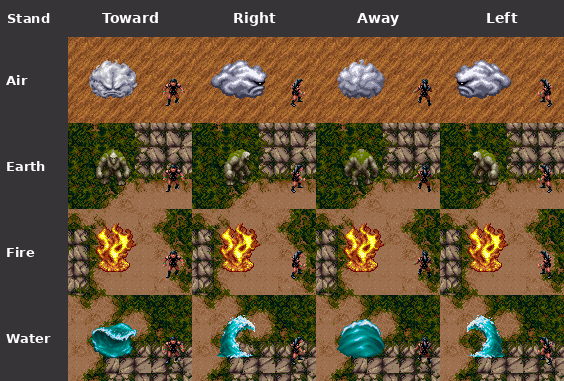
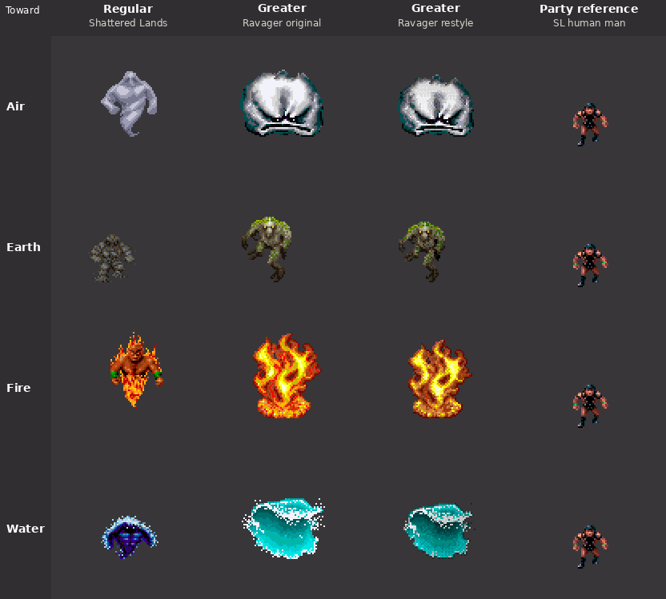
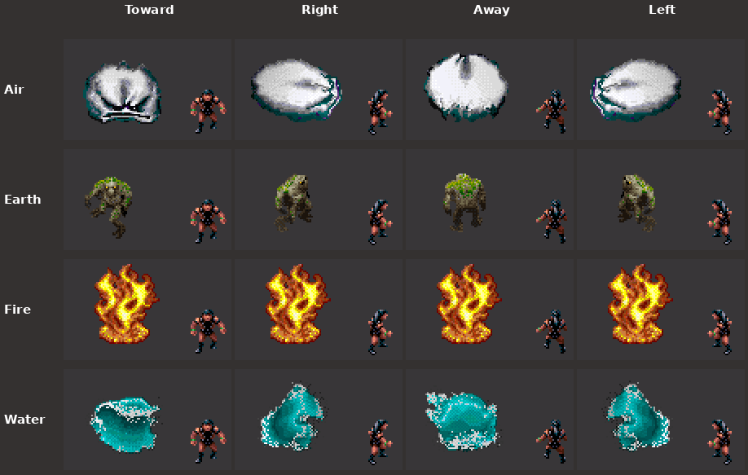
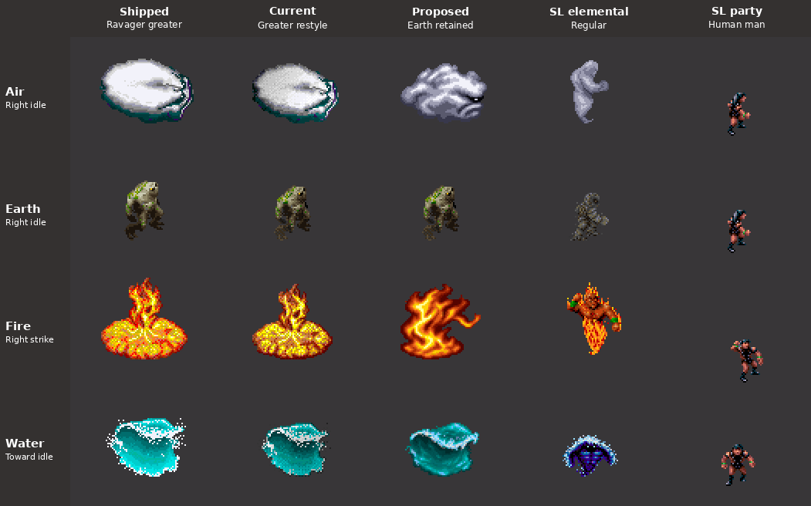

# Regular and Greater Elementals

Regular Air, Earth, Fire and Water use their Shattered Lands figures. Their greater counterparts use Ravager designs adapted to stand beside the Shattered Lands party. Each tier has its own walking pictures, combat pictures and animation script in the review build.

| Element | Regular object → figure | Shattered Lands donor object | Greater object → figure | Greater design |
| --- | --- | --- | --- | --- |
| Air | 422 → 2538 | 176 | 426 → 2405 | Scowling cloud that unfurls into a whirlwind |
| Earth | 424 → 1881 | 164 | 428 → **3954** | Moss-topped stone brute with a forward lean and heavy arms |
| Fire | 420 and 423 → 2540 | 172 | 409 and 427 → 2557 | Column of open flame that flares outward on attack |
| Water | 425 → 915 | 174 | 429 → **3955** | Curling turquoise wave with a breaking crest |

The earlier Earth and Water approvals carry over to **regular Earth (1881)** and **regular Water (915)**. The original game also used 1881 for Greater Earth and 915 for Greater Water. Their new numbers, 3954 and 3955, are specific to the redraw project.

## Current animations



[Enlarged group animation](img/elemental-motion-earth-steady-detail.gif)

| Greater figure | Enlarged comparison | Motion to watch |
| --- | --- | --- |
| 2405 Air · **artwork approved** | [Air animation](img/2405-elemental-motion.gif) | The cloud keeps its single visible brow in profile, opens into a whirlwind, then reforms facing the same way. |
| 3954 Earth · **artwork approved** | [Revised Earth animation](img/3954-earth-steady-detail.gif) | The planted foot takes the weight as the opposite knee passes. The fists rise over the mossy shoulders and drop into a crouching strike. |
| 2557 Fire · **artwork approved** | [Fire animation](img/2557-elemental-motion.gif) | The standing flame keeps its shape. The windup and spray reach left or right in profile, outward toward the viewer or up behind the crown when facing away. |
| 3955 Water · **artwork approved** | [Water animation](img/3955-elemental-motion.gif) | The front crest rolls forward, the back shows the swell, and the profile opens into a breaking wave on the target side. |

The group loop uses the same pixel scale for the greater creature and the Shattered Lands human. Each individual loop also includes the shipped greater creature and the regular Shattered Lands elemental. Each shows all four facings together through standing, two travel cycles, an attack and recovery. The comparisons use synchronized review pacing and terrain from RGN042 and RGN044.

The previews were rendered from a test archive. Applying the motion package to a fresh game archive reproduced the preview resources. All 262 active steps across the four greater figures decoded, and all sixteen directional attacks returned to their matching idle frame and anchor. Live encounters and cleric summons still need testing. [Current motion package](proposals/elemental-motion-earth-steady.zip) · [Installer](proposals/apply_elemental_tiers.py) (select the new package with `--package elemental-motion-earth-steady.zip`).

### Greater Earth redraw · artwork approved

The approved version is figure 3954 with the transparency repair and stabilized lighting in all four facings. Live encounter playback is pending.

The passing steps and strike preparation previously brightened the forearms and broke the moss into bright speckles. The revision matches each pose to its facing’s idle lighting and carries the face and crown markings through the movement. The Earth-only loop shows every scripted picture in order at review speed on RGN044 terrain. [Watch Greater Earth in all four facings](img/3954-earth-steady-focus.gif)

Across the four walk loops, the difference between the brightest and darkest frame averages fell from 13–14 levels to 2–3 on a 0–255 brightness scale. The test archive preserved every opacity mask across all 26 pictures and the full animation script. All 66 active steps decoded. Each decoded Earth-only GIF frame was checked against its rendered pixels on the terrain.

**Previous lighting after the transparency repair.** [Game-size Earth](img/3954-earth-repaired-native.gif) · [Enlarged Earth](img/3954-earth-repaired-detail.gif) · [Game-size group](img/elemental-motion-earth-repaired-native.gif) · [Enlarged group](img/elemental-motion-earth-repaired-detail.gif) · [Previous package](proposals/elemental-motion-earth-repaired.zip)

The previous redraw lost some pale highlights when its background was removed. The repair restores 300 transparent pixels across five travel-bank frames and three combat-bank frames from the source artwork. The head, shoulders and forearms now stay solid through the passing step and windup. All 26 packed frames were checked on two contrasting backgrounds. The original open spaces between limbs remain visible. [Before and after on a checkerboard](img/3954-earth-transparency-proof.png)

The pale stone face, mossy shoulders and long forearms carry through all four facings. Larger areas of light on the fists, knees and toes separate the limbs at game size. The moss is strongest in the rear view, where the face is hidden. The Earth comparison shows the shipped sprite, the previous pass, this redraw, the regular Shattered Lands Earth Elemental and the human party figure on RGN044 terrain. [Game-size Earth animation](img/3954-earth-steady-native.gif) · [Enlarged Earth animation](img/3954-earth-steady-detail.gif)

A fresh test archive resolved all 66 active steps of figure 3954 to the new art. Each of the four strikes recovered to its matching idle picture and anchor with Ravager’s original timing and movement. The lighting revision replaces the two Greater Earth picture banks in the preceding package.

**Before the transparency repair.** [Game-size Earth](img/3954-earth-redraw-native.gif) · [Enlarged Earth](img/3954-earth-redraw-detail.gif) · [Game-size group](img/elemental-motion-earth-revised-native.gif) · [Enlarged group](img/elemental-motion-earth-revised-detail.gif) · [Earlier redraw package](proposals/elemental-motion-earth-revised.zip)

**Previous review with the earlier Earth figure.** [Game-size group](img/elemental-motion-native.gif) · [Enlarged group](img/elemental-motion-detail.gif) · [Earth animation](img/3954-elemental-motion.gif) · [Earlier motion package](proposals/elemental-motion.zip)

## Earlier animation pass



[Native-size lineup](img/elemental-tiers-native.png) · [Game-size animation on encounter terrain](img/elemental-tiers-native.gif) · [Enlarged animation](img/elemental-tiers-detail.gif)

The first column shows the regular figure in Ravager’s palette. The next two show the shipped greater creature and its first animation pass. The last column shows the Shattered Lands human man in the same scripted facing and action. Greater Fire uses the same flame sequence in all four directions. The loop cycles through standing, moving and attacking toward, right, away and left at review speed. Each row uses terrain sampled from a greater encounter, RGN042 for air and RGN044 for the other three.

**First-pass artwork.** The first pass uses the project’s Ravager restyle at 92% of shipped size to retain the bulk of the greater creatures. The illustrated cloud face became the basis for the approved Greater Air redraw. The animation here uses the restyled original throughout. [Greater Air illustrated study and encounter placements](README.md#2405-greater-air-elemental-white-cloud)

## Archive check

The package contains 24 resources across eight figures. Only the picture fields in object records 428 and 429 change. The regular Earth and Water resources are byte-for-byte copies of the approved packages. Regular Air and Fire use the Shattered Lands pictures with Ravager’s original action slots, timing and movement.

Greater Air’s shipped profile walk uses frame 10, which faces forward, followed by frame 11, which is missing from its 11-frame travel bank. The shipped comparison marks that missing step. The review script cycles the two actual profile poses, keeps the away walk facing away, and returns each strike to its facing’s idle pose.

All ten actor templates resolved to the intended pictures after rebuilding and reopening a test archive. All 107 base frames, 82 combat frames and 492 active script steps decoded. Reapplying the package produced a byte-identical archive. Spell casts and encounter playback in the running game still need checking.

[Review pictures and scripts](proposals/elemental-tiers.zip) · [Installer](proposals/apply_elemental_tiers.py) · [GFF reader and writer used by the installer](https://github.com/daaki85/darksun-recompiled/blob/8933c6dd14e72de05a8678370a6d38e3ffeaa36c/tools/sl_figures.py)

Keep the ZIP beside the installer. From that directory, run the following with the path to the recompiled project's tools directory and a separate output path.

```sh
PYTHONPATH=/path/to/darksun-recompiled/tools python3 apply_elemental_tiers.py /path/to/OBJEX.GFF /path/to/review/OBJEX.GFF
```

## Facing and style review



| Greater figure | What reads at game size | Recommendation |
| --- | --- | --- |
| **2405 Air** | The side walk holds its profile. The pale oval hides the eye and brow that make the front recognizable. The whirlwind still reads when it opens. | Give the profile one projecting brow, one visible eye and a darker bank of cloud underneath. Match the existing front study across the other facings. |
| **3954 Earth** | The forward shoulder overlaps the chest, the near knee steps clear of the far leg, and the mossy back comes into view on the turn away. Its weight and camera angle sit well beside the SL Earth Elemental. The shadowed leg recedes into the RGN044 greenery. | Keep the angle and stride. Preserve the silhouette and check the near shin in the live encounter. |
| **2557 Fire** | The same rising column works as an idle from every direction. The burst also plays identically in every direction, even as the SL fire elemental and the party member turn to strike. | Keep the idle. Lean the plume and its leading tongue toward the target for the windup. Carry that direction through the burst. |
| **3955 Water** | The two profiles break in opposite directions and the rear shows the back of the swell. In front, scattered white pixels obscure where the lip curls toward the viewer. | Keep the side angles. Group the foam along one curved lip and deepen the shadow under it. |



The proposed column shows three single-pose studies in the encounter palettes. Earth repeats the current pose. All columns show the scripted facing and the same action. For Fire, the comparison uses the opening attack step. The animation package above still contains the earlier first pass. The proposed animations above carry these single-pose studies into movement and combat. The animated redraws for all four greater elementals are approved. Live encounter and summon playback are pending. [Game-size poses on encounter terrain](img/elemental-angle-poses-terrain.png) · [Indexed pose artwork](proposals/elemental-angle-poses.zip)
