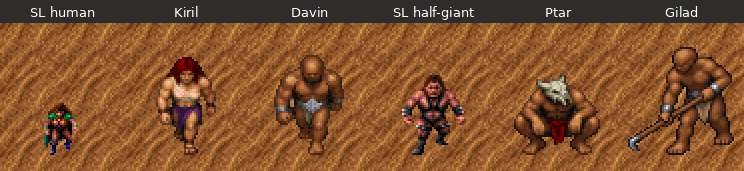
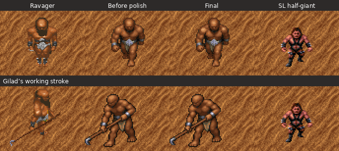
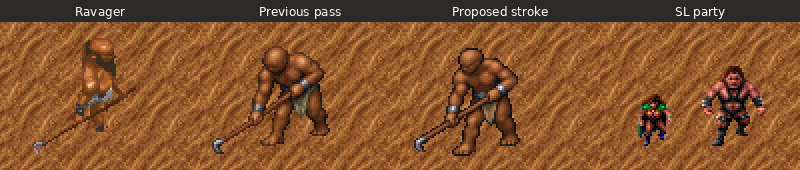
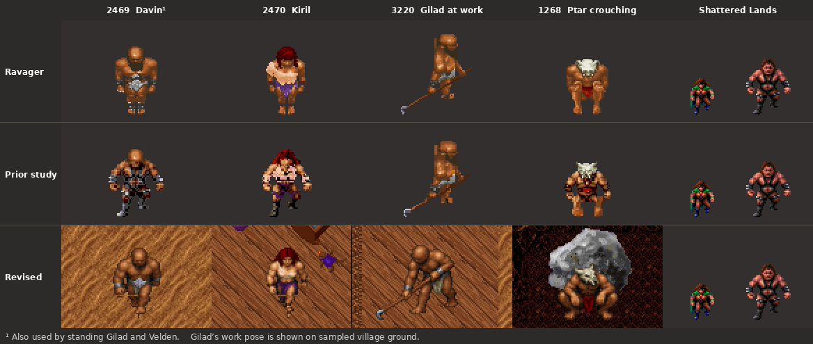
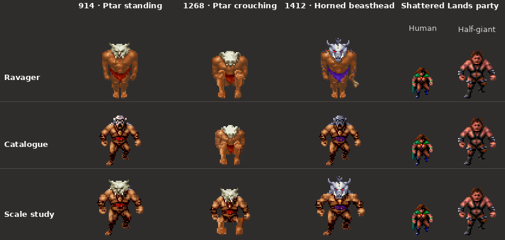
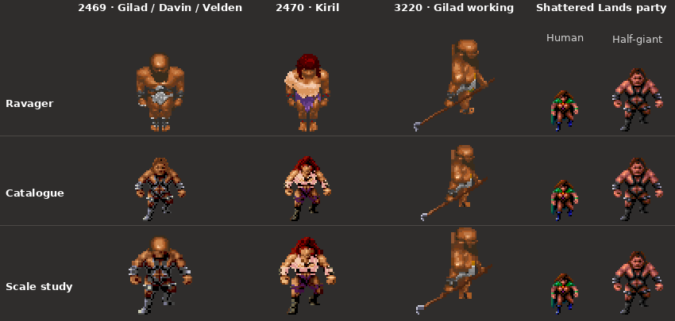
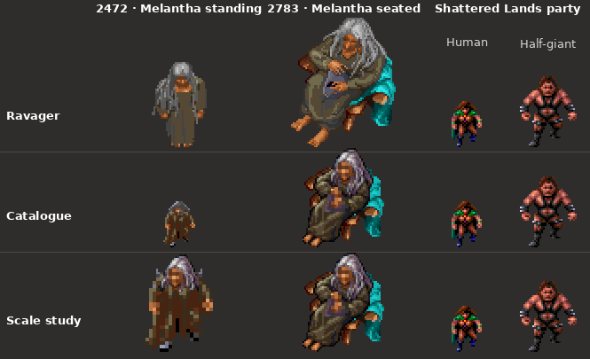

# Giants in the Ravager figure catalogue

Ten catalogue entries depict living Silt Sea or beasthead giants. Some characters have a separate figure for a seated pose or a task. Compare the two poses of the same individual before using a party member as a size reference.

| Figure | Character or pose | Evidence and scale reference |
|---|---|---|
| [818](README.md#818-helmine) | Helmine and the rescued infant | Nest pose, object 1. The infant is drawn into the same three frames. The 35-pixel seated artwork and its matched likeness are approved. Standing figure 2471 now follows the seated silver-haired likeness. [Matched comparison](img/helmine-matched-native.gif) |
| [914](README.md#914-beast-headed-giant-skull-head-loincloth) | Ptar and the beasthead giants | Ptar (139) and two Beasthead Giant records (198 and 451) share the approved standing figure, walk and all four attack facings. [Complete approved resources](approved/914-ptar.zip) [Movement comparison with approved crouch 1268](img/914-ptar-review-native.gif) |
| [1268](README.md#1268-beast-headed-giant-crouched) | Ptar crouching | Object 445 is Ptar. Keep his head and shoulders consistent with his standing figure 914 when he crouches beside Magnolia. |
| [1412](README.md#1412-beast-headed-giant-horned-loincloth) | Horned beasthead giants | Object 140 is Ptar’s Friend. Objects 199 and 522 are named Beasthead Giant. The 51-pixel stance, walk and both action sequences in all four facings are approved. [Approved artwork and script](proposals/1412-horned-beasthead.zip). |
| [2469](README.md#2469-huge-bald-muscular-man) | Gilad, Davin and Velden | Gilad the farmer (214), Davin the hunter (217) and Velden the smith (218) share one standing figure. Compare Gilad’s working pose at 3220. |
| [2470](README.md#2470-big-woman-red-hair-purple) | Kiril | Object 215 is Kiril, leader of the Silt Sea giant village. Compare her with the villagers using 2469. |
| [2471](README.md#2471-big-woman-dark-hair-teal) | Helmine standing | Object 9 is the same shaman seen in the nest at 818. She is small for a giant. Her approved standing artwork retains the shipped 49-pixel height. [Scale comparison](img/helmine-scale-lineup-native.png) [Facings and rescue pose](img/helmine-matched-detail.gif) |
| [2472](README.md#2472-melantha-standing) | Melantha standing | Object 51 is the exiled silt giant. Compare her with her approved seated artwork at 2783. |
| [2783](README.md#2783-melantha) | Melantha in her hut | Object 560 is the seated silt giant. Picture 2784 completes the lower portion of this figure and its chair. The approved scene includes the straw bed. |
| [3220](README.md#3220-gilad) | Gilad at work | Object 49 is the same farmer who shares standing figure 2469 with Davin and Velden. Use his shoulders and the ground contact of the hook to set the working pose. |

## Approved giant figures

The approved artwork covers crouching Ptar (1268), the standing and walking figure shared by Davin, Gilad and Velden (2469), Kiril (2470), and Gilad working (3220). The lineup places all four beside the Shattered Lands human woman and male half-giant on sampled village ground at the same scale.

[Native-size lineup](img/giants-final-beside-sl-native.png) · [Approved base pictures and animation scripts](approved/four-giant-figures.zip)

Figure 2469 uses compact shoulder highlights and a deeper shadow where the upper arm meets the torso in all 15 standing and walking frames. In both frames of 3220, a five-pixel dark edge separates Gilad’s forward fingers from the haft. The third column below shows these final details beside the Shattered Lands half-giant.

[Native-size polish comparison](img/giants-polish-native.gif) · [Party lineup before the polish](img/giants-beside-sl-detail.png)

The earlier comparison below preserves the approved two-frame stroke before the grip detail was added.

[Native-size working stroke](img/3220-gilad-stroke-native.gif)

The eight approved resource chunks were loaded into a test archive and their animation frame references verified. Live in-game playback is pending.

## Giant motion review

The first row shows the shipped Ravager figures. The middle row preserves the previous size study. The bottom row animates the new proposals alongside a Shattered Lands human woman and male half-giant at the same pixel scale. This sheet preserves the earlier working stroke for Gilad. The approved lineup and final stroke appear above.

[Game-size comparison](img/giants-reworked-native.gif)

| Figure | What to look for in motion |
|---|---|
| 2469 · Davin, Gilad and Velden | The bald head, broad shoulders, metal belt plate and cuffs should identify the same giant in each facing. Davin appears at his village placement. All three men share this art. |
| 2470 · Kiril | Her red hair, pale wrap and purple skirt should stay distinct as she turns. Judge her height against Davin and the wooden floor around her. |
| 3220 · Gilad working | Compare the head and shoulders to 2469. Watch both hands on the haft and the small clods at the blade. This preview stages his two-frame action on terrain sampled at standing Gilad’s village placement. |
| 1268 · Ptar crouching | Wide-set knees and planted feet support the lowered skull as he turns and reaches. The cave uses Ptar’s recorded placement. His three-frame gesture plays in its stored order. Compare the skull and shoulder width with standing Ptar below. |

The following sheets show the walking figures from the front, side and rear. The action-only columns show the shipped pose, the revised gesture and a second view of that gesture. These sheets synchronize the figures for comparison. Standing Melantha uses a provisional 55-pixel scale. The seated figure is her approved reference.

| Figures | Enlarged animation | Game size |
|---|---|---|
| Standing Ptar, crouching Ptar and the horned beasthead | [Beastheads](img/giants-motion-beastheads-detail.gif) | [Native pixels](img/giants-motion-beastheads-native.gif) |
| Davin’s shared figure, Kiril and working Gilad | [Village giants](img/giants-motion-village-detail.gif) | [Native pixels](img/giants-motion-village-native.gif) |
| Standing and seated Melantha | [Melantha](img/giants-motion-melantha-detail.gif) | [Native pixels](img/giants-motion-melantha-native.gif) |

The test archive round-tripped 80 new frames across seven figures and all script picture references resolved. The scenery views are reconstructions. Playback inside Ravager remains to be checked. [Proposed figure and animation chunks](proposals/giants-motion-study.zip)

## Visual review of the remaining giants

Each sheet uses the same magnification throughout. The first row shows the shipped Ravager art, the second shows the current catalogue version, and the third is a proposed single-pose study. The Shattered Lands human woman and male half-giant stand on the same baseline as the figures under review.

**Ptar and the beastheads.** The proposed standing and crouching poses share Ptar’s bone-coloured head and shoulders. The horned beasthead retains its longer, violet-grey face. The cave and island previews use recorded placements.

[Reconstructed cave and island scenes](img/giants-beastheads-scenes.png)

**The Silt Sea village.** Gilad, Davin and Velden share 2469. The study restores its bald head and uses the shipped 50-pixel standing height alongside Kiril at 49. Working Gilad’s 55-pixel extent includes his hook. Compare the bent figure and the standing one at the shoulders.

[Reconstructed settings for Davin and Kiril](img/giants-village-scenes.png)

**Melantha.** The standing study takes the hair and face from the approved seated drawing. Its 55-pixel height is provisional. The approved 56-pixel seated image includes her chair and appears twice as a reference.

[Approved animation in the hut with the straw bed](img/2783-giant-bed-scale.gif)

## Half-giants and shared figures

| Figure | Record or artwork |
|---|---|
| [598](README.md#598-half-giant-male-party-figure-object-308) | The male half-giant party slot (308) shares its artwork with Gerrakis (32002), who has race code 5. |
| [692](README.md#692-half-giant-female-party-figure-object-309) | Object 309 is the female half-giant party slot and the sole user. |
| [2022](README.md#2022-big-woman-orange-hair) | Melody, mine boss (74), is Half-giant in her character record (5) and in the cluebook. Her Shattered Lands half-giant model, copper braid and [revised shoulder shading](img/2022-shoulder-profile.png) are approved. |
| [2429](README.md#2429-huge-muscular-man-green-bands-half-giant) | Originally shared. The approved split leaves only Miner 274 on 2429, in a grey tunic at Half-giant scale. His record is Dwarf (2). Half-giant Draxan 370 uses 3964, the eight Humans use 3965 and the Mul zombie uses 3959. |
| [2437](README.md#2437-slave-and-brainsniffer-human-man-in-teal) | The earlier half-giant label describes its build. Both users, Slave 241 and Brainsniffer 499, are Human (1). |
| [2486](README.md#2486-mines2-standing-figure-7) | Object 5906 shares the shipped outline of 692 and 2022. Its own race is unspecified. The approved mine still uses the 41-pixel female half-giant stance. |
| [2487](README.md#2487-mines2-standing-figure-8) | Object 5907 shares 99.3% of its visible pixels with the mirrored 2429 idle. The approved still uses the bandana half-giant outside the elevator group. Its race is unrecorded. |
| [2932](README.md#2932-fallen-figure-in-rgn043-pose-2) | Crypt body 3087 has no recorded race. Its shipped pose matches both village giant 2469 (base 11) and Human leader 2474 (base 13). |
| [3613](README.md#3613-miner-with-pick) | The approved miner uses the SL half-giant body as its art reference. Object 288 has no race field. |

The cluebook identifies a group of male half-giant miners in grey tunics by the Mines2 elevator. The three large miners grouped there use picture 2429, object 274, whose race field is 2. GPL 270 also describes a group of human miners in this encounter. Keep the map and dialogue evidence attached to that group. Other uses of 2429 need their own record checks. The two static working figures 2479 and 3612 have no recorded race. The scene comparison keeps the five 275 miners and four 276 miners in place behind the three copies of 274. [Compare elevator group scales](img/2429-elevator-scale.png)

## Other uses of “giant”

[1753](README.md#1753-skeleton-white-bones) is explicitly named Giant Skeleton and has an undead race code. Giant snakes (1756) and the giant sundew (2345) have their own creature references. Keign ([2474, object 195](README.md#2474-el-and-the-silt-sea-leader)) commands the wolf-headed giants. His race field is Human (1). His two axes and Drisha’s cage key match the Human described in the [Silt Sea Islands walkthrough](../../guide/wake-of-the-ravager-walkthrough.txt#L3501). Magnolia is Ptar’s captive and the jann Sultan’s daughter.

## Sources and limits

The audit joined shipped OBJEX.GFF object-picture pointers (OJFF) to character and scenery records (RDFF), then compared names and explicit race codes with the cluebook, rescue and village dialogue, and map placements. For the Silt Sea villagers, the mobile records carry 0 and the separate task poses have no race field. The beastheads on 914 and 1412 carry code 12, which is also used by unrelated monsters. Names and encounter evidence establish the giant identities. Unidentified combat pictures 2541 and 2900 have no identified character owner in this audit.

The *Wake of the Ravager Cluebook* names Ptar in the Humbleton Forest section, identifies the island villagers and the two beasthead groups on pp. 72–75, and describes Melantha, Helmine and the infant on pp. 76–77. GPLDATA.GFF scripts 2–3 cover Melantha and Helmine, 115–118 the village, 260–263 the wolfpack, and 270 the miners. [Silt Sea encounter walkthrough](../../guide/wake-of-the-ravager-walkthrough.txt#L3479)
