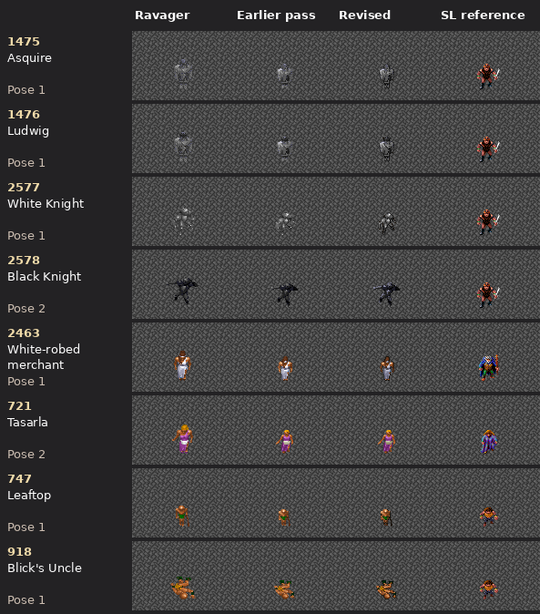
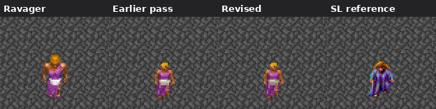
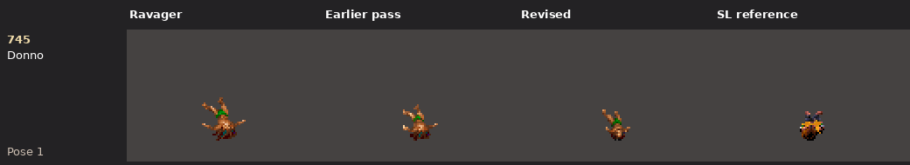
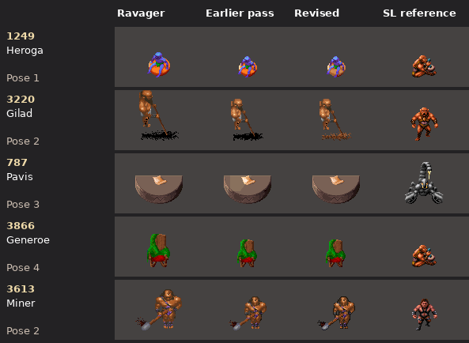
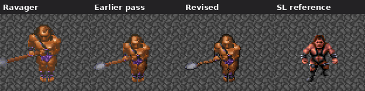
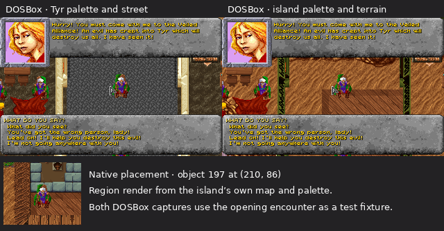
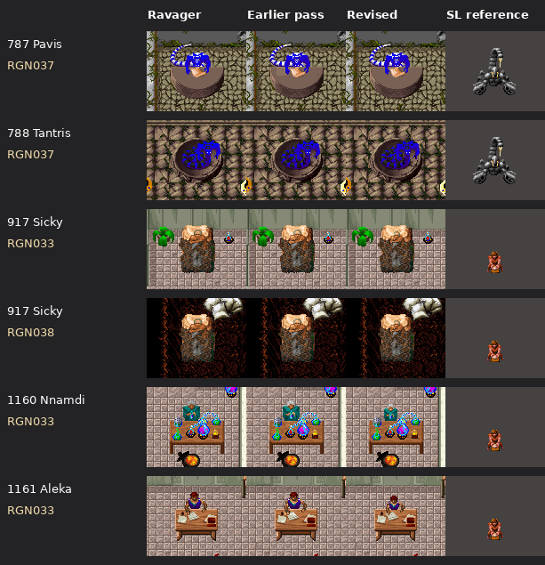
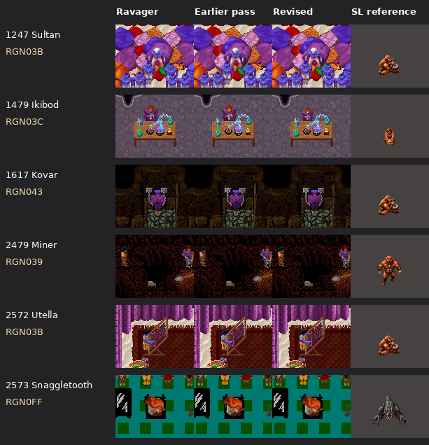
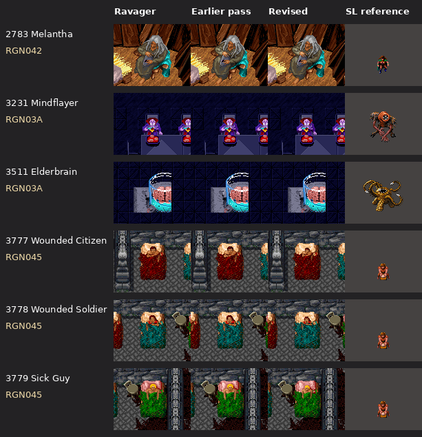

# Merchant and scenery revisions

[Download the current artwork and frame viewer](proposals/merchant-batch-contrast.zip) · [Earlier batch and its review history](merchant-batch.md)

Open **review.html** in the download and choose **Game size (1×)**. Each figure has its Ravager original, current proposal, named Shattered Lands reference, game-record race and stored animation slots. The earlier package remains available for comparison.

## Tyr street comparison

| Figure | Change and review recommendation |
|---|---|
| 1475 Asquire, 1476 Ludwig, 2577 White Knight | Recommend the darker plate rims and joints. Compare the shoulder against the street and the bent elbow against the breastplate. The SL comparison is the Castle Guard. |
| 2578 Black Knight | Recommend the new steel highlights. The shoulder and forward plate stay visible during the lunge, and the darkest plates still distinguish this knight from 2577. |
| 2463 White-robed merchant | Lowered the white cloth one shade and darkened its contour across all 27 base and combat frames. Recommend the revised robe. The merchant records identify these NPCs as Human. |
| 721 Tasarla | Lowered the apron one shade in both poses. The arm and its cleared space match the approved reach pixel for pixel. Recommend the colour change. |
| 747 Leaftop, 918 Blick’s Uncle | Deepened the arm and leg creases. See the [approved Leaftop redraw](README.md#747-leaftop). The [approved second pass for prone Blick](README.md#918-blicks-uncle) matches his standing artwork and uses the Shattered Lands human man as its scale reference. The two figures’ own objects leave race unset. Leaftop’s separate combat record identifies him as Halfling. |

The knight and Tasarla records leave race unset. Other walking and standing studies with soft contours received a shadow-side pass. Helmine, Ptar, Magnolia, Zorani, Sirah, Abelard, Miric, the creatures and the drakes retain their earlier artwork. Donno’s separate pose revision is below.

## Donno, figure 745

**Artwork approved.** [Cavern 2 comparison at game size](img/donno-cavern-native.png). The revised silhouette is 16 × 18 pixels inside the original 25 × 25 frame. The earlier pass measured 20 × 21 and the fallen SL male halfling measures 14 × 17. The legs still run diagonally, the shorts stay green, and the face has a small lit plane against the darker hair. The shipped figure has one pose. Donno’s standing character record identifies him as **Halfling**. [Native-size comparison](img/donno-fallen-native.png)

## Prop and palette details

- **1249 Heroga.** Shifted the orange cushion toward ochre in all five poses. The [approved Heroga redraw](README.md#1249-heroga) uses this cushion.
- **3220 Gilad.** Recovered the pattern of the source grains under the hook in the second pose, with brown earth tones and gaps for the ground to show through. The subsequent giant review contains the [approved working stroke](giant-figures.md#approved-giant-figures).
- **787 Pavis.** Restored the shipped basin surface. The third stored frame is the empty state. The small tan shape at the centre belongs to the original. Recommend the restored basin.
- **3866 Generoe.** The original regional colours in the brown and green chair art can acquire Tyr’s bright magenta when displayed outside their intended palette. The old proposal has 20, 13, 20 and 19 solid magenta pixels across its four states in Tyr, and zero in its native RGN041. The revision maps the opaque regional details to stable colours. It preserves every transparent pixel and has zero pure-magenta pixels in all four poses across all 20 region palettes. Recommend the palette correction. The walkthrough describes an old man in a rocking chair and the game record leaves his race unset. The seated SL drummer provides the posture reference. [Encounter description](../../guide/wake-of-the-ravager-walkthrough.txt#L3519)
- **3613 Miner with pick.** Both poses use the male half-giant from SL’s creation object 308, picture 2072, as their reference. The miner’s broad upper body and planted stance fit that scale. The later party comparison supersedes this resized proposal. [New miner drawn from the SL half-giant](scenery-and-miner.md#the-miner-beside-the-party) Ravager object 288 leaves the miner’s race unset. Heroga and Gilad’s records also leave race unset.

## Generoe in the game

Both captures use the shipped DOS game executable. A private test installation displays Generoe during the opening Tyr encounter, first on its cobbles and then with the island terrain and palette. The tested pose showed zero magenta pixels in both runs. The native placement panel uses the actual RGN041 palette, ground and placed objects at map position (210, 86). The fixture is separate from the downloadable artwork.

## Scenery and occupant scale

**Earlier scale study.** The recommendation to retain full-size décor has been withdrawn. The new studies lower the furniture and check the figures in their rooms beside SL party references. [Updated scenery review](scenery-and-miner.md#how-large-the-furniture-should-look)

Seventeen scenery figures were checked at their recorded placements. Sicky occurs in two regions, giving eighteen comparisons. The first three columns use the same map position and palette. The fourth shows the named SL reference at the same pixel scale. The region sheets use each figure’s first stored frame. The viewer includes every pose.

| Figures | Recommendation |
|---|---|
| 917 Sicky, 3777 Wounded Citizen, 3778 Wounded Soldier, 3779 Sick Guy | Use 82% for the exposed head and body. The original empty bed, picture 3787, supplies the pillow and cover visible around the smaller person. Keep the original bed footprint. |
| 1160 Nnamdi, 1161 Aleka, 1479 Ikibod | Use 82% for the attendant. Each figure has its own empty-counter state, which gives an exact source for the counter under the smaller silhouette. Inspect Aleka’s hand beside the papers. |
| 787 Pavis, 788 Tantris, 2573 Snaggletooth, 3511 Elderbrain | Keep the vessel, support and creature at encounter scale. These compositions have no human occupant to match to a walker. |
| 1247 Sultan | Individual redraw approved. [Both idle poses and the empty cushion in the Jann tent](README.md#1247-sultan). |
| 1617 Kovar | [Individual redraw approved for the chained poses and empty shackles](README.md#1617-kovar). |
| 2479 Miner | [Individual redraw approved at both mine openings](README.md#2479-miner). |
| 2572 Utella | [Revised weaving animation approved](README.md#2572-utella). |
| 2783 Melantha | [Silt giant, two-piece chair and 82% straw bed approved](README.md#2783-melantha). |
| 3231 Mindflayer | [Revised dining room approved](README.md#3231-mindflayer). |

## Verification and approval status

The 54 numbered studies contain 219 frames. The detached Human merchant study contains another 27. All 246 decoded from their candidate picture chunks at the original frame extents. A combined OBJEX test loaded all 56 numbered base and combat resources and preserved the shipped animation scripts. The detached study stays outside that test archive so the party elf keeps figure 691. The viewer was exercised at 1× through a combat frame.

The current revisions are proposals. Tasarla’s gesture retains its earlier approval. The preceding batch archive, original catalogue images and approval history are available above.
