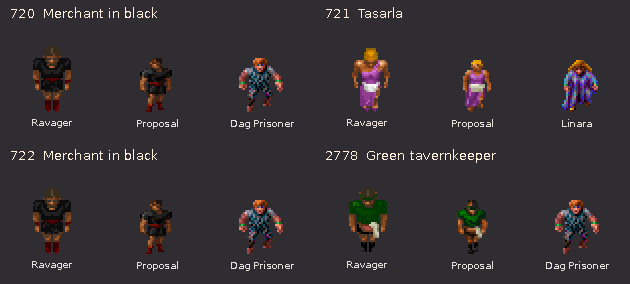
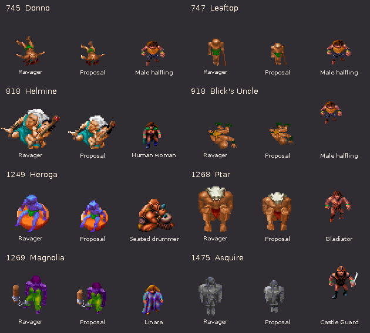
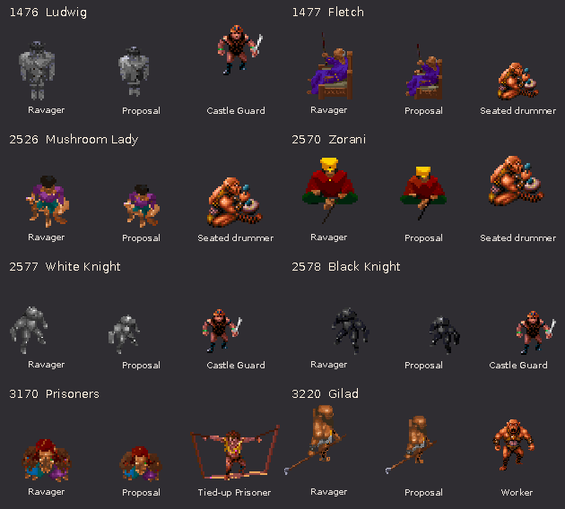
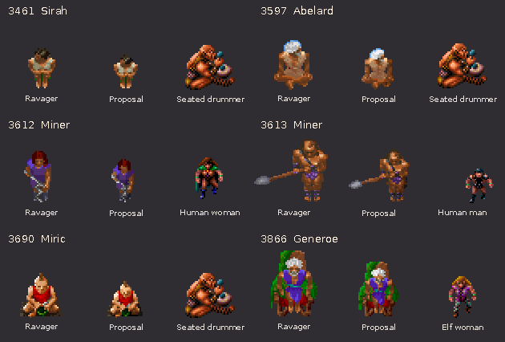
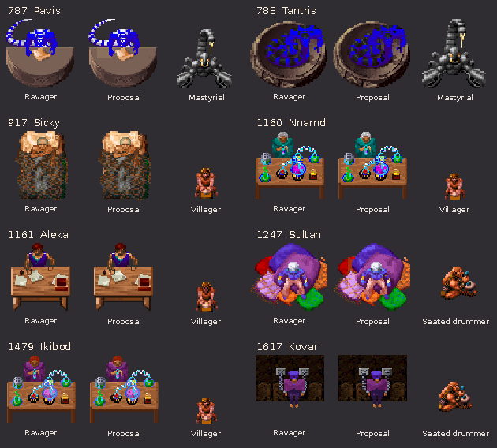
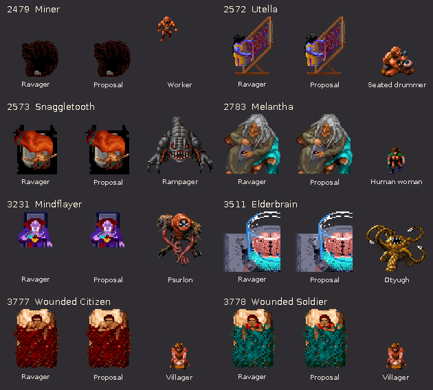
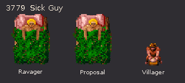
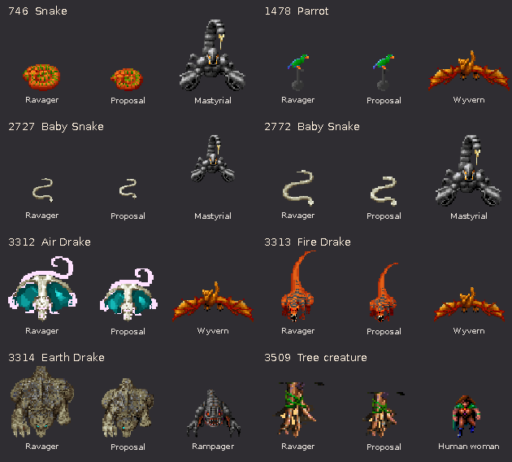
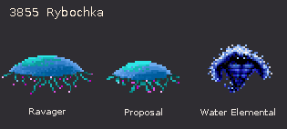
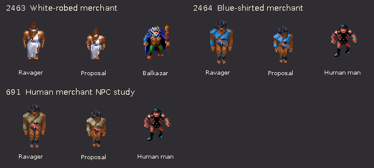

# Merchants and short-animation figures

[Current revisions, map comparisons and download](merchant-batch-contrast.md). The sheets and download below preserve the earlier pass.

Figures 719, 720, 721, 722 and 2778 have approved artwork, including Tasarla’s corrected reach. The animated sheets show sample poses at an equal scale within each comparison. The downloadable review includes every stored frame, original script slots, game-record race and named Shattered Lands references.

[Download artwork and offline frame viewer](proposals/merchant-batch.zip)

In the download, open **review.html**. Select a figure, then choose a script slot or **All stored poses**. Use **Game size (1×)** to judge the gesture at native resolution. The 54 numbered proposals preserve original frame dimensions and scripts. Their 219 frames decoded pixel-for-pixel in a combined archive test. Figure 691 has its own detached 27-frame NPC study. In-game placement and palette checks are pending.

## Tyr merchants and townspeople

| Figure | Game object and race | Shattered Lands reference | Review |
|---|---|---|---|
| [720](README.md#720-merchant-black-no-walking) · Merchant in black | 159 Merchant · unspecified | Dag Prisoner (picture 1669) | **Artwork approved.** Both hands open from a black tunic. The staggered red boots and shoulders stay planted. |
| [721](README.md#721-woman-pink-dress-no-walking) · Tasarla | 163 Tasarla · unspecified | Linara (picture 154) | **Artwork approved · corrected reach.** Tasarla keeps her gold hair, pale apron and one-arm reach. The robe and foot angle follow approved figure 719. |
| [722](README.md#722-merchant-black-no-walking) · Merchant in black | 151 Merchant · unspecified | Dag Prisoner (picture 1669) | **Artwork approved.** The same two drawings as 720. Its second pose has a shorter hold in the original script. |
| [2778](README.md#2778-tavernkeeper-green-no-walking) · Green tavernkeeper | 150 Tavernkeeper · unspecified | Dag Prisoner (picture 1669) | **Artwork approved.** A green-shirt counterpart to Stitches. The four cloth poses follow the approved 718 stance and keep the tavernkeeper’s own timing. |

## Standing and seated figures

| Figure | Game object and race | Shattered Lands reference | Review |
|---|---|---|---|
| [745](README.md#745-donno) · Donno | 176 Donno · no race field here. Character record 99 gives Halfling. | Male halfling (standing, picture 2068; fallen, picture 2069, frame 13) | **Revised artwork approved.** The [earlier comparison](img/745-donno-detail.png) guided the smaller [approved fallen pose](README.md#745-donno). |
| [747](README.md#747-leaftop) · Leaftop | 186 Leaftop · unspecified | Male halfling (picture 2068) | Leaftop leans on a staff. The separate Leaftop combat record using figure 651 identifies that character as Halfling. |
| [818](README.md#818-helmine) · Helmine | 1 Helmine · unspecified | Human woman (picture 2099) | Keep the low seated silhouette and projecting pole. |
| [918](README.md#918-blicks-uncle) · Blick's Uncle | 3147 Blick's Uncle · unspecified | Male halfling (picture 2068) | The figure lies on its back; the raised footwear gives the clearest view of the angle. |
| [1249](README.md#1249-heroga) · Heroga | 471 Heroga · unspecified | Seated drummer (picture 65) | Preserve the orange seated silhouette and the movement of the sleeves. |
| [1268](README.md#1268-beast-headed-giant-crouched) · Ptar | 445 Ptar · unspecified | Gladiator (picture 924) | Keep Ptar’s broad, bowed head and crouch. |
| [1269](README.md#1269-magnolia) · Magnolia | 146 Magnolia · unspecified | Linara (picture 154) | Check the chain and weight at the edge of the silhouette. |
| [1475](README.md#1475-asquire) · Asquire | 225 Asquire · unspecified | Castle Guard (picture 246) | Small upper-body gesture in armour. |
| [1476](README.md#1476-ludwig) · Ludwig | 226 Ludwig · unspecified | Castle Guard (picture 246) | Use the same armour scale as Asquire; compare the distinct gesture. |
| [1477](README.md#1477-fletch) · Fletch | 230 Fletch · unspecified | Seated drummer (picture 65) | Seated figure with a narrow upright staff and chair. |
| [2526](README.md#2526-mushroom-lady-crouched) · Mushroom Lady | 359 Mushroom Lady · unspecified | Seated drummer (picture 65) | Keep the squat pose and exposed hands under the mushroom cap. |
| [2570](README.md#2570-zorani-seated-cross-legged) · Zorani | 145 Zorani · unspecified | Seated drummer (picture 65) | Cross-legged stance and cane; keep the ground contact clear. |
| [2577](README.md#2577-white-knight) · White Knight | 279 White Knight · unspecified | Castle Guard (picture 246) | Silver armour shares its pose family with the Black Knight. |
| [2578](README.md#2578-black-knight) · Black Knight | 280 Black Knight · unspecified | Castle Guard (picture 246) | Compare directly to the White Knight; the dark armour needs readable edges. |
| [3170](README.md#3170-prisoners) · Prisoners | 378 Prisoners · unspecified | Tied-up Prisoner (picture 1877) | Multiple prisoners form one sprite; check the overlap of the heads. |
| [3220](README.md#3220-gilad) · Gilad | 49 Gilad · unspecified | Worker (picture 48) | Keep the long pole aligned with the hands. |
| [3461](README.md#3461-sirah-crouched) · Sirah | 13 Sirah · unspecified | Seated drummer (picture 65) | A low crouch with hands near the ground. |
| [3597](README.md#3597-abelard) · Abelard | 520 Abelard · unspecified | Seated drummer (picture 65) | The cap and seated knees carry the silhouette. |
| [3612](README.md#3612-woman-purple-miner) · Miner | 289 Miner, 500 Miner · unspecified | Human woman (picture 2099) | Keep the miner’s purple garment and the small hand movement. |
| [3613](README.md#3613-miner-with-pick) · Miner | 288 Miner · unspecified | Earlier reference, Human man (picture 2095). [Current half-giant comparison](img/miner-half-giant.png) | The extended tool is part of the two-frame gesture. |
| [3690](README.md#3690-miric) · Miric | 50 Miric · unspecified | Seated drummer (picture 65) | A single seated pose, with one arm braced. |
| [3866](README.md#3866-generoe-in-his-rocking-chair) · Generoe | 197 Generoe · unspecified | Elf woman (picture 2059) | [See the seated reference, palette correction and in-game check](merchant-batch-contrast.md#generoe-in-the-game). |

## Figures with scenery

| Figure | Game object and race | Shattered Lands reference | Review |
|---|---|---|---|
| [787](README.md#787-pavis) · Pavis | 465 Pavis · unspecified | Mastyrial (picture 2159) | Scorpion and basin form one picture. Check in its map scene before approval. |
| [788](README.md#788-tantris) · Tantris | 562 Tantris · unspecified | Mastyrial (picture 2159) | The revised two-pose figure and lowered basin are approved. [Before and after](README.md#788-tantris) |
| [917](README.md#917-sicky) · Sicky | 1338 Sicky · unspecified | Villager (picture 632) | The character and bedding share a picture. Check in its map scene before approval. |
| [1160](README.md#1160-nnamdi) · Nnamdi | 174 Nnamdi · unspecified | Villager (picture 632) | Merchant-like counter scene with bottles and a tabletop. Check in its map scene before approval. |
| [1161](README.md#1161-aleka) · Aleka | 175 Aleka · unspecified | Villager (picture 632) | Preserve the table edge and papers around the hand movement. Check in its map scene before approval. |
| [1247](README.md#1247-sultan) · Sultan | 106 Sultan · unspecified | Seated drummer (picture 65) | Individual redraw approved. [Compare both idle poses in the Jann tent](README.md#1247-sultan). |
| [1479](README.md#1479-ikibod) · Ikibod | 227 Ikibod · unspecified | Villager (picture 632) | Countertop and bottles match the composition used for Nnamdi. Check in its map scene before approval. |
| [1617](README.md#1617-kovar) · Kovar | 191 chained Kovar · unspecified. 190 mobile Kovar · Human (1) | Human male party figure (picture 2095) | [Approved redraw with both wrists attached through the three captive poses](README.md#1617-kovar). |
| [2479](README.md#2479-miner) · Miner | 360 Miner · unspecified | Worker (picture 48) | [Approved individual redraw at both Mines2 placements](README.md#2479-miner). |
| [2572](README.md#2572-utella) · Utella | 147 Utella · unspecified | Human female party figure (picture 2099) | [Revised bent-elbow weaving motion approved](README.md#2572-utella). |
| [2573](README.md#2573-snaggletooth) · Snaggletooth | 262 Snaggletooth · no race field. Walking Snaggle (85) · Halfling | Male halfling (2068), fallen pose (2069, frame 13) | [Approved Humbleton sickbed redraw and matching empty bed.](README.md#2573-snaggletooth) |
| [2783](README.md#2783-melantha) · Melantha | 560 Melantha · Silt giant in dialogue (GPL 2) | Human woman and half-giant man for scale | [Silt giant redraw and 82% straw bed approved](README.md#2783-melantha). |
| [3231](README.md#3231-mindflayer) · Mindflayer | 5166 Mindflayer, 5167 Mindflayer, 5168 Mindflayer, 5169 Mindflayer, 5170 Mindflayer · unspecified | Psurlon (picture 1907) | [Five diners, bowls and resized dining furniture](README.md#3231-mindflayer). Revised room approved. |
| [3511](README.md#3511-elderbrain) · Elderbrain | 1339 Elderbrain · unspecified | Otyugh (picture 2224) | Complete redraw approved. [Compare the assembled tank through idle and destruction](README.md#3511-elderbrain). |
| [3777](README.md#3777-wounded-citizen) · Wounded Citizen | 379 Wounded Citizen · unspecified | Villager (picture 632) | Seated or reclining figure under a bedcover. Check in its map scene before approval. |
| [3778](README.md#3778-wounded-soldier) · Wounded Soldier | 380 Wounded Soldier · unspecified | Villager (picture 632) | Blue-green bedding belongs to the picture. Check in its map scene before approval. |
| [3779](README.md#3779-sick-guy) · Sick Guy | 381 Sick Guy · unspecified | Villager (picture 632) | Green bedding belongs to the picture. Check in its map scene before approval. |

## Creatures and single poses

| Figure | Game object and race | Shattered Lands reference | Review |
|---|---|---|---|
| [746](README.md#746-snake) · Snake | 2978 Snake · unspecified | Mastyrial (picture 2159) | A single coiled snake. Compare the tight coil with the curve and shading of the Mastyrial’s tail. **Artwork approved** after review at all four [Cavern 2 placements](img/746-cavern-native.png). |
| [1478](README.md#1478-parrot) · Parrot | 118 Parrot · unspecified | Wyvern (picture 1204) | A perched parrot and its stand. The Wyvern is a wing-shading reference only. Check in its map scene before approval. |
| [2727](README.md#2727-baby-snake) · Baby Snake | 557 Baby Snake · unspecified | Mastyrial (picture 2159) | Approved shared bank. [Both Cavern 2 animations](img/2727-2772-baby-snake-motion.gif). |
| [2772](README.md#2772-baby-snake) · Baby Snake | 558 Baby Snake · unspecified | Mastyrial (picture 2159) | Approved with 2727 after checking its own mirrored side loop. |
| [3312](README.md#3312-air-drake) · Air Drake | 415 Air Drake, 561 Air Drake · code 0 | Wyvern (picture 1204) | A single large frontal drake pose. Check in its map scene before approval. |
| [3313](README.md#3313-fire-drake) · Fire Drake | 547 Fire Drake · code 0 | Wyvern (picture 1204) | A single long-bodied fire drake pose. Check in its map scene before approval. |
| [3314](README.md#3314-earth-drake) · Earth Drake | 541 Earth Drake · code 12 | Rampager (picture 2426) | A single low, broad earth drake pose. Check in its map scene before approval. |
| [3509](README.md#3509-rope-vine-tree) · Rope-vine tree | 2251 · interactive scenery | Tree (picture 353) | The island quest switches from vines to bare bark. Compare the trunk with its separate crown in both states. |
| [3855](README.md#3855-rybochka) · Rybochka | 566 Rybochka · Human | Water Elemental (picture 2171) | Two stored poses reused by multiple slots. Its object record has race code 1 (Human), despite the nonhumanoid artwork. Check in its map scene before approval. |

## Shared merchant figures

| Figure | Game object and race | Shattered Lands reference | Review |
|---|---|---|---|
| [2463](README.md#2463-raenika-and-the-merchant) · White-robed merchant | 131 Merchant, 496 Raenika · Human | Balkazar (picture 724) | White robe and dark hair. Merchant and Raenika share the full standing, walking and combat art. Both records identify them as Human. |
| [2464](README.md#2464-man-blue-shirt) · Blue-shirted merchant | 120 Acar, 132 Merchant, 143 Dhukkar, 164 VA Member · Human | Human man (picture 2095) | Blue shirt and dark hair. Merchant, Acar, Dhukkar and VA Member share this full set. All four game records identify them as Human. |
| [691](README.md#691-elf-male-party-figure-object-304) · Human merchant NPC study | 152 Armorer, 153 Weaponer, 154 Salesperson, 155 Salesperson, 320 Salesperson, 321 Salesperson, 322 Armorer, 323 Weaponer, 324 Salesperson, 325 Salesperson · Human | Human man (picture 2095) | Detached NPC study for ten Human merchants. Keep the approved player-created elf separate. No 691 replacement is included in the batch archive patch. |

## Scope notes

The scan covered the remaining catalogue entries and their base and combat frame banks. The batch includes single poses and short gesture sets, plus the two twelve-frame baby snakes and the full sets used by merchants. Pictures with several action slots can reuse very little art, so frame count and script use were checked together.

The four-pixel **1736 Bit o’Tarrasque** is a fragment and stays with the Tarrasque review. **2424 Receptionist** has 27 stored poses without a local script. It belongs in a full-pose review. The previously approved merchants and party figures keep their recorded decisions.

Two records use the same black-tunic artwork (720 and 722) with different timing. Figure 691 remains unchanged in the batch archive test. The detached merchant design applies only to its ten Human NPC records if integrated separately from the player-created elf.
