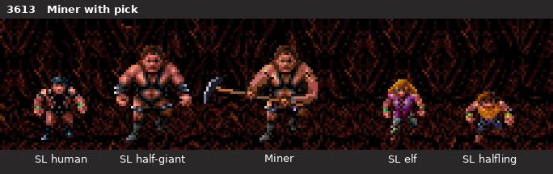
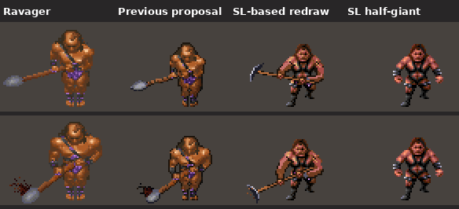
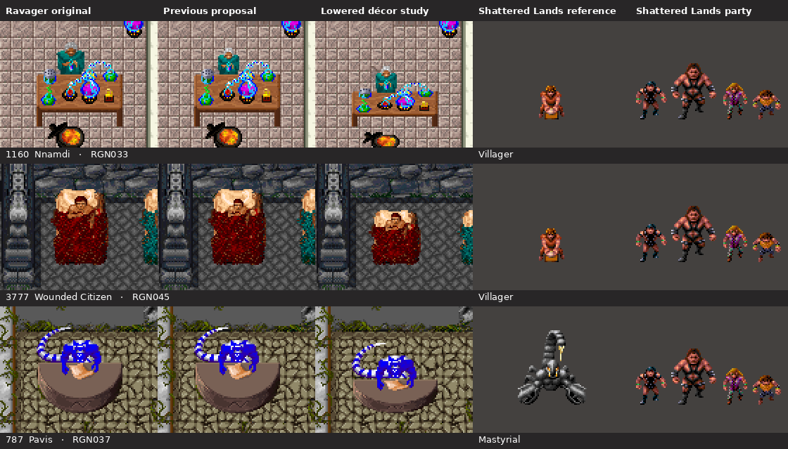
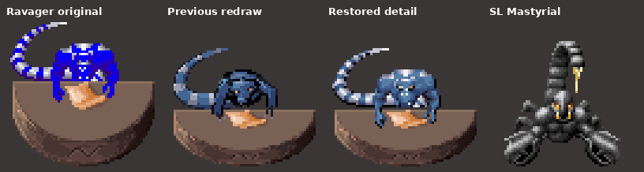
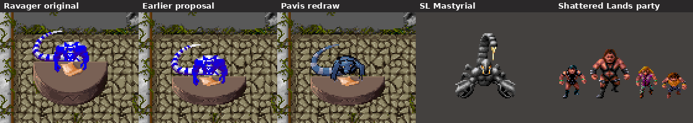
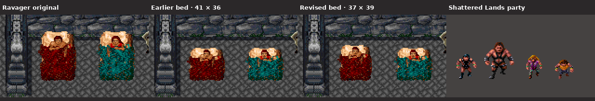

# Scenery scale and the miner with a pick

The 37 × 39 cot proportions approved for 3777 Wounded Citizen also apply to 917 Sicky, 3778 Wounded Soldier and 3779 Sick Guy. Each keeps its own patient, bedding colours and animation timing. Nnamdi’s lowered bottle counter is approved. The same decision covers Ikibod’s matching counter. Aleka’s lowered writing table and gesture are approved. Pavis’s restored-detail creature and lowered basin are approved. The two-pose miner redraw is approved, completing this nine-figure batch review. The download includes every stored pose, the original script timings, a native-size viewer and the party comparisons. [Download the artwork and viewer](proposals/scenery-and-miner.zip)

## The miner beside the party

**3613 Miner with pick.** The previous proposal reduced the Ravager miner and changed his shading. That retained Ravager’s anatomy and viewing angle. The approved redraw starts with picture 2072, the Shattered Lands male half-giant from character creation. His head, shoulders, chest and boots establish the scale. The two forearms, grips, pick and violet work-wrap are drawn for the job. Both hands carry the shaft through the stroke, and his boots stay planted. Ravager object 288 leaves race unspecified. Half-giant is the chosen art reference.

My read is that the new figure belongs beside the party. At game size, the shoulders and foot spacing match the half-giant, while the tool and low hands identify the miner. The lineup is staged on mine terrain and uses the actual SL human man, male half-giant, elf woman and male halfling on one ground line. [Play at native size](img/miner-party-native.gif)

## How large the furniture should look

The earlier project decision kept Ravager’s ground and wall heights and lowered eligible furniture to 66% of its visible height toward its base. Its width and ground contact stay fixed. The project lists 60 pictures in Tyr and records an in-game check. The implementation skips pictures with animation scripts, which includes the occupied beds and counters. [Owner’s review](https://github.com/daaki85/darksun-recompiled/blob/8933c6dd14e72de05a8678370a6d38e3ffeaa36c/docs/FIGURES.md#after-the-owners-review-2026-11-20) · [List of 60 Tyr pictures](https://github.com/daaki85/darksun-recompiled/blob/8933c6dd14e72de05a8678370a6d38e3ffeaa36c/docs/RAVAGER-FIGURES.md#map-artwork-squashed-60) · [Furniture transform](https://github.com/daaki85/darksun-recompiled/blob/8933c6dd14e72de05a8678370a6d38e3ffeaa36c/tools/sl_figures.py#L532)

The previous scenery pass reduced the people but kept the large furniture baked into their sprites. It also rendered surrounding props from the stock archive. In the new study the furniture receives the earlier vertical treatment, then the person or creature is placed at the new counter, pillow or basin height. Surrounding eligible props use the output of the same furniture tool for that region. The columns show the same camera position and pixel scale.

| Figures | What to look for |
|---|---|
| 1160 Nnamdi, 1161 Aleka, 1479 Ikibod | The table, including bottles or papers, is lower. The attendants keep the figure scale from the prior proposal. Check the hand at the table edge. The empty-counter state uses the same transform. |
| 917 Sicky, 3777 Wounded Citizen, 3778 Wounded Soldier, 3779 Sick Guy | The head rests on the lowered pillow. All four beds share the approved 37 × 39 proportions. The Wounded Citizen panel also shows the neighbouring bed at the revised height. |
| 787 Pavis | The basin and its empty state are lower. The creature keeps its silhouette above the rim. The blue is from the region palette. |

All seven occupants’ game records leave race unspecified. The SL Villager supplies their human-sized figure comparison. Pavis is compared with the SL Mastyrial. I recommend the lowered counters and beds as the scale reference for occupied furniture. The basin is a separate encounter study. Object 465 names Pavis and leaves race unspecified. The walkthrough places Paviss among the Yuan-Ti and has him prepare a note. The Mastyrial supplies an SL shading and scale reference. [Idle animation](img/787-pavis-motion.gif) · [Empty state](img/787-pavis-empty.png) · [Encounter description](../../guide/wake-of-the-ravager-walkthrough.txt#L2883) [All bed and counter placements, including both of Sicky’s regions](img/beds-and-counters.png)

Tantris’s lowered basin, original two poses and viewing angle are approved. [Original and approved Tantris](README.md#788-tantris)

Snaggle’s occupied sickbed (2573) is approved. It shares its exposed frame and anchor with empty bed 2574. [Sickbed comparison](README.md#2573-snaggletooth)

The Elderbrain tank and platform are approved for both the idle and destruction sequences. [Assembled Elderbrain](README.md#3511-elderbrain) The [seated Sultan](README.md#1247-sultan) is approved for both idle poses and the empty-cushion state. [Kovar](README.md#1617-kovar) is approved for the three captive poses and empty shackles. [Miner 2479](README.md#2479-miner) is approved at both mine openings. [Utella](README.md#2572-utella) is approved for the revised bent-elbow motion at her loom. [Melantha](README.md#2783-melantha) is approved at silt-giant scale with her chair and the 82% straw bed. The [seated Mindflayer](README.md#3231-mindflayer) is approved for both eating poses and the slumped pose with the revised table, chairs and place settings. Miner 2479 and miner 3613 are separate pictures.

Nnamdi and Ikibod share a pixel-identical empty counter and the same figure silhouette in each corresponding pose. Ikibod uses different colours and gesture timing. Aleka’s separate writing table has papers under the moving hand. [View Aleka beside the party](img/1161-aleka-motion.gif)

## 787 Pavis creature redraw

**Artwork approved.** Use the restored-detail creature and lowered basin. The previous redraw lost the separation between the shoulders, face and hands. This pass recovers the individual fingers and the broad, uneven bands around the original tail arc in both poses. Short light edges pick out the brow, jaw and knuckles against the blue-grey shadows.

[Compare in the room beside the SL party](img/787-pavis-detail.gif) · [Play at native size](img/787-pavis-detail-native.gif)

**Previous redraw.** Pavis leans over the tan surface, with a narrow snout, a warm eye, and a banded tail that swings from one side to the other. The blue-grey hide uses small highlights on the brow and shoulders. Object 465 leaves race unspecified. The Mastyrial provides the Shattered Lands lighting reference and the party provides the scale comparison.

The two idle poses use the original 500 and 450 ms preview timing. The third frame decoded identically to the approved empty basin in the combined archive check. [Native-size animation](img/787-pavis-redraw-native.gif) · [Empty state](img/787-pavis-empty.png)

## 3777 Wounded Citizen bed revision

The earlier lowered bed measured 41 × 36 pixels. The approved revision measures 37 × 39. Two pixels come in on each side and the head of the bed extends three pixels farther up the screen. The foot stays on its original ground line. The patient keeps the same body pixels and sits two pixels higher against the pillow. Object 379 leaves race unspecified. [Game-size animation](img/3777-wounded-citizen-bed.gif) · [Placement sheet](img/beds-and-counters.png)

## Verification

The nine proposed picture resources contain 32 stored frames. Each decoded at its original frame extent in a combined OBJEX test copy. The original scripts supply their anchors and timing. The source utility reproduced its recorded count of 60 Tyr pictures. The scenery comparisons are map renders, and the miner lineup is a staged size and animation comparison. These drafts have not been playtested in DOSBox. [Previous artwork and full comparison history](merchant-batch-contrast.md)
