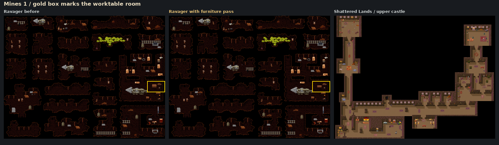
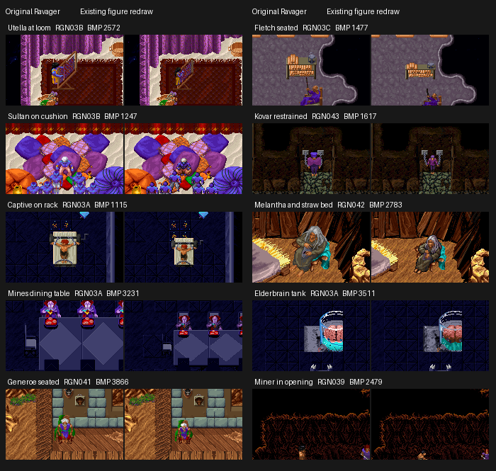

# Ravager furniture at Shattered Lands scale

The first pass lowers 19 freestanding shelves at all 54 of their placements. Each uses the 0.66 vertical scale of the Tyr furniture pass. The shelf contents are part of each picture. Its horizontal scale, floor contact and palette are preserved. The originals came from the player's Ravager files during the package build. The Loader applies the resulting pictures through the existing figure option.

## What the first pass looks like

The gold box on the two headquarters maps marks the room enlarged below. The third panel shows the upper castle in Shattered Lands at the same map scale. The two headquarters maps have identical terrain and object coordinates.

Look at the bookcase and potion shelf against the back wall. Their tops come down 20 and 19 pixels, respectively. Both now show 38 rows of artwork. Compare the space above the furniture and the proportions of the shelves in the upper castle.

## Loose furniture and storage

The second pass lowers 61 more pictures at 217 placements in nine regions. It covers barrels, crates, counters, benches, tables, beds and seating. Three interactive fixtures have separate open and closed drawings. Both use the same bottom anchor and the shipped animation timings.

The gold box marks the Mines 1 storeroom in the first two maps. In the enlarged view, compare the height of the wide worktable against the stacked crates behind it. The Forest scene shows a bed, its foot chest and a neighboring gem table. In Volcano 1, compare the proportions of the round tabletop and the stool to its right. All three rows use scene renders from the Loader's built object file.

The candidate review also turned up sets that need different treatment. Squashing the Forest dining tables and stools in place opens a gap on the far side of the table. A Veiled Alliance crate has a separate vase resting on its top edge. The tall Mines 3 throne comprises two separately placed pictures. These sets need coordinated placement. The three round Volcano 2 floor displays (3527–3529) keep their depth against the paving.

## Earlier figure work

The figures and their furniture can share one picture. Other scenes use a separate bed, stall front, table leg or place setting. Compared 81 stored frames across 33 pictures with the originals and examined 20 scenes with the mod's object remaps and Mines 3 placement changes applied. The panels show the original Ravager scene on the left of each pair and the existing figure work on the right. These are offline renders of the first stored pose. The Tyr stall has since been checked in DOSBox. Scripted transitions and interactions in the other rooms still need a play check.

| Scene | Finding and decision |
|---|---|
| Nnamdi and Ikibod's bottle counters, Aleka's writing table | The bottles, papers and hands meet the lowered surface. The empty poses use the lower surface too. Keep these three as references for staffed counters. |
| Sicky and the patients under Tyr | The patients' heads rest on the pillows and the occupied cots share a foot line. The chosen proportions are 37 × 39 for the four revised patient cots. Keep Cleave, Snaggle and the separate empty bed in the comparison when reviewing other beds. |
| Pavis and Tantris | The bodies remain distinct above the lowered rims. Pavis's empty basin keeps its low profile. Keep the existing poses. |
| Sultan, Fletch, Utella, Generoe and Melantha | The cushion, seats, loom and giant's bed belong with the figures. Melantha's set has its own approved 82% bed scale. Preserve those individual decisions when comparing neighboring furniture. |
| Notaku's stall | The live Tyr view shows a strip of teal shop floor between Notaku and the joined front halves. His feet, the mortar and the glassware read separately. Retain the approved counter height. |
| Mines 3 | The dining seats line up with the smaller table and place settings after the existing ETAB change. Check the seated, eating and slumped states together in-game. The Elderbrain tank and its platform also need one assembled check through destruction. |
| Captives and mine openings | Kovar's supports, the captive's rack and the mine opening frame their figures. Review attachment to the surroundings whenever an adjoining prop changes. |

## Live check in Tyr

The left screenshot shows the approved stall in Shadow Square. In the right screenshot, look for the purple chairs against the left wall of the red-carpeted room. The lower one is picture 2590 at (1341, 238). Its visible pixels match the new, shorter drawing in the Loader’s object file. [Playtest log](../../playtest/logs/2026-11-27-ravager-furniture.md)

## Region work queue

The scan covered all 20 shipped region files. The counts below are distinct picture references in each region's placement table before object-picture remaps, using the installed Mines 3 placement override. Pictures shared between regions count once in each. The two furniture columns count placements, including repeats. The last column names the next review for that region.

| Region | Pictures | Shelves lowered | Other furniture lowered | Next review |
|---|---:|---:|---:|---|
| 001 Forest | 252 | 0 | 18 | Adjust dining table and stool spacing as a group |
| 032 Tyr | 246 | 1 | 42 | Check remaining indoor storage states in play |
| 033 Veiled Alliance | 195 | 21 | 60 | Test vase-bearing crate and damaged beds with separate props |
| 034 Pyramid | 152 | 0 | 23 | Test cabinet 3250 in both states |
| 036 Yuan-ti | 104 | 3 | 0 | Check surrounding vessels against the three shelves |
| 037 Temple | 62 | 0 | 0 | Use Pavis and Tantris as references for nearby fixtures |
| 038 Mines 1 | 108 | 0 | 12 | Check worktable, crates and Sicky's neighboring furnishings in play |
| 039 Mines 2 | 160 | 0 | 0 | Check mining equipment and its animated states against the two miner pictures |
| 03A Mines 3 | 219 | 8 | 7 | Check dining sequence, tank destruction and other chairs in-game |
| 03B Jann | 173 | 0 | 0 | Compare freestanding camp furniture against Utella and the seated Sultan |
| 03C Mosaic | 89 | 0 | 0 | Compare stocked counter 703 with Fletch's chair and Ikibod's stall |
| 03D Volcano 2 | 143 | 15 | 22 | Compare room placements in-game |
| 03E Volcano 1 | 133 | 6 | 19 | Check lowered stocked counter 2630 beside shelf 2631 in-game |
| 03F Volcano 3 | 95 | 0 | 0 | Distinguish furnishings from formations, starting with spires 1376–1378 |
| 041 Giants | 216 | 0 | 0 | Review seats and tables against Generoe at giant scale |
| 042 Cloud | 131 | 0 | 0 | Check the surrounding furnishings against Melantha's bespoke bed |
| 043 Crypt | 175 | 0 | 0 | Inspect narrow wooden furnishings 3824–3830 and Kovar's supports |
| 044 Cosmos | 86 | 0 | 0 | Inspect the multi-part group around 1716–1723, including its scripted states |
| 045 Under Tyr | 135 | 0 | 14 | Check loose stools and crates beside the patient cots in-game |
| 0FF Limbo | 690 | 0 | 0 | Trace holding-area furniture and scripted actors to their gameplay use, including Snaggle |

The [picture inventory](inventory.csv) records both furniture passes, the redrawn pieces examined and candidates for subsequent passes. It includes all placements found for each listed picture and catalogue package names where applicable. Candidate families are provisional. Compare all orientations and raised or stacked objects as a set before accepting a change. An area is complete when its furniture has a recorded visual decision and the affected rooms and scripted states pass the in-game check. The project is still open against that standard.
