# Ravager furniture at Shattered Lands scale

The first pass lowers 19 freestanding shelves at all 54 of their placements. Each uses the 0.66 vertical scale of the Tyr furniture pass. The shelf contents are part of each picture. Its horizontal scale, floor contact and palette are preserved. The originals came from the player's Ravager files during the package build. The Loader applies the resulting pictures through the existing figure option.

## What the first pass looks like

The gold box on the two headquarters maps marks the room enlarged below. The third panel shows the upper castle in Shattered Lands at the same map scale. The two headquarters maps have identical terrain and object coordinates.

Look at the bookcase and potion shelf against the back wall. Their tops come down 20 and 19 pixels, respectively. Both now show 38 rows of artwork. Compare the space above the furniture and the proportions of the shelves in the upper castle.

## Loose furniture and storage

The second pass lowers 61 more pictures at 217 placements in nine regions. It covers barrels, crates, counters, benches, tables, beds and seating. Three interactive fixtures have separate open and closed drawings. Both use the same bottom anchor and the shipped animation timings.

The gold box marks the Mines 1 storeroom in the first two maps. In the enlarged view, compare the height of the wide worktable against the stacked crates behind it. The Forest scene shows a bed, its foot chest and a neighboring gem table. In Volcano 1, compare the proportions of the round tabletop and the stool to its right. All three rows use scene renders from the Loader's built object file.

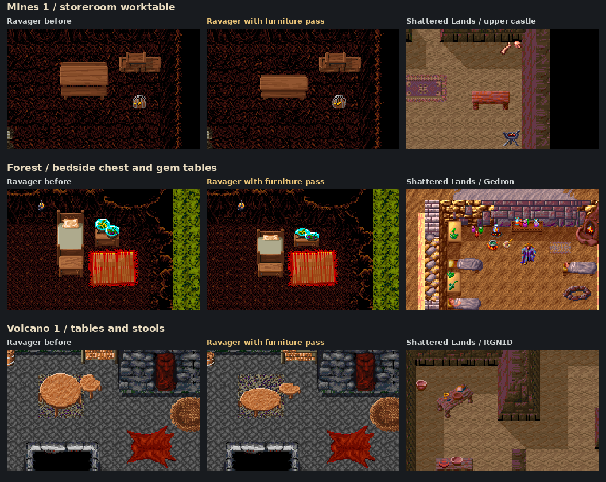

The three round Volcano 2 floor displays (3527–3529) keep their depth against the paving.

## Furniture assembled from separate objects

The third pass lowers 18 pictures at 41 placements. The Forest has eight tables and 30 associated pieces. Fourteen stools and benches move closer to their tables so that the far seats tuck under the tabletop. In the Veiled Alliance headquarters, the vase drops seven pixels to meet the newly lowered crate. The same vase drawing appears at nine other locations, which retain their original positions. In Mines 3 the throne back drops ten pixels to meet the seat. The earlier figure redraw supplies the rest of the Mines 3 dining-room layout.

The whole Forest is shown at one quarter of game-map resolution. The box marks the room enlarged in the first row of the detail sheet. Gedron is shown at the same scale. In the detail sheet, compare the space behind the far chair, the bottom edge of the vase, and the join between the two sections of the throne. The right column shows a Gedron table, an upper castle chest, and the throne in Gedron. The Ravager panels use the previous furniture pass on the left and the Loader's built object and region files on the right. These are map renders with the first stored pose of each picture.

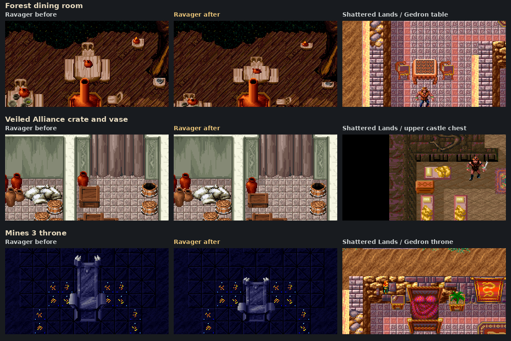

## Jann, Mosaic and the Silt Sea Giants

The fourth pass changes 14 pictures at 26 placements. On the maps, the gold rectangles pick out the Sultan’s room and a giant’s plank table. The Shattered Lands references show a furnished room in the upper castle and a table in Gedron at the same map scale.

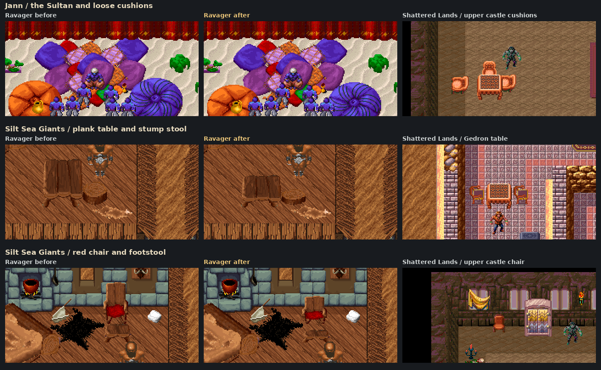

- **Jann.** Around the Sultan, applying the Tyr scale to the whole cushion opened strips of sand between overlapping pillows. On the five thick cushion drawings, the embroidered tops now sit three or five pixels lower. Only the lower edge is compressed. The thin pillows and the Sultan’s own seat keep their original depth in the pile. The two baskets near Utella’s loom use the regular Tyr treatment.
- **Silt Sea Giants.** The red chair drops from 49 to 33 visible rows. At the plank table, look at the stump stool and the giant standing behind it. The table keeps its 48-pixel width and both pieces sit on their original floor lines. The seven revised pictures also include the two angled wooden furnishings, the wall-side table and the low footstool. Generoe’s occupied rocker keeps all four poses from the figure redraw.
- **Mosaic.** The movable bookcase beside Fletch and Ikibod’s stocked work surface already have the earlier artwork. The museum’s sixteen display positions form a puzzle. The data includes empty, damaged and dressed busts, plus separate bust objects in Limbo. The game asks the player to move Horace to another stand, remove Ellith and break Khildril. Keep the display heights pending a playthrough of those transitions.

The figure sheet shows the rooms from the built mod. Comparing the previous and new Loader output found changes only in the 14 selected pictures. All 26 placements produced a visible pixel change when checked individually. Both furniture columns use the figure redraw. The standing village giants use the idle frame and foot anchor from their animation script. Other pictures in these static renders use their first stored pose. Direct in-game inspection of the revised rooms is still open.

The giant behind the stump stool is Gilad, object 214 at (500, 602). He also appears at the lower edge of the red-chair view. The earlier preview selected picture 2469’s frame 0, which the mod retains from the original game. For the same facing, the approved animation script selects frame 12. Both furniture builds match the approved picture and script byte for byte. The close-up below holds the furniture fixed to show the pose correction.

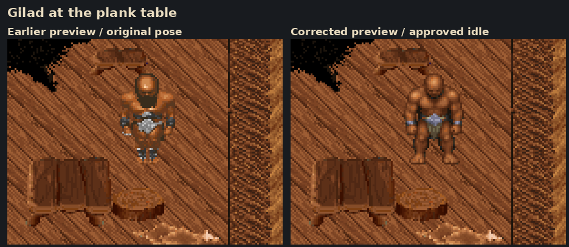

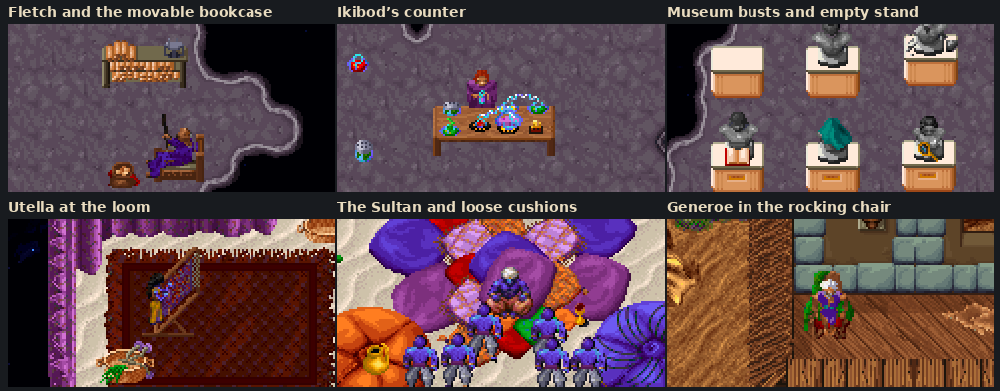

## Crypt, Cloud and the Temple of the Cosmos

The fifth pass lowers eight Crypt pictures at eleven placements and three Cloud pictures at one placement each. On the whole maps, the gold rectangles mark the Crypt barracks, the Cloud pottery and the corresponding rooms in Gedron.

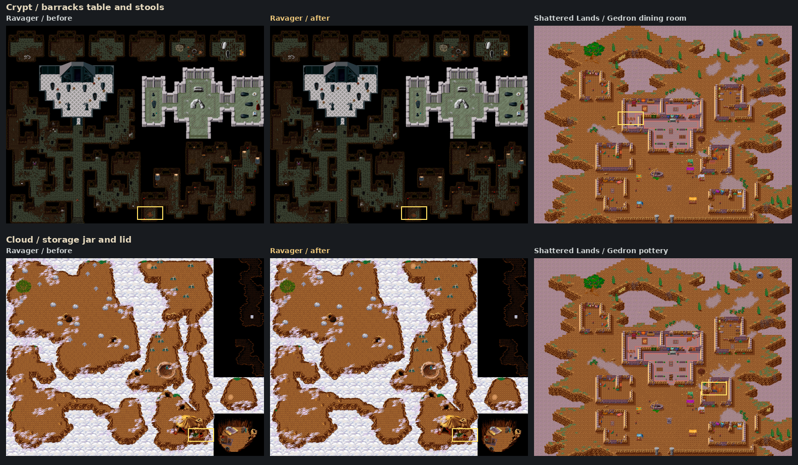

In the first row, follow the back edge of the Crypt table and the stools on either side. In the second, the blankets and pillow move down toward the foot of the bed. The third shows a squat clay jar with its lid resting against the side. Its width and contact with the ground match the previous build. The Shattered Lands column shows Gedron’s dining room, upper castle beds and Gedron pottery.

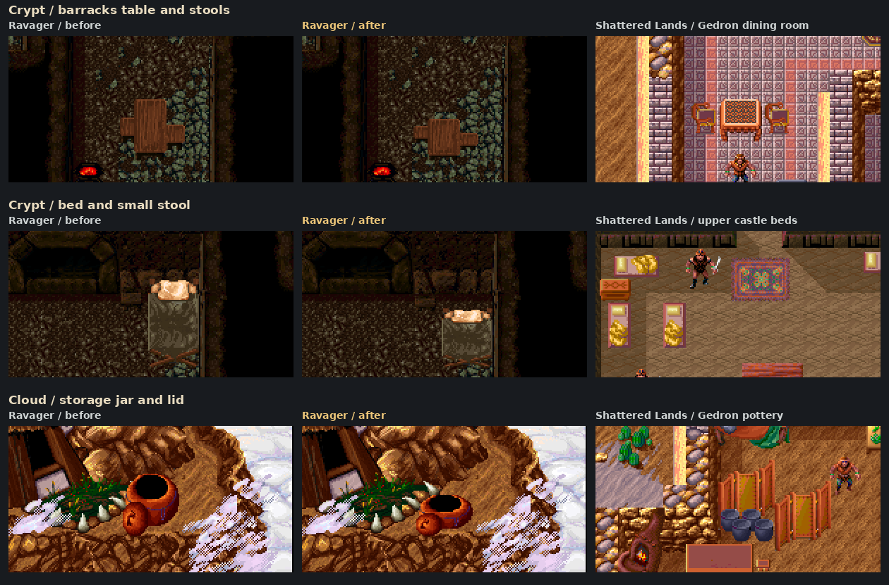

- **Crypt.** The barracks tables, benches, stools and four beds take the Tyr scale. Jumah’s green table partly conceals a key. In a trial render, lowering that table and seat increased the visible key from 48 to 56 pixels. The shipped version keeps the original overlap. Kovar’s shackles were reviewed with his approved figure poses.
- **Cloud.** The open jar, loose lid and jar with a leaning lid take the same scale. Melantha’s bed and her figure share an earlier redraw with its own bed proportions. The table and stool beside her are painted into three adjoining pieces of rug. Those pieces still meet across the floor.
- **Temple of the Cosmos.** The four elemental gate capstones meet the surrounding stonework. The four central statues receive the ritual artifacts. All eight pictures occur in both versions of the temple. Both stored frames of each picture were checked against the previous build. Keep their dimensions and check the ritual in play.

The two Ravager columns use the Loader’s previous and revised object files and select a standing or stationary pose from the animation script where available. All 14 changed placements were checked individually under the surrounding artwork. Each of the six rooms below rendered identically across the two builds. In-game checks of these rooms remain open.

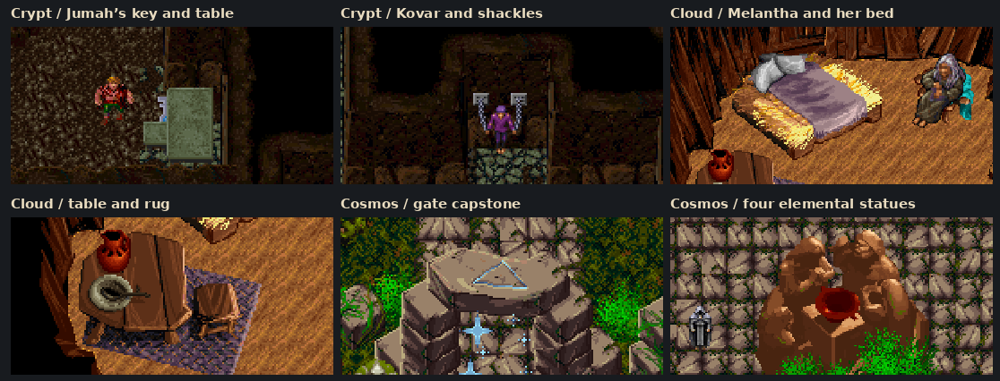

## Mines 2 and Volcano 3

The barrel-and-sack pile in Mines 2 also appears twice in Tyr, once in Volcano 2 and once Under Tyr. Lowering the entire pile to 66% almost hid both barrel lids behind a foreground wall in Tyr. At 82% the lids still read separately, the sacks meet the ground and the pile sits lower beside the mine crate. Both Loader builds were rendered in the same room at each of the five placements. The rebuild changed only picture 3558.

Two separate miners were checked against the earlier figure redraw. The first pair below shows the miner at the tunnel mouth (2479) on the second step of his animation. The second pair shows the miner with the pick (3613) on the first step. Each pair holds the room and animation step fixed. Both frames of each miner differ from stock in the built file.

On the Mines 2 map, twelve similar fixtures (2510–2521) each have three stored states. Picture 3733 has two states and two placements. Their art and animation scripts match the preceding build. Their use during mine travel still needs an in-game check. In Volcano 3, the three flagged spires (1376–1378) repeat at 128 placements along the lava and rocky ground. The lower map shows the patch enlarged above. Keep the spires at their terrain height.

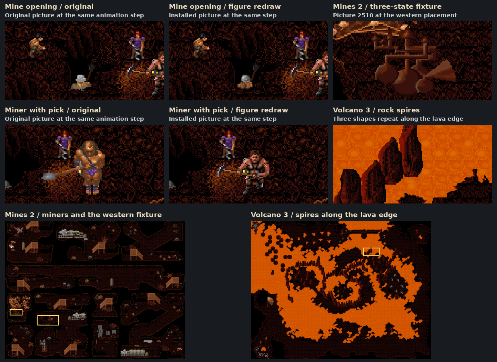

## Ruined Alliance headquarters and the Yuan-ti tunnels

The seventh pass changes 14 pictures at 24 placements. Seventeen placements are in the Veiled Alliance headquarters, five in the Yuan-ti tunnels and two in Mines 3. Across all seven passes, 138 pictures have been revised at 381 placements in 15 regions. The whole maps mark the torn teal bed and the two-piece weapon display. The right column shows upper castle beds and a Gedron table at the same map scale.

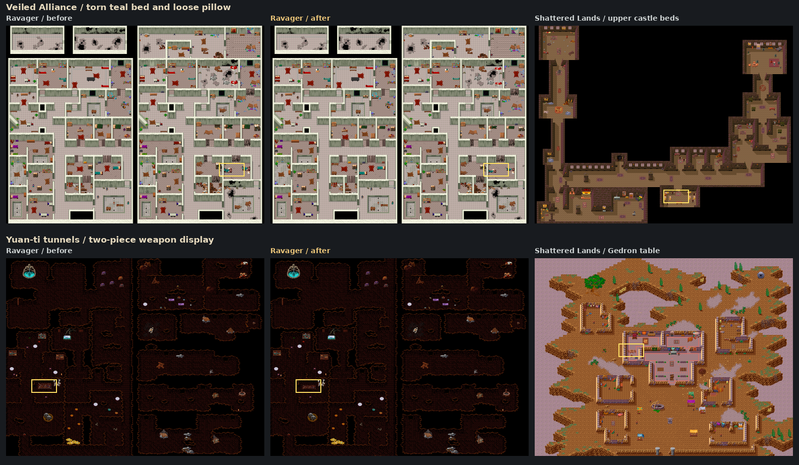

In the Alliance rooms, look at the pillow caught on the torn teal blanket and the two loose pillows beside the green bed. Only the pillows that rested against the upper halves of the beds moved, both down 11 pixels. The floor pillows keep their positions. The sideways intact green bed, its damaged counterpart, the upright damaged bed and the torn red couch now use the Tyr scale. The earlier occupied sickbed redraw is visible in the separate review below.

The ruined storeroom uses four broken crate pictures across two piles. The standard squash opened a gap below the red pot. At 82% height, with the rear crates brought closer to the front ones and the pot lowered onto its crate, the stack still reads through the foreground wall. The Yuan-ti jar and two bowls also use 82% so that the pale rims remain visible against the liquid.

The two halves of the weapon display share a floor line in both regions. In each palette the assembled result matches a single 66% reduction of the entire display, pixel for pixel across the join. Earlier art supplies the three Yuan-ti shelves and the sacks and jars elsewhere in the tunnels.

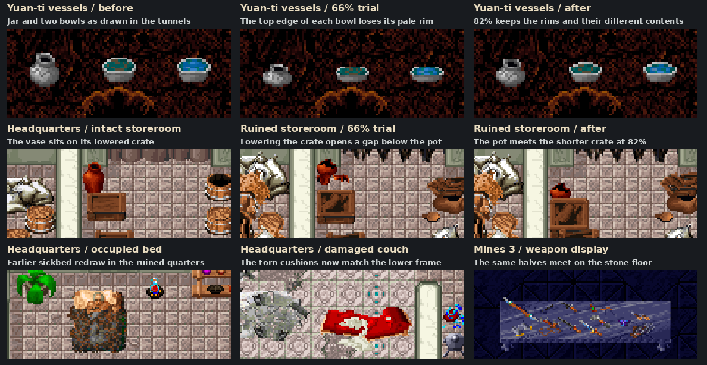

The comparisons use the previous and revised Loader object and region files. All 24 placements were checked individually for a visible difference. The only placement data changes were the vertical positions of two pillows, four crates and one pot. Direct play checks of the headquarters after the attack and the display in both regions remain open.

## Earlier figure work

The figures and their furniture can share one picture. Other scenes use a separate bed, stall front, table leg or place setting. Compared 81 stored frames across 33 pictures with the originals and examined 20 scenes with the mod's object remaps and Mines 3 placement changes applied. The panels show the original Ravager scene on the left of each pair and the existing figure work on the right. These are offline renders of the first stored pose. The Tyr stall has since been checked in DOSBox. Scripted transitions and interactions in the other rooms still need a play check.

| Scene | Finding and decision |
|---|---|
| Nnamdi and Ikibod's bottle counters, Aleka's writing table | The bottles, papers and hands meet the lowered surface. The empty poses use the lower surface too. Keep these three as references for staffed counters. |
| Sicky and the patients under Tyr | The patients' heads rest on the pillows and the occupied cots share a foot line. The chosen proportions are 37 × 39 for the four revised patient cots. Keep Cleave, Snaggle and the separate empty bed in the comparison when reviewing other beds. |
| Pavis and Tantris | The bodies remain distinct above the lowered rims. Pavis's empty basin keeps its low profile. Keep the existing poses. |
| Sultan, Fletch, Utella, Generoe and Melantha | The cushion, seats, loom and giant's bed belong with the figures. Melantha's set has its own approved 82% bed scale. Preserve those individual decisions when comparing neighboring furniture. |
| Notaku's stall | The live Tyr view shows a strip of teal shop floor between Notaku and the joined front halves. His feet, the mortar and the glassware read separately. Retain the approved counter height. |
| Mines 3 | The dining seats line up with the smaller table and place settings after the existing ETAB change. Check the seated, eating and slumped states together in-game. The Elderbrain tank and its platform also need one assembled check through destruction. |
| Captives and mine openings | Kovar's supports, the captive's rack and the mine opening frame their figures. Review attachment to the surroundings whenever an adjoining prop changes. |

## Live check in Tyr

The left screenshot shows the approved stall in Shadow Square. In the right screenshot, look for the purple chairs against the left wall of the red-carpeted room. The lower one is picture 2590 at (1341, 238). Its visible pixels match the new, shorter drawing in the Loader’s object file. [Playtest log](../../playtest/logs/2026-11-27-ravager-furniture.md)

## Region work queue

The scan covered all 20 shipped region files. The counts below are distinct picture references in each region's placement table before object-picture remaps, using the installed Mines 3 placement override. Pictures shared between regions count once in each. The two furniture columns count placements, including repeats. The last column names the next review for that region.

| Region | Pictures | Shelves lowered | Other furniture lowered | Next review |
|---|---:|---:|---:|---|
| 001 Forest | 252 | 0 | 56 | Check dining sets in play |
| 032 Tyr | 246 | 1 | 44 | Check remaining indoor storage states in play |
| 033 Veiled Alliance | 195 | 21 | 78 | Check both headquarters layouts in play, including torn beds, pillows and the pot on the broken crate |
| 034 Pyramid | 152 | 0 | 23 | Test cabinet 3250 in both states |
| 036 Yuan-ti | 104 | 3 | 5 | Check the weapon display and small vessels in play |
| 037 Temple | 62 | 0 | 0 | Use Pavis and Tantris as references for nearby fixtures |
| 038 Mines 1 | 108 | 0 | 12 | Check worktable, crates and Sicky's neighboring furnishings in play |
| 039 Mines 2 | 160 | 0 | 1 | Check the storage pile, miners and multi-state fixtures in play |
| 03A Mines 3 | 219 | 8 | 11 | Check the weapon display, throne, dining sequence and tank destruction in play |
| 03B Jann | 173 | 0 | 15 | Check cushion piles and baskets in play, and the covered wagon in both states |
| 03C Mosaic | 89 | 0 | 0 | Check movable bookcase and museum bust transitions in play |
| 03D Volcano 2 | 143 | 15 | 23 | Compare room placements in-game |
| 03E Volcano 1 | 133 | 6 | 19 | Check lowered stocked counter 2630 beside shelf 2631 in-game |
| 03F Volcano 3 | 95 | 0 | 0 | Lava spires reviewed at terrain height. Check the remaining scenery in play |
| 041 Giants | 216 | 0 | 11 | Check the plank tables, red chairs and Generoe’s rocker in play |
| 042 Cloud | 131 | 0 | 3 | Check the jars in play and the occupied bed through Melantha’s scene |
| 043 Crypt | 175 | 0 | 11 | Check barracks furniture, the key beneath Jumah’s table and Kovar’s shackles in play |
| 044 Cosmos | 86 | 0 | 0 | Check the elemental gates and artifact placement on the ritual statues in play |
| 045 Under Tyr | 135 | 0 | 15 | Check loose stools and crates beside the patient cots in-game |
| 0FF Limbo | 690 | 0 | 0 | Trace holding-area furniture and scripted actors to their gameplay use, including Snaggle |

The [picture inventory](inventory.csv) records all seven furniture passes, the redrawn pieces examined and candidates for subsequent passes. It includes all placements found for each listed picture and catalogue package names where applicable. Candidate families are provisional. Compare all orientations and raised or stacked objects as a set before accepting a change. An area is complete when its furniture has a recorded visual decision and the affected rooms and scripted states pass the in-game check. The project is still open against that standard.
