# Ravager furniture at Shattered Lands scale

## Project progress

All 20 shipped region files have been scanned. The first eight passes revised 140 pictures at 387 placements across 16 regions. Follow-up checks added 20 pictures, including the stocked round table used four times in Volcano 1, three silver furnishings and two side-facing counters. Six cover the empty throne summoned from Limbo into El’s Temple, three different mine chests, the kitchen crates and the upright polearm stand shared by three regions. Another eight form five two-piece worktables in Mines 3. The four regions with no new furniture squash in the first eight passes were Mosaic, Volcano 3, the Temple of the Cosmos and Limbo. The first three have recorded decisions on puzzle fixtures or terrain. Limbo holds objects the game can bring into other areas.

Live checks cover all four two-piece red beds in Tyr, both headquarters layouts and Mines 1. The Alliance storeroom stacks, Notaku’s stall and a chair in Tyr, and the complete Mosaic museum puzzle and exit have also been checked. All eleven inventoried Yuan-ti furniture placements have now been seen in DOSBox, including the two storage piles from the figure redraw. The Volcano pass covers all 21 inventoried shelves, the set dining tables and the second torn-bed design, including its other placement in Tyr. The wider all-area review is still open. Ikibod’s work surface, the six temple braziers and Tantris leaving his throne have now been checked in play. The wizard’s potion and tapestry sequence is still open. The Mines 3 dining sequence, tank destruction and prisoner release have been checked in DOSBox. The Cosmos ritual remains open. [Mosaic in DOSBox](#live-check-in-the-mosaic-museum)

## Repairing the split beds and the Alliance storeroom

The whole-map comparison marks both bedrooms and the intact storeroom. The upper castle in Shattered Lands provides a reference at the same map scale.

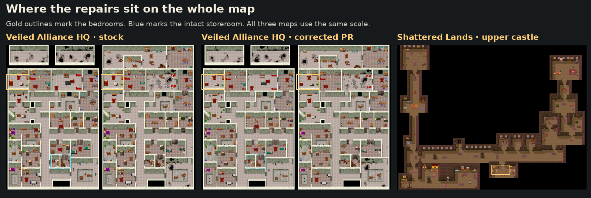

The red bed was already in the figure redraw. Its pillow and upper blanket are picture 524. The foot and legs are 525. Scaling the two pictures separately exposed three full rows of floor through the blanket. All four placements have the same overlap. Scaling the joined 68-row image once gives a 45-row bed with a continuous blanket and the original floor line. The game still draws two objects, with their original dimensions, positions and order.

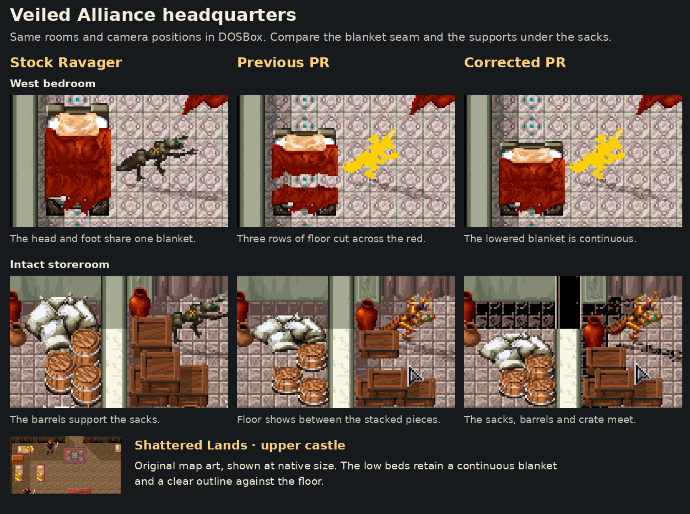

The paired bed appears at (55, 423) and (1079, 423) in the Alliance, (407, 95) in Tyr and (1996, 1340) in Mines 1. These coordinates identify the head piece. At each site the foot is 22 map pixels south. All four repaired beds matched the joined drawing in DOSBox.

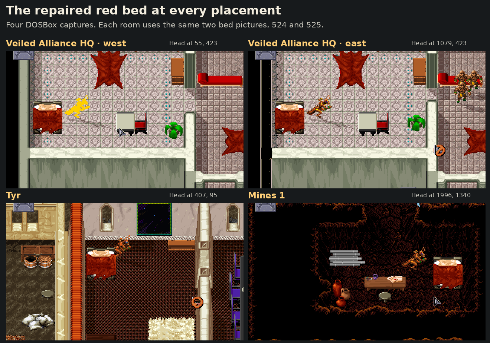

In the intact Alliance storeroom, the rear barrels moved seven pixels toward the foreground. The barrel supporting the sacks moved two, and the sacks moved eleven. The crate carrying the intact red vase also needed to sit on the boxes below. The crate and its vase moved another ten pixels together. The sack piles on the floor and the separate broken-crate arrangements keep their existing placements.

Pictures 2591 and 2704 in the original defect report belong to the red chair and pale table nearby. The placement review covers thirteen chairs and six tables across Tyr and the Alliance. [All nineteen placements, stock and current](alliance-bed-id-review.png) · [DOSBox playtest](../../playtest/logs/2026-11-27-ravager-furniture-joins.md)

## Freestanding shelves

The first pass lowers 19 freestanding shelves at all 54 of their placements. The first version used the 0.66 vertical scale of the Tyr furniture pass on each shelf. The later Mines 3 orb check and Volcano shop checks protect the contents of five shelves by shortening the spaces between their boards. The shelf contents are part of each picture. Its horizontal scale, floor contact and palette are preserved. The originals came from the player's Ravager files during the package build. The Loader applies the resulting pictures through the existing figure option.

## What the first pass looks like

The gold box on the two headquarters maps marks the room enlarged below. The third panel shows the upper castle in Shattered Lands at the same map scale. The two headquarters maps have identical terrain and object coordinates.

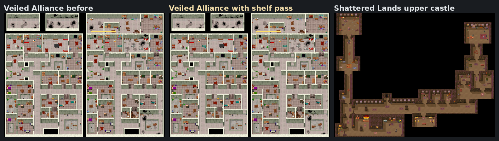

Look at the bookcase and potion shelf against the back wall. Their tops come down 20 and 19 pixels, respectively. Both now show 38 rows of artwork. Compare the space above the furniture and the proportions of the shelves in the upper castle.

## Loose furniture and storage

The second pass lowers 61 more pictures at 217 placements in nine regions. It covers barrels, crates, counters, benches, tables, beds and seating. Three interactive fixtures have separate open and closed drawings. Both use the same bottom anchor and the shipped animation timings.

The gold box marks the Mines 1 storeroom in the first two maps. In the enlarged view, compare the height of the wide worktable against the stacked crates behind it. The Forest scene shows a bed, its foot chest and a neighboring grape plant. In Volcano 1, compare the proportions of the round tabletop and the stool to its right. All three rows use scene renders from the Loader's built object file.

The three round Volcano 2 floor displays (3527–3529) keep their depth against the paving.

## Furniture assembled from separate objects

The third pass lowers 18 pictures at 41 placements. The Forest has eight tables and 30 associated pieces. Fourteen stools and benches move closer to their tables so that the far seats tuck under the tabletop. In the Veiled Alliance headquarters, the vase initially dropped seven pixels to meet the newly lowered crate. The later stack repair moved the crate and vase together onto the lower boxes. The same vase drawing appears at nine other locations, which retain their original positions. In Mines 3 the throne back drops ten pixels to meet the seat. The earlier figure redraw supplies the rest of the Mines 3 dining-room layout.

The whole Forest is shown at one quarter of game-map resolution. The box marks the room enlarged in the first row of the detail sheet. Gedron is shown at the same scale. In the detail sheet, compare the space behind the far chair, the bottom edge of the vase, and the join between the two sections of the throne. The right column shows a Gedron table, an upper castle chest, and the throne in Gedron. The Ravager panels use the previous furniture pass on the left and the Loader's built object and region files on the right. These are map renders with the first stored pose of each picture.

### Forest dining tables in play

Seven main tables and seven small side tables now retain their full-size vessels on the lowered wood. Three rear chairs moved four to six pixels from the earlier squash so their backs remain visible. All eight main tables and 30 associated pieces were checked in the game. A hanging cloth covers the middle of one long bench in both builds. Cleave’s occupied bed uses its catalogue redraw. [Playtest and remaining Forest checks](../../playtest/logs/2026-11-27-ravager-forest-dining.md)

[Whole Forest beside Gedron](forest-dining-whole-maps.png) · [Original, previous and revised rooms beside Shattered Lands](forest-dining-live.png) · [All eight tables in DOSBox](forest-dining-all-eight.png)

### Forest plants and both sickbeds

The two stands previously labelled gem tables hold harvestable acorns and grapes. Both plants and all three cup tables now retain the artwork on top of their shortened wooden supports. Cleave’s bed keeps its height when the Hero Flask revives him. Snaggle’s catalogue painting sits on the same shortened frame in his Forest room. The foot chest has two stored poses. The second pose was staged because we found no Use action at that placement.

[Whole maps](forest-plants-whole-maps.png) · [Before and after beside Shattered Lands](forest-plants-and-cups.png) · [Beds, chest and harvest](forest-beds-and-harvest.png) · [Playtest](../../playtest/logs/2026-11-27-ravager-forest-plants-and-sickbeds.md)

## Jann, Mosaic and the Silt Sea Giants

The fourth pass changes 14 pictures at 26 placements. On the maps, the gold rectangles pick out the Sultan’s room and a giant’s plank table. The Shattered Lands references show a furnished room in the upper castle and a table in Gedron at the same map scale.

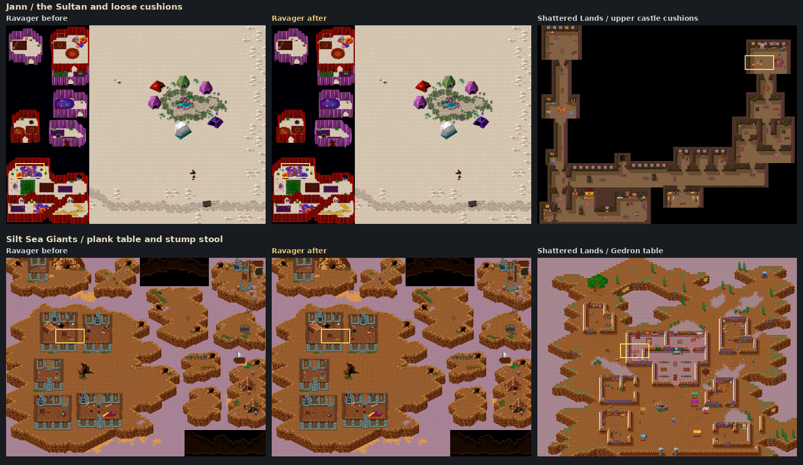

- **Jann.** Around the Sultan, applying the Tyr scale to the whole cushion opened strips of sand between overlapping pillows. On the five thick cushion drawings, the embroidered tops now sit three or five pixels lower. Only the lower edge is compressed. The thin pillows and the Sultan’s own seat keep their original depth in the pile. The two baskets near Utella’s loom use the regular Tyr treatment.
- **Silt Sea Giants.** The red chair drops from 49 to 33 visible rows. At the plank table, look at the stump stool and the giant standing behind it. The table keeps its 48-pixel width and both pieces sit on their original floor lines. The seven revised pictures also include the two angled wooden furnishings, the wall-side table and the low footstool. Generoe’s rocker keeps its three occupied poses and its empty drawing from the figure redraw.
- **Mosaic.** The movable bookcase beside Fletch and Ikibod’s stocked work surface already have the earlier artwork. Eight active busts and eight corresponding displays share a common pedestal height. The [museum playtest](#live-check-in-the-mosaic-museum) covers the seven bust interactions, Terris left in place, and all eight shards of the wall mirror.

The figure sheet shows the rooms from the built mod. Comparing the previous and new Loader output found changes only in the 14 selected pictures. All 26 placements produced a visible pixel change when checked individually. Both furniture columns use the figure redraw. The standing village giants use the idle frame and foot anchor from their animation script. Other pictures in these static renders use their first stored pose. The revised Jann and Giants rooms still need in-game inspection.

The giant behind the stump stool is Gilad, object 214 at (500, 602). He also appears at the lower edge of the red-chair view. The earlier preview selected picture 2469’s frame 0, which the mod retains from the original game. For the same facing, the approved animation script selects frame 12. Both furniture builds match the approved picture and script byte for byte. The close-up below holds the furniture fixed to show the pose correction.

### The giants’ homes in DOSBox

All 12 inventoried placements were checked in the game. The three plank tables keep their 48-pixel width and original floor contact. The two red chairs, footstool, stump stools, wall-side table and angled furnishings also keep their floor positions. Keep these proportions. Generoe’s rocking animation uses three occupied poses. The fourth stored drawing shows his empty chair. It has the same seat height as the settled pose.

The earlier picture of Gilad beside the table used an original standing frame in a reconstructed scene. Gilad was away from the table during our visit. In their own rooms, Velden and Davin both displayed the approved redrawn frame 12 of that same picture, 2469. Stock Ravager displayed frame 0 at the matching cameras.

[Whole islands beside Gedron](giants-furniture-whole-map.png) · [Furniture beside Shattered Lands](giants-furniture-live.png) · [Other furniture placements](giants-other-rooms.png) · [Velden and Generoe in the game](giants-figures-live.png) · [Playtest and placement ledger](../../playtest/logs/2026-11-28-ravager-silt-sea-giants.md)

## Crypt, Cloud and the Temple of the Cosmos

The fifth pass lowers eight Crypt pictures at eleven placements and three Cloud pictures at one placement each. On the whole maps, the gold rectangles mark the Crypt barracks, the Cloud pottery and the corresponding rooms in Gedron.

In the first row, follow the back edge of the Crypt table and the stools on either side. In the second, the blankets and pillow move down toward the foot of the bed. The third shows a squat clay jar with its lid resting against the side. Its width and contact with the ground match the previous build. The Shattered Lands column shows Gedron’s dining room, upper castle beds and Gedron pottery.

- **Crypt.** The barracks tables, benches, stools and four beds take the Tyr scale. Jumah’s green table partly conceals a key. In a trial render, lowering that table and seat increased the visible key from 48 to 56 pixels. The shipped version keeps the original overlap. Kovar’s shackles were reviewed with his approved figure poses.
- **Cloud.** The open jar, loose lid and jar with a leaning lid take the same scale. Melantha’s bed and her figure share an earlier redraw with its own bed proportions. The table and stool beside her are painted into three adjoining pieces of rug. Those pieces still meet across the floor.
- **Temple of the Cosmos.** The four elemental gate capstones meet the surrounding stonework. The four central statues receive the ritual artifacts. All eight pictures occur in both versions of the temple. Both stored frames of each picture were checked against the previous build. Keep their dimensions and check the ritual in play.

The two Ravager columns use the Loader’s previous and revised object files and select a standing or stationary pose from the animation script where available. All 14 changed placements were checked individually under the surrounding artwork. Each of the six rooms below rendered identically across the two builds. In-game checks of these rooms remain open.

## Mines 2 and Volcano 3

The barrel-and-sack pile in Mines 2 also appears twice in Tyr, once in Volcano 2 and once Under Tyr. Lowering the entire pile to 66% almost hid both barrel lids behind a foreground wall in Tyr. At 82% the lids still read separately, the sacks meet the ground and the pile sits lower beside the mine crate. Both Loader builds were rendered in the same room at each of the five placements. The rebuild changed only picture 3558.

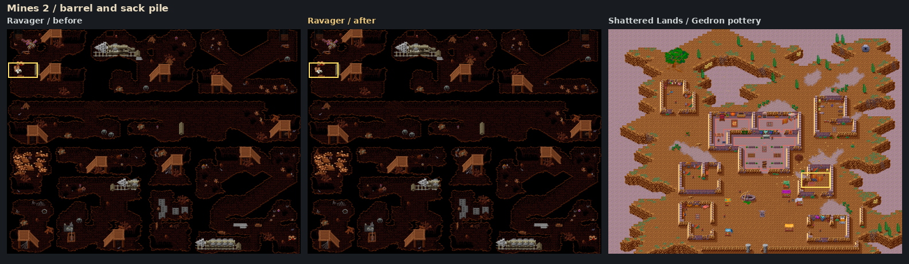

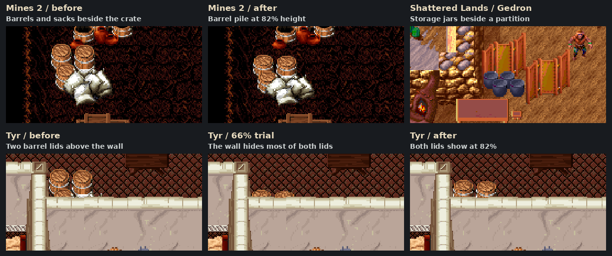

Two separate miners were checked against the earlier figure redraw. The first pair below shows the miner at the tunnel mouth (2479) on the second step of his animation. The second pair shows the miner with the pick (3613) on the first step. Each pair holds the room and animation step fixed. Both frames of each miner differ from stock in the built file.

On the Mines 2 map, twelve similar fixtures (2510–2521) each have three stored states. Picture 3733 has two states and two placements. Their art and animation scripts match the preceding build. Their use during mine travel still needs an in-game check. In Volcano 3, the three flagged spires (1376–1378) repeat at 128 placements along the lava and rocky ground. The lower map shows the patch enlarged above. Keep the spires at their terrain height.

### Volcano Core spires in DOSBox

Keep the three recurring spires at their original heights. The central ridge is easier to follow where the dark tips overlap the orange lava. A private DOSBox trial applied the furniture scale to all 128 placements. The 60-, 63- and 54-pixel shapes became 40, 42 and 36 pixels tall. The eastern row gained more space between tips but lost much of its outline at map scale. In the Shattered Lands Lava Rift, tall rock arches and low outcrops also mark different parts of the channel.

[Whole maps beside the Lava Rift](volcano-core-spires-whole-maps.png) · [Current height and shorter trial in DOSBox](volcano-core-spires-live.png) · [All 128 placements](volcano-core-placement-check.csv) · [Playtest](../../playtest/logs/2026-11-28-ravager-volcano-core-spires.md)

## Ruined Alliance headquarters and the Yuan-ti tunnels

The seventh pass changes 14 pictures at 24 placements. Seventeen placements are in the Veiled Alliance headquarters, five in the Yuan-ti tunnels and two in Mines 3. Across all seven passes, 138 pictures have been revised at 381 placements in 15 regions. The whole maps mark the torn teal bed and the two-piece weapon display. The right column shows upper castle beds and a Gedron table at the same map scale.

In the Alliance rooms, look at the pillow caught on the torn teal blanket and the two loose pillows beside the green bed. Only the pillows that rested against the upper halves of the beds moved, both down 11 pixels. The floor pillows keep their positions. The sideways intact green bed, its damaged counterpart, the upright damaged bed and the torn red couch now use the Tyr scale. The earlier occupied sickbed redraw is visible in the separate review below.

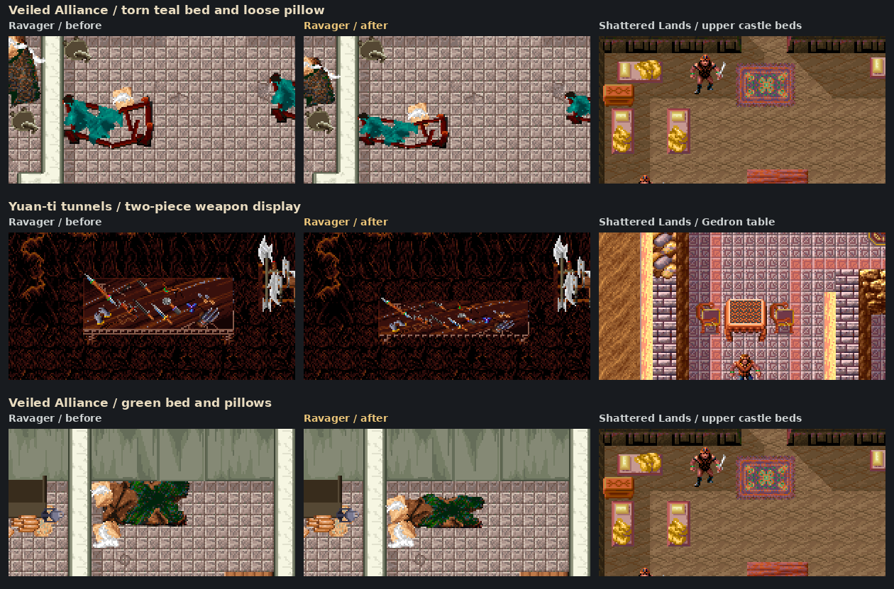

The ruined storeroom uses four broken crate pictures across two piles. The standard squash opened a gap below the red pot. At 82% height, with the rear crates brought closer to the front ones and the pot lowered onto its crate, the stack still reads through the foreground wall. The Yuan-ti jar and two bowls also use 82% so that the pale rims remain visible against the liquid.

The two halves of the weapon display share a floor line in both regions. In each palette the assembled result matches a single 66% reduction of the entire display, pixel for pixel across the join. Earlier art supplies the three Yuan-ti shelves and the sacks and jars elsewhere in the tunnels.

The comparisons use the previous and revised Loader object and region files. All 24 placements were checked individually for a visible difference. The only placement data changes were the vertical positions of two pillows, four crates and one pot. Direct play checks of the headquarters after the attack and the display in both regions remain open.

## El’s Temple

Six smoking braziers flank the approach to Tantris’s throne. The two pictures differ in the direction of the curling smoke. Lowering the entire picture shortened the smoke. Instead the bowl was reduced from 22 rows to 15, and the 14 rows of exposed smoke were moved down intact. Each bowl keeps its 26-pixel width and its floor line.

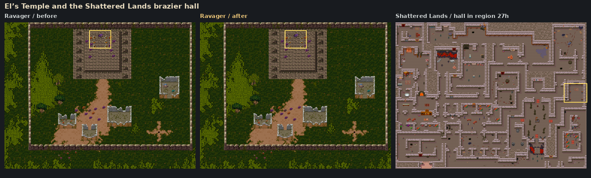

The enlarged views compare the throne approach with the paired braziers in Shattered Lands region 27h. The bottom row shows Pavis’s occupied and empty basins and Tantris’s second pose. All five stored figure frames decode and their pictures and animation scripts match the preceding build. Only the two brazier pictures changed in the built object file. All six placements show the change individually. These were the checks before the throne transition was played.

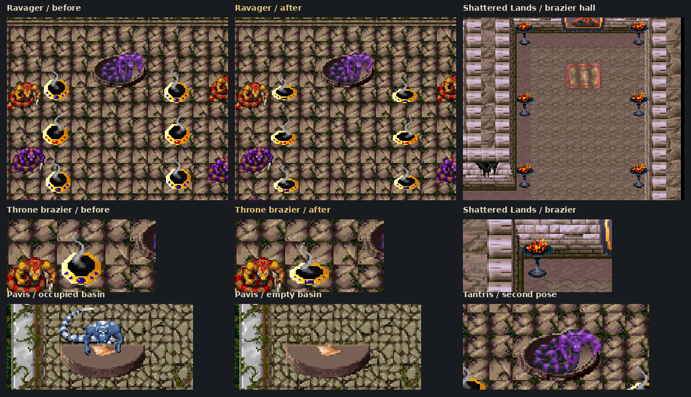

In DOSBox, all six lowered braziers stood on the same floor points as their stock counterparts. When Tantris rose, the game brought in a separate empty throne from Limbo. In both stock Ravager and the previous PR the seat moved 37 pixels right and 58 down, into the right-hand aisle. It also grew taller on the previous PR. Picture 789 now has a 34-row bowl, and its object has the drawing offset needed for the rim to stay where Tantris sat. The dialogue and the prisoners’ escape message still play. [Playtest and placement measurements](../../playtest/logs/2026-11-27-ravager-throne-and-workshop.md)

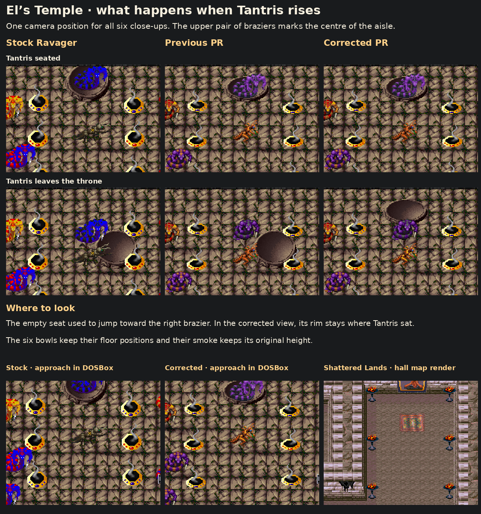

The green coils and red center beside the prisoner occupy the same floor space in the original game and the mod. All 623 visible pixels match in the two DOSBox captures. [Prison room beside the Shattered Lands brazier hall](el-temple-prisoner-fixture.png) · [Playtest](../../playtest/logs/2026-11-28-ravager-temple-prison-room.md)

The inventory also records three earlier figure and scenery reviews more precisely. Each of the six previously flagged stall pieces is visible in the assembled Notaku stall. The Jann wagon body and shafts each have a drawn state and a one-pixel state. The four Elderbrain tank pictures contain 98 frames between them and have no direct region placements. The later Mines 3 playtest identified the separate composite pictures used during destruction.

## Earlier figure work

The figures and their furniture can share one picture. Other scenes use a separate bed, stall front, table leg or place setting. Compared 81 stored frames across 33 pictures with the originals and examined 20 scenes with the mod's object remaps and Mines 3 placement changes applied. The panels show the original Ravager scene on the left of each pair and the existing figure work on the right. These are offline renders of the first stored pose. The Tyr stall has since been checked in DOSBox. Scripted transitions and interactions in the other rooms still need a play check.

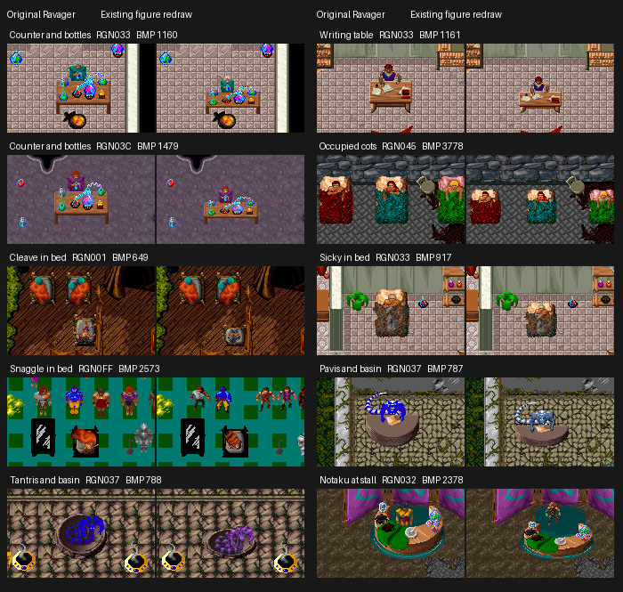

| Scene | Finding and decision |
|---|---|
| Nnamdi and Ikibod's bottle counters, Aleka's writing table | The bottles, papers and hands meet the lowered surface. The empty poses use the lower surface too. Keep these three as references for staffed counters. |
| Sicky and the patients under Tyr | The patients' heads rest on the pillows and the occupied cots share a foot line. The chosen proportions are 37 × 39 for the four revised patient cots. Keep Cleave, Snaggle and the separate empty bed in the comparison when reviewing other beds. |
| Pavis and Tantris | The bodies remain distinct above the lowered rims. Pavis's empty basin keeps its low profile. Keep the existing poses. |
| Sultan, Fletch, Utella, Generoe and Melantha | The cushion, seats, loom and giant's bed belong with the figures. Melantha's set has its own approved 82% bed scale. Preserve those individual decisions when comparing neighboring furniture. |
| Notaku's stall | The live Tyr view shows a strip of teal shop floor between Notaku and the joined front halves. His feet, the mortar and the glassware read separately. Retain the approved counter height. |
| Mines 3 | The live dining encounter needed five bowl placements corrected. The Elderbrain tank needed two additional encounter pictures. Both sequences have since been played through. |
| Captives and mine openings | Kovar's supports, the captive's rack and the mine opening frame their figures. Review attachment to the surroundings whenever an adjoining prop changes. |

## Live check in Tyr

The left screenshot shows the approved stall in Shadow Square. In the right screenshot, look for the purple chairs against the left wall of the red-carpeted room. The lower one is picture 2590 at (1341, 238). Its visible pixels match the new, shorter drawing in the Loader’s object file. [Playtest log](../../playtest/logs/2026-11-27-ravager-furniture.md)

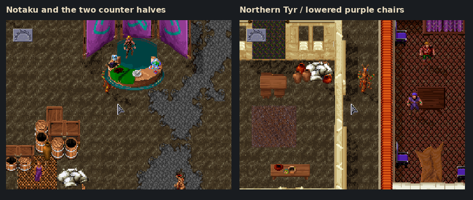

## Ikibod’s workshop in Mosaic

Picture 1479 contains Ikibod, his hands, the bottles, the tabletop and its legs. The existing redraw leaves the desk 61 pixels wide. In the same DOSBox view the tabletop sits lower, the legs meet the same floor line and the three occupied poses keep the wizard behind the bottles. The fourth, unattended frame was checked in the artwork. Keep all four at their present scale. [Playtest](../../playtest/logs/2026-11-27-ravager-throne-and-workshop.md)

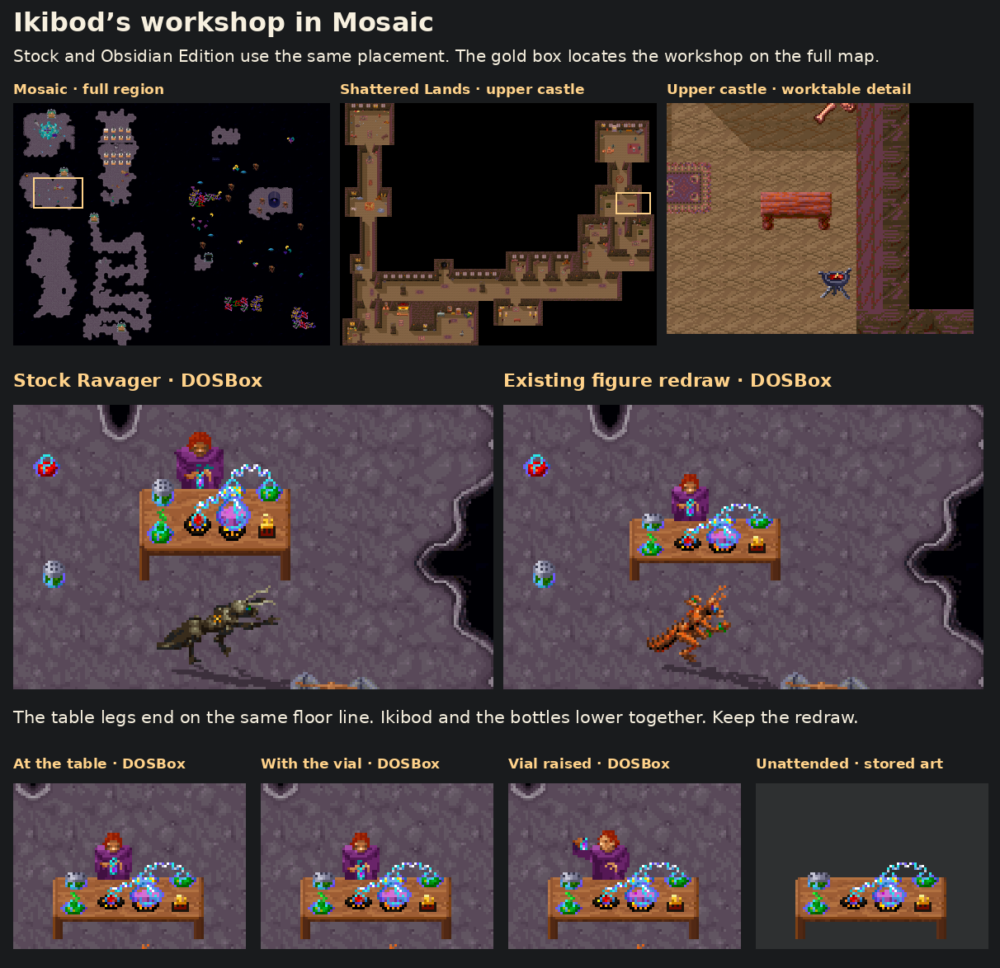

## Live check in the Mosaic museum

The gold rectangle marks the museum on the full Mosaic map. The lower pair shows the same southern display rows from the same DOSBox camera before and after four puzzle interactions. In the lower row, Horace leaves an empty stand at the far left, Khildril breaks into pieces, and Horace takes Ellith’s place at the far right. In the upper row, Biblid holds the book from beneath Fletch’s movable bookcase.

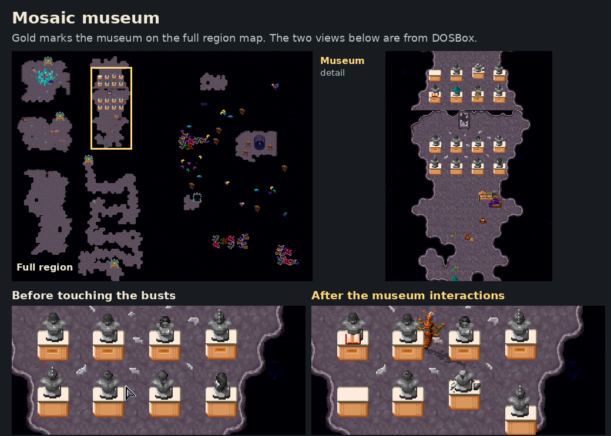

Keep the tested displays at their current height. The cream top shows where a bust can be placed, and the book remains visible against the front lip. Ellith’s pedestal moves down one 16-pixel map square when she comes off it. Horace then sits squarely on it in the lower position. The close-ups show both portable busts and the bookcase that already received the figure redraw. [Playtest log](../../playtest/logs/2026-11-27-ravager-mosaic-museum.md)

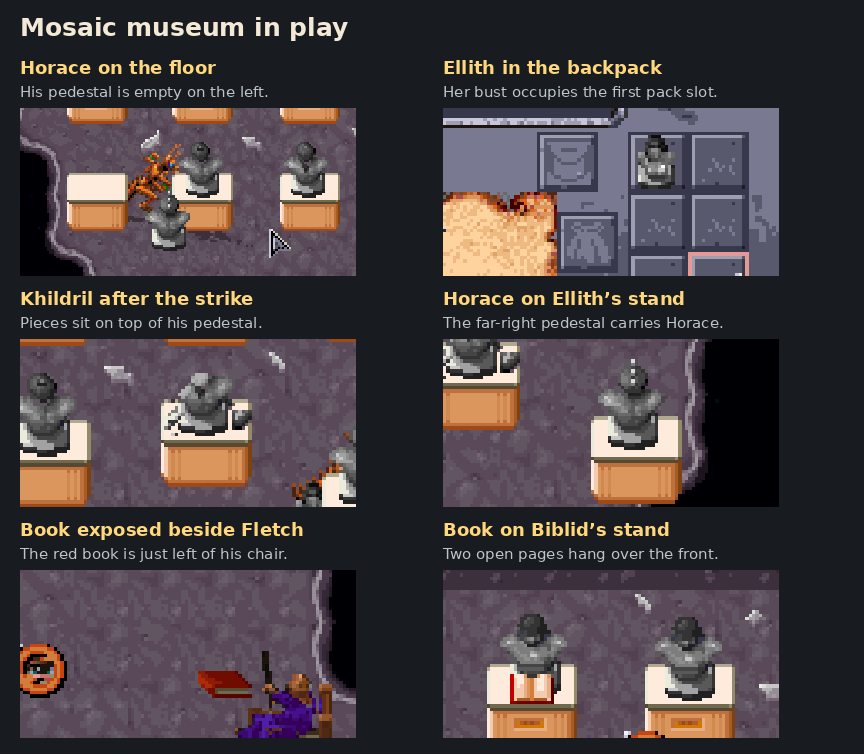

Tamind’s sheet covers his head. Finali’s hand mirror remains visible on her stand. Kaldumeir acknowledges the coins with a message, and Terris stays as found. The wall mirror still looked cracked after seven shards. The eighth restored the reflective pane. Walking north through it returned the party to Veiled Alliance headquarters. Keep the museum furnishings at their reviewed heights. [Completion playtest](../../playtest/logs/2026-11-27-ravager-mosaic-mirror.md)

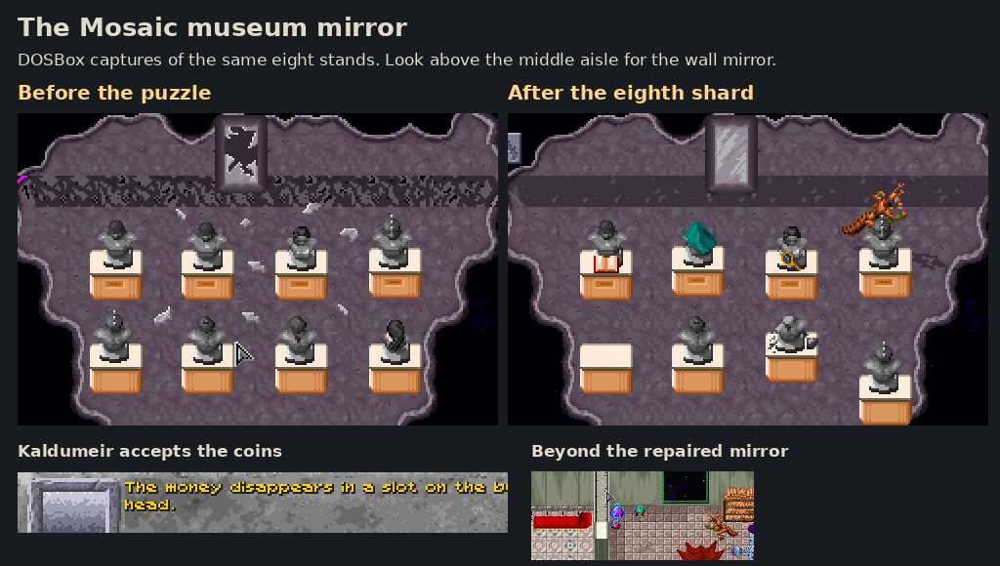

## Pavis’s basin and the two hinged chests

In El’s Temple the paper rests just inside the curved rim while Pavis works. When he stands, the paper and the basin stay in place. The earlier figure redraw already handles both poses. [Matched DOSBox views of Pavis](pavis-basin-live.png)

Mines 3 has a working loot chest. Its two stock drawings are identical to the closed and open chest in the Pyramid, which already received the furniture treatment. The Mines copy now uses the same proportions and retains its own drawing offsets. The gold boxes show where to find both chests and the upper castle reference in Shattered Lands.

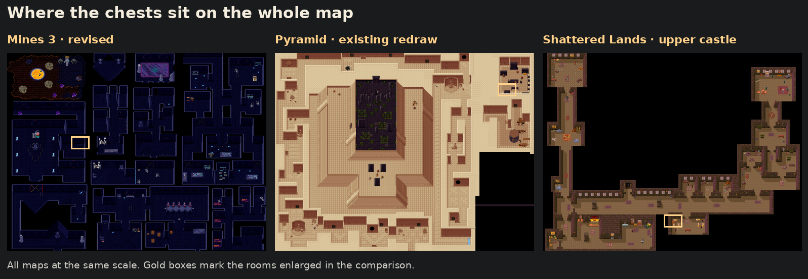

The comparison uses the same scale for all four rooms. Look at the front panel when the lid is down, then at the distance between the hinge and the top of the raised lid. In the Pyramid, the foreground wall covers the lower edge. [Playtest and fixture details](../../playtest/logs/2026-11-27-ravager-basin-and-chests.md)

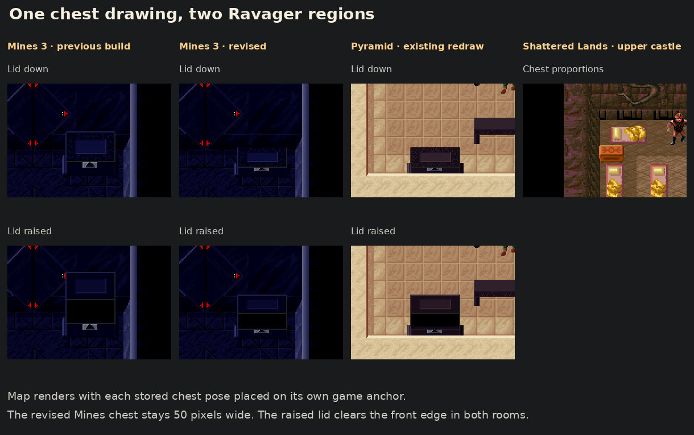

### Kalak’s Pyramid

The two shelves in the eastern room drop from 64 to 42 visible rows. Keep the present height of the shelves, tables and six narrow chairs. The cabinet between the shelves is a passage large enough for the party to enter. Both placements of picture 2546 retain their original art. In play the eastern doors opened on first use. A second use offered passage and took the party to the Garden. The tall doorway beside the lower seating in the Shattered Lands Upper Castle gives a reference for that difference in scale.

[Whole Pyramid before and after beside the Upper Castle](pyramid-furniture-whole-maps.png) · [Room comparisons and cabinet in play](pyramid-furniture-live.png) · [Measurements for all 25 placements](pyramid-placements.csv) · [Playtest](../../playtest/logs/2026-11-28-ravager-pyramid-furniture.md)

The DOSBox close-ups below show the party opening the Mines chest on both builds. The map renders above show the front edge that the party partly covers.

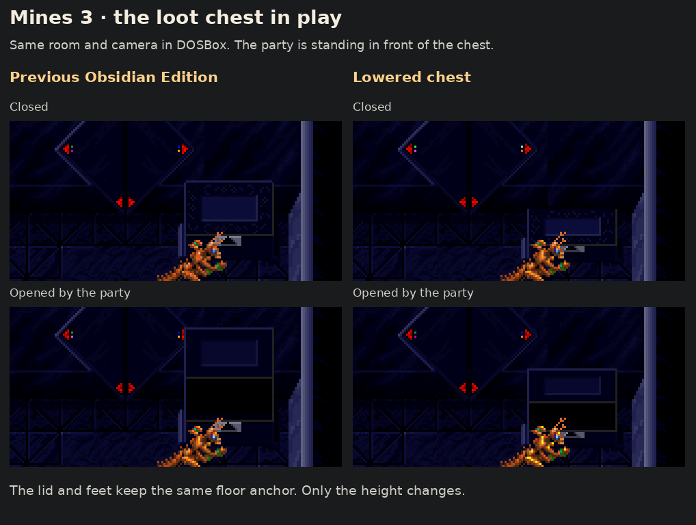

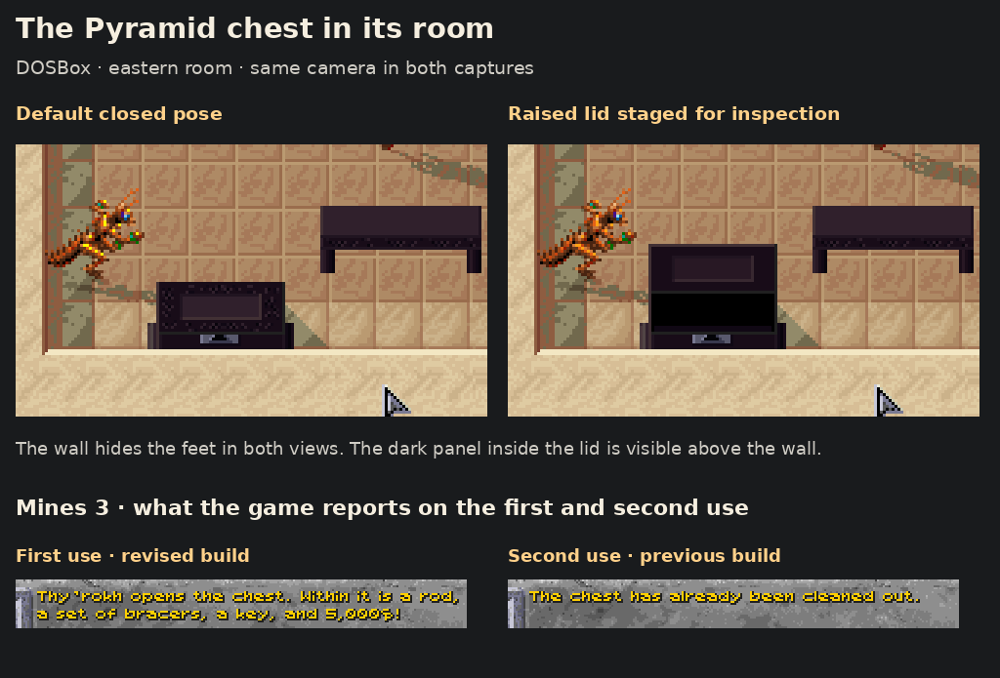

## Mines 3 dining room and Elderbrain

The whole maps show where the two encounters sit and where to find the Gedron table used for scale. The close-ups below show what the game draws as the encounters run.

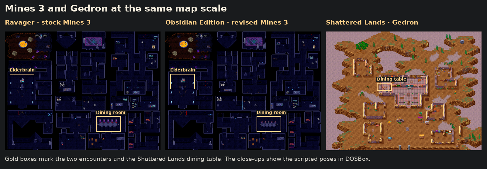

The earlier figure redraw already supplied the smaller table, chairs and all five diners. In play, their hands hid every red bowl during the meal. Moving the bowls eight pixels toward the front of the table makes all five visible. When the diners slump, they cover their own bowls as they do in stock Ravager.

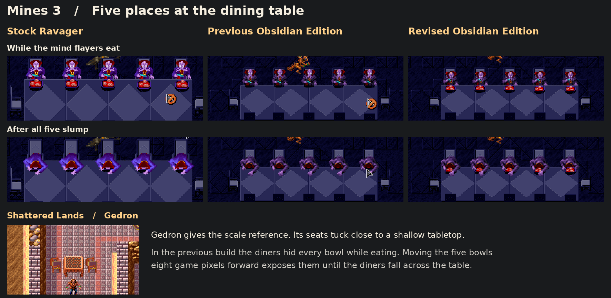

The previous build still showed stock tank art in play. The Elderbrain encounter draws a separate intact tank and a 29-frame destruction sequence. Both now carry the approved redraw, including the darker fluid, broken glass and ejected brain. The native reward appeared after the flash. [Playtest conditions and script details](../../playtest/logs/2026-11-27-ravager-mines-diners-and-elderbrain.md)

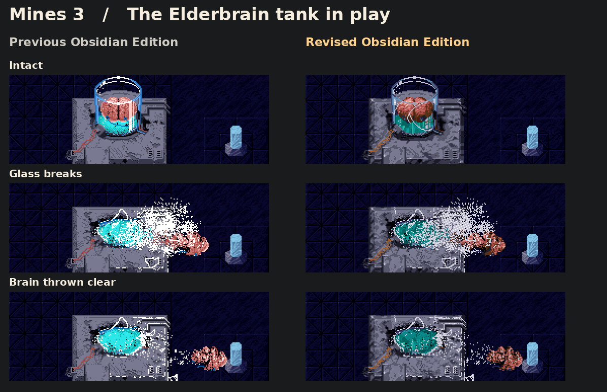

## The prisoner’s rack and the weapon displays

In Mines 3, the rescuer earns 1,000 experience when the prisoner comes off the rack. The redrawn rack stays in place. The game calls the freed prisoner a miner in the farewell message. Keep the earlier figure redraw for both the occupied and empty fixture. [Stock and revised rescue sequence](captive-rack-live.png)

The lying weapons belong to a two-piece table. Both halves meet in the Mines and in the Yuan-ti tunnels. The tunnel jar and two bowls also keep their outlines against the brown floor. [Both weapon tables and the three vessels in DOSBox](weapon-tables-live.png)

The tall polearms beside the table belong to a third, separate picture, 2796. This pass shortens its shafts and stand while keeping the upper 16 rows of blade detail. The top moves down 14 game pixels and both feet keep their positions. The Shattered Lands rack in the Subterranean Temple beneath Teaquetzl provides a same-scale comparison. [Four placements in DOSBox and the temple reference](polearm-stands-live.png)

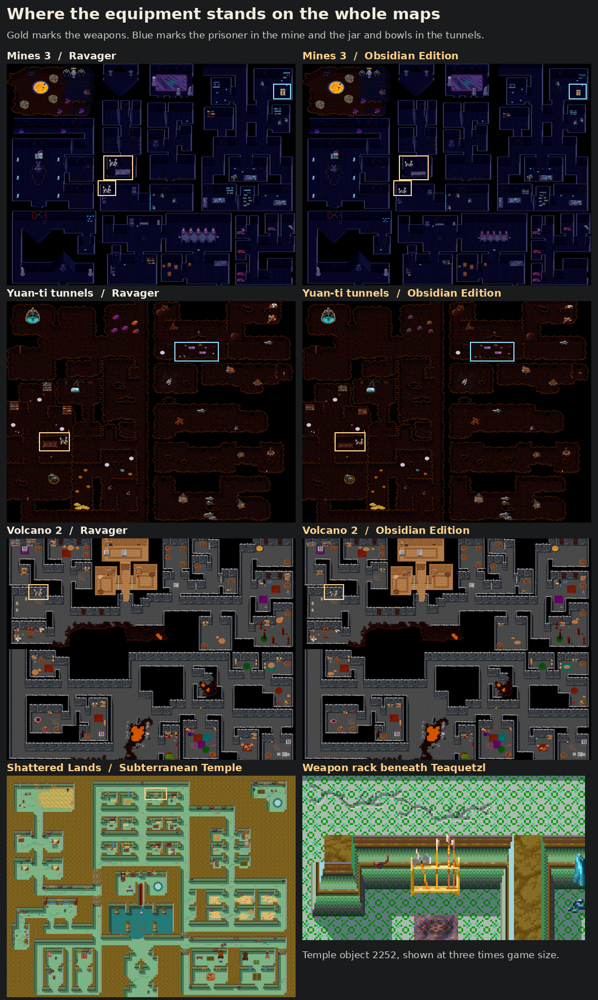

[Playtest route, stock controls and rescue conditions](../../playtest/logs/2026-11-27-ravager-racks-and-polearms.md)

## Mines 3 and Yuan-ti shelves

The mine’s orb shelf exposed a problem with scaling the contents along with their support. Stock Ravager uses the same 14 × 10 blue orb on the shelf and on the laboratory floor. At the first-pass height of 33 pixels, the six on the shelf lost the lower part of their facets. Moving the three loaded boards closer together gives a 42-pixel shelf, down from 50, with all six orbs intact.

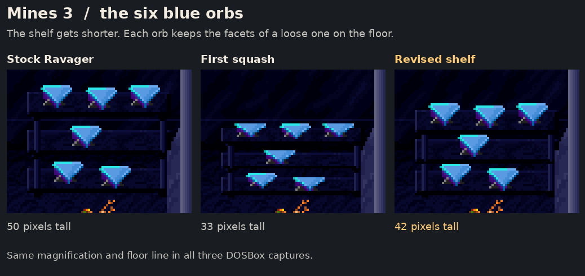

The eight mine shelves and three tunnel shelves were each compared in DOSBox against the stock figures control. The chemical shelf still lets the party choose a reagent, and touching an orb gives the Mind Flayer’s thoughts. The two piles of jars, barrels and sacks in the Yuan-ti storeroom already use the figure redraw. Their individual containers remain visible. [All eleven shelf placements in play](mine-tunnel-shelves-live.png) · [Interactions and storeroom comparison](mine-shelf-and-tunnel-storage-live.png) · [Playtest route](../../playtest/logs/2026-11-27-ravager-mine-and-tunnel-shelves.md)

The blue box marks the orb shelf. The Shattered Lands comparison is the stocked potion stand in Gedron. It shows how much detail can fit on a low stand at the original game resolution.

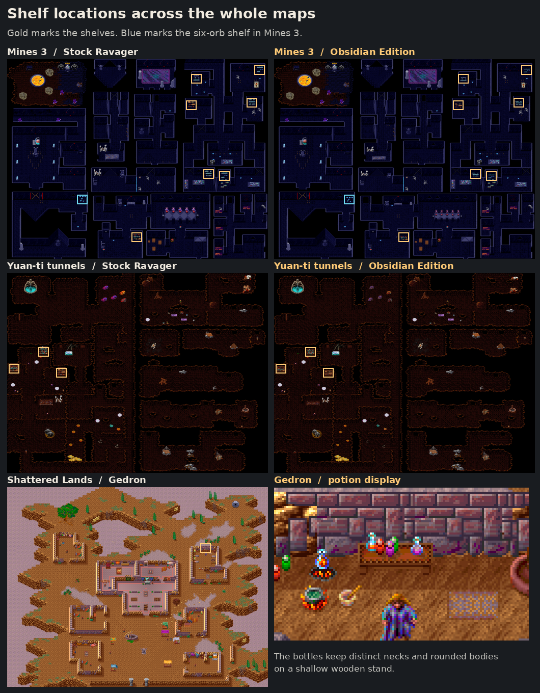

## Mines 3 kitchen, chests and loose furniture

The gold squares mark the two chests. The blue square marks the kitchen crates. The Shattered Lands upper castle has a low chest between two beds, shown at the lower right for comparison.

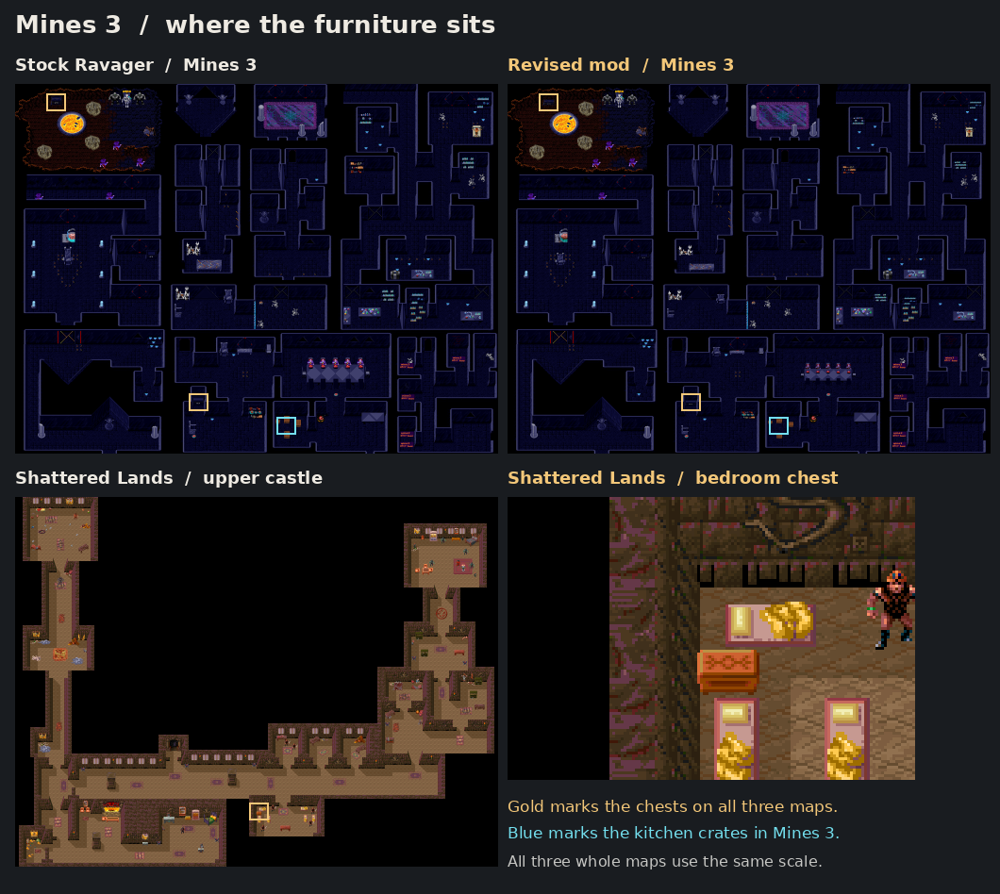

The previous mod lowered the little box marked “Cooking poisons” and left three neighboring wooden crates at their original height. The revised crates stand 21 pixels tall, down from 31. The party can still open all three.

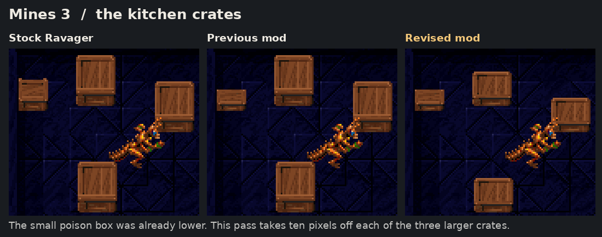

The chest by the lava pool opens and gives plate armor. Unlocking the chef’s chest gives the triangular key and a scroll. It continues to show its closed lid after that interaction in both builds. The comparison shows its other stored drawing in a separate staged visit.

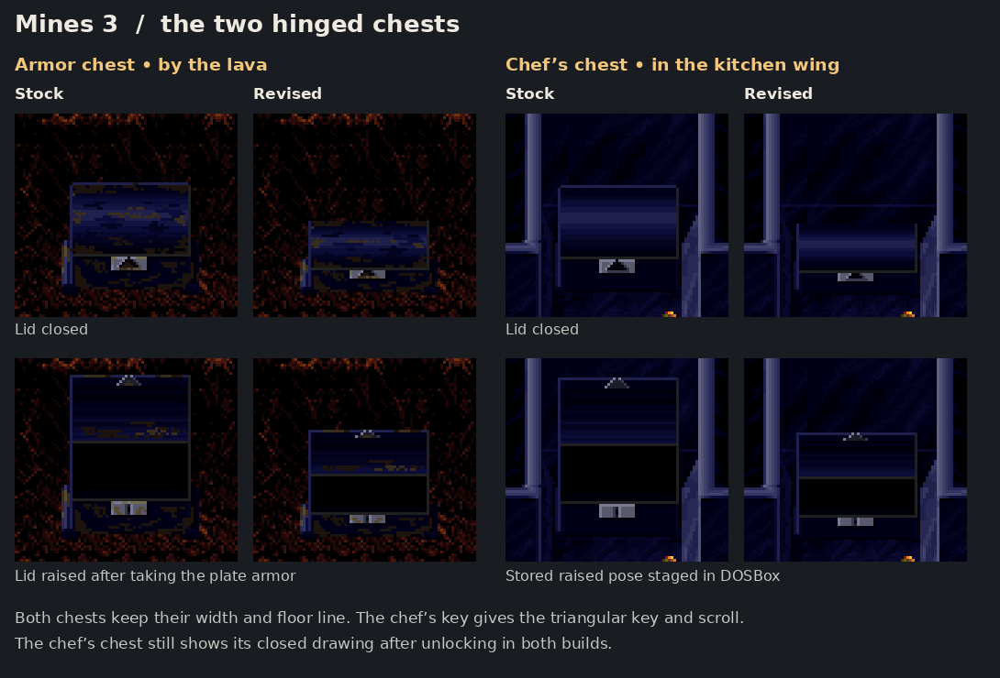

The five loose chairs and the stone table already use the lower drawings. Their bases align with stock in DOSBox. The separate red bowl by the side chair and the loose blue orb beside the front-facing chair remain visible. [All six furnishings in play](mine-loose-seats-live.png) · [Playtest route, interactions and capture conditions](../../playtest/logs/2026-11-27-ravager-mine-kitchen-and-chests.md)

## Mines 3 worktables, safe and forge throne

The five lab and kitchen worktables share a dark stone top. The vial rack, bottles and coiled tubing are painted into it. Lowering only the bottom 16 rows moves each top down five pixels and leaves every vessel intact. On the long table, the native pictures meet through a bottle. It stays whole because both pieces are lowered together. The short stocked stand in Gedron gives a Shattered Lands reference at the same magnification.

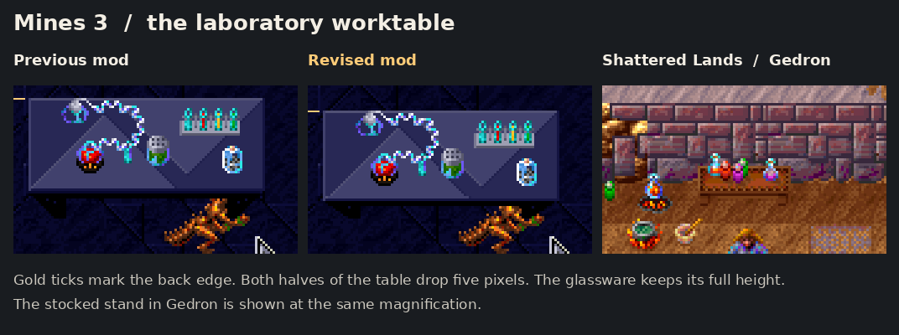

[Whole maps before and after, alongside Gedron](mine-worktable-whole-maps.png) · [All five tables at their actual placements](mine-five-worktables-live.png)

The Inquisitor’s safe is bolted to the floor. Its clamps extend before the lid comes away and rests in front. All three original poses remain visible through the unlock. [The three poses in DOSBox](mine-inquisitor-safe-live.png)

The forge throne includes a skeleton whose hands release Promere’s Hammer. The two drawings meet through the weapon. They already align in both poses, so the throne keeps its original scale. The kitchen kettle and four winged statues also retain their proportions. [Forge throne, kettle and statues](mine-forge-and-statuary-live.png) · [Playtest conditions, room coordinates and scripted rewards](../../playtest/logs/2026-11-27-ravager-mine-worktables-and-forge.md)

## The Volcano dining hall, shops and storeroom

The dining hall in Volcano 1 used two different scales. Its four set tables had retained the tall stock drawing while the adjacent bare tables and stools were lower. Picture 1321 is an identical copy of 2624, the stocked table used in Volcano 2 and both Alliance layouts. Both now use the lowered bare table beneath the original bowls, cups and platter. The two counter designs keep the painted jugs by shortening the bases below them.

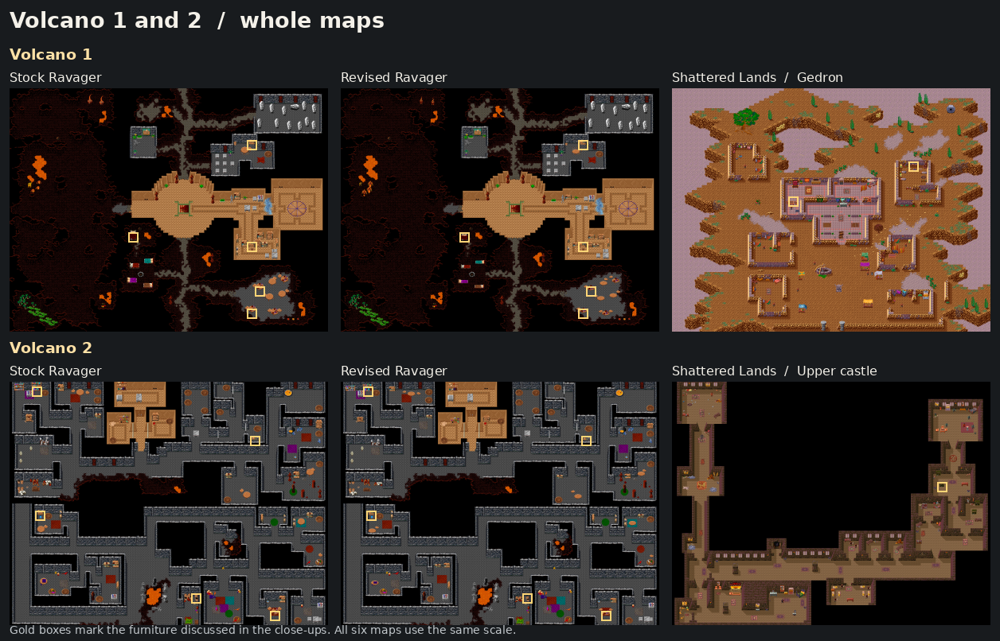

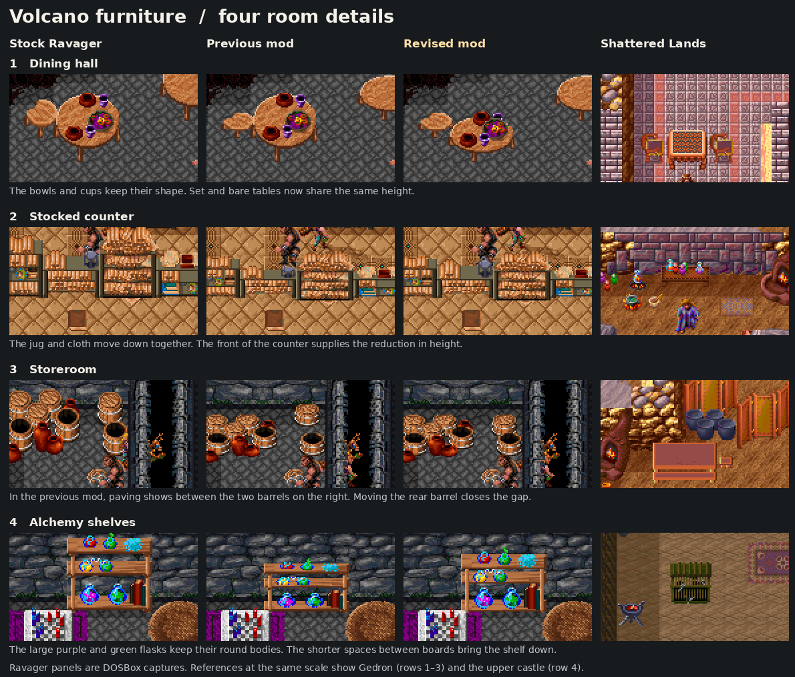

The rear barrel in the Volcano 2 southern storeroom moves down eight pixels. Its front partner sits on its original floor point. The side-by-side barrels and the neighboring pile from the earlier redraw keep their placements.

All 21 original Volcano shelf placements were checked against the stock game. Four shop shelves, 2979–2982, had shortened glassware, vials or books. Removing bare rows from the wood and the spaces between boards preserves each occupied row of the original. All 14 placements of these shared shelf, counter and table designs in the Alliance headquarters were checked in play. [All 21 shelf placements in DOSBox](volcano-shelves-live.png)

Another torn blanket was split across the bed pictures from the figure redraw. The head (530) and foot (531) overlap by five rows in both Volcano 1 and Tyr. The repaired blanket uses the joined 68-row drawing, lowered once to 45 visible rows. The turquoise bed nearby already has a single continuous drawing. [Both torn beds before and after repair](volcano-tyr-torn-bed-live.png) · [Playtest and room coordinates](../../playtest/logs/2026-11-27-ravager-volcano-furniture.md)

## Silver furnishings and side-facing counters

Volcano 1 has seven silver stools together in one room. Their 24-pixel width stays the same while their visible height drops from 30 to 20 pixels. The larger silver table drops from 44 rows to 29. The two matching rolled seats behind the tables each need their own placement adjustment. In Volcano 2 the seat still tucks under the table. In Volcano 1 the feet just meet its back edge. The other three tables keep their floor points.

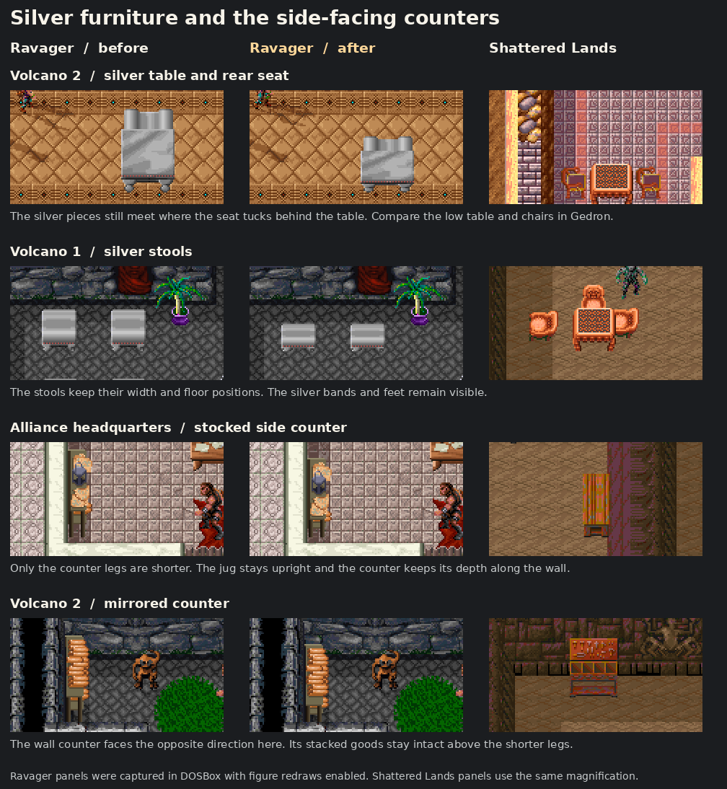

The narrow displays along the walls are counters viewed from the side. Compressing the whole picture flattened the jug and shortened the row of goods along the wall. Shortening only the bottom 18 rows lowers the top by six pixels. All 12 counters were reviewed in both builds, including four that face the opposite way and four shared by the intact and ruined Alliance layouts.

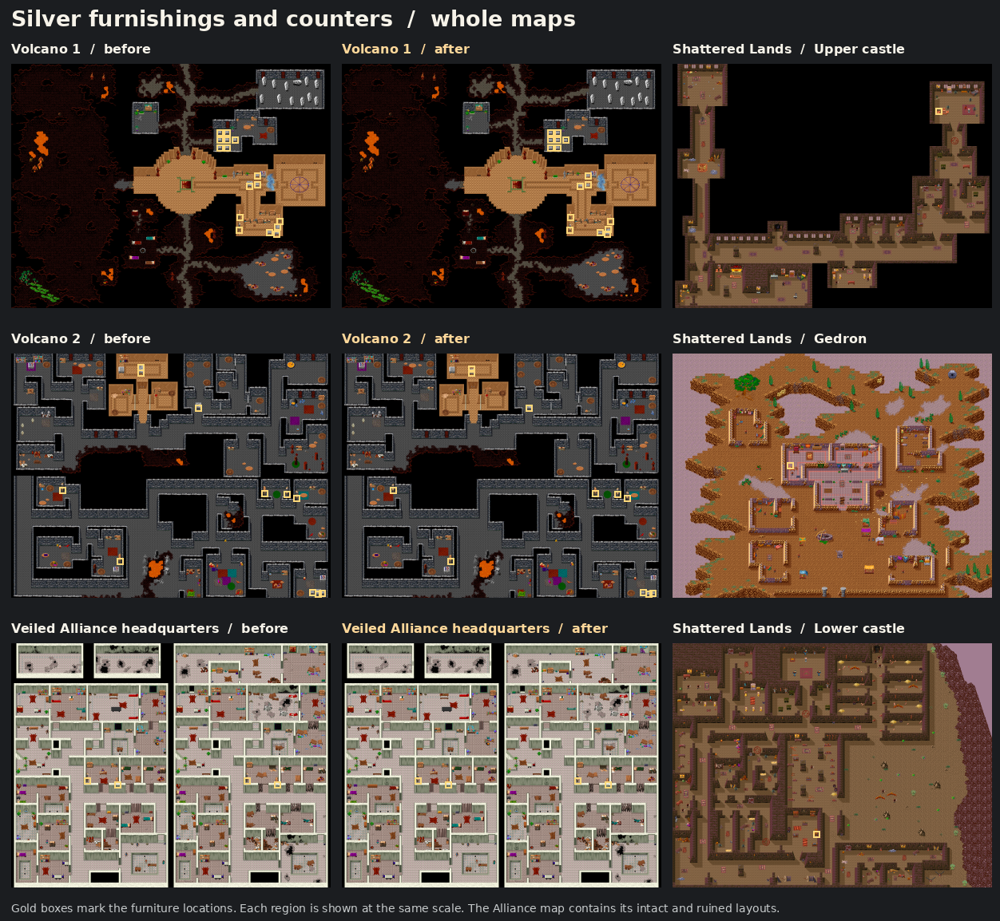

Both Ravager close-up columns use the mod’s figure redraws. All five furnishings still matched stock before this pass. [All 11 rooms in DOSBox](silver-furniture-all-rooms.png) · [Placement ledger and both seat joins](../../playtest/logs/2026-11-27-ravager-silver-furniture.md)

## Region work queue

The scan covered all 20 shipped region files. Nine regions have in-game coverage for every placement currently listed in the furniture inventory. They are the Forest (60), the Pyramid (25), the Yuan-ti tunnels (11), El’s Temple (9), Mines 3 (72), Volcano 1 (48), Volcano 2 (57), Volcano 3 (128) and Silt Sea Giants (12). Eleven regions still have room or interaction checks open. The counts below are distinct picture references in each region's placement table before object-picture remaps, using the installed Mines 3 placement override. Pictures shared between regions count once in each. The two furniture columns count placements in the first eight passes, including repeats. The subsequent polearm change covers two stands in Mines 3, one in the Yuan-ti tunnels and one in Volcano 2. The last column names the next review for that region.

| Region | Pictures | Shelves lowered | Other furniture lowered | Next review |
|---|---:|---:|---:|---|
| 001 Forest | 252 | 0 | 56 | All 60 inventoried placements checked in DOSBox. Both fruit prompts and Cleave’s cure played through. Snaggle’s bed and the chest’s raised lid checked with staged pose selection |
| 032 Tyr | 246 | 1 | 44 | Check remaining indoor storage states in play |
| 033 Veiled Alliance | 195 | 21 | 78 | Red beds, intact storage stacks and four side-facing counters checked in play. Check remaining ruined fixtures and pillows |
| 034 Pyramid | 152 | 0 | 23 | All 25 inventoried placements checked in DOSBox. The teleportation cabinet opens on first use and takes the party to the Garden on the second |
| 036 Yuan-ti | 104 | 3 | 5 | All eleven inventoried furniture placements checked in play, including three shelves and both redrawn storage piles |
| 037 Temple | 62 | 0 | 6 | All nine listed placements checked in DOSBox, including the six braziers, both occupied furnishings and their vacated states, and the coiled fixture beside the prisoner |
| 038 Mines 1 | 108 | 0 | 12 | Red bed checked in play. Check worktable, crates and Sicky's neighboring furnishings |
| 039 Mines 2 | 160 | 0 | 1 | Check the storage pile, miners and multi-state fixtures in play |
| 03A Mines 3 | 219 | 8 | 12 | Dining, tank, throne, chest, prisoner release and all three weapon displays checked in play. All eight shelves, loose furniture, five worktables and all safe poses checked. Both forge-throne poses, the kettle and four winged statues reviewed. All 72 inventoried placements have in-game coverage |
| 03B Jann | 173 | 0 | 15 | Check cushion piles and baskets in play, and the covered wagon in both states |
| 03C Mosaic | 89 | 0 | 0 | Museum exit and Ikibod’s occupied workbench verified. Check the potion and tapestry sequence |
| 03D Volcano 2 | 143 | 15 | 23 | All 57 listed placements checked in play, including 15 front-facing shelves, five side-facing counters, six silver furnishings and the repaired barrel stack |
| 03E Volcano 1 | 133 | 6 | 19 | All 48 listed placements checked in play, including the redrawn beds, six front-facing shelves, four set tables, three side-facing counters and 13 silver furnishings |
| 03F Volcano 3 | 95 | 0 | 0 | All 128 listed spires checked in DOSBox. Keep the original terrain heights. The seven destructible rocks use separate pictures |
| 041 Giants | 216 | 0 | 11 | All 12 inventoried placements checked in DOSBox. Generoe’s three rocking poses played in his house. The stored empty chair was staged |
| 042 Cloud | 131 | 0 | 3 | Check the jars in play and the occupied bed through Melantha’s scene |
| 043 Crypt | 175 | 0 | 11 | Check barracks furniture, the key beneath Jumah’s table and Kovar’s shackles in play |
| 044 Cosmos | 86 | 0 | 0 | Check the elemental gates and artifact placement on the ritual statues in play |
| 045 Under Tyr | 135 | 0 | 15 | Check loose stools and crates beside the patient cots in-game |
| 0FF Limbo | 690 | 0 | 0 | Mosaic busts traced to play. Trace other fixtures and actors including Snaggle |

The [picture inventory](inventory.csv) records all eight furniture passes, the redrawn pieces examined and candidates for subsequent passes. It includes all placements found for each listed picture and catalogue package names where applicable. Candidate families are provisional. Compare all orientations and raised or stacked objects as a set before accepting a change. An area is complete when its furniture has a recorded visual decision and the affected rooms and scripted states pass the in-game check. The project is still open against that standard.
