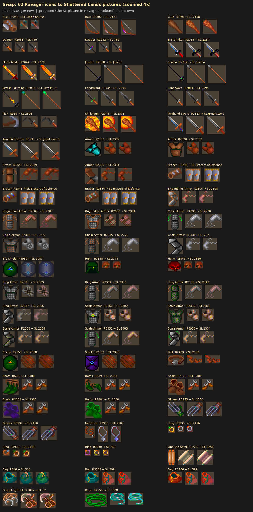
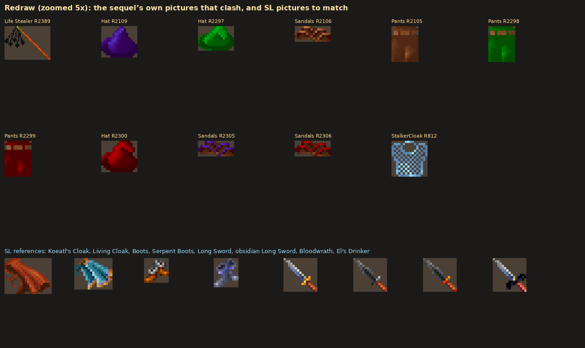

# Wake of the Ravager's item icons against Shattered Lands' (2026-11-28)

Daaki's ask: compare every Wake of the Ravager item icon with Shattered Lands' and propose, for each,
**swap** (an SL picture fits), **keep** (it already matches SL's art, or the sequel's own fits) or
**redraw** (no SL counterpart, and it clashes). The preference is icons that match Shattered Lands.
**This is a proposal: nothing in the game is changed yet.**

## The result

The sequel has **428 pictures** for items that can be carried (from 1,233 item objects in its
`OBJEX.GFF`: doors, furniture, bodies and other scenery left out). Shattered Lands has 208.

| Group | Swap | Keep | Redraw |
| --- | ---: | ---: | ---: |
| Weapons | 16 | 69 | 1 |
| Armour (body pieces, shields, helms, bracers) | 28 | 11 | 0 |
| Clothing (boots, belts, gloves, hats, pants, sandals, cloaks) | 8 | 15 | 10 |
| Jewellery (rings, necklaces, gems, bracelets) | 4 | 48 | 0 |
| Magic (rods, scrolls, potions, orbs) | 1 | 42 | 0 |
| Other things (keys, notes, books, fruit, quest items) | 5 | 170 | 0 |
| **All** | **62** | **355** | **11** |

Of the 355 kept, **93 are already SL's own pictures** (the same, or recoloured), **12 are pictures
Shattered Lands already shows** (the Loader's darts, double spear, trikal, lotulis and great axes are
drawn from the sequel's), and **250 are the sequel's own** for things SL never had: quest items, keys,
notes, maps, potions, the psionic bracelets, its own gems and named weapons. Those fit SL's style
(the same artists' hand: outlined, shaded, the same scale), so they stay.

The earlier finding holds: the sequel's weapons are mostly SL's art recoloured. Where it drew its
own, it is mostly **armour and clothing**: every body armour piece, the boots, bracers, belt and
gloves. Those are the bulk of the swaps.

## Swap (62)

Each shows the sequel's picture now, the SL picture as the sequel would show it (each colour the
nearest of the sequel's fixed colours, as the Loader already does for SL items carried across), and
SL's own. At game size: [doubled](swap-game-size-2x.png), [true size](swap-game-size-1x.png).

- **Body armour (25)**: the sequel draws a whole shirt, sleeve or leg of mail; SL a small piece of
  each material. Each goes to SL's piece of the same place and material (leather, brigandine, chain,
  ring, scale). One oddity: the sequel's object 823 is named Ring Armor but its type is scale legs;
  it is proposed as SL's Ring Leg Armor, after the name the player sees.
- **Weapons (16)**: the plain Bow, Club, two stone daggers, the obsidian long sword (two pictures),
  the obsidian axe (drawn as a cleaver), the Pick (the sequel's flat curved drawing; SL's pick is
  the one the Loader's picks come from), the javelins (black from point to butt, so they hardly
  show; the Loader's Javelin and Javelin +1 instead), El's Drinker, and the Flame Blade and
  Shillelagh spells' weapons.
- **The Twohand Sword (2)**: SL shows the sequel's own picture with its blade 3 pixels longer than a
  long sword's (the user's ask, 2026-11-25); the sequel's own is long-sword size. For parity it
  takes SL's longer one.
- **Heirlooms (7)**: SL's named items that cross into a sequel object should keep SL's look: El's
  Drinker, El's Shield, the Quicksilver Glove, the Silver Necklace, and three rings whose sequel
  objects show another ring's picture (SL's El's Ring shows the Storm Ring's, the Wind Ring shows the
  Ring of Insight's, the Ring of Insight a new drawing).
- **Shields and helms (4)**: two magic round shields, a green-hood helm and the red plain Helm.
- **Bracers (3)**: to the Loader's Bracers of Defense, SL's only bracers.
- **Clothing (8)**: the Belt, five boots (big flat drawings, about 16 pixels, against SL's 11), two
  gauntlets (the same drawing as the Quicksilver Glove's).
- **Other (6)**: the One-use Scroll (39 objects; the Spellbook shares its rolled picture, so after
  the swap the two tell apart), the Rope, the Grappling Hook and three bags.

Two things to decide with the swaps:

1. **Magic items lose their own colour.** Five boots become one picture, three bracers one, the
   magic shields and armour the plain one. The Loader already gives magic items a shine
   (`ravshine.py`); each swapped magic item would shine in its sequel colour (violet boots shine
   violet, and so on), so they still tell apart.
2. **The picture is also the item on the ground.** A swapped item lies on the map as SL's picture
   too, as SL's own items do.

How it would be built (once approved): the Loader's copy of `OBJEX.GFF` already takes SL pictures
for the mod's items (`ravitems.picture`, `ravgear.py`); a swap points the sequel object's OJFF at
SL's picture, read from the player's own Shattered Lands at run time. Nothing from either game goes in
the repository. Shattered Lands itself is unchanged by any of it.

## Redraw (11)

The sequel's own pictures for things SL has none of, which clash with SL's style. All are items the
sequel alone has, so they stay in Wake of the Ravager (the rule for unique items) and are redrawn
there only; the redrawing is Codex's work (brief: project files,
`codex-notes/2026-11-28-ravager-item-icon-redraws.md`).

- **Life Stealer**: a black tassel on a 34-pixel shaft, twice a long sword's size and nearly all
  black. Redraw as a sword at SL's long sword size.
- **Pants (3)**: flat blocks with no folds.
- **Hats (3)**: flat blobs.
- **Sandals (3)**: flat strips.
- **Stalker Cloak**: a flat blue checkerboard.

## Keep (355)

By group: [weapons](keep-weapons-2x.png), [armour](keep-armour-2x.png),
[clothing](keep-clothing-2x.png), [jewellery](keep-jewellery-2x.png), [magic](keep-magic-2x.png),
[other things](keep-misc-2x.png). The name's colour says why: blue, SL's own picture; gold, SL already
shows it; white, the sequel's own.

Close calls kept, which could be swapped or redrawn if wanted:

- **The 16 psionic bracelets** are flat striped bands. SL's psionic items that cross into them are
  rings, but the sequel names them Bracelet, so a ring's picture would mislead. Kept.
- **The robes, vests and shirts** have folds and shading; kept. (The Loader's Ashen and Veiled
  Robes in SL are another option for the robes.)
- **The Spellbook** keeps the rolled picture the One-use Scroll has now.
- **Broken Weapon**: SL draws its broken weapon as the club; the sequel's two broken pieces say more.
- **Wood colours**: the sequel's staves, polearms and great axe hafts are a lighter tan than SL's.
  Kept: the sequel's palette stays as it is (the user's choice, 2026-11-27).
- Pictures in the colours an area sets (32-95 of the palette: the shards, plants, the Flayer ichor,
  the drake hides) are shown in the colours of the area they lie in.

## The data

[icons.csv](icons.csv): every picture, its objects, name, group, verdict, the SL picture proposed
or matched, and why. Picture numbers are the BMP chunks of each game's object file (`OBJEX.GFF`,
`SEGOBJEX.GFF`); "R" in the sheets is the sequel's, "SL" Shattered Lands'.

How it was made: every item object's picture read from both games' files (the playtest kit's
`setup_game.sh` and `setup_ravager.sh`), each sequel picture matched to every SL one by shape (overlap
of the trimmed outline) and shading (brightness correlation), SSI's own transfer list (`ITEMS.BIN`:
which SL item becomes which sequel item) used where it names one, and every verdict then checked by
eye.
