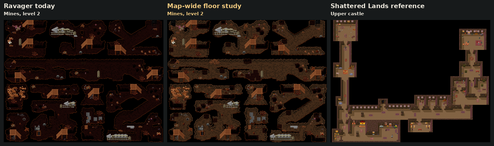
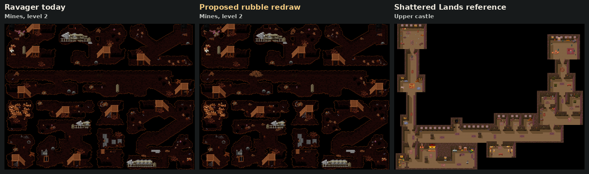
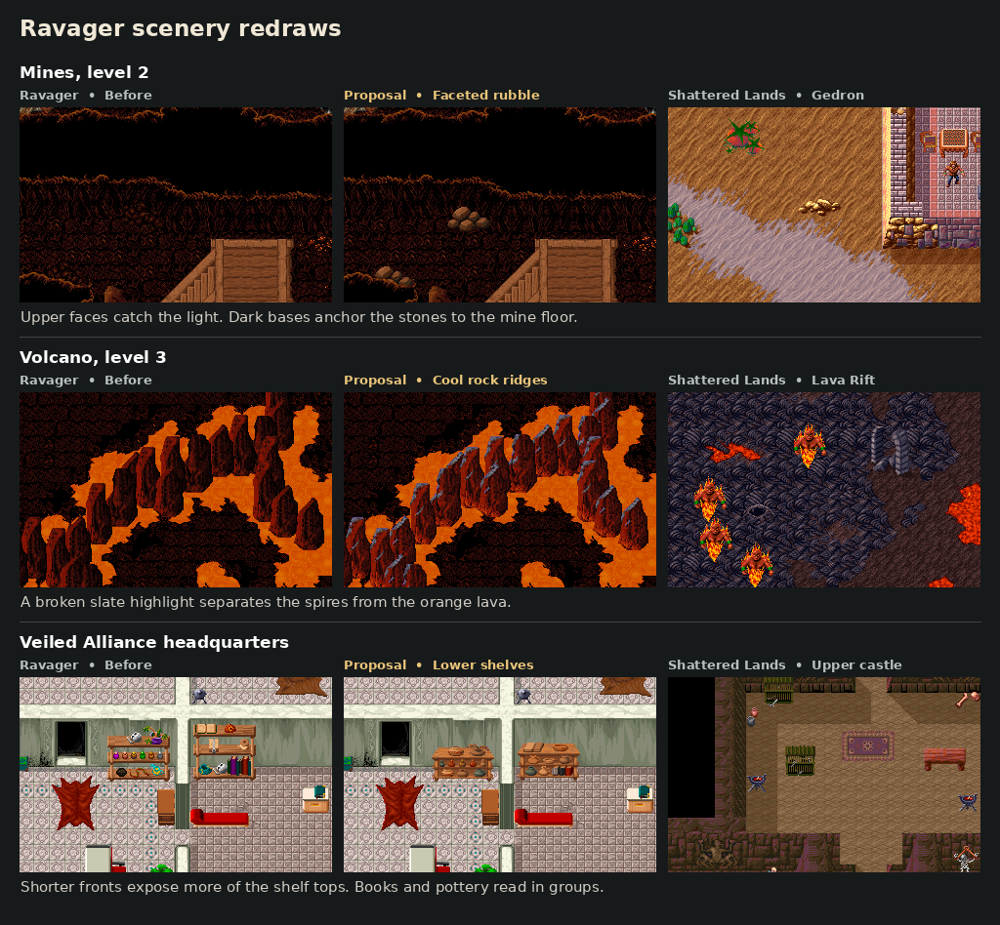
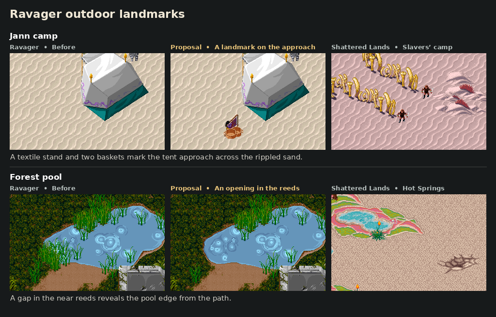

# Wake of the Ravager and Shattered Lands map comparisons

Each row shows Ravager on the left, a proposed edit to the same view in the middle, and a Shattered Lands reference on the right. The current views use game data and the mod artwork reviewed at `1e1d0308`. The proposals are static mockups.

## Mines level 2 at whole-map scale

The lighter earthen floor makes the long passage across the upper third easier to follow. The upper castle in Shattered Lands shows how a floor can stand apart from the black space around it. The lighter floor also reveals repeating bands in the mine texture.

Changing just the rubble affects less than 1% of the full map. Look near the left end of that same passage.

## At game scale

